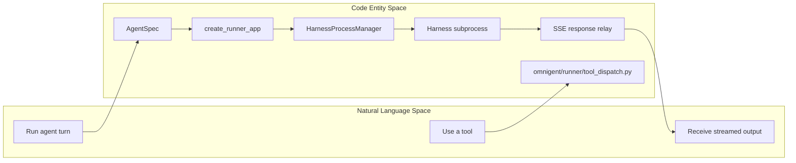
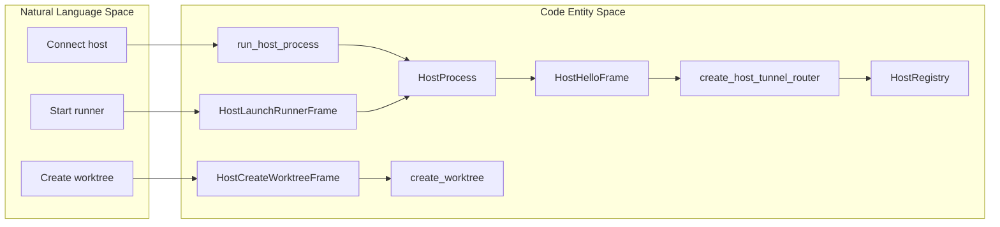

# Glossary

Relevant source files

The following files were used as context for generating this wiki page:

- [docs/AGENT_YAML_SPEC.md](docs/AGENT_YAML_SPEC.md)
- [examples/remy/config.yaml](examples/remy/config.yaml)
- [feature-map/README.md](feature-map/README.md)
- [feature-map/composer.md](feature-map/composer.md)
- [feature-map/native-harnesses.md](feature-map/native-harnesses.md)
- [feature-map/sessions.md](feature-map/sessions.md)
- [feature-map/terminals.md](feature-map/terminals.md)
- [omnigent/entities/environment_filesystem.py](omnigent/entities/environment_filesystem.py)
- [omnigent/host/connect.py](omnigent/host/connect.py)
- [omnigent/host/frames.py](omnigent/host/frames.py)
- [omnigent/inner/_cwd_scan.py](omnigent/inner/_cwd_scan.py)
- [omnigent/inner/bwrap_sandbox.py](omnigent/inner/bwrap_sandbox.py)
- [omnigent/inner/datamodel.py](omnigent/inner/datamodel.py)
- [omnigent/inner/loader.py](omnigent/inner/loader.py)
- [omnigent/inner/os_env.py](omnigent/inner/os_env.py)
- [omnigent/inner/sandbox.py](omnigent/inner/sandbox.py)
- [omnigent/inner/seatbelt_sandbox.py](omnigent/inner/seatbelt_sandbox.py)
- [omnigent/onboarding/agent/tools/python/list_builtin_tools.py](omnigent/onboarding/agent/tools/python/list_builtin_tools.py)
- [omnigent/runner/app.py](omnigent/runner/app.py)
- [omnigent/runner/tool_dispatch.py](omnigent/runner/tool_dispatch.py)
- [omnigent/runtime/prompt.py](omnigent/runtime/prompt.py)
- [omnigent/server/host_registry.py](omnigent/server/host_registry.py)
- [omnigent/server/routes/host_tunnel.py](omnigent/server/routes/host_tunnel.py)
- [omnigent/server/routes/hosts.py](omnigent/server/routes/hosts.py)
- [omnigent/spec/omnigent.py](omnigent/spec/omnigent.py)
- [omnigent/spec/parser.py](omnigent/spec/parser.py)
- [omnigent/spec/types.py](omnigent/spec/types.py)
- [omnigent/terminals/registry.py](omnigent/terminals/registry.py)
- [omnigent/tools/builtins/__init__.py](omnigent/tools/builtins/__init__.py)
- [omnigent/tools/builtins/async_inbox.py](omnigent/tools/builtins/async_inbox.py)
- [omnigent/tools/builtins/hindsight.py](omnigent/tools/builtins/hindsight.py)
- [omnigent/tools/builtins/spawn.py](omnigent/tools/builtins/spawn.py)
- [omnigent/tools/manager.py](omnigent/tools/manager.py)
- [tests/browser_ui/chat/test_session_grid.py](tests/browser_ui/chat/test_session_grid.py)
- [tests/e2e/omnigent/test_example_remy.py](tests/e2e/omnigent/test_example_remy.py)
- [tests/e2e/test_subagent_long_handoff_reachable_e2e.py](tests/e2e/test_subagent_long_handoff_reachable_e2e.py)
- [tests/e2e/test_terminal_launch_retry_cleanup_e2e.py](tests/e2e/test_terminal_launch_retry_cleanup_e2e.py)
- [tests/e2e_ui/agents/test_subagent_long_handoff_retrieval.py](tests/e2e_ui/agents/test_subagent_long_handoff_retrieval.py)
- [tests/host/test_connect.py](tests/host/test_connect.py)
- [tests/host/test_frames.py](tests/host/test_frames.py)
- [tests/inner/test_bwrap_sandbox.py](tests/inner/test_bwrap_sandbox.py)
- [tests/inner/test_bwrap_symlink_mask_3265.py](tests/inner/test_bwrap_symlink_mask_3265.py)
- [tests/inner/test_cwd_scan.py](tests/inner/test_cwd_scan.py)
- [tests/inner/test_loader.py](tests/inner/test_loader.py)
- [tests/inner/test_os_env.py](tests/inner/test_os_env.py)
- [tests/inner/test_os_env_grant_reach.py](tests/inner/test_os_env_grant_reach.py)
- [tests/inner/test_os_env_runtime_imports.py](tests/inner/test_os_env_runtime_imports.py)
- [tests/inner/test_sandbox.py](tests/inner/test_sandbox.py)
- [tests/inner/test_seatbelt_sandbox.py](tests/inner/test_seatbelt_sandbox.py)
- [tests/onboarding/test_list_builtin_tools.py](tests/onboarding/test_list_builtin_tools.py)
- [tests/resources/examples/agent_with_os_env_bwrap.yaml](tests/resources/examples/agent_with_os_env_bwrap.yaml)
- [tests/resources/examples/agent_with_os_env_seatbelt.yaml](tests/resources/examples/agent_with_os_env_seatbelt.yaml)
- [tests/runner/test_app_sessions_native_events_lifecycle.py](tests/runner/test_app_sessions_native_events_lifecycle.py)
- [tests/runner/test_hindsight_local_dispatch.py](tests/runner/test_hindsight_local_dispatch.py)
- [tests/runner/test_runner_dispatch.py](tests/runner/test_runner_dispatch.py)
- [tests/runtime/test_prompt.py](tests/runtime/test_prompt.py)
- [tests/server/integration/test_host_tunnel_route.py](tests/server/integration/test_host_tunnel_route.py)
- [tests/server/integration/test_session_host_launch.py](tests/server/integration/test_session_host_launch.py)
- [tests/server/test_host_registry.py](tests/server/test_host_registry.py)
- [tests/spec/test_omnigent_adapter.py](tests/spec/test_omnigent_adapter.py)
- [tests/spec/test_parser.py](tests/spec/test_parser.py)
- [tests/terminals/test_launch_failure_cleanup.py](tests/terminals/test_launch_failure_cleanup.py)
- [tests/terminals/test_registry.py](tests/terminals/test_registry.py)
- [tests/tools/builtins/test_async_inbox.py](tests/tools/builtins/test_async_inbox.py)
- [tests/tools/builtins/test_hindsight.py](tests/tools/builtins/test_hindsight.py)
- [tests/tools/builtins/test_registry_unified.py](tests/tools/builtins/test_registry_unified.py)
- [tests/tools/builtins/test_spawn.py](tests/tools/builtins/test_spawn.py)
- [tests/tools/builtins/test_sys_session.py](tests/tools/builtins/test_sys_session.py)
- [tests/tools/test_manager.py](tests/tools/test_manager.py)
- [web/src/grid/GridDropTargets.tsx](web/src/grid/GridDropTargets.tsx)
- [web/src/grid/GridSessionPane.test.tsx](web/src/grid/GridSessionPane.test.tsx)
- [web/src/grid/GridSessionPane.tsx](web/src/grid/GridSessionPane.tsx)
- [web/src/grid/GridSessionsContext.test.tsx](web/src/grid/GridSessionsContext.test.tsx)
- [web/src/grid/GridSessionsContext.tsx](web/src/grid/GridSessionsContext.tsx)
- [web/src/grid/GridWorkspace.tsx](web/src/grid/GridWorkspace.tsx)
- [web/src/grid/gridLayout.test.ts](web/src/grid/gridLayout.test.ts)
- [web/src/grid/gridLayout.ts](web/src/grid/gridLayout.ts)

## Purpose and scope

This glossary defines Omnigent terms for onboarding engineers and maps user-facing concepts to code entities. It focuses on the requested architecture, runtime, protocol, data-model, and developer-workflow vocabulary. The supplied source excerpts expose line-level details for the Runner, Host Daemon, host tunnel frames, spec parser, and runner tool dispatch; entries for other terms point to their named implementation modules where available, without assuming details not established by those excerpts.

Sources: [omnigent/runner/app.py:1-7](); [omnigent/host/connect.py:1-7](); [omnigent/spec/parser.py:1-3]()

## Core concepts and data model

### Agent and specification terms

- **Agent** — A configured assistant whose definition is parsed into an `AgentSpec`. An agent configuration can describe execution, tools, policies, skills, MCP servers, and OS-environment settings; the parser imports these types and parses an agent image directory. [omnigent/spec/parser.py:1-3](); [omnigent/spec/parser.py:25-66]()

- **AgentSpec** — The typed representation of an agent configuration. `omnigent.spec.parser.parse` reads an agent image directory and produces this representation; the parser imports `AgentSpec` and related specification types. [omnigent/spec/parser.py:1-3](); [omnigent/spec/parser.py:39-66]()

- **ExecutorSpec** — The specification type associated with how an agent executes. It is part of the types imported by the parser and is also used by runner tests when constructing agent specifications. [omnigent/spec/parser.py:39-66](); [tests/runner/test_runner_dispatch.py:99-102]()

- **ToolSpec** — A tool-description type used in executor-related runtime and test code. The runner’s dispatch layer imports `ToolSpec` as part of its agent-spec type references. [omnigent/runner/tool_dispatch.py:41-48](); [tests/runner/test_runner_dispatch.py:61-76]()

- **PolicySpec** — A policy-configuration type imported by the agent-spec parser. The parser also defines a YAML loader specifically to preserve the string key `on`, which is used as a policy selector field. [omnigent/spec/parser.py:39-66](); [omnigent/spec/parser.py:79-95]()

- **OSEnvSpec** — The OS-environment specification type used by the runner’s local tool dispatch and imported by the spec parser alongside sandbox and terminal environment types. [omnigent/runner/tool_dispatch.py:41-48](); [omnigent/spec/parser.py:25-36]()

- **Skill** — A named capability represented in agent configuration and discovered from `SKILL.md` files. The parser defines a `SKILL.md` frontmatter pattern, while host code handles skill inventory and skill-content request/result frames. [omnigent/spec/parser.py:63-76](); [omnigent/host/frames.py:161-163](); [omnigent/host/connect.py:110-115]()

- **MCP (Model Context Protocol)** — The external-tool integration vocabulary used by Omnigent’s agent specs and runner. The parser imports `MCPServerConfig`; the Runner app imports MCP route registration and MCP execution components; runner dispatch documents that spec-defined MCP tools are dispatched through a `RunnerMcpManager`. [omnigent/spec/parser.py:51-66](); [omnigent/runner/app.py:108-112](); [omnigent/runner/tool_dispatch.py:9-17]()

- **CEL Policy** — A policy term for policies expressed in CEL. The supplied excerpts do not expose the CEL evaluator implementation; use the policy implementation modules as the code entry point rather than inferring evaluation details here. [omnigent/spec/parser.py:39-66]()

Sources: [omnigent/spec/parser.py:1-3](); [omnigent/spec/parser.py:25-76](); [omnigent/runner/tool_dispatch.py:9-17](); [omnigent/runner/tool_dispatch.py:41-48](); [omnigent/runner/app.py:108-112](); [omnigent/host/frames.py:161-163]()

### Session and conversation

- **Session** — The runtime-facing unit of agent work. Runner APIs and tool dispatch use a session identifier, and the Runner app contains session-related resource, history, routing, and sub-agent components. [omnigent/runner/tool_dispatch.py:157-167](); [omnigent/runner/app.py:88-105](); [omnigent/runner/app.py:149-170]()

- **Conversation** — The persisted or streamed interaction associated with a session. In the Runner-to-harness path, the runner accepts an events request for a conversation, forwards it to a harness, and relays the harness response stream. [tests/runner/test_runner_dispatch.py:1-25]()

- **Fork** — Creating a new session from an existing session or conversation history. The feature map describes session forks as a way to branch an interaction; the supplied code excerpts do not include the fork implementation, so the store and session route modules are the appropriate code entry points. [feature-map/sessions.md:53-64]()

- **Project** — A grouping used to organize sessions. The feature map describes adding sessions to projects; the supplied code excerpts do not show the project model or store implementation. [feature-map/sessions.md:47-50]()

- **Scheduled Task** — A task-related concept surfaced through runner tool dispatch: the runner imports async task tools and task-cancellation tools. The exact persistence and scheduling lifecycle are outside the supplied excerpts. [omnigent/runner/tool_dispatch.py:71-76]()

Sources: [omnigent/runner/app.py:88-105](); [omnigent/runner/app.py:149-170](); [omnigent/runner/tool_dispatch.py:157-167](); [omnigent/runner/tool_dispatch.py:71-76](); [tests/runner/test_runner_dispatch.py:1-25](); [feature-map/sessions.md:47-64]()

## Execution and transport

### Harness, Runner, and Host

- **Harness** — The execution component that runs an agent turn. In the subprocess-backed path, the Runner resolves the harness type and spawn environment from an agent spec, obtains a harness client, forwards the request, and relays the response stream. [omnigent/runner/app.py:1-6](); [tests/runner/test_runner_dispatch.py:11-25]()

- **Runner** — The FastAPI service that owns harness subprocesses and dispatches requests to them. The Runner app’s module documentation describes spec resolution and harness selection; the end-to-end test documents the event request, harness subprocess, Unix-domain-socket client, and streamed response flow. [omnigent/runner/app.py:1-7](); [tests/runner/test_runner_dispatch.py:11-25]()

- **Host Daemon** — The long-running `omnigent host` process. It connects to the server over WebSocket, registers as a host, handles launch/stop runner frames, starts runner subprocesses on demand, and reports results. [omnigent/host/connect.py:1-7]()

- **Managed Host** — A host connection authenticated using a server-managed launch token rather than the ordinary user auth provider. The host tunnel router documentation identifies this path for server-managed sandbox hosts. [omnigent/server/routes/host_tunnel.py:140-165]()

- **Sandbox Provider** — A provider or integration that supplies sandbox execution infrastructure. The supplied excerpts do not expose the provider abstraction or its registry; the sandbox implementation entry points are the sandbox modules and provider configuration code. The parser imports OS-environment sandbox types as part of agent-spec processing. [omnigent/spec/parser.py:25-36]()

- **Zygote** — The host-side manager for a prewarmed runner process. The host imports `ZygoteManager`, `ZygoteRunnerProc`, and `ZygoteUnavailable`; tests describe zygote prewarming as part of host startup and provide a switch to disable real zygote creation. [omnigent/host/connect.py:128-136](); [tests/host/test_connect.py:135-148]()

Sources: [omnigent/runner/app.py:1-7](); [omnigent/host/connect.py:1-7](); [omnigent/host/connect.py:128-136](); [omnigent/server/routes/host_tunnel.py:140-165](); [omnigent/spec/parser.py:25-36](); [tests/runner/test_runner_dispatch.py:11-25](); [tests/host/test_connect.py:135-148]()

### Host and runner tunnel protocols

- **Host tunnel** — The server-side WebSocket endpoint used by hosts to register and exchange control frames. The host sends `host.hello`; the server validates the frame protocol version, maintains a live `HostRegistry` connection, and persists host registration through `HostStore`. [omnigent/server/routes/host_tunnel.py:1-15]()

- **Host frame** — A JSON control message on the host tunnel. Host frames cover runner launch/stop and related host operations; they do not carry HTTP request/response traffic. The host frame schema is deliberately separate from runner-tunnel frames. [omnigent/host/frames.py:1-18]()

- **Runner tunnel** — A separate transport used by runners to connect to the server. The host-frame module reuses runner-tunnel ping/pong keepalive frames while keeping the two protocol schemas partitioned. [omnigent/host/frames.py:1-18](); [omnigent/server/routes/host_tunnel.py:71-77]()

- **ACP (Agent Control Protocol)** — The acronym used in the codebase for ACP-based CLI harnesses; the Runner app imports `ACP_CLI_HARNESSES`. The supplied excerpts do not include the ACP wire schema or executor implementation, so avoid treating it as interchangeable with the host or runner tunnel protocols. [omnigent/runner/app.py:37-42]()

- **SSE (Server-Sent Events)** — The HTTP streaming format used for harness responses in the runner-dispatch path. The runner test describes forwarding a request to a harness and relaying each SSE chunk through the runner to the client. [tests/runner/test_runner_dispatch.py:1-25]()

Sources: [omnigent/host/frames.py:1-18](); [omnigent/server/routes/host_tunnel.py:1-15](); [omnigent/server/routes/host_tunnel.py:71-77](); [omnigent/runner/app.py:37-42](); [tests/runner/test_runner_dispatch.py:1-25]()

### Egress, elicitation, and routing

- **Egress Proxy** — The network-egress control component associated with sandboxed execution. The supplied parser excerpt shows `model_egress` is parsed as a distinct typed grant; the proxy’s enforcement behavior is not included in the supplied source excerpts. [tests/spec/test_parser.py:60-78]()

- **Elicitation** — A user-input or approval request surfaced in an agent interaction. The supplied excerpts do not include the server-side elicitation implementation; the relevant code entry point is the session orchestration and permission/elicitation routes.

- **Smart Routing** — A routing capability described in the native-harness feature map for Pi: the selected route is applied before inference, and tool turns and follow-up questions retain history. The supplied excerpts establish the feature’s behavior at the product level, but do not show its routing function implementation. [feature-map/native-harnesses.md:24-25](); [feature-map/native-harnesses.md:95-97]()

Sources: [tests/spec/test_parser.py:60-78](); [feature-map/native-harnesses.md:24-25](); [feature-map/native-harnesses.md:95-97]()

## Workspace and native-harness terms

- **Worktree** — A Git worktree used as an isolated workspace. The host process imports `create_worktree`, `list_worktrees`, and `remove_worktree` from `omnigent.host.git_worktree`; host tunnel frames include create, list, and remove worktree requests and results. [omnigent/host/connect.py:128-133](); [omnigent/host/frames.py:153-158]()

- **Bridge Directory** — A per-session or per-harness filesystem location used by native harness integrations to exchange state or relay tools. The Runner app imports bridge-related native helpers, including bridge-directory deletion and Claude bridge identifiers. The supplied excerpts do not show the directory layout or its specific files. [omnigent/runner/app.py:113-143]()

- **Forwarder** — A component that relays harness output or messages across a boundary. The Runner app imports `_forward_harness_response` and auto-forwarder lifecycle helpers; the runner-dispatch test describes the runner relaying SSE chunks from the harness to the client. [omnigent/runner/app.py:121-132](); [tests/runner/test_runner_dispatch.py:21-25]()

- **Native harness** — A harness that integrates with a vendor coding CLI or native terminal workflow. The feature map describes native harnesses as separately implemented integrations sharing user journeys such as launch, sign-in, approvals, resume, terminal, and cleanup. [feature-map/native-harnesses.md:1-8]()

Sources: [omnigent/host/connect.py:128-133](); [omnigent/host/frames.py:153-158](); [omnigent/runner/app.py:113-143](); [tests/runner/test_runner_dispatch.py:21-25](); [feature-map/native-harnesses.md:1-8]()

## Tools, terminal interaction, and streaming

- **Runner-local tool dispatch** — Tool execution performed inside the Runner for intercepted `action_required` events. The dispatch module groups tools into OS-environment, REST, file, terminal, MCP, and client-side categories. It relays `action_required` events upstream unchanged for visibility while local dispatch handles the relevant categories. [omnigent/runner/tool_dispatch.py:1-17]()

- **Terminal Registry** — The runner-side registry used for terminal tools and session resources. The dispatch module imports terminal-tool implementations and references `TerminalRegistry`; the Runner app imports `SessionResourceRegistry` and terminal lifecycle types. [omnigent/runner/tool_dispatch.py:41-48](); [omnigent/runner/tool_dispatch.py:102-108](); [omnigent/runner/app.py:149-155]()

- **REPL (Read-Eval-Print Loop)** — An interactive terminal interface term used by the codebase. Runner documentation identifies a REPL terminal name and session key, and the dispatch module notes that the executor emits tool-call progress/observation events for the REPL while skipping local dispatch itself. [omnigent/runner/app.py:113-119](); [omnigent/runner/tool_dispatch.py:1-7]()

- **BlockStream** — A semantic-block streaming concept in the Python client SDK, listed in the project documentation. The supplied excerpts do not include its implementation; use the SDK’s `BlockStream` definition and transforms as the code entry point.

- **Harness Bench** — A harness conformance suite named in the project documentation. The supplied excerpts do not include its tests or runner; use the Harness Bench test suite as the implementation and behavioral reference.

Sources: [omnigent/runner/tool_dispatch.py:1-17](); [omnigent/runner/tool_dispatch.py:41-48](); [omnigent/runner/tool_dispatch.py:102-108](); [omnigent/runner/app.py:113-119]()

## Memory and developer-workflow terms

- **Hindsight** — A memory-related integration term in the project vocabulary. The supplied excerpts do not show its implementation, storage model, or data flow; use the Hindsight tool and integration modules as the code entry point.

- **Nessie** — A project-specific term. Its implementation is not identified in the supplied excerpts, so this glossary does not assign it a storage or versioning role.

- **repro-agent** — The developer agent named for bug-reproduction workflows. Its source directory is `dev/repro-agent/`; the supplied excerpts do not include its driver or recording-lane implementation.

- **resolve-agent** — The developer agent named for bug-resolution workflows. Its source directory is `dev/resolve-agent/`; the supplied excerpts do not include its driver or agent environment.

- **Config Signature** — A configuration-signature term associated with local-server configuration. The supplied excerpts do not include its definition or the invalidation behavior, so consult the local-server implementation before relying on this term’s precise semantics.

Sources: [omnigent/runner/tool_dispatch.py:68-76]()

## System relationships

### Natural-language actions mapped to execution entities

This diagram maps the user-level action “run an agent and use a tool” onto the visible Runner and spec entities. The test describes the request/response flow through `create_runner_app`, `HarnessProcessManager`, a harness subprocess, and SSE relay; the dispatch module names the local tool categories. [tests/runner/test_runner_dispatch.py:11-25](); [omnigent/runner/tool_dispatch.py:1-17]()

**Diagram: Agent turn and tool dispatch**

Sources: [tests/runner/test_runner_dispatch.py:11-25](); [omnigent/runner/tool_dispatch.py:1-17](); [omnigent/spec/parser.py:39-66]()

### Natural-language host operations mapped to protocol entities

This diagram maps “connect a host,” “start a runner,” and “create a worktree” to host-process, frame, and server entities. Host frames carry control messages, while runner HTTP traffic uses a separate runner tunnel. [omnigent/host/connect.py:1-7](); [omnigent/host/frames.py:1-18](); [omnigent/server/routes/host_tunnel.py:1-15]()

**Diagram: Host control path**

Sources: [omnigent/host/connect.py:1-7](); [omnigent/host/connect.py:128-133](); [omnigent/host/frames.py:136-158](); [omnigent/server/routes/host_tunnel.py:1-15](); [omnigent/server/routes/host_tunnel.py:140-155]()

## Quick reference

| Term | Code entry point or evidence |
|---|---|
| `AgentSpec` | Parser entry point: `omnigent/spec/parser.py` [omnigent/spec/parser.py:1-3]() |
| `Runner` | Runner FastAPI app: `omnigent/runner/app.py` [omnigent/runner/app.py:1-7]() |
| `Host Daemon` | Host process loop: `omnigent/host/connect.py` [omnigent/host/connect.py:1-7]() |
| `MCP` | Spec type and runner dispatch references [omnigent/spec/parser.py:51-66](); [omnigent/runner/tool_dispatch.py:9-17]() |
| `ACP` | ACP CLI harness registry reference [omnigent/runner/app.py:37-42]() |
| `Worktree` | Host Git worktree operations and frame types [omnigent/host/connect.py:128-133](); [omnigent/host/frames.py:153-158]() |
| `SSE` | Harness stream relay in runner-dispatch test [tests/runner/test_runner_dispatch.py:21-25]() |
| `Zygote` | Host zygote manager import and test startup gate [omnigent/host/connect.py:128-136](); [tests/host/test_connect.py:135-148]() |
| `Runner-local tool dispatch` | Tool-category definitions [omnigent/runner/tool_dispatch.py:1-17]() |

Sources: [omnigent/spec/parser.py:1-3](); [omnigent/runner/app.py:1-7](); [omnigent/host/connect.py:1-7](); [omnigent/runner/tool_dispatch.py:1-17](); [omnigent/host/frames.py:136-158](); [tests/runner/test_runner_dispatch.py:21-25]()

## Notes on evidence and further navigation

Some requested terms are named in the repository’s broader documentation and module layout, but their implementations were not included in the supplied source excerpts. For those terms—such as `BlockStream`, `Elicitation`, `Egress Proxy`, `Hindsight`, `Nessie`, `CEL Policy`, `Scheduled Task`, and `Config Signature`—the definitions above deliberately avoid asserting unverified implementation details. Follow the named subsystem or feature documentation before depending on exact data flow or semantics.

Sources: [omnigent/spec/parser.py:1-3](); [omnigent/runner/app.py:1-7](); [omnigent/host/connect.py:1-7]()