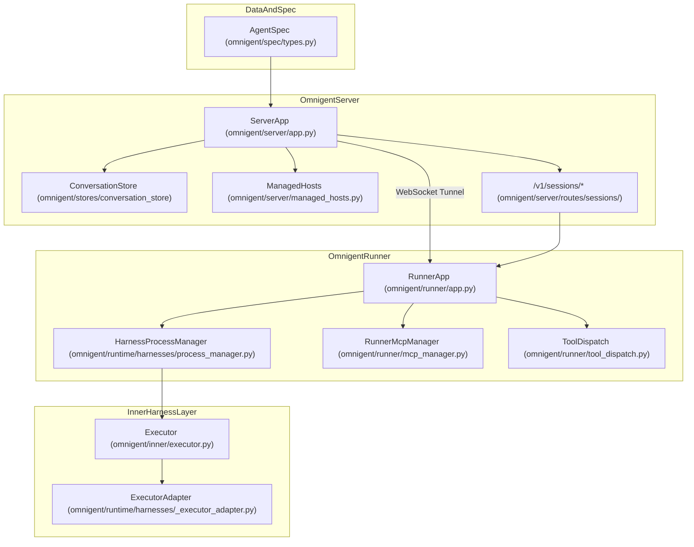
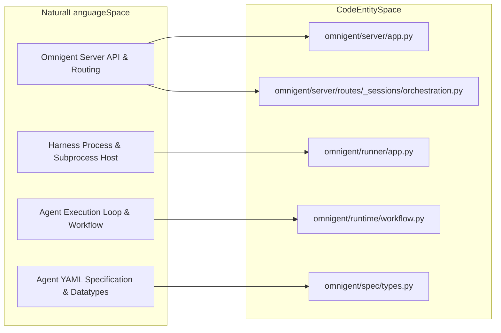
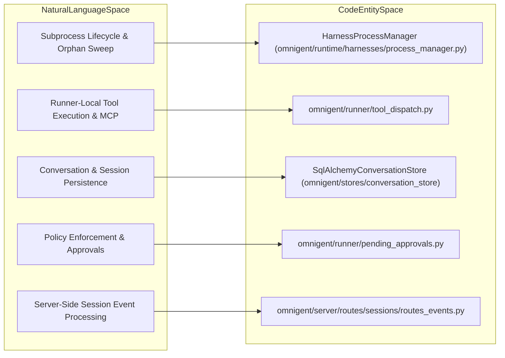

# Core Architecture

Relevant source files

The following files were used as context for generating this wiki page:

- [examples/remy/config.yaml](examples/remy/config.yaml)
- [omnigent/onboarding/agent/tools/python/list_builtin_tools.py](omnigent/onboarding/agent/tools/python/list_builtin_tools.py)
- [omnigent/runner/app.py](omnigent/runner/app.py)
- [omnigent/runner/tool_dispatch.py](omnigent/runner/tool_dispatch.py)
- [omnigent/runtime/prompt.py](omnigent/runtime/prompt.py)
- [omnigent/server/app.py](omnigent/server/app.py)
- [omnigent/server/routes/_sessions/common.py](omnigent/server/routes/_sessions/common.py)
- [omnigent/server/routes/_sessions/helpers.py](omnigent/server/routes/_sessions/helpers.py)
- [omnigent/server/routes/_sessions/orchestration.py](omnigent/server/routes/_sessions/orchestration.py)
- [omnigent/server/routes/sessions/__init__.py](omnigent/server/routes/sessions/__init__.py)
- [omnigent/server/routes/sessions/routes_core.py](omnigent/server/routes/sessions/routes_core.py)
- [omnigent/server/routes/sessions/routes_events.py](omnigent/server/routes/sessions/routes_events.py)
- [omnigent/server/schemas.py](omnigent/server/schemas.py)
- [omnigent/tools/builtins/__init__.py](omnigent/tools/builtins/__init__.py)
- [omnigent/tools/builtins/async_inbox.py](omnigent/tools/builtins/async_inbox.py)
- [omnigent/tools/builtins/hindsight.py](omnigent/tools/builtins/hindsight.py)
- [omnigent/tools/builtins/spawn.py](omnigent/tools/builtins/spawn.py)
- [omnigent/tools/manager.py](omnigent/tools/manager.py)
- [openapi.json](openapi.json)
- [tests/e2e/omnigent/test_example_remy.py](tests/e2e/omnigent/test_example_remy.py)
- [tests/e2e/test_subagent_long_handoff_reachable_e2e.py](tests/e2e/test_subagent_long_handoff_reachable_e2e.py)
- [tests/e2e_ui/agents/test_subagent_long_handoff_retrieval.py](tests/e2e_ui/agents/test_subagent_long_handoff_retrieval.py)
- [tests/onboarding/test_list_builtin_tools.py](tests/onboarding/test_list_builtin_tools.py)
- [tests/runner/test_app_sessions_native_events_lifecycle.py](tests/runner/test_app_sessions_native_events_lifecycle.py)
- [tests/runner/test_hindsight_local_dispatch.py](tests/runner/test_hindsight_local_dispatch.py)
- [tests/runner/test_runner_dispatch.py](tests/runner/test_runner_dispatch.py)
- [tests/runtime/test_prompt.py](tests/runtime/test_prompt.py)
- [tests/server/integration/test_sessions_endpoints.py](tests/server/integration/test_sessions_endpoints.py)
- [tests/server/routes/test_sessions_snapshot.py](tests/server/routes/test_sessions_snapshot.py)
- [tests/server/test_app.py](tests/server/test_app.py)
- [tests/tools/builtins/test_async_inbox.py](tests/tools/builtins/test_async_inbox.py)
- [tests/tools/builtins/test_hindsight.py](tests/tools/builtins/test_hindsight.py)
- [tests/tools/builtins/test_registry_unified.py](tests/tools/builtins/test_registry_unified.py)
- [tests/tools/builtins/test_spawn.py](tests/tools/builtins/test_spawn.py)
- [tests/tools/builtins/test_sys_session.py](tests/tools/builtins/test_sys_session.py)
- [tests/tools/test_manager.py](tests/tools/test_manager.py)

This page provides a high-level overview of Omnigent's core architecture, detailing how its major subsystems—the server, runner, inner harness layer, runtime engine, and data model—interact to enable multi-agent orchestration and execution.

---

## Agent Spec & Data Model

Omnigent agents are configured through a declarative YAML specification framework. The root `AgentSpec` type [omnigent/spec/types.py:172-172]() binds together execution parameters (`ExecutorSpec`), tool declarations (`ToolSpec`), policy guardrails (`PolicySpec`), and environment setup (`OSEnvSpec`). The spec parsing and validation system in the runtime [omnigent/runtime/workflow.py:79-80]() performs environment variable expansions and credential resolution for consistent spec interpretation.

At runtime, core datatypes like `Message` and `ConversationItem` [omnigent/entities/__init__.py:22-23]() represent session state, messages, tool interactions, and agent metadata for persistent storage and orchestration. The `AgentCache` component on the server [omnigent/server/app.py:78-78]() efficiently manages active agent specs across system boundaries to reduce latency and duplication.

For a detailed exploration of the spec format, types, and parsing logic, see [Agent Spec & Data Model](#2.1).

**Sources:**
- [omnigent/spec/types.py:172-172]()
- [omnigent/entities/__init__.py:22-23]()
- [omnigent/runtime/workflow.py:79-80]()
- [omnigent/server/app.py:78-78]()

---

## Runtime & Workflow Engine

The runtime engine, centered in `omnigent/runtime/workflow.py`, implements the core agent execution loop. It progresses through stages of loading the agent spec, building prompts for the LLM, invoking the language model, dispatching tools as needed, and processing subsequent turns [omnigent/runtime/workflow.py:1-78](). The workflow supports features like checkpointing to persist durable state for recovery and context compaction strategies to keep session histories within token limits.

It oversees policy enforcement on outputs and orchestrates multi-turn LLM interactions with seamless tool integration, providing the backbone for flexible agent behavior.

For in-depth technical details of the execution loop, LLM invocation, tool dispatch, and checkpointing, see [Runtime & Workflow Engine](#2.2).

**Sources:**
- [omnigent/runtime/workflow.py:1-78]()

---

## Inner Harness Layer

The inner harness layer, implemented across `omnigent/inner/` and `omnigent/harnesses/`, is responsible for executing agent-specific code and interactions with LLM providers. It supports a variety of harness types such as the Claude SDK and native harnesses, Codex, ACP-based agents (e.g. Qwen, Goose), and others like Cursor and Copilot.

This layer manages low-level lifecycle operations, including sandboxes, egress proxies, executor adapters for interfacing agent code, and forwarders for routing messages [omnigent/runtime/harnesses/_executor_adapter.py:87-90](). It enables isolation, environment management (e.g. via `OSEnvironment`), and native terminal session orchestration.

For comprehensive details on executor implementations, harness plugins, sandboxes, and capability registries, see [Inner Harness Layer](#2.3).

**Sources:**
- [omnigent/inner/executor.py:59-75]()
- [omnigent/runtime/harnesses/_executor_adapter.py:87-90]()

---

## Runner

The runner, defined as a FastAPI application in `omnigent/runner/app.py`, acts as the execution host for harness subprocesses. It manages spawning, environment resolution, and lifecycle of harness processes through the `HarnessProcessManager` [omnigent/runtime/harnesses/process_manager.py:44-51]().

The runner resolves the harness type from the agent spec, dispatches most tools locally (including OS environment and terminal tools), and handles message forwarding between harnesses and the server. It integrates MCP management through `RunnerMcpManager` for multi-component protocols and exposes WebSocket tunnel endpoints for session connectivity [omnigent/runner/app.py:1-193]().

For detailed coverage of harness subprocess management, tool dispatch, MCP integration, and transport mechanisms, see [Runner](#2.4).

**Sources:**
- [omnigent/runner/app.py:1-193]()
- [omnigent/runtime/harnesses/process_manager.py:44-51]()

---

## Server

The Omnigent server is the central control plane implemented as a FastAPI application in `omnigent/server/app.py`. It exposes REST API routes for agents, sessions, conversations, hosts, and related entities, providing authentication, authorization, and session orchestration [omnigent/server/app.py:107-129]().

Persistent storage uses SQLAlchemy models and stores for conversations, agents, files, and policies. The server also manages managed sandboxes and orchestrates host lifecycles and tunnels [omnigent/server/managed_hosts.py:72-74]().

Key authentication and multi-user capabilities are integrated through `AuthProvider`. The server communicates with runners via WebSocket tunnels to coordinate live session execution and resource management.

For detailed routing, state management, and host deployment, see [Server](#2.5).

**Sources:**
- [omnigent/server/app.py:107-129]()
- [omnigent/server/managed_hosts.py:72-74]()

---

## System Component Interaction

The diagram below illustrates the major components of Omnigent and the relationships between the server, runner, inner harness layer, and data model. It includes key code entities like FastAPI apps, process managers, and spec types referenced for developer exploration.

**Sources:**
- [omnigent/server/app.py:107-129]()
- [omnigent/runner/app.py:1-193]()
- [omnigent/runtime/harnesses/process_manager.py:44-51]()
- [omnigent/spec/types.py:172-173]()
- [omnigent/server/routes/sessions/__init__.py:1-20]()
- [omnigent/runner/tool_dispatch.py:1-18]()

---

## Natural Language Space to Code Entity Space Mapping: Subsystems

This diagram maps the natural language description of key subsystems in Omnigent to their primary code modules, helping engineers bridge conceptual components with implementation.

**Sources:**
- [omnigent/server/app.py:1-2]()
- [omnigent/runner/app.py:1-7]()
- [omnigent/runtime/workflow.py:1-5]()
- [omnigent/spec/types.py:172-172]()
- [omnigent/server/routes/_sessions/orchestration.py:1-6]()

---

## Natural Language Space to Code Entity Space Mapping: Runtime Actions

This diagram shows how key runtime actions like process management, tool dispatch, session persistence, and policy enforcement correspond to concrete code entities inside Omnigent.

**Sources:**
- [omnigent/runtime/harnesses/process_manager.py:44-51]()
- [omnigent/runner/tool_dispatch.py:1-18]()
- [omnigent/stores/conversation_store/sqlalchemy_store.py:1-30]()
- [omnigent/runner/pending_approvals.py:1-10]()
- [omnigent/server/routes/sessions/routes_events.py:1-2]()