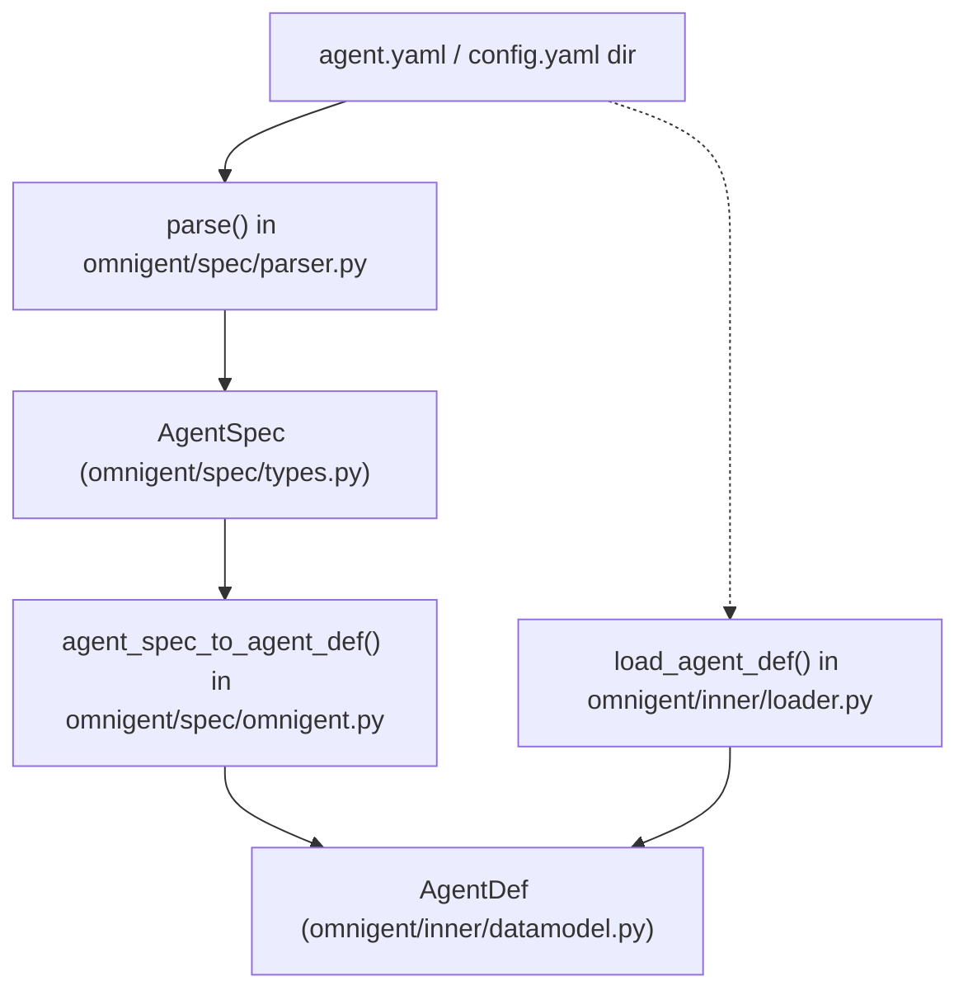
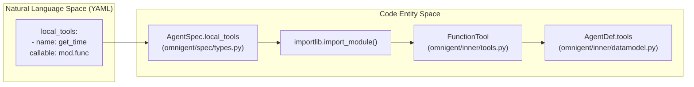

# Agent Spec & Data Model

Relevant source files

The following files were used as context for generating this wiki page:

- [docs/AGENT_YAML_SPEC.md](docs/AGENT_YAML_SPEC.md)
- [omnigent/entities/environment_filesystem.py](omnigent/entities/environment_filesystem.py)
- [omnigent/inner/_cwd_scan.py](omnigent/inner/_cwd_scan.py)
- [omnigent/inner/bwrap_sandbox.py](omnigent/inner/bwrap_sandbox.py)
- [omnigent/inner/datamodel.py](omnigent/inner/datamodel.py)
- [omnigent/inner/loader.py](omnigent/inner/loader.py)
- [omnigent/inner/os_env.py](omnigent/inner/os_env.py)
- [omnigent/inner/sandbox.py](omnigent/inner/sandbox.py)
- [omnigent/inner/seatbelt_sandbox.py](omnigent/inner/seatbelt_sandbox.py)
- [omnigent/spec/omnigent.py](omnigent/spec/omnigent.py)
- [omnigent/spec/parser.py](omnigent/spec/parser.py)
- [omnigent/spec/types.py](omnigent/spec/types.py)
- [tests/inner/test_bwrap_sandbox.py](tests/inner/test_bwrap_sandbox.py)
- [tests/inner/test_bwrap_symlink_mask_3265.py](tests/inner/test_bwrap_symlink_mask_3265.py)
- [tests/inner/test_cwd_scan.py](tests/inner/test_cwd_scan.py)
- [tests/inner/test_loader.py](tests/inner/test_loader.py)
- [tests/inner/test_os_env.py](tests/inner/test_os_env.py)
- [tests/inner/test_os_env_grant_reach.py](tests/inner/test_os_env_grant_reach.py)
- [tests/inner/test_os_env_runtime_imports.py](tests/inner/test_os_env_runtime_imports.py)
- [tests/inner/test_sandbox.py](tests/inner/test_sandbox.py)
- [tests/inner/test_seatbelt_sandbox.py](tests/inner/test_seatbelt_sandbox.py)
- [tests/resources/examples/agent_with_os_env_bwrap.yaml](tests/resources/examples/agent_with_os_env_bwrap.yaml)
- [tests/resources/examples/agent_with_os_env_seatbelt.yaml](tests/resources/examples/agent_with_os_env_seatbelt.yaml)
- [tests/spec/test_omnigent_adapter.py](tests/spec/test_omnigent_adapter.py)
- [tests/spec/test_parser.py](tests/spec/test_parser.py)

This page details the Omnigent agent specification format, core data model types, and the parsing, validation, and translation mechanisms that bridge static agent YAML configurations with live runtime execution engines.

---

## 1. Agent YAML Specification Format

Omnigent defines agents declaratively via YAML files. The system supports native **Agent Spec** versioned directories (`config.yaml`) and simplified **Omnigent YAML** single-file formats. Parsing and validating these specs are primarily managed in `omnigent/spec/parser.py`.

### Key Spec Classes

Several core dataclasses represent the agent image spec parsed from YAML, defined in `omnigent/spec/types.py`:

- **`AgentSpec`**: The root dataclass aggregating agent configuration blocks, including the executor, tools, guardrails (policies), OS environment, terminals, skills, and MCP servers [omnigent/spec/types.py:480-550]().

- **`ExecutorSpec`**: Configures the agent execution backend, including model selection via the `model` field, harness selection via `harness` (e.g., `claude-sdk`, `openai-agents`, `antigravity`), and authentication via `ExecutorAuth` [omnigent/spec/types.py:383-420]().

- **`ToolsConfig`**: Declares multiple tool types available to the agent, including MCP servers, local Python function tools, sub-agents, and handoff tools [omnigent/spec/types.py:314-340]().

- **`PolicySpec`** and **`GuardrailsSpec`**: Guardrails provide policy definitions that govern requests, responses, tool calls, and decisions. `GuardrailsSpec` encapsulates these policy lists and associated settings like `ask_timeout` for human approval gating [omnigent/spec/types.py:448-470]().

- **`RetryPolicy`**: Defines a unified retry policy with parameters such as max retries, exponential backoff values, jitter, timeout per request, and retryable HTTP status codes. This policy applies to both in-process SDK retries and workflow-level retries [omnigent/spec/types.py:43-92]().

### Parsing and Validation

Parsing is implemented in `omnigent/spec/parser.py`, with the public `parse()` function designed to read a directory containing an agent image and its `config.yaml`.

- A custom YAML loader, `_ConfigYamlLoader`, inherits from PyYAML's `SafeLoader` but overrides boolean parsing to comply with YAML 1.2 syntax, preventing common traps with boolean keys like `on:` in policy selectors [omnigent/spec/parser.py:77-134]().

- Integer and float fields are coerced thoughtfully to reject YAML booleans masquerading as numbers [omnigent/spec/parser.py:136-176]().

- If the `config.yaml` is missing in the directory, a specialized `AgentImageConfigMissingError` (a subclass of both `FileNotFoundError` and `OmnigentError`) is raised to deliver a clear 404 error code rather than a server internal error [omnigent/spec/parser.py:179-198]().

- The parser expands environment variables in connection blocks and MCP-related headers when `expand_env=True` is set [omnigent/spec/parser.py:3900-3913]().

- Spec versions, required fields, and consistent typing are enforced; invalid or malformed specs lead to meaningful exceptions for early feedback [omnigent/spec/parser.py:200-206]().

Sources: [omnigent/spec/parser.py:1-180](), [omnigent/spec/parser.py:179-198](), [omnigent/spec/parser.py:200-206](), [omnigent/spec/parser.py:3900-3913](), [omnigent/spec/types.py:43-92](), [omnigent/spec/types.py:314-340](), [omnigent/spec/types.py:383-420](), [omnigent/spec/types.py:448-470](), [omnigent/spec/types.py:480-550]()

---

## 2. Core Data Model Types

Omnigent’s internal data model captures conversation state, individual messages, and executable agent artifacts.

### 2.1 Message and History

- **`Message`**: Represents a single message or turn in a conversation. Fields include:
  - `role`: One of `"system"`, `"user"`, `"assistant"`, `"tool_call"`, or `"tool_result"`.
  - `content`: Message body, which can be plain text or structured JSON.
  - `timestamp`: UTC creation time (defaults to current time).
  - `source`: Origin identifier (e.g., `"primary"` or a tool name).
  - `metadata`: Arbitrary JSON-like metadata attached during runtime, such as tracing or policy annotations.

  Defined in `omnigent/inner/datamodel.py` [omnigent/inner/datamodel.py:50-70]().

- **`History`**: Ordered record of `Message` instances associated with a conversation or session. Provides:
  - `append(msg)`: Adds messages.
  - `get_context_window(max_tokens)`: Returns messages; token-aware trimming is delegated to the `omnigent.runtime.compaction` module.
  - `search(query)`: Substring search over all messages.
  - `as_text()`: Renders messages as simple labeled lines.

  Defined in `omnigent/inner/datamodel.py` [omnigent/inner/datamodel.py:101-138]().

### 2.2 AgentDef (Runtime Definition)

An `AgentDef` captures a runtime-resolved agent artifact, containing Python-callable tools, policy handlers, and other executable components needed by the runtime engine.

- **Translation**: The forward translation from `AgentSpec` (static parsed config) to `AgentDef` (runtime artifact) is handled by `agent_spec_to_agent_def()` in `omnigent/spec/omnigent.py`. This function resolves callable import paths specified as strings (e.g., `"examples._shared.tool_functions.get_current_time"`) into live Python callables using `importlib.import_module`. Unsupported concepts such as policies, OSEnv sandbox, MCP-type tools, or cancellable function tools currently raise errors to avoid silent failures [omnigent/spec/omnigent.py:137-141]().

- **Round-trip Invariant**: The inverse translation `agent_def_to_agent_spec()` enables re-serialization of runtime `AgentDef` back into `AgentSpec`. Together they must round-trip reliably, verified by comprehensive tests in `tests/spec/test_omnigent_roundtrip.py` [omnigent/spec/omnigent.py:11-15]().

### 2.3 Conversations and Items

At runtime, agents manage conversation histories, session state, and metadata including:
- Reasoning effort levels (e.g., `low`, `medium`, `high`, `xhigh`).
- Model override names.
- Tools, policies, and skills available to the agent execution environment.

These runtime dynamics are stored using `AgentDef` and the various message types above.

Sources: [omnigent/inner/datamodel.py:50-70](), [omnigent/inner/datamodel.py:101-138](), [omnigent/spec/omnigent.py:11-15](), [omnigent/spec/omnigent.py:137-141]()

---

## 3. OS Environment & Sandbox Model

The `os_env` agent spec section configures how agents interact with the underlying operating system, including the use of sandboxes for isolation.

- **`OSEnvSpec`**: Defines working directories, environment variable inheritance, and specific OS environment options accessible to the agent. Includes tooling configuration and file path grants [omnigent/inner/datamodel.py:236-258]().

- **`OSEnvSandboxSpec`**: Governs sandbox backend selection and policies:
  - Backend types include Linux Bubblewrap (`linux_bwrap`) and macOS Seatbelt (`darwin_seatbelt`).
  - Specifies allowed read roots, writable directories, dotfile masking, network access, egress relay configuration, and environment variable passthrough [omnigent/inner/datamodel.py:206-234]().

- **`TerminalEnvSpec`**: Enables declaration of named interactive shell environments accessible to the agent’s terminals, e.g., `bash` or `zsh` shells [omnigent/inner/datamodel.py:261-285]().

### Sandbox Backends

- **Linux Bubblewrap (`linux_bwrap`)**: Uses `bwrap` to create a hermetic mount namespace and a hardened seccomp profile to isolate processes, filesystem visibility, and network access. The sandbox blocks certain kernel syscalls, hides host dotfiles (except a whitelist like `.venv`), and manages `$TMPDIR` for writable scratch space. The backend is registered and configured according to the `SandboxPolicy` [omnigent/inner/bwrap_sandbox.py:1-183]().

- **macOS Seatbelt (`darwin_seatbelt`)**: Applies a `sandbox-exec` profile to restrict file and network access. It uses a similar `SandboxPolicy` abstraction but the profile semantics and limitations differ (no namespace isolation, deny overrides allow strictly, AF_UNIX socket path length limits, etc.) [omnigent/inner/seatbelt_sandbox.py:1-144]().

Sources: [omnigent/inner/datamodel.py:206-285](), [omnigent/inner/bwrap_sandbox.py:1-183](), [omnigent/inner/seatbelt_sandbox.py:1-144]()

---

## Data Flow Diagrams

### Agent Spec Translation & Execution Preparation

This diagram shows how a static agent YAML or directory config is parsed into an `AgentSpec`, then translated into a runtime `AgentDef` containing resolved executable components ready for the runtime engine.

Sources: [omnigent/spec/parser.py:167-180](), [omnigent/spec/types.py:480-550](), [omnigent/spec/omnigent.py:137-141](), [omnigent/inner/loader.py:75-116](), [omnigent/inner/datamodel.py:310-350]()

---

### Tool Resolution Flow

This diagram illustrates the translation of declared callable tools from YAML strings (`mod.func`) into actual Python `FunctionTool` objects resolved via dynamic import, then registered into the runtime `AgentDef`.

Sources: [omnigent/spec/types.py:314-340](), [omnigent/inner/tools.py:1-50](), [omnigent/spec/omnigent.py:137-141]()

---

## Summary Table: Data Model Classes

| Class               | File Path                   | Role                                                        |
| ------------------- | --------------------------- | ----------------------------------------------------------- |
| `AgentSpec`         | `omnigent/spec/types.py`    | Static, serializable configuration parsed from YAML specs. |
| `AgentDef`          | `omnigent/inner/datamodel.py` | Runtime-ready definition holding resolved callables and registries. |
| `Message`           | `omnigent/inner/datamodel.py` | Core atomic unit of conversation history (role, content, metadata). |
| `RetryPolicy`       | `omnigent/spec/types.py`    | Declarative L0/L2 retry and exponential backoff policy.     |
| `OSEnvSpec`         | `omnigent/inner/datamodel.py` | Defines working directories and environment variable inheritance. |
| `OSEnvSandboxSpec`  | `omnigent/inner/datamodel.py` | Configuration governing process isolation backends (`linux_bwrap`, `darwin_seatbelt`). |

Sources: [omnigent/spec/types.py:43-92](), [omnigent/spec/types.py:480-550](), [omnigent/inner/datamodel.py:50-70](), [omnigent/inner/datamodel.py:206-258](), [omnigent/inner/datamodel.py:310-350]()

---

This page captures the foundational representation of agents in Omnigent through standardized, typed YAML specs and their translation into live objects supporting execution and lifecycle management. It also outlines sandboxing for OS interaction and tooling expansion, enabling secure and flexible agent runtime configurations.