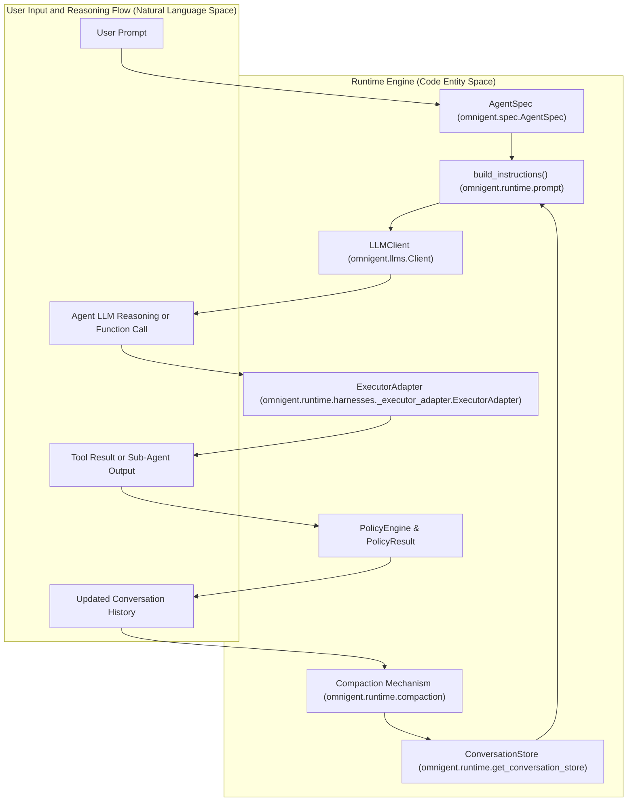
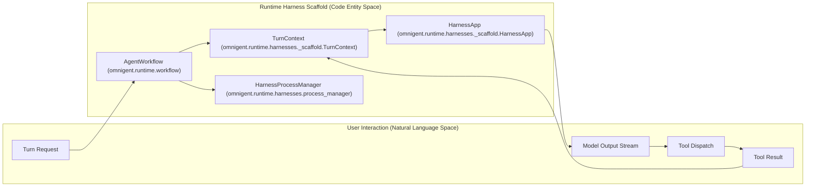

# Runtime & Workflow Engine

Relevant source files

The following files were used as context for generating this wiki page:

- [omnigent/cli_config.py](omnigent/cli_config.py)
- [omnigent/harness_aliases.py](omnigent/harness_aliases.py)
- [omnigent/onboarding/ambient.py](omnigent/onboarding/ambient.py)
- [omnigent/onboarding/configure_models.py](omnigent/onboarding/configure_models.py)
- [omnigent/onboarding/detected.py](omnigent/onboarding/detected.py)
- [omnigent/onboarding/harness_install.py](omnigent/onboarding/harness_install.py)
- [omnigent/onboarding/harness_readiness.py](omnigent/onboarding/harness_readiness.py)
- [omnigent/onboarding/provider_config.py](omnigent/onboarding/provider_config.py)
- [omnigent/runtime/harnesses/__init__.py](omnigent/runtime/harnesses/__init__.py)
- [omnigent/runtime/harnesses/_scaffold.py](omnigent/runtime/harnesses/_scaffold.py)
- [omnigent/runtime/workflow.py](omnigent/runtime/workflow.py)
- [tests/cli/test_configure_models.py](tests/cli/test_configure_models.py)
- [tests/e2e/omnigent/test_codex_gateway_auth_error.py](tests/e2e/omnigent/test_codex_gateway_auth_error.py)
- [tests/e2e/omnigent/test_run_harness_without_agent_e2e.py](tests/e2e/omnigent/test_run_harness_without_agent_e2e.py)
- [tests/e2e/test_codex_native_terminal_recovery_e2e.py](tests/e2e/test_codex_native_terminal_recovery_e2e.py)
- [tests/e2e/test_policy_verdict_delivery_desync_e2e.py](tests/e2e/test_policy_verdict_delivery_desync_e2e.py)
- [tests/e2e/test_subagent_tool_limit_e2e.py](tests/e2e/test_subagent_tool_limit_e2e.py)
- [tests/e2e_ui/chat/test_absolute_watchdog_spares_active_turn.py](tests/e2e_ui/chat/test_absolute_watchdog_spares_active_turn.py)
- [tests/e2e_ui/chat/test_wedged_llm_call_recovers_run.py](tests/e2e_ui/chat/test_wedged_llm_call_recovers_run.py)
- [tests/inner/conftest.py](tests/inner/conftest.py)
- [tests/inner/test_seccomp.py](tests/inner/test_seccomp.py)
- [tests/onboarding/test_ambient.py](tests/onboarding/test_ambient.py)
- [tests/onboarding/test_detected.py](tests/onboarding/test_detected.py)
- [tests/onboarding/test_harness_install.py](tests/onboarding/test_harness_install.py)
- [tests/onboarding/test_harness_readiness.py](tests/onboarding/test_harness_readiness.py)
- [tests/onboarding/test_provider_config.py](tests/onboarding/test_provider_config.py)
- [tests/resources/agents/subagent-tool-limit/agents/worker/config.yaml](tests/resources/agents/subagent-tool-limit/agents/worker/config.yaml)
- [tests/resources/agents/subagent-tool-limit/agents/worker/tools/python/calculate.py](tests/resources/agents/subagent-tool-limit/agents/worker/tools/python/calculate.py)
- [tests/resources/agents/subagent-tool-limit/config.yaml](tests/resources/agents/subagent-tool-limit/config.yaml)
- [tests/runner/conftest.py](tests/runner/conftest.py)
- [tests/runner/test_app_sessions_native_supervision.py](tests/runner/test_app_sessions_native_supervision.py)
- [tests/runner/test_app_sessions_native_workflow_messages.py](tests/runner/test_app_sessions_native_workflow_messages.py)
- [tests/runner/test_runner_policy.py](tests/runner/test_runner_policy.py)
- [tests/runtime/harnesses/_test_scaffold_harnesses.py](tests/runtime/harnesses/_test_scaffold_harnesses.py)
- [tests/runtime/harnesses/test_executor_adapter_recovery.py](tests/runtime/harnesses/test_executor_adapter_recovery.py)
- [tests/runtime/harnesses/test_human_wait_survives_idle_watchdog.py](tests/runtime/harnesses/test_human_wait_survives_idle_watchdog.py)
- [tests/runtime/harnesses/test_scaffold.py](tests/runtime/harnesses/test_scaffold.py)
- [tests/runtime/harnesses/test_scaffold_human_wait_watchdog.py](tests/runtime/harnesses/test_scaffold_human_wait_watchdog.py)
- [tests/runtime/harnesses/test_scaffold_policy_evaluation.py](tests/runtime/harnesses/test_scaffold_policy_evaluation.py)
- [tests/runtime/harnesses/test_scaffold_policy_failclose.py](tests/runtime/harnesses/test_scaffold_policy_failclose.py)
- [tests/runtime/harnesses/test_wedged_turn_recovery.py](tests/runtime/harnesses/test_wedged_turn_recovery.py)
- [tests/runtime/test_openai_agents_sdk_spawn_env.py](tests/runtime/test_openai_agents_sdk_spawn_env.py)
- [tests/runtime/test_provider_spawn_env.py](tests/runtime/test_provider_spawn_env.py)
- [tests/test_harness_aliases.py](tests/test_harness_aliases.py)
- [tests/test_model_catalog_store.py](tests/test_model_catalog_store.py)

The Runtime & Workflow Engine, primarily implemented in `omnigent/runtime/workflow.py` [omnigent/runtime/workflow.py:1-3314](), is the central orchestrator responsible for agent execution within Omnigent. It handles the continuous agent execution lifecycle: loading agent specifications, constructing prompts, invoking LLMs through various harnesses, dispatching tool calls, enforcing policies, resolving credentials, and checkpointing conversation state durably for crash recovery.

## Purpose and Scope

This page comprehensively documents the runtime agent execution loop implemented in `omnigent/runtime/workflow.py` [omnigent/runtime/workflow.py:1-3314](), with references to associated subsystems including harness scaffolding, compaction, credential resolution, and policy enforcement. It explains the data flow and key abstractions enabling robust, multi-harness LLM interactions combined with tool invocation, policy verdicting, and state persistence.

Sources: [omnigent/runtime/workflow.py:1-3314]()

---

## 1. Agent Execution Loop & Workflow Orchestration

At the heart of the runtime engine is a resilient event loop that continuously drives agent turns. Steps include:

- Load or deserialize the agent spec for the current session.
- Build instructions and conversation history into the prompt.
- Resolve provider credentials and spawn-environment variables.
- Invoke the target LLM harness to get a response or function call.
- Optionally dispatch tool calls triggered by the LLM.
- Enforce policies on tool calls and subsequent outputs.
- Compact the conversation history to respect token limits.
- Checkpoint conversation state persistently to prevent loss on crashes.
- Repeat the cycle until the task is complete or cancelled.

This loop efficiently alternates between generating reasoning tokens and acting on tool results, managing sync and async tool calls transparently.

**Diagram 1: Agent Execution Loop Bridging Prompt to Conversation State and Tool Execution**

Sources: [omnigent/runtime/workflow.py:1-200](), [omnigent/runtime/prompt.py:90-90](), [omnigent/runtime/compaction.py:81-88](), [omnigent/runtime/workflow.py:77-99]()

---

## 2. LLM Invocation, Harnessing & Credential Resolution

Omnigent supports multiple harnesses to interface with various LLM providers and SDKs. The runtime determines which harness to invoke based on the `AgentSpec` executor's configuration.

### Supported Harness Types

The harness key space (`AgentHarnessType`) covers:

- `claude-sdk`
- `codex`
- `pi`
- `openai-agents-sdk`
- `antigravity`
- `kimi`
- `qwen`
- `goose`

This is defined as a literal type for static checking [omnigent/runtime/workflow.py:161-163]().

### ExecutorAdapter Abstraction

The `ExecutorAdapter` wraps provider-specific implementations to unify:

- Reading/writing messages between Omnigent turn context and the harness protocol.
- Managing per-turn message translation.
- Dispatching commands or function calls, including sub-agents and tools.

This modularity enables plugging in different LLM providers without altering the top-level loop.

### Credential and Provider Resolution

Agent executor specs declare an `auth` block that can specify:

- `api_key`-style credentials (typical for OpenAI, Anthropic).
- `provider` entries referencing provider configs supporting gateway routing.
- OAuth tokens or databricks profiles.

The runtime uses `load_providers()` to load and merge *effective* provider configs, resolving from environment variables or platform config files [omnigent/runtime/workflow.py:61-75](). Secret environment variable expansions are done with `expand_envvars_with_omnigent_prefix()` for safe interpolation [omnigent/runtime/workflow.py:101-101]().

### Spawn Environment Building and Provider Gateway Routing

Each harness receives a tailored spawn environment including gateway base URLs, model identifiers, and auth commands that allow transparent provider-neutral routing:

- E.g., `HARNESS_CLAUDE_SDK_MODEL`, `HARNESS_CLAUDE_SDK_GATEWAY_BASE_URL`
- This layer decouples runtime invocation from specific API endpoints.
  
This routing strategy is tested explicitly in `tests/runtime/test_provider_spawn_env.py` to ensure accurate var emission per provider [tests/runtime/test_provider_spawn_env.py:1-50]().

Sources: [omnigent/runtime/workflow.py:79-200](), [tests/runtime/test_provider_spawn_env.py:1-50]()

---

## 3. Tool Dispatch, Policy Enforcement & Verdict Delivery

Tools represent commands or external API calls that the agent can execute, triggered by LLM function calls or inline tool requests. The workflow engine manages their lifecycle.

### Policy Enforcement

Policies govern whether an action (tool call, LLM request) is allowed, denied, or requires human approval (`ASK` verdict) [omnigent/runtime/workflow.py:20-40]().

- Policy enforcement is phase-aware: tool call denials fail closed, while advisory decisions fail open to preserve agent operation.
- Many policy evaluations round-trip to the runner for centralized enforcement, leveraging the runner's `PolicyEngine`.
- The engine supports asynchronous enforcement cycles with deferred approval and disallowing unsafe tool calls.

### Tool Execution

`TurnContext` handles tool dispatch with policies enforced beforehand. Tools may be synchronous or asynchronous, in-process or external.

- Tool calls are dispatched via `TurnContext.dispatch_tool()`.
- Asynchronous tool completion uses a signaling protocol to unblock the turn loop once results are ready.

### Verdict Delivery

The runtime delivers policy verdicts and tool results back to the LLM in the next message, enabling context-aware reasoning and chaining.

Sources: [omnigent/runtime/workflow.py:20-40]()

---

## 4. Context Management, Compaction & Token Counting

To handle long-running conversations exceeding LLM context windows, the engine employs multi-layered compaction strategies.

| Layer | Method | Description |
|-------|---------|-------------|
| **1** | Surgical Clearing | Replaces long prior tool results and binary blocks with concise markers (`[Previous tool result cleared]`) to reduce token load without losing intent [omnigent/runtime/compaction.py:81-87](). |
| **2** | LLM Summarization | Uses an LLM call to summarize older conversation history into a smaller single summary message pair [omnigent/runtime/compaction.py:87-89](). |
| **3** | Truncation Fallback | If still over limits, drops oldest messages (hard cut-off) to fit within window [omnigent/runtime/compaction.py:89-90](). |

### Context Window Resolution

The engine determines the effective token window of the target model using `resolve_catalog_model()` [omnigent/models/model_catalog.py:40-50]() and `LLMClient` capabilities [omnigent/llms/client.py:100-120]().

- This consults an authoritative registry per known model.
- Defaults to catalog model constraints.
- Falls back to a conservative minimum window size.

### Token Counting

Token counts are estimated using `count_tokens()` [omnigent/runtime/compaction.py:87-87]().

- Used proactively to decide when to compact conversation history.
- Helps avoid runtime errors or costly LLM rejections due to context overflow.

Sources: [omnigent/runtime/compaction.py:69-90](), [omnigent/models/model_catalog.py:40-50](), [omnigent/llms/client.py:100-120]()

---

## 5. Harness Process Management & Scaffolding

All harness implementations conform to a scaffold pattern defined in `omnigent/runtime/harnesses/_scaffold.py` [omnigent/runtime/harnesses/_scaffold.py:1-152]():

### HarnessApp & TurnContext

- `HarnessApp` exposes a FastAPI app over Unix sockets that provides:
  - Downward-facing event ingestion (`POST /v1/sessions/{conversation_id}/events`).
  - Health checks.
  - A consistent startup and shutdown lifecycle for harness processes.

- `TurnContext` orchestrates single-agent turn execution within the harness, including:
  - Reading input events.
  - Managing per-turn idle and absolute timeouts (`_DEFAULT_TURN_IDLE_TIMEOUT_S`, `_TURN_ABSOLUTE_TIMEOUT_S`) [omnigent/runtime/harnesses/_scaffold.py:132-146]().
  - Streaming response accumulation and delivery.
  - Handling forked turns and sub-agent chaining.

### Watchdogs and Timeouts

- Idle watchdogs detect stuck or unresponsive harness turns to cancel stalled work. The default idle timeout is 3600 seconds (1 hour) [omnigent/runtime/harnesses/_scaffold.py:132-132]().
- Absolute turn timeouts ensure a hard ceiling preventing runaway processing. The default absolute timeout is 10800 seconds (3 hours) [omnigent/runtime/harnesses/_scaffold.py:146-146]().

**Diagram 2: Mapping User Inputs to Harness Scaffold and Executor Adapter Components**

Sources: [omnigent/runtime/workflow.py:1-200](), [omnigent/runtime/harnesses/_scaffold.py:1-152]()

---

# Summary

The Runtime & Workflow Engine bridges the high-level natural language agent specification and interactive user inputs to the low-level provider harness invocations and tool executions. It robustly orchestrates credential resolution, policy enforcement, multi-turn compaction, durable checkpointing, and subprocess management to enable multi-harness, long-context agent workflows in Omnigent.

Sources:  
[omnigent/runtime/workflow.py:1-3314](),  
[omnigent/runtime/harnesses/_scaffold.py:1-152](),  
[omnigent/runtime/compaction.py:69-90](),  
[omnigent/models/model_catalog.py:40-50](),  
[omnigent/llms/client.py:100-120](),  
[tests/runtime/test_provider_spawn_env.py:1-50]()