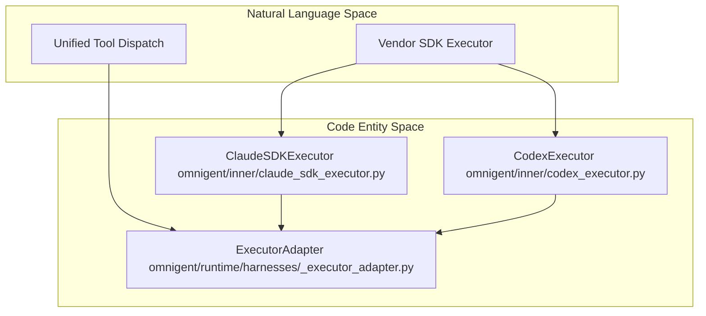
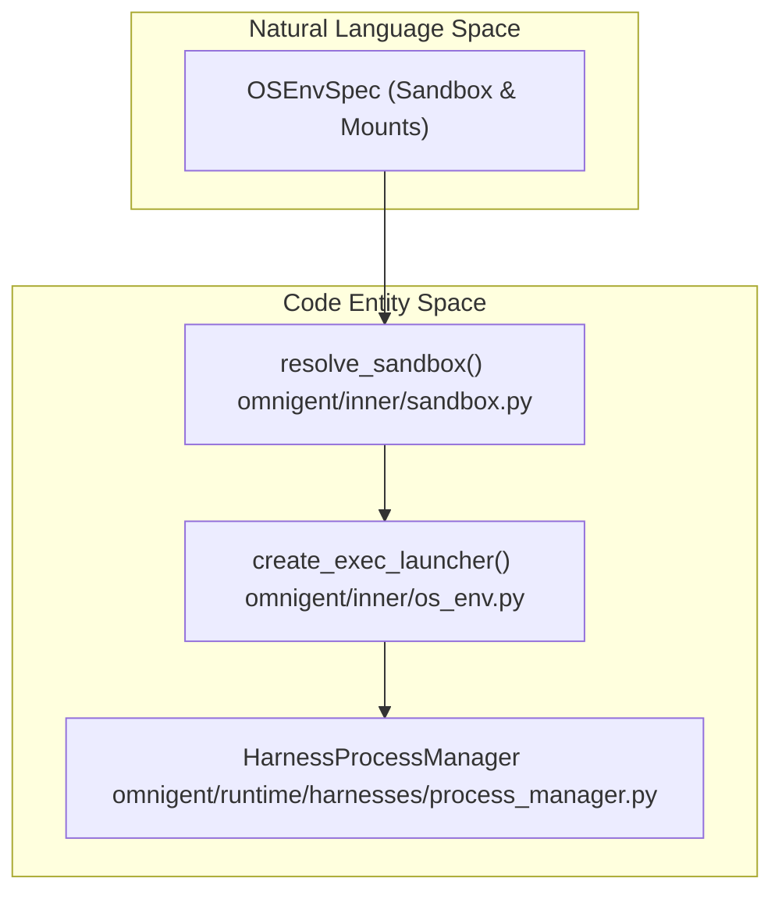

# Inner Harness Layer

Relevant source files

The following files were used as context for generating this wiki page:

- [designs/harness-capabilities-bench-seam.md](designs/harness-capabilities-bench-seam.md)
- [designs/harness-modular-registry-proposal.md](designs/harness-modular-registry-proposal.md)
- [designs/harness-plugin-interface.md](designs/harness-plugin-interface.md)
- [omnigent/community/__init__.py](omnigent/community/__init__.py)
- [omnigent/community/harness/__init__.py](omnigent/community/harness/__init__.py)
- [omnigent/harness_capabilities.py](omnigent/harness_capabilities.py)
- [omnigent/harness_plugins.py](omnigent/harness_plugins.py)
- [omnigent/native/owner_claim.py](omnigent/native/owner_claim.py)
- [omnigent/runner/native/__init__.py](omnigent/runner/native/__init__.py)
- [omnigent/runtime/filesystem_registry.py](omnigent/runtime/filesystem_registry.py)
- [omnigent/runtime/harnesses/process_manager.py](omnigent/runtime/harnesses/process_manager.py)
- [omnigent/util/reasoning_effort.py](omnigent/util/reasoning_effort.py)
- [scripts/backend-smoke.sh](scripts/backend-smoke.sh)
- [tests/_helpers/README.md](tests/_helpers/README.md)
- [tests/_helpers/host.py](tests/_helpers/host.py)
- [tests/_helpers/live_server.py](tests/_helpers/live_server.py)
- [tests/_helpers/pi_native.py](tests/_helpers/pi_native.py)
- [tests/_helpers/server_runner.py](tests/_helpers/server_runner.py)
- [tests/e2e/resilience/lab/lab.py](tests/e2e/resilience/lab/lab.py)
- [tests/e2e/resilience/test_lab_smoke.py](tests/e2e/resilience/test_lab_smoke.py)
- [tests/e2e/test_files_upload_e2e.py](tests/e2e/test_files_upload_e2e.py)
- [tests/e2e/test_filesystem_changed_files_e2e.py](tests/e2e/test_filesystem_changed_files_e2e.py)
- [tests/e2e/test_inaccessible_git_metadata_e2e.py](tests/e2e/test_inaccessible_git_metadata_e2e.py)
- [tests/e2e/test_non_git_changed_files_e2e.py](tests/e2e/test_non_git_changed_files_e2e.py)
- [tests/e2e/test_orphan_sweep_unreadable_tmp_parent_e2e.py](tests/e2e/test_orphan_sweep_unreadable_tmp_parent_e2e.py)
- [tests/e2e/test_subagent_model_override_respawn_e2e.py](tests/e2e/test_subagent_model_override_respawn_e2e.py)
- [tests/e2e_ui/files/test_non_git_stray_gitdir.py](tests/e2e_ui/files/test_non_git_stray_gitdir.py)
- [tests/inner/test_terminal_orphan_ownership.py](tests/inner/test_terminal_orphan_ownership.py)
- [tests/native/test_owner_claim.py](tests/native/test_owner_claim.py)
- [tests/runner/test_app_pi_native_model.py](tests/runner/test_app_pi_native_model.py)
- [tests/runner/test_app_sessions_native_terminal_routing.py](tests/runner/test_app_sessions_native_terminal_routing.py)
- [tests/runner/test_app_sessions_native_workflow_init.py](tests/runner/test_app_sessions_native_workflow_init.py)
- [tests/runner/test_enforce_sandbox_gate.py](tests/runner/test_enforce_sandbox_gate.py)
- [tests/runtime/harnesses/test_process_manager.py](tests/runtime/harnesses/test_process_manager.py)
- [tests/runtime/harnesses/test_process_manager_idle_config.py](tests/runtime/harnesses/test_process_manager_idle_config.py)
- [tests/runtime/test_filesystem_git_discovery.py](tests/runtime/test_filesystem_git_discovery.py)
- [tests/runtime/test_filesystem_registry.py](tests/runtime/test_filesystem_registry.py)
- [tests/test_harness_capabilities.py](tests/test_harness_capabilities.py)
- [tests/test_harness_plugins.py](tests/test_harness_plugins.py)
- [tests/test_local_server_helper.py](tests/test_local_server_helper.py)
- [tests/test_native_dispatch.py](tests/test_native_dispatch.py)
- [tests/test_reasoning_effort.py](tests/test_reasoning_effort.py)

The **Inner Harness Layer** (`omnigent/inner/` and `omnigent/harnesses/`) encompasses the core subsystems responsible for executing AI coding agents, managing terminal harnesses, sandboxing, and the harness capabilities registry within Omnigent. It acts as the critical bridge between the natural language agent specifications provided at the frontend and the concrete implementations such as subprocesses, third-party SDK interactions, and protocol-based executors.

This layer organizes the lifecycle and execution environment of agents including:

- Native terminal harnesses running real vendor CLI tools wrapped in tmux or terminal multiplexers.
- SDK-based and ACP-protocol executors facilitating in-process or remote API-based agent invocations.
- Sandboxing and OS environment configuration including isolation runtimes, persistent terminal sessions, and egress proxies.
- The harness plugin and capability registries that provide discoverable harness metadata and orchestrate harness-specific behaviors.

As this is a **parent page**, detailed technical and implementation specifics for each aspect are maintained in the child pages below:

- [Native Terminal Harnesses (Claude, Codex, Pi, Cursor, Antigravity)](#2.3.1)
- [SDK & ACP Executors](#2.3.2)
- [Sandboxing, OS Environment & Terminals](#2.3.3)

Sources: `[omnigent/inner/executor.py:59-75]`, `[omnigent/harness_plugins.py:55-191]`, `[omnigent/runtime/harnesses/process_manager.py:1-166]`

---

## Overview of Subsystems

The Inner Harness Layer partitions into three main functional domains, each managing critical aspects of agent execution and harness runtime:

### 1. Native Terminal TUI Harnesses

This domain handles native terminal multiplexers (`tmux`/`PTY`) managing vendor-specific CLI tools such as Claude Code, Codex, Pi, Cursor, and Antigravity. The harnesses wrap terminal sessions, handle transcript forwarding for web UI synchronization, manage application servers bridging to the runner, and implement native policy hooks.

These harnesses maintain stateful terminal sessions, interpret and forward input/output, and coordinate permission and interrupt logic per harness.

For the comprehensive technical breakdown of native harness lifecycle, bridge directories, transcript forwarding, hooks, and app servers, see:  
[Native Terminal Harnesses (Claude, Codex, Pi, Cursor, Antigravity)](#2.3.1).

Sources: `[omnigent/harness_plugins.py:55-191]`, `[omnigent/runner/native/__init__.py:1-137]`

---

### 2. SDK & ACP Executors

SDK Executors run vendor SDKs in-process (e.g., Claude SDK, OpenAI Agents SDK, Databricks, Copilot, Cursor, Pi, Codex). ACP Executors communicate with external agents over the ACP protocol (Qwen, Goose, Hermes). The executor subsystem unifies these disparate execution models into a consistent interface for turn invocation, interrupt handling, and event streaming.

The `ExecutorAdapter` wraps different executor types to standardize lifecycle and dispatch semantics.

For details on executor classes, protocols, and the adapter pattern used to harmonize SDK and protocol executors, see:  
[SDK & ACP Executors](#2.3.2).

Sources: `[omnigent/inner/executor.py:59-75]`

---

### 3. Sandboxing, OS Environment & Terminals

This subsystem manages the OS-level environment required to securely isolate and run agent subprocesses. It configures Bubblewrap (`bwrap`) sandboxes on Linux, macOS Seatbelt sandbox profiles, egress proxying for outbound traffic control, and persistent terminal session lifecycles.

The harness process manager oversees subprocess spawning, lifetime, idle reaping, crash recovery, and IPC socket management.

The control bridges mediate communication channels between the runner and sandboxed harness subprocesses.

For a full explanation of sandbox hosting, terminal control bridge mechanisms, subprocess process management, and environment orchestration, see:  
[Sandboxing, OS Environment & Terminals](#2.3.3).

Sources: `[omnigent/runtime/harnesses/process_manager.py:1-166]`, `[omnigent/inner/sandbox.py:77-84]`

---

## Architectural Mapping: Natural Language to Code Entities

The following diagrams map high-level natural language concepts like "Native Terminal Harness" and "SDK Executor" to precise code entities, classes, and modules in the Omnigent codebase, bridging the natural language space to code entity space.

### Diagram 1: Harness Concepts to Executor & Adapter Code Classes

This diagram bridges natural language descriptions of vendor execution layers to the concrete Python classes (`ClaudeSDKExecutor`, `CodexExecutor`, and `ExecutorAdapter`) responsible for invoking models and dispatching tools.

Sources: `[omnigent/inner/executor.py:59-75]`, `[omnigent/runtime/harnesses/_executor_adapter.py:108-150]`

---

### Diagram 2: Isolation and Sandbox Management Architecture

This flow demonstrates how sandbox environment specifications from agent YAML (`OSEnvSpec`) flow through the sandbox resolver (`resolve_sandbox()`), which produces executable launchers (`create_exec_launcher()`), culminating in runtime process supervision by the `HarnessProcessManager`.

Sources: `[omnigent/inner/datamodel.py:58-67]`, `[omnigent/inner/sandbox.py:77-84]`, `[omnigent/runtime/harnesses/process_manager.py:1-166]`

---

## Summary of Child Pages

### 2.3.1 Native Terminal Harnesses

This child page elaborates on native tmux/TUI harnesses for specific AI vendors (Claude, Codex, Pi, Cursor, Antigravity). It details bridge directories, PTY/terminal hooks, transcript forwarders synchronizing terminal output to the web UI, native app-servers mediating communication, and integration with native policy hooks.

For comprehensive details, see:  
[Native Terminal Harnesses (Claude, Codex, Pi, Cursor, Antigravity)](#2.3.1)

Sources: `[omnigent/harness_plugins.py:55-191]`, `[tests/runner/test_app_sessions_native_events_lifecycle.py:1-25]`

---

### 2.3.2 SDK & ACP Executors

Covers in-process SDK executors such as Claude SDK, OpenAI Agents SDK, Databricks, Copilot, Cursor, Pi, and Codex. Also describes ACP-protocol executors like Qwen, Goose, and Hermes. The page explains `ExecutorAdapter` which wraps these diverse executors, normalizes their event loops, and standardizes turn invocation and interrupt semantics.

For technical details and usage, see:  
[SDK & ACP Executors](#2.3.2)

Sources: `[omnigent/inner/claude_sdk_executor.py:1-75]`, `[omnigent/inner/codex_executor.py:1-75]`, `[omnigent/runtime/harnesses/_executor_adapter.py:108-150]`

---

### 2.3.3 Sandboxing, OS Environment & Terminals

This page explains OS environment tools and sandboxing approaches using Bubblewrap (`bwrap`) on Linux and Seatbelt profiles on macOS. It covers control bridges for the harness subprocesses, persistent terminal management, and outbound egress proxying that governs network access from sandboxes.

Subprocess lifecycle management by `HarnessProcessManager` (spawn, idle reaping, orphan cleanup) is also detailed here.

For full technical coverage, see:  
[Sandboxing, OS Environment & Terminals](#2.3.3)

Sources: `[omnigent/inner/sandbox.py:77-84]`, `[omnigent/inner/os_env.py:1-20]`, `[omnigent/runtime/harnesses/process_manager.py:1-166]`