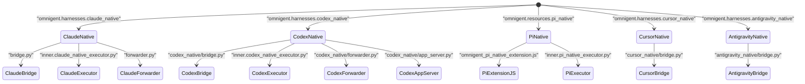

# Native Terminal Harnesses (Claude, Codex, Pi, Cursor, Antigravity)

<details>
<summary>Relevant source files</summary>

The following files were used as context for generating this wiki page:

- [docs/CODEX_STATUS_DIAGNOSTICS.md](docs/CODEX_STATUS_DIAGNOSTICS.md)
- [docs/NATIVE_INPUT_DELIVERY_DIAGNOSTICS.md](docs/NATIVE_INPUT_DELIVERY_DIAGNOSTICS.md)
- [omnigent/entities/conversation.py](omnigent/entities/conversation.py)
- [omnigent/harnesses/claude_native/bridge.py](omnigent/harnesses/claude_native/bridge.py)
- [omnigent/harnesses/claude_native/delivery_diagnostics.py](omnigent/harnesses/claude_native/delivery_diagnostics.py)
- [omnigent/harnesses/claude_native/forwarder.py](omnigent/harnesses/claude_native/forwarder.py)
- [omnigent/harnesses/codex_egress.py](omnigent/harnesses/codex_egress.py)
- [omnigent/harnesses/codex_native/app_server.py](omnigent/harnesses/codex_native/app_server.py)
- [omnigent/harnesses/codex_native/bridge.py](omnigent/harnesses/codex_native/bridge.py)
- [omnigent/harnesses/codex_native/forwarder.py](omnigent/harnesses/codex_native/forwarder.py)
- [omnigent/harnesses/codex_native/launch_args.py](omnigent/harnesses/codex_native/launch_args.py)
- [omnigent/harnesses/codex_native/main.py](omnigent/harnesses/codex_native/main.py)
- [omnigent/harnesses/codex_native/side_chat.py](omnigent/harnesses/codex_native/side_chat.py)
- [omnigent/harnesses/opencode_native/app_server.py](omnigent/harnesses/opencode_native/app_server.py)
- [omnigent/harnesses/opencode_native/client.py](omnigent/harnesses/opencode_native/client.py)
- [omnigent/harnesses/opencode_native/forwarder.py](omnigent/harnesses/opencode_native/forwarder.py)
- [omnigent/harnesses/pi_native/resume.py](omnigent/harnesses/pi_native/resume.py)
- [omnigent/inner/claude_native_executor.py](omnigent/inner/claude_native_executor.py)
- [omnigent/inner/codex_native_executor.py](omnigent/inner/codex_native_executor.py)
- [omnigent/inner/pi_native_executor.py](omnigent/inner/pi_native_executor.py)
- [omnigent/native/native_bridge_common.py](omnigent/native/native_bridge_common.py)
- [omnigent/onboarding/codex_auth_readiness.py](omnigent/onboarding/codex_auth_readiness.py)
- [omnigent/resources/pi_native/omnigent_pi_native_extension.js](omnigent/resources/pi_native/omnigent_pi_native_extension.js)
- [omnigent/resources/pi_native/omnigent_pi_native_extension.test.js](omnigent/resources/pi_native/omnigent_pi_native_extension.test.js)
- [omnigent/runner/native/interrupt.py](omnigent/runner/native/interrupt.py)
- [omnigent/runner/native/orchestration.py](omnigent/runner/native/orchestration.py)
- [omnigent/runner/native_controls.py](omnigent/runner/native_controls.py)
- [omnigent/stores/conversation_store/overrides.py](omnigent/stores/conversation_store/overrides.py)
- [tests/e2e/_codex_loopback_resume.py](tests/e2e/_codex_loopback_resume.py)
- [tests/e2e/_pi_subagent_startup_server.py](tests/e2e/_pi_subagent_startup_server.py)
- [tests/e2e/test_acp_session_selection.py](tests/e2e/test_acp_session_selection.py)
- [tests/e2e/test_claude_native_cold_resume_items_500_e2e.py](tests/e2e/test_claude_native_cold_resume_items_500_e2e.py)
- [tests/e2e/test_claude_native_forwarder_stall_replay_dedup_e2e.py](tests/e2e/test_claude_native_forwarder_stall_replay_dedup_e2e.py)
- [tests/e2e/test_claude_native_forwarder_user_message_loss_e2e.py](tests/e2e/test_claude_native_forwarder_user_message_loss_e2e.py)
- [tests/e2e/test_claude_native_subagent_batch_timeout_e2e.py](tests/e2e/test_claude_native_subagent_batch_timeout_e2e.py)
- [tests/e2e/test_claude_native_worktree_relocation_e2e.py](tests/e2e/test_claude_native_worktree_relocation_e2e.py)
- [tests/e2e/test_codex_cold_resume_compaction_tool_e2e.py](tests/e2e/test_codex_cold_resume_compaction_tool_e2e.py)
- [tests/e2e/test_codex_cold_resume_namespaced_tool_e2e.py](tests/e2e/test_codex_cold_resume_namespaced_tool_e2e.py)
- [tests/e2e/test_codex_native_dir_gc_e2e.py](tests/e2e/test_codex_native_dir_gc_e2e.py)
- [tests/e2e/test_codex_native_launch_config_timeout_recovers_e2e.py](tests/e2e/test_codex_native_launch_config_timeout_recovers_e2e.py)
- [tests/e2e/test_codex_native_resume_provider_e2e.py](tests/e2e/test_codex_native_resume_provider_e2e.py)
- [tests/e2e/test_codex_native_supported_efforts_e2e.py](tests/e2e/test_codex_native_supported_efforts_e2e.py)
- [tests/e2e/test_codex_status_audit_e2e.py](tests/e2e/test_codex_status_audit_e2e.py)
- [tests/e2e/test_native_resume_provider_e2e.py](tests/e2e/test_native_resume_provider_e2e.py)
- [tests/e2e/test_native_subagent_cancel_hard_stop_matrix.py](tests/e2e/test_native_subagent_cancel_hard_stop_matrix.py)
- [tests/e2e/test_opencode_native_startup_cancel_leak_e2e.py](tests/e2e/test_opencode_native_startup_cancel_leak_e2e.py)
- [tests/e2e/test_pi_native_resume_duplicate_tool_result_e2e.py](tests/e2e/test_pi_native_resume_duplicate_tool_result_e2e.py)
- [tests/e2e/test_pi_native_smart_routing.py](tests/e2e/test_pi_native_smart_routing.py)
- [tests/e2e/test_pi_native_subagent_startup_lifecycle.py](tests/e2e/test_pi_native_subagent_startup_lifecycle.py)
- [tests/e2e_ui/approvals/test_opencode_question.py](tests/e2e_ui/approvals/test_opencode_question.py)
- [tests/e2e_ui/chat/test_codex_native_ambient_bedrock.py](tests/e2e_ui/chat/test_codex_native_ambient_bedrock.py)
- [tests/e2e_ui/chat/test_side_chat_entrypoints.py](tests/e2e_ui/chat/test_side_chat_entrypoints.py)
- [tests/e2e_ui/sessions/test_codex_native_compact_takes_effect.py](tests/e2e_ui/sessions/test_codex_native_compact_takes_effect.py)
- [tests/e2e_ui/sessions/test_compact_offline_native_reconnect.py](tests/e2e_ui/sessions/test_compact_offline_native_reconnect.py)
- [tests/entities/test_conversation_extended.py](tests/entities/test_conversation_extended.py)
- [tests/entities/test_entities.py](tests/entities/test_entities.py)
- [tests/harnesses/claude_native/forwarder/test_subagent_discovery.py](tests/harnesses/claude_native/forwarder/test_subagent_discovery.py)
- [tests/harnesses/claude_native/test_claude_native_bridge.py](tests/harnesses/claude_native/test_claude_native_bridge.py)
- [tests/harnesses/claude_native/test_claude_native_delivery_logging.py](tests/harnesses/claude_native/test_claude_native_delivery_logging.py)
- [tests/harnesses/claude_native/test_claude_native_exit_on_escape_dialogs.py](tests/harnesses/claude_native/test_claude_native_exit_on_escape_dialogs.py)
- [tests/harnesses/claude_native/test_claude_native_footer_focus.py](tests/harnesses/claude_native/test_claude_native_footer_focus.py)
- [tests/harnesses/claude_native/test_claude_native_pending_prompt.py](tests/harnesses/claude_native/test_claude_native_pending_prompt.py)
- [tests/harnesses/claude_native/test_claude_native_prompt_refusal_typed.py](tests/harnesses/claude_native/test_claude_native_prompt_refusal_typed.py)
- [tests/harnesses/claude_native/test_claude_native_shell_mode_draft.py](tests/harnesses/claude_native/test_claude_native_shell_mode_draft.py)
- [tests/harnesses/claude_native/test_claude_native_slow_ready.py](tests/harnesses/claude_native/test_claude_native_slow_ready.py)
- [tests/harnesses/codex_native/app_server/test_startup.py](tests/harnesses/codex_native/app_server/test_startup.py)
- [tests/harnesses/codex_native/forwarder/test_turn_errors.py](tests/harnesses/codex_native/forwarder/test_turn_errors.py)
- [tests/harnesses/codex_native/session/test_resume_permissions.py](tests/harnesses/codex_native/session/test_resume_permissions.py)
- [tests/harnesses/codex_native/session/test_resume_rollouts.py](tests/harnesses/codex_native/session/test_resume_rollouts.py)
- [tests/harnesses/codex_native/session/test_subscription.py](tests/harnesses/codex_native/session/test_subscription.py)
- [tests/harnesses/codex_native/session/test_terminal_prepare.py](tests/harnesses/codex_native/session/test_terminal_prepare.py)
- [tests/harnesses/codex_native/test_codex_native.py](tests/harnesses/codex_native/test_codex_native.py)
- [tests/harnesses/codex_native/test_codex_native_app_server_stderr.py](tests/harnesses/codex_native/test_codex_native_app_server_stderr.py)
- [tests/harnesses/codex_native/test_codex_native_bridge.py](tests/harnesses/codex_native/test_codex_native_bridge.py)
- [tests/harnesses/codex_native/test_codex_native_launch_args.py](tests/harnesses/codex_native/test_codex_native_launch_args.py)
- [tests/harnesses/codex_native/test_codex_native_side_chat.py](tests/harnesses/codex_native/test_codex_native_side_chat.py)
- [tests/harnesses/pi_native/test_pi_native_extension.py](tests/harnesses/pi_native/test_pi_native_extension.py)
- [tests/harnesses/pi_native/test_pi_native_resume.py](tests/harnesses/pi_native/test_pi_native_resume.py)
- [tests/inner/test_claude_native_executor.py](tests/inner/test_claude_native_executor.py)
- [tests/inner/test_claude_native_executor_answer_hold.py](tests/inner/test_claude_native_executor_answer_hold.py)
- [tests/inner/test_codex_native_executor.py](tests/inner/test_codex_native_executor.py)
- [tests/inner/test_pi_native_executor.py](tests/inner/test_pi_native_executor.py)
- [tests/runner/test_acp_session_selection.py](tests/runner/test_acp_session_selection.py)
- [tests/runner/test_app_sessions_native_events_options.py](tests/runner/test_app_sessions_native_events_options.py)
- [tests/runner/test_app_sessions_native_session_change_heal.py](tests/runner/test_app_sessions_native_session_change_heal.py)
- [tests/runner/test_app_sessions_native_terminals_autocreate.py](tests/runner/test_app_sessions_native_terminals_autocreate.py)
- [tests/runner/test_app_sessions_native_terminals_runtime.py](tests/runner/test_app_sessions_native_terminals_runtime.py)
- [tests/runner/test_app_sessions_native_wake_forwarders.py](tests/runner/test_app_sessions_native_wake_forwarders.py)
- [tests/runner/test_codex_model_pick_fallback.py](tests/runner/test_codex_model_pick_fallback.py)
- [tests/runner/test_codex_native_launch_config.py](tests/runner/test_codex_native_launch_config.py)
- [tests/runner/test_delete_session_bridge_cleanup.py](tests/runner/test_delete_session_bridge_cleanup.py)
- [tests/runner/test_native_interrupt_runner.py](tests/runner/test_native_interrupt_runner.py)
- [tests/runner/test_native_subagent_turn_outcome_delivery.py](tests/runner/test_native_subagent_turn_outcome_delivery.py)
- [tests/runner/test_pi_native_resume_wiring.py](tests/runner/test_pi_native_resume_wiring.py)
- [tests/runtime/test_fetch_all_items.py](tests/runtime/test_fetch_all_items.py)
- [tests/runtime/test_inference_routing.py](tests/runtime/test_inference_routing.py)
- [tests/server/integration/conftest.py](tests/server/integration/conftest.py)
- [tests/server/integration/test_codex_model_change_after_idle_reap.py](tests/server/integration/test_codex_model_change_after_idle_reap.py)
- [tests/server/integration/test_host_runner_launch_worktree.py](tests/server/integration/test_host_runner_launch_worktree.py)
- [tests/server/integration/test_hosts_api.py](tests/server/integration/test_hosts_api.py)
- [tests/server/integration/test_native_model_change_failures.py](tests/server/integration/test_native_model_change_failures.py)
- [tests/server/integration/test_session_worktree_create.py](tests/server/integration/test_session_worktree_create.py)
- [tests/server/integration/test_sessions_archive.py](tests/server/integration/test_sessions_archive.py)
- [tests/server/integration/test_sessions_compact.py](tests/server/integration/test_sessions_compact.py)
- [tests/server/routes/test_native_smart_routing_create.py](tests/server/routes/test_native_smart_routing_create.py)
- [tests/server/routes/test_sessions_crud.py](tests/server/routes/test_sessions_crud.py)
- [tests/server/routes/test_sessions_usage_loading.py](tests/server/routes/test_sessions_usage_loading.py)
- [tests/server/routes/test_skills.py](tests/server/routes/test_skills.py)
- [tests/server/test_builtin_bundles.py](tests/server/test_builtin_bundles.py)
- [tests/test_codex_egress.py](tests/test_codex_egress.py)
- [tests/test_native_bridge_common.py](tests/test_native_bridge_common.py)
- [tests/test_opencode_native_app_server.py](tests/test_opencode_native_app_server.py)
- [tests/test_opencode_native_client.py](tests/test_opencode_native_client.py)
- [tests/test_opencode_native_forwarder.py](tests/test_opencode_native_forwarder.py)
- [web/src/components/chat/SideChatPane.test.tsx](web/src/components/chat/SideChatPane.test.tsx)
- [web/src/components/chat/SideChatPane.tsx](web/src/components/chat/SideChatPane.tsx)

</details>


## Purpose and Scope

The native terminal harness subsystem in Omnigent facilitates integration of interactive terminal multiplexer (tmux) sessions and TUI-based coding agents—including Claude Code, Codex, Pi, Cursor, and Antigravity—with Omnigent's runtime and server infrastructure. Unlike purely API-based integrations, these harnesses operate native interactive binaries within persistent tmux panes, linking their input and output through filesystem rendezvous (bridge) directories, MCP stdio relays, JSONL transcript forwarders, app-server clients, and native policy hooks. This approach enables native policy enforcement, tool invocation, and session orchestration leveraging the existing terminal UX while maintaining a rich observability envelope.

Sources: [omnigent/harnesses/claude_native/bridge.py:1-30](), [omnigent/runner/native/orchestration.py:1-80]()

---

## 1. Rendezvous & Bridge Directories Architecture

Each native harness session configures a dedicated **bridge directory** on the local filesystem, scoped per user via `stable_user_id()` and housed under a sandboxed temp directory hierarchy [omnigent/harnesses/claude_native/bridge.py:107-135](). This directory acts as a communication hub between the Omnigent services and the native terminal process:

- **`bridge.json`**: Main session connection and state metadata.
- **`tmux.json`**: Contains tmux socket and target pane information for input injection.
- **`tool_relay.json` / `tool_relay.env`**: Exposes the local tool relay HTTP endpoint and token for managing native MCP tool calls and hooks.

### Key Components and Flow

1. The Omnigent runner launches or attaches to a tmux pane with the native harness TUI process attached (e.g., `claude` CLI).
2. The runner publishes tmux target connection info into the bridge directory (`tmux.json`) [omnigent/runner/native/orchestration.py:133-176]().
3. Web UI or API turns dispatch messages by driving `tmux send-keys` injections into the harness terminal pane [omnigent/harnesses/claude_native/bridge.py:55-65]().
4. The native harness MCP stdio relay, running as a child process of the harness binary, exposes Omnigent tools to the interactive session [omnigent/harnesses/claude_native/bridge.py:16-20]().
5. Background forwarding processes tail transcripts and mirror state updates to Omnigent server stores.

```mermaid
%% Diagram: Natural Language to Terminal Input Injection Bridge
graph TD
    subgraph NaturalLanguageSpace
        User["User Chat UI"]
        Runner["Omnigent Runner Web App"]
        User -->|Send Message| Runner
    end
    subgraph CodeEntitySpace
        Runner -->|_publish_tmux_target_for_bridge()| ResourceRegistry["SessionResourceRegistry"]
        ResourceRegistry -->|Write tmux.json| TmuxJson["tmux.json (socket + pane)"]
        TmuxJson -->|Read| ClaudeBridge["omnigent.harnesses.claude_native.bridge"]
        ClaudeBridge -->|inject_user_message()| TmuxPane["Native Terminal Pane"]
    end
```

*Figure 1: Omnigent bridging user natural language inputs by injecting keystrokes into tmux pane attached to the native harness.*

Sources: [omnigent/harnesses/claude_native/bridge.py:16-30,107-135,55-65](), [omnigent/runner/native/orchestration.py:110-176]()

---

## 2. Transcript Forwarding & State Mirroring

The native harnesses maintain transcript forwarder processes that continuously monitor and parse the live session transcript outputs and state indicators. These forwarders:

- For Claude, tail augmented JSONL transcript files updated by the native harness's live copy [omnigent/harnesses/claude_native/forwarder.py:40-46]().
- For Codex, connect to the native harness app-server endpoint via `CodexAppServerClient` and relay events [omnigent/harnesses/codex_native/forwarder.py:31-35]().
- Incrementally post updates (transcript lines, tool calls, and reasoning data) to the central Omnigent store via HTTP APIs [omnigent/harnesses/claude_native/forwarder.py:58-62]().

This strategy separates message injection from output consumption, preventing race conditions or duplicate transcript emission on the client side.

```mermaid
%% Diagram: Forwarding Transcript State from Native App-Server or Files to Backend
graph TD
    subgraph NaturalLanguageSpace
        TranscriptEvents["Agent Transcript Stream (JSONL or App Server)"]
        TranscriptEvents -->|Emit| Forwarder["Transcript Forwarder Process"]
    end
    subgraph CodeEntitySpace
        Forwarder["omnigent.harnesses.claude_native.forwarder.ClaudeTranscriptForwarder"] -->|read_transcript_items_from_offset()| ClaudeTranscriptFile["claude.jsonl"]
        Forwarder["omnigent.harnesses.codex_native.forwarder.CodexForwarder"] -->|subscribe_to_notifications()| CodexAppServerClient["CodexAppServerClient"]
        CodexAppServerClient -->|post_session_events()| ServerEndpoint["Omnigent Server API"]
        ServerEndpoint -->|Persist| Database["Omnigent Session Store"]
    end
```

*Figure 2: Transcript forwarder marries native transcript streams with backend persistence.*

Sources: [omnigent/harnesses/claude_native/forwarder.py:1-60](), [omnigent/harnesses/codex_native/forwarder.py:1-64]()

---

## 3. Native Policy Hooks & Elicitation Parking

Omnigent enforces policies natively by intercepting lifecycle events (e.g., `PreToolUse`, `SessionStart`) through filesystem hooks and HTTP relay calls embedded in the native harness context [omnigent/harnesses/claude_native/bridge.py:143-154]().

The policy evaluation HTTP call scheme conforms to:

```
POST /v1/sessions/{sessionId}/policies/evaluate
{
  "hook": "TOOL_CALL",
  "context": {...},
  ...
}
```

If the server responds with a policy verdict of `ASK` (request for human approval), the native hook logic **parks** the execution. A parked request holds the HTTP connection open, publishing an approval card in the web UI and deferring the final allow/deny verdict until a human operator resolves it. This disallows proceeding until explicit authorization is received.

The native Pi harness implements a resilient HTTP polling and re-attachment strategy in its long-poll loop to handle connection timeouts and retries robustly [omnigent/resources/pi_native/omnigent_pi_native_extension.js:1-137]().

```python
# Example policy evaluation function in omnigent/native/native_policy_hook.py:
def evaluate_native_policy(bridge_dir: Path, payload: dict[str, Any]) -> dict[str, Any]:
    """
    Executes an HTTP POST to the Omnigent server session policy endpoint,
    handling retries and ASK parking to enforce governance.
    """
    # ... implementation details ...
```

Sources: [omnigent/resources/pi_native/omnigent_pi_native_extension.js:1-137]()

---

## 4. Harness Implementations Overview

Omnigent supports multiple harnesses under a unified model of native terminal bridging. Each uses different IPC and state mechanisms suited to the agent's native runtime:

| Harness Name | Core IPC / Protocol | Key Modules | Notes |
|---|---|---|---|
| **Claude Code** | Filesystem rendezvous, MCP stdio server, tmux `send-keys` | `omnigent.harnesses.claude_native.bridge`<br>`omnigent.inner.claude_native_executor`<br>`omnigent.harnesses.claude_native.forwarder` | Uses tmux injection and JSONL transcript forwarder. |
| **Codex** | Unix socket JSON-RPC app-server, config syncing | `omnigent.harnesses.codex_native.bridge`<br>`omnigent.inner.codex_native_executor`<br>`omnigent.harnesses.codex_native.forwarder` | Connects to app-server, streams events, uses JSON-RPC protocol. |
| **Pi** | Node.js extension with HTTP long-poll policy hook | `omnigent.resources.pi_native.omnigent_pi_native_extension.js` | Implements resilient HTTP policy evaluation with re-attachment semantics. |
| **Cursor** | Bridge directories and socket targets for native TUI | `omnigent.harnesses.cursor_native.bridge` (refer to runtime tests) | Supports workspace bridging and event forwarding. |
| **Antigravity** | State-file monitoring and step-level synchronization | `omnigent.harnesses.antigravity_native.bridge` (refer to runtime tests) | Uses native state files and synchronizes step execution. |

### Code Entity Mapping Diagram:



*Figure 3: Native terminal harnesses mapped to their key bridge, executor, and forwarder code modules.*

Sources: [omnigent/harnesses/claude_native/bridge.py:1-100](), [omnigent/inner/claude_native_executor.py:1-160](), [omnigent/harnesses/codex_native/forwarder.py:1-60](), [omnigent/resources/pi_native/omnigent_pi_native_extension.js:1-137](), [omnigent/harnesses/codex_native/app_server.py:1-173](), [omnigent/inner/pi_native_executor.py]()

---

## Summary

The native terminal harness layer in Omnigent orchestrates multiple agents that run as native interactive CLI or TUI programs inside tmux or equivalent terminal multiplexers. Through carefully designed bridge directories, tmux injection locks, MCP stdio relays, transcript file tailing, native app-server clients, and real-time forwarding, the system achieves a tight coupling between Omnigent’s web UI and the native agent processes.

Governance policies are enforced inline through native policy hooks that issue session-level HTTP evaluations and manage deferred prompts with parking semantics. The modular harness implementations for Claude, Codex, Pi, Cursor, and Antigravity balance the need for responsive native user interactions with robust server-side migration and observability.

This design empowers a seamless hybrid of native and web UI usage, maximizing productivity while preserving strict security and policy governance.

---

## References

- `omnigent/harnesses/claude_native/bridge.py` [1-175]()
- `omnigent/harnesses/claude_native/forwarder.py` [1-166]()
- `omnigent/inner/claude_native_executor.py` [1-201]()
- `omnigent/harnesses/codex_native/app_server.py` [1-173]()
- `omnigent/harnesses/codex_native/forwarder.py` [1-157]()
- `omnigent/inner/codex_native_executor.py` [1-195]()
- `omnigent/resources/pi_native/omnigent_pi_native_extension.js` [1-150]()
- `omnigent/runner/native/orchestration.py` [1-182]()