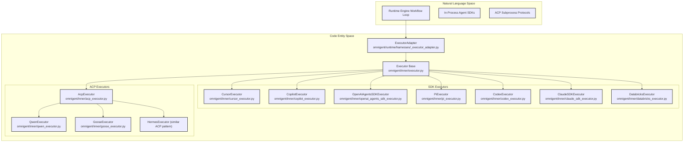
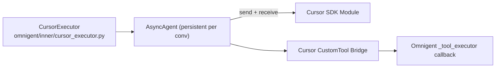
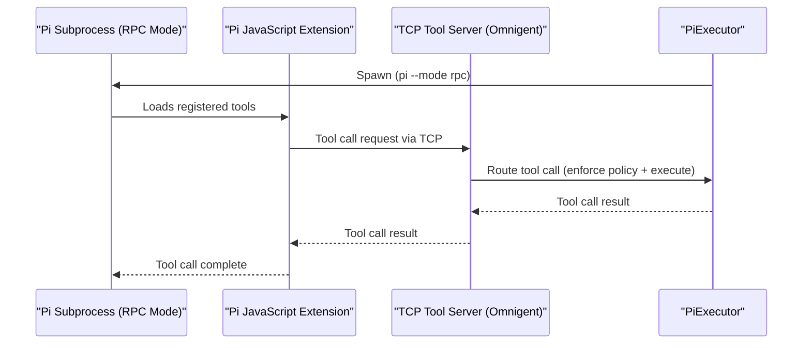
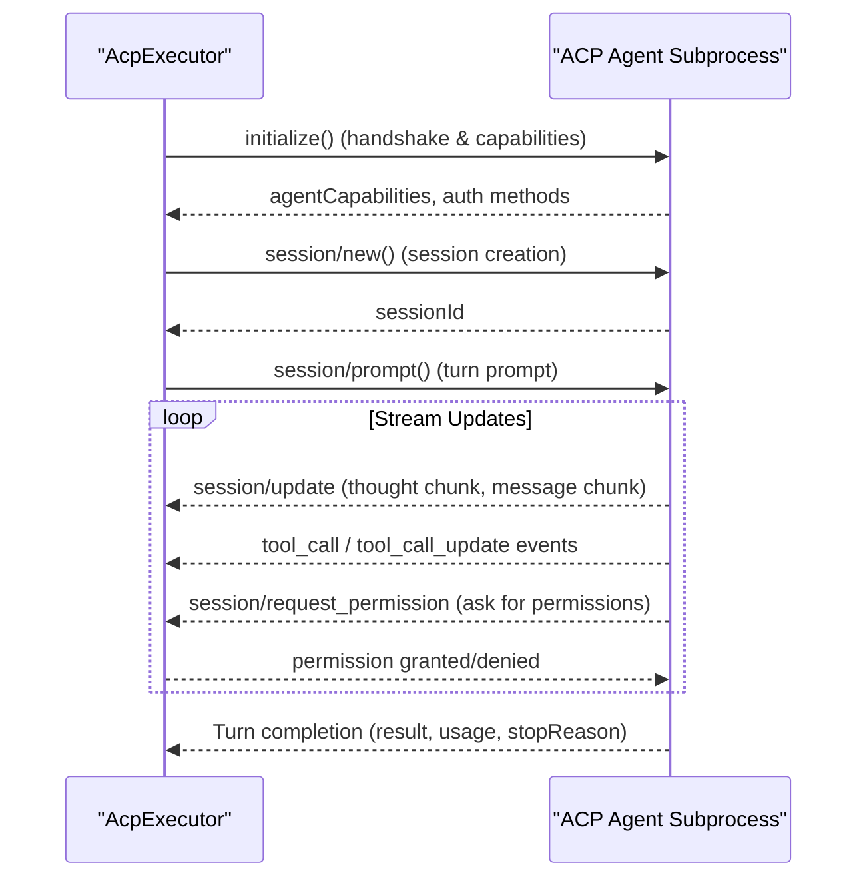
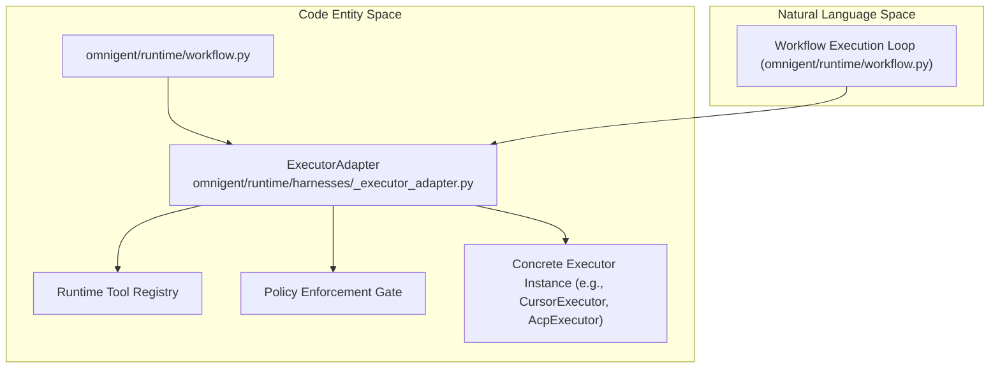

# SDK & ACP Executors

Relevant source files

The following files were used as context for generating this wiki page:

- [docs/QWEN_FOLLOWUPS.md](docs/QWEN_FOLLOWUPS.md)
- [feature-map/harness-acceptance.md](feature-map/harness-acceptance.md)
- [omnigent/harnesses/pi_native/bridge.py](omnigent/harnesses/pi_native/bridge.py)
- [omnigent/harnesses/pi_native/credentials.py](omnigent/harnesses/pi_native/credentials.py)
- [omnigent/inner/acp_executor.py](omnigent/inner/acp_executor.py)
- [omnigent/inner/acp_harness.py](omnigent/inner/acp_harness.py)
- [omnigent/inner/claude_sdk_executor.py](omnigent/inner/claude_sdk_executor.py)
- [omnigent/inner/claude_sdk_harness.py](omnigent/inner/claude_sdk_harness.py)
- [omnigent/inner/codex_executor.py](omnigent/inner/codex_executor.py)
- [omnigent/inner/codex_harness.py](omnigent/inner/codex_harness.py)
- [omnigent/inner/codex_staging.py](omnigent/inner/codex_staging.py)
- [omnigent/inner/codex_worker.py](omnigent/inner/codex_worker.py)
- [omnigent/inner/copilot_executor.py](omnigent/inner/copilot_executor.py)
- [omnigent/inner/copilot_harness.py](omnigent/inner/copilot_harness.py)
- [omnigent/inner/cursor_executor.py](omnigent/inner/cursor_executor.py)
- [omnigent/inner/cursor_harness.py](omnigent/inner/cursor_harness.py)
- [omnigent/inner/cursor_policy_hook.py](omnigent/inner/cursor_policy_hook.py)
- [omnigent/inner/databricks_executor.py](omnigent/inner/databricks_executor.py)
- [omnigent/inner/databricks_token.py](omnigent/inner/databricks_token.py)
- [omnigent/inner/executor.py](omnigent/inner/executor.py)
- [omnigent/inner/goose_executor.py](omnigent/inner/goose_executor.py)
- [omnigent/inner/hermes_policy_hook.py](omnigent/inner/hermes_policy_hook.py)
- [omnigent/inner/openai_agents_sdk_executor.py](omnigent/inner/openai_agents_sdk_executor.py)
- [omnigent/inner/openai_agents_sdk_harness.py](omnigent/inner/openai_agents_sdk_harness.py)
- [omnigent/inner/pi_executor.py](omnigent/inner/pi_executor.py)
- [omnigent/inner/qwen_executor.py](omnigent/inner/qwen_executor.py)
- [omnigent/models/pi_model_compatibility.py](omnigent/models/pi_model_compatibility.py)
- [omnigent/onboarding/acp_auth.py](omnigent/onboarding/acp_auth.py)
- [omnigent/onboarding/antigravity_auth.py](omnigent/onboarding/antigravity_auth.py)
- [omnigent/onboarding/copilot_auth.py](omnigent/onboarding/copilot_auth.py)
- [omnigent/onboarding/cursor_auth.py](omnigent/onboarding/cursor_auth.py)
- [omnigent/onboarding/extra_install.py](omnigent/onboarding/extra_install.py)
- [omnigent/pi_prompt.py](omnigent/pi_prompt.py)
- [omnigent/runtime/harnesses/_executor_adapter.py](omnigent/runtime/harnesses/_executor_adapter.py)
- [omnigent/spec/_omnigent_compat.py](omnigent/spec/_omnigent_compat.py)
- [tests/cli/test_login_databricks.py](tests/cli/test_login_databricks.py)
- [tests/codex_parity/README.md](tests/codex_parity/README.md)
- [tests/codex_parity/conftest.py](tests/codex_parity/conftest.py)
- [tests/codex_parity/sidecar/Cargo.lock](tests/codex_parity/sidecar/Cargo.lock)
- [tests/codex_parity/sidecar/Cargo.toml](tests/codex_parity/sidecar/Cargo.toml)
- [tests/codex_parity/sidecar/src/main.rs](tests/codex_parity/sidecar/src/main.rs)
- [tests/codex_parity/test_codex_executor_parity.py](tests/codex_parity/test_codex_executor_parity.py)
- [tests/e2e/_host_login_workspace.py](tests/e2e/_host_login_workspace.py)
- [tests/e2e/omnigent/test_antigravity_lifecycle_e2e.py](tests/e2e/omnigent/test_antigravity_lifecycle_e2e.py)
- [tests/e2e/omnigent/test_antigravity_streaming_e2e.py](tests/e2e/omnigent/test_antigravity_streaming_e2e.py)
- [tests/e2e/omnigent/test_per_harness_antigravity.py](tests/e2e/omnigent/test_per_harness_antigravity.py)
- [tests/e2e/omnigent/test_per_harness_cursor.py](tests/e2e/omnigent/test_per_harness_cursor.py)
- [tests/e2e/omnigent/test_pi_retry_session_sync_e2e.py](tests/e2e/omnigent/test_pi_retry_session_sync_e2e.py)
- [tests/e2e/test_codex_gateway_stale_bearer_e2e.py](tests/e2e/test_codex_gateway_stale_bearer_e2e.py)
- [tests/e2e/test_host_auth_prefers_user_over_m2m_sp_e2e.py](tests/e2e/test_host_auth_prefers_user_over_m2m_sp_e2e.py)
- [tests/e2e/test_host_inline_login.py](tests/e2e/test_host_inline_login.py)
- [tests/e2e/test_pi_native_cli_version_floor_e2e.py](tests/e2e/test_pi_native_cli_version_floor_e2e.py)
- [tests/e2e/test_pi_native_cold_resume_model_rewrite_e2e.py](tests/e2e/test_pi_native_cold_resume_model_rewrite_e2e.py)
- [tests/e2e/test_pi_native_model_scope_e2e.py](tests/e2e/test_pi_native_model_scope_e2e.py)
- [tests/e2e/test_pi_native_unmanaged_model.py](tests/e2e/test_pi_native_unmanaged_model.py)
- [tests/e2e_ui/sessions/test_codex_multistep_turn_usage.py](tests/e2e_ui/sessions/test_codex_multistep_turn_usage.py)
- [tests/e2e_ui/sessions/test_kimi_usage_reaches_agent_info.py](tests/e2e_ui/sessions/test_kimi_usage_reaches_agent_info.py)
- [tests/harnesses/pi_native/test_pi_native_credentials.py](tests/harnesses/pi_native/test_pi_native_credentials.py)
- [tests/inner/test_acp_executor.py](tests/inner/test_acp_executor.py)
- [tests/inner/test_acp_executor_timeout_config.py](tests/inner/test_acp_executor_timeout_config.py)
- [tests/inner/test_claude_sdk_executor.py](tests/inner/test_claude_sdk_executor.py)
- [tests/inner/test_claude_sdk_harness.py](tests/inner/test_claude_sdk_harness.py)
- [tests/inner/test_codex_executor.py](tests/inner/test_codex_executor.py)
- [tests/inner/test_codex_harness.py](tests/inner/test_codex_harness.py)
- [tests/inner/test_codex_worker_containment.py](tests/inner/test_codex_worker_containment.py)
- [tests/inner/test_copilot_executor.py](tests/inner/test_copilot_executor.py)
- [tests/inner/test_cursor_executor.py](tests/inner/test_cursor_executor.py)
- [tests/inner/test_databricks_auth_command.py](tests/inner/test_databricks_auth_command.py)
- [tests/inner/test_databricks_executor.py](tests/inner/test_databricks_executor.py)
- [tests/inner/test_goose_executor.py](tests/inner/test_goose_executor.py)
- [tests/inner/test_hermes_policy_hook.py](tests/inner/test_hermes_policy_hook.py)
- [tests/inner/test_openai_agents_sdk_executor.py](tests/inner/test_openai_agents_sdk_executor.py)
- [tests/inner/test_openai_agents_sdk_harness.py](tests/inner/test_openai_agents_sdk_harness.py)
- [tests/inner/test_pi_executor.py](tests/inner/test_pi_executor.py)
- [tests/inner/test_qwen_executor.py](tests/inner/test_qwen_executor.py)
- [tests/onboarding/test_acp_auth.py](tests/onboarding/test_acp_auth.py)
- [tests/onboarding/test_antigravity_auth.py](tests/onboarding/test_antigravity_auth.py)
- [tests/onboarding/test_copilot_auth.py](tests/onboarding/test_copilot_auth.py)
- [tests/onboarding/test_cursor_auth.py](tests/onboarding/test_cursor_auth.py)
- [tests/onboarding/test_extra_install.py](tests/onboarding/test_extra_install.py)
- [tests/runtime/harnesses/test_executor_adapter.py](tests/runtime/harnesses/test_executor_adapter.py)
- [tests/runtime/test_acp_spawn_env.py](tests/runtime/test_acp_spawn_env.py)
- [tests/runtime/test_antigravity_spawn_env.py](tests/runtime/test_antigravity_spawn_env.py)
- [tests/runtime/test_claude_sdk_spawn_env.py](tests/runtime/test_claude_sdk_spawn_env.py)
- [tests/runtime/test_copilot_spawn_env.py](tests/runtime/test_copilot_spawn_env.py)
- [tests/runtime/test_cursor_spawn_env.py](tests/runtime/test_cursor_spawn_env.py)
- [tests/spec/test_load.py](tests/spec/test_load.py)
- [tests/spec/test_pi_context_files.py](tests/spec/test_pi_context_files.py)
- [tests/test_goose_executor_interrupt.py](tests/test_goose_executor_interrupt.py)
- [tests/test_pi_model_compatibility.py](tests/test_pi_model_compatibility.py)
- [tests/test_qwen_native_bridge.py](tests/test_qwen_native_bridge.py)
- [tests/test_server_url.py](tests/test_server_url.py)

This page details the implementation of Omnigent's in-process SDK executors (Claude SDK, OpenAI Agents SDK, Databricks, Copilot, Cursor, Pi, Codex) and Agent Client Protocol (ACP) executors (Qwen, Goose, Hermes, and the generic `AcpExecutor`). It also covers the `ExecutorAdapter` wrapping layer that bridges these diverse agent runtimes into Omnigent's core runtime engine.

---

## 1. Executor Abstraction & Architecture

Omnigent models diverse agent interaction modes behind a unified `Executor` interface defined in `[omnigent/inner/executor.py]()`. Each executor manages the lifecycle of a conversational turn, streams output incrementally (text, reasoning, tool calls), coordinates tool dispatch, and enforces policies.

*Figure 1: Architecture bridging the runtime engine to SDK and ACP executors.*

**Notes:**
- The `ExecutorAdapter` normalizes interface differences across executors.
- SDK executors run agent SDKs locally (e.g., Cursor, Copilot), often embedding tool bridges.
- ACP executors talk over JSON-RPC subprocess protocols to heterogeneous external agents.

Sources:  
`[omnigent/inner/executor.py:89-105]()`  
`[omnigent/runtime/harnesses/_executor_adapter.py:20-87]()`  
`[omnigent/inner/cursor_executor.py:1-174]()`  
`[omnigent/inner/copilot_executor.py:1-145]()`  
`[omnigent/inner/pi_executor.py:1-192]()`  
`[omnigent/inner/codex_executor.py:1-180]()`  
`[omnigent/inner/claude_sdk_executor.py:1-163]()`  
`[omnigent/inner/databricks_executor.py:1-100]()`  
`[omnigent/inner/acp_executor.py:1-154]()`  
`[omnigent/inner/qwen_executor.py:1-~]()`  
`[omnigent/inner/goose_executor.py:1-~]()`  

---

## 2. In-Process SDK Executors

SDK executors instantiate and manage agent SDK clients locally, running agent loops in-process or via local bridges. They expose Omnigent-declared tools into the SDKs’ native function-calling mechanisms, enabling native in-process tool calls that respect Omnigent's policy and tooling systems.

### 2.1 Cursor Executor (`CursorExecutor`)

- **Location:** `[omnigent/inner/cursor_executor.py]()`
- **Function:** Drives Cursor via the `cursor-sdk` Python package.
- **Session Management:** Maintains one persistent `AsyncAgent` per Omnigent conversation, reusing it across turns.
- **Tool Bridging:** Each spec-declared `ToolSpec` is bridged as a `cursor_sdk.CustomTool` whose `execute` callback calls back into Omnigent's `_tool_executor`. Callbacks use `asyncio.run_coroutine_threadsafe` to hop into the main event loop.
- **Model Resolution:** `_resolve_model` maps gateway or Databricks-suffixed model IDs to Cursor-recognized IDs. The SDK requires an explicit model; non-Cursor model names fallback to `"auto-smart"` [omnigent/inner/cursor_executor.py:140-164]().

*Figure 2: CursorExecutor's in-process SDK integration and tool callback bridging.*

Sources:  
`[omnigent/inner/cursor_executor.py:3-174]()`  
`[tests/inner/test_cursor_executor.py:1-181]()`  

---

### 2.2 Copilot Executor (`CopilotExecutor`)

- **Location:** `[omnigent/inner/copilot_executor.py]()`
- **Function:** Runs GitHub Copilot agents using the `github-copilot-sdk` Python package.
- **Event Stream:** Translates streamed `copilot.SessionEvent` objects (assistant text, reasoning, tool calls) into Omnigent `ExecutorEvent`s.
- **Tool Bridging:** Similar bridging pattern exposing `ToolSpec` as `copilot.Tool` with async `handler` routing to `_tool_executor`.
- **Policy Enforcement for Native Tools:** Implements a two-stage gating when native Copilot tools invoke permissions:
  1. If policy denies, the tool call is rejected immediately—but the agent keeps running.
  2. Otherwise, user elicitation occurs via the web-UI approval card with a default allowance if elicitation is unavailable.
- **Model Resolution:** `_resolve_model` strips Databricks or non-Copilot IDs, falling back to Copilot's own auto-select.

Sources:  
`[omnigent/inner/copilot_executor.py:1-145]()`  
`[tests/inner/test_copilot_executor.py:1-76]()`  

---

### 2.3 OpenAI Agents SDK Executor (`OpenAIAgentsSDKExecutor`)

- **Location:** `[omnigent/inner/openai_agents_sdk_executor.py]()`
- **Function:** Interfaces with the OpenAI Agents SDK; manages conversation state locally.
- **Content Handling:** Supports decoding inline `data:` URI text uploads into expanded blocks for input to the agent.
- Implements a persistent state per turn and maps SDK message events into Omnigent events for rendering and tool execution.

Sources:  
`[omnigent/inner/openai_agents_sdk_executor.py:1-180]()`  

---

### 2.4 Pi Executor (`PiExecutor`)

- **Location:** `[omnigent/inner/pi_executor.py]()`
- **Function:** Runs the Pi coding agent in RPC mode (`pi --mode rpc`) as a subprocess communicating via JSONL over stdin/stdout.
- **Tool Bridge:** Omnigent tools are exposed to Pi via a dynamically generated JavaScript extension that registers each tool with `pi.registerTool()` [omnigent/inner/pi_executor.py:8-10](). Tool calls proxy over a local TCP socket back to Omnigent.
- **Model Resolution:** Handles Databricks and other provider-specific models and fallback logic [omnigent/inner/pi_executor.py:68-77]().
- **Policy Enforcement:** Policy gates all native tool calls before execution, cancelling the Pi run on denial.

*Figure 3: PiExecutor tool call bridging via TCP socket and JS extension.*

Sources:  
`[omnigent/inner/pi_executor.py:1-192]()`  
`[tests/inner/test_pi_executor.py:1-224]()`  

---

### 2.5 Codex Executor (`CodexExecutor`)

- **Location:** `[omnigent/inner/codex_executor.py]()`
- **Function:** Manages the Codex App Server subprocess, keeping a long-lived session per Omnigent conversation [omnigent/inner/codex_executor.py:3-5]().
- **Subprocess Handling:** Launches and monitors a `codex app-server` subprocess per session, preserving conversation state across turns.
- **Tool Integration:** Omnigent tools are exported to Codex as App Server `dynamicTools`, enabling the Codex client to call Omnigent tools dynamically [omnigent/inner/codex_executor.py:5]().
- **Communication:** Uses a JSONL protocol with enveloped messages for requests, notifications, and streaming responses [omnigent/inner/codex_executor.py:136-139]().
- **Model & Config Overrides:** Supports Databricks gateway authentication and model parameter overrides to integrate managed Codex environments [omnigent/inner/codex_executor.py:44-47]() and `_databricks_codex_config_overrides` [omnigent/inner/codex_executor.py:188-203]().
- **Timeouts and Error Handling:** Includes connection retry logic, certificate failure detection, and subprocess lifecycle management [omnigent/inner/codex_executor.py:49-59]().

Sources:  
`[omnigent/inner/codex_executor.py:1-180]()`  
`[tests/inner/test_codex_executor.py:1-213]()`  

---

### 2.6 Claude SDK Executor (`ClaudeSDKExecutor`)

- **Location:** `[omnigent/inner/claude_sdk_executor.py]()`
- **Function:** Runs agents using the `claude-agent-sdk` Python package [omnigent/inner/claude_sdk_executor.py:3-4]().
- **Tool Bridging:** Omnigent tools are bridged into the SDK session as MCP tools, allowing Claude to call them alongside its built-in capabilities [omnigent/inner/claude_sdk_executor.py:7-8]().
- **Internal Agent Loop:** The SDK manages its own internal agent loop (tool calls, retries, context) [omnigent/inner/claude_sdk_executor.py:10]().
- **Event Translation:** Translates the SDK message stream into Omnigent `ExecutorEvent`s and builds session history from observed tool-use blocks [omnigent/inner/claude_sdk_executor.py:11-12]().
- **Databricks Integration:** Supports Databricks-hosted Claude via native Anthropic Messages API, building `ANTHROPIC_BASE_URL` and `apiKeyHelper` from Databricks credentials [omnigent/inner/claude_sdk_executor.py:22-25]().

Sources:  
`[omnigent/inner/claude_sdk_executor.py:1-163]()`  
`[tests/inner/test_claude_sdk_executor.py:1-193]()`  

---

### 2.7 Databricks Executor (`DatabricksExecutor`)

- **Location:** `[omnigent/inner/databricks_executor.py]()`
- **Function:** Executes agents directly within a Databricks workspace, leveraging Databricks notebooks or jobs.
- **Environment Setup:** Manages the Databricks environment, including credential resolution and workspace configuration.
- **Tool Integration:** Bridges Omnigent tools to be callable within the Databricks execution context.
- **Model Routing:** Handles model routing and authentication through the Databricks AI Gateway.

Sources:  
`[omnigent/inner/databricks_executor.py:1-100]()`  
`[tests/inner/test_databricks_executor.py:1-100]()`  

---

## 3. ACP-Protocol Executors

The **Agent Client Protocol (ACP)** is an open JSON-RPC 2.0 protocol carried over newline-delimited JSON streams on subprocess stdin/stdout (`[omnigent/inner/acp_executor.py]()`). It standardizes bi-directional agent-client communication enabling Omnigent to drive heterogeneous external agents agnostically.

*Figure 4: ACP JSON-RPC interaction lifecycle managed by `AcpExecutor`.*

### 3.1 Generic `AcpExecutor`

- **Location:** `[omnigent/inner/acp_executor.py]()`
- **Function:** Spawns any user-configured ACP agent command with its arguments, handling the standard initialize, session lifecycle, prompt streaming, and permission requests [omnigent/inner/acp_executor.py:15-23]().
- **Session ID Modes:** Supports two modes configuring session ID assignment:
  - `"server"`: agent assigns sessionId (Goose-style) [omnigent/inner/acp_executor.py:18]().
  - `"client"`: Omnigent generates sessionId (Qwen-style) [omnigent/inner/acp_executor.py:19]().
- **Tool Call Handling:** Maps ACP `tool_call` and `tool_call_update` notifications into Omnigent tool call events (`ToolCallRequest`, `ToolCallComplete`), forwarding permissions through policy evaluation and human consent elicitation [omnigent/inner/acp_executor.py:39-42]().
- **Permissions and Interrupts:** Honors agent-initiated `session/request_permission` requests and implements turn cancellation via `session/cancel` notifications [omnigent/inner/acp_executor.py:42-43]().

### 3.2 Vendor-Specific ACP Executors

- **`QwenExecutor`** and **`GooseExecutor`** specialize the generic `AcpExecutor`:
  - Preconfigure command-line flags, environment variables, and session modes suited for their respective agents.
  - Share identical core ACP transport and event translation logic.
- **`HermesExecutor`** follows the same ACP pattern for Hermes agents.

Sources:  
`[omnigent/inner/acp_executor.py:1-154]()`  
`[omnigent/inner/qwen_executor.py:1-~]()`  
`[omnigent/inner/goose_executor.py:1-~]()`  

---

## 4. ExecutorAdapter Wrapping

The `ExecutorAdapter`, implemented in `[omnigent/runtime/harnesses/_executor_adapter.py]()`, is the abstraction layer between the Omnigent runtime engine workflow (`[omnigent/runtime/workflow.py]()`) and concrete executors. It performs:

- Configuration normalization (runs with sanitized and enriched specs).
- Credential injection and environment setup.
- Tool callback binding and policy enforcement bridging.
- Token usage observation and telemetry reporting.
- Error normalization and retry policy interpretation.
- Turn timing, streaming adaptations, and cancelation forwarding.

*Figure 5: The ExecutorAdapter normalizes and delegates turn execution.*

Sources:  
`[omnigent/runtime/harnesses/_executor_adapter.py:20-87]()`  
`[omnigent/runtime/workflow.py:90-160]()`  

---

## 5. Tool Bridging & Policy Enforcement

All SDK and ACP executors share a unified model for tools and policy:

- **Tool Registration:** Spec-declared tools (`ToolSpec`) are either:
  - Exposed directly as in-process callable hooks (in SDK executors).
  - Exported via dynamically generated MCP servers (`[omnigent/inner/_acp_omnigent_mcp.py]()`) to ACP agents.
- **Policy Gates:** Native or bridged tool invocations flow through Omnigent's policy evaluation pipeline, enforcing budgets, risk assessments, CEL policy scripts, and enforcing policy verdicts before allowing tool execution.
- **Sub-agent Delegation:** Sub-agent tool calls are also handled within the policy framework (`[omnigent/inner/acp_executor.py]()`, `[omnigent/inner/executor.py]()`) to ensure consistent approval controls.

Sources:  
`[omnigent/inner/acp_executor.py]()`, `[omnigent/inner/_acp_omnigent_mcp.py]()`, `[omnigent/inner/executor.py:89-105]()`  

---

# Summary

This page documents Omnigent's rich support for multiple agent execution modes:

- **SDK Executors:** Run agents inside Python or subprocess bridges while exposing tools in-process with tight policy integration. This includes Cursor, Copilot, Pi, OpenAI Agents SDK, Claude SDK, Codex, and Databricks.
- **ACP Executors:** Generic and vendor-specialized executors speaking the ACP JSON-RPC protocol over subprocess stdio, supporting streaming, tool calls, permission gates, and turn interrupts.
- **ExecutorAdapter:** The funnel normalizing config, environment, tooling, and telemetry to unify heterogeneous executors behind a common runtime engine interface.

Together, these allow Omnigent to uniformly orchestrate agent conversations, tool calls, and policy enforcement across a diverse landscape of LLM-backed agents.

---

# References Summary Table

| Executor                | Key File(s) / Classes                                | Key Features                                         |
|------------------------|-----------------------------------------------------|-----------------------------------------------------|
| CursorExecutor          | `inner/cursor_executor.py`                           | Persistent AsyncAgent, in-process bridged tools via custom_tools, async callbacks |
| CopilotExecutor         | `inner/copilot_executor.py`                          | GitHub Copilot SDK, streamed SessionEvents, native tool policy gating |
| OpenAIAgentsSDKExecutor | `inner/openai_agents_sdk_executor.py`                | OpenAI Agents SDK integration, data URI file decoding |
| PiExecutor              | `inner/pi_executor.py`                               | RPC subprocess with JS extension registering tools, TCP tool server |
| CodexExecutor           | `inner/codex_executor.py`                            | Persistent subprocess, dynamicTools export, Databricks overrides |
| ClaudeSDKExecutor       | `inner/claude_sdk_executor.py`                       | Claude Agent SDK, MCP tool bridging, Databricks gateway support |
| DatabricksExecutor      | `inner/databricks_executor.py`                       | Databricks workspace execution, notebook/job integration |
| AcpExecutor             | `inner/acp_executor.py`                              | Generic JSON-RPC ACP client over stdio, fully streaming with permission handling |
| QwenExecutor, GooseExecutor, HermesExecutor | `inner/qwen_executor.py`, `inner/goose_executor.py`, related | Vendor-tuned ACP protocol executors |

---

This concludes the full technical overview of Omnigent's SDK and ACP executor implementations and their integration within the runtime system.

Sources:  
`[omnigent/inner/cursor_executor.py]()`, `[omnigent/inner/copilot_executor.py]()`, `[omnigent/inner/openai_agents_sdk_executor.py]()`, `[omnigent/inner/pi_executor.py]()`, `[omnigent/inner/codex_executor.py]()`, `[omnigent/inner/claude_sdk_executor.py]()`, `[omnigent/inner/databricks_executor.py]()`, `[omnigent/inner/acp_executor.py]()`, `[omnigent/inner/qwen_executor.py]()`, `[omnigent/inner/goose_executor.py]()`, `[omnigent/runtime/harnesses/_executor_adapter.py]()`, `[omnigent/runtime/workflow.py]()`