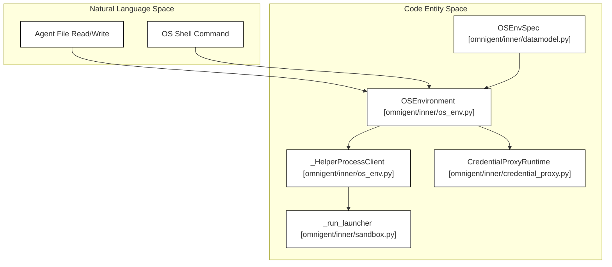
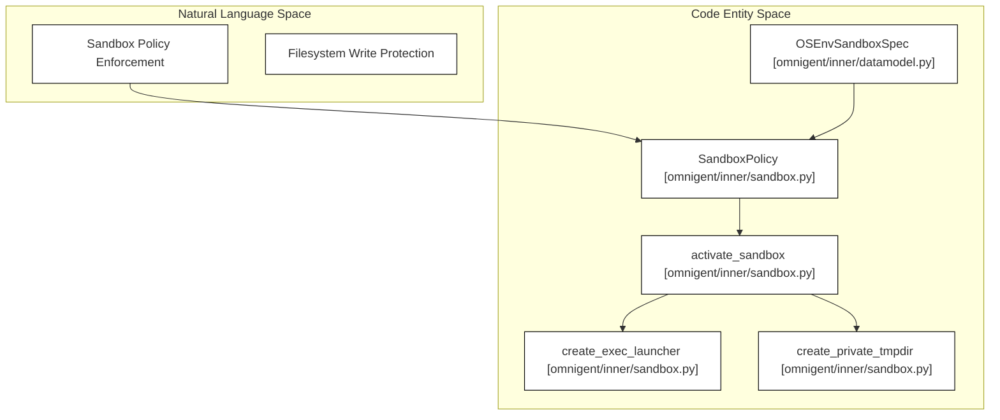
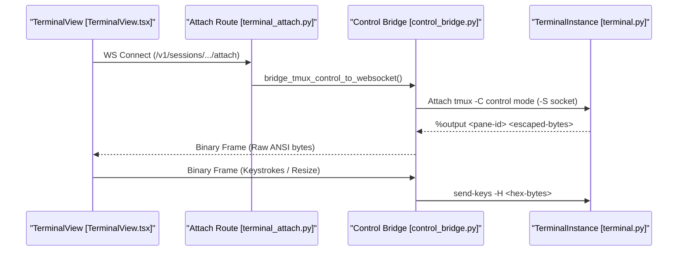

# Sandboxing, OS Environment & Terminals

<details>
<summary>Relevant source files</summary>

The following files were used as context for generating this wiki page:

- [docs/AGENT_YAML_SPEC.md](docs/AGENT_YAML_SPEC.md)
- [docs/terminal-probe-error-capture.md](docs/terminal-probe-error-capture.md)
- [feature-map/README.md](feature-map/README.md)
- [feature-map/composer.md](feature-map/composer.md)
- [feature-map/native-harnesses.md](feature-map/native-harnesses.md)
- [feature-map/sessions.md](feature-map/sessions.md)
- [feature-map/terminals.md](feature-map/terminals.md)
- [omnigent/entities/environment_filesystem.py](omnigent/entities/environment_filesystem.py)
- [omnigent/inner/_cwd_scan.py](omnigent/inner/_cwd_scan.py)
- [omnigent/inner/bwrap_sandbox.py](omnigent/inner/bwrap_sandbox.py)
- [omnigent/inner/datamodel.py](omnigent/inner/datamodel.py)
- [omnigent/inner/loader.py](omnigent/inner/loader.py)
- [omnigent/inner/os_env.py](omnigent/inner/os_env.py)
- [omnigent/inner/sandbox.py](omnigent/inner/sandbox.py)
- [omnigent/inner/seatbelt_sandbox.py](omnigent/inner/seatbelt_sandbox.py)
- [omnigent/inner/terminal.py](omnigent/inner/terminal.py)
- [omnigent/runner/direct_attach.py](omnigent/runner/direct_attach.py)
- [omnigent/runner/resource_registry.py](omnigent/runner/resource_registry.py)
- [omnigent/server/routes/terminal_attach.py](omnigent/server/routes/terminal_attach.py)
- [omnigent/spec/omnigent.py](omnigent/spec/omnigent.py)
- [omnigent/spec/parser.py](omnigent/spec/parser.py)
- [omnigent/spec/types.py](omnigent/spec/types.py)
- [omnigent/terminals/control_bridge.py](omnigent/terminals/control_bridge.py)
- [omnigent/terminals/registry.py](omnigent/terminals/registry.py)
- [tests/browser_ui/chat/test_session_grid.py](tests/browser_ui/chat/test_session_grid.py)
- [tests/e2e/test_codex_native_tmux_scrollback_e2e.py](tests/e2e/test_codex_native_tmux_scrollback_e2e.py)
- [tests/e2e/test_terminal_launch_retry_cleanup_e2e.py](tests/e2e/test_terminal_launch_retry_cleanup_e2e.py)
- [tests/e2e_ui/shells/test_terminal_clipboard_consent.py](tests/e2e_ui/shells/test_terminal_clipboard_consent.py)
- [tests/inner/test_bwrap_sandbox.py](tests/inner/test_bwrap_sandbox.py)
- [tests/inner/test_bwrap_symlink_mask_3265.py](tests/inner/test_bwrap_symlink_mask_3265.py)
- [tests/inner/test_cwd_scan.py](tests/inner/test_cwd_scan.py)
- [tests/inner/test_loader.py](tests/inner/test_loader.py)
- [tests/inner/test_os_env.py](tests/inner/test_os_env.py)
- [tests/inner/test_os_env_grant_reach.py](tests/inner/test_os_env_grant_reach.py)
- [tests/inner/test_os_env_runtime_imports.py](tests/inner/test_os_env_runtime_imports.py)
- [tests/inner/test_sandbox.py](tests/inner/test_sandbox.py)
- [tests/inner/test_seatbelt_sandbox.py](tests/inner/test_seatbelt_sandbox.py)
- [tests/inner/test_terminal.py](tests/inner/test_terminal.py)
- [tests/inner/test_terminal_probe_diagnostics.py](tests/inner/test_terminal_probe_diagnostics.py)
- [tests/resources/examples/agent_with_os_env_bwrap.yaml](tests/resources/examples/agent_with_os_env_bwrap.yaml)
- [tests/resources/examples/agent_with_os_env_seatbelt.yaml](tests/resources/examples/agent_with_os_env_seatbelt.yaml)
- [tests/runner/test_resource_registry.py](tests/runner/test_resource_registry.py)
- [tests/runner/test_session_resources.py](tests/runner/test_session_resources.py)
- [tests/runner/test_terminal_resource_attach_ws.py](tests/runner/test_terminal_resource_attach_ws.py)
- [tests/spec/test_omnigent_adapter.py](tests/spec/test_omnigent_adapter.py)
- [tests/spec/test_parser.py](tests/spec/test_parser.py)
- [tests/terminals/test_control_bridge.py](tests/terminals/test_control_bridge.py)
- [tests/terminals/test_launch_failure_cleanup.py](tests/terminals/test_launch_failure_cleanup.py)
- [tests/terminals/test_registry.py](tests/terminals/test_registry.py)
- [web/src/components/blocks/TerminalSession.test.ts](web/src/components/blocks/TerminalSession.test.ts)
- [web/src/components/blocks/TerminalSession.ts](web/src/components/blocks/TerminalSession.ts)
- [web/src/components/blocks/TerminalView.test.tsx](web/src/components/blocks/TerminalView.test.tsx)
- [web/src/components/blocks/TerminalView.tsx](web/src/components/blocks/TerminalView.tsx)
- [web/src/components/ui/sonner.tsx](web/src/components/ui/sonner.tsx)
- [web/src/components/ui/toast.test.tsx](web/src/components/ui/toast.test.tsx)
- [web/src/grid/GridDropTargets.tsx](web/src/grid/GridDropTargets.tsx)
- [web/src/grid/GridSessionPane.test.tsx](web/src/grid/GridSessionPane.test.tsx)
- [web/src/grid/GridSessionPane.tsx](web/src/grid/GridSessionPane.tsx)
- [web/src/grid/GridSessionsContext.test.tsx](web/src/grid/GridSessionsContext.test.tsx)
- [web/src/grid/GridSessionsContext.tsx](web/src/grid/GridSessionsContext.tsx)
- [web/src/grid/GridWorkspace.tsx](web/src/grid/GridWorkspace.tsx)
- [web/src/grid/gridLayout.test.ts](web/src/grid/gridLayout.test.ts)
- [web/src/grid/gridLayout.ts](web/src/grid/gridLayout.ts)

</details>


## Purpose and Scope

This page documents Omnigent's OS environment containment, sandboxing primitives, network egress filtering, managed tmux terminal lifecycles, and the control-mode WebSocket bridge (`[omnigent/inner/terminal.py]()`, `[omnigent/inner/os_env.py]()`, `[omnigent/inner/sandbox.py]()`, `[omnigent/terminals/control_bridge.py]()`). These layers protect the host system while providing agents and interactive web terminals with high-performance filesystem access, safe subprocess execution, and real-time ANSI terminal streaming.

---

## 1. OS Environment Abstraction & Helper Subprocess

Omnigent abstracts the OS environment via the `OSEnvironment` class [`omnigent/inner/os_env.py:10-160`] and `OSEnvSpec` [`omnigent/inner/datamodel.py:10-160`]. This abstraction runs agent file and shell commands in a managed environment configured with sanitized environment variables, optional containment, and credential proxy injection.



- **`OSEnvironment`** encapsulates filesystem operations and shell execution, managing environment variables and working directory.
- Environment variables are strictly controlled. A whitelist macro `_DEFAULT_ENV_PASSTHROUGH` includes safe POSIX and Windows variables but omits injection vectors like `LD_PRELOAD` or `PYTHONSTARTUP` [`omnigent/inner/os_env.py:83-153`].
- Helpers such as `read()`, `write()`, `edit()`, and `shell()` run via helper subprocesses communicating JSON-RPC requests.
- Credential proxy runtime configurations enable safe injection of secrets when allowed by agent specs.
- The `OSEnvSpec` in the agent YAML defines the desired OS environment, including `env_passthrough` for specific environment variables and `credential_proxy` for credential management [`docs/AGENT_YAML_SPEC.md:48-48`].

Sources: `[omnigent/inner/os_env.py]()`, `[omnigent/inner/datamodel.py]()`, `[docs/AGENT_YAML_SPEC.md]()`

---

## 2. Sandbox Containment: Bubblewrap & Seatbelt

Filesystem and process sandboxing are implemented using platform-native containment tools—Bubblewrap (Linux) and Seatbelt (macOS). This layer applies sandbox policies to child processes to restrict filesystem writes, deny Unix sockets, and dictate allowed network egress [`omnigent/inner/sandbox.py`] based on the `OSEnvSandboxSpec` [`omnigent/inner/datamodel.py:33-33`].



- **`SandboxPolicy`** configures writable and read-only roots and Unix socket restrictions [`omnigent/inner/sandbox.py:49-57`].
- **`activate_sandbox`** chooses the backend and applies the policy to sandboxed commands.
- **`create_exec_launcher`** builds the command line that runs the sandboxed process with mount namespaces or seatbelt profiles.
- Private tmp directories isolate processes and enforce ownership, cleaned up after use.
- The `OSEnvSandboxSpec` allows agents to declare their sandbox requirements, such as `read_roots`, `write_roots`, and `deny_unix_sockets` [`omnigent/inner/datamodel.py:33-33`].

Sources: `[omnigent/inner/sandbox.py]()`, `[omnigent/inner/datamodel.py]()`

---

## 3. Egress Proxy & Network Isolation

Network access from sandboxed environments is mediated by an egress proxy subsystem implemented via HTTP/HTTPS interception to enforce policies on outbound requests [`omnigent/inner/terminal.py:42-43`].

- **`start_egress_proxy`** sets up a local HTTP proxy listener that filters requests.
- **`apply_egress_env`** configures environment variables (e.g., `HTTP_PROXY`) to route all outbound connections through the proxy handle (`EgressProxyHandle`).
- This ensures network activity conforms to runtime policies and action controls.
- The `model_egress` field in `AgentSpec` allows agents to declare specific network egress rules for LLM calls [`tests/spec/test_parser.py:60-69`].

Sources: `[omnigent/inner/terminal.py]()`, `[omnigent/inner/egress/controller.py]()`, `[tests/spec/test_parser.py]()`

---

## 4. Persistent Terminal Management

Omnigent manages persistent terminal sessions using isolated tmux servers with private Unix sockets. Each `TerminalInstance` runs a shell or agent CLI inside a dedicated tmux server instance [`omnigent/inner/terminal.py`].

- **`TerminalInstance`** represents a tmux server encapsulated in a private directory and socket path with tracking of running state [`omnigent/inner/terminal.py:86-90`].
- **Terminal creation** uses `create_terminal_instance` which:
  - Allocates a unique temporary directory (`_TERMINAL_DIR_PREFIX`) for isolation.
  - Records the launching process via an owner-PID file enabling later cleanups of orphaned terminals.
  - Applies tmux server options for scrollback and session persistence [`omnigent/inner/terminal.py:30-170`].

- **Remain-on-exit** option is configured so the tmux pane survives the CLI termination, allowing diagnostic capture of final output without the tmux server dying immediately [`omnigent/inner/terminal.py:154-173`].
- **Idle watcher threads** monitor the terminal's liveness and pane activity to report exit events or inactivity using user-defined callbacks [`omnigent/inner/terminal.py:78-170`].
- Tests validate the idle watcher behavior and pane state retention on exit [`tests/inner/test_terminal.py:78-188`].
- The `TerminalEnvSpec` in the agent YAML allows defining named interactive terminal environments for the agent [`docs/AGENT_YAML_SPEC.md:49-49`].

Sources: `[omnigent/inner/terminal.py]()`, `[tests/inner/test_terminal.py]()`, `[docs/AGENT_YAML_SPEC.md]()`

---

## 5. Tmux Control Bridge & WebSocket Transport

The control bridge connects browser terminal clients to managed tmux sessions using tmux's control mode (`tmux -C`) over WebSocket. This enables real-time streaming of ANSI output and input forwarding [`omnigent/terminals/control_bridge.py`].



- **`bridge_tmux_control_to_websocket`** establishes a control-mode client to tmux, parses `%output` lines, unescapes octal-escaped bytes (`unescape_control_output`), and sends binary frames to the browser.
- Browser keyboard input and resize events are encoded as hexadecimal `send-keys -H` commands and injected into tmux, ensuring lossless transmission of control characters and UTF-8 [`omnigent/terminals/control_bridge.py:69-141`].
- Buffer events like `%paste-buffer-changed` are processed to manage clipboard synchronization.
- The bridge handles lifecycle commands (`%exit`, `%window-close`) and communicates close reasons for clean client disconnects.
- WebSocket close codes include application-specific reasons such as wrong-replica routing (`4400`) and terminal not found (`4404`), enabling robust reconnection logic in the frontend [`web/src/components/blocks/TerminalSession.ts:41-44`].
- Tests cover the correctness of output unescaping, hex send keys chunking, clipboard buffer management, and graceful cancellation on disconnect [`tests/terminals/test_control_bridge.py`].

Sources: `[omnigent/terminals/control_bridge.py]()`, `[omnigent/server/routes/terminal_attach.py]()`, `[tests/terminals/test_control_bridge.py]()`, `[web/src/components/blocks/TerminalSession.ts]()`

---

## 6. Frontend Terminal View & Session

The web UI integrates the managed tmux terminals into a responsive browser experience with the `TerminalSession` pure-JavaScript class and React wrapper component `TerminalView` [`web/src/components/blocks/TerminalSession.ts`] and [`web/src/components/blocks/TerminalView.tsx`].

- **`TerminalSession`** handles raw binary input/output over WebSocket, decodes tmux control events, manages scrollback, and implements features like WebGL acceleration, OSC 52 clipboard syncing, and resize handling. It lives outside React lifecycle for stability.
- **`TerminalView`** is a React component creating and disposing `TerminalSession` instances, synchronizing theme preferences (light/dark terminal palettes), and controlling keyboard focus behavior.
- It includes automatic exponential backoff reconnection schedules (`RECONNECT_BACKOFF_MS`) for resiliency against transient network or server outages.
- Clickable links in terminal output use safe custom handlers (`openTerminalLink`) that open URLs in new tabs or route internal session links client-side without reloading [`web/src/components/blocks/TerminalSession.ts:129-151`].
- File URI click handling enables linking to workspace files relative to the root [`web/src/components/blocks/TerminalSession.ts:105-127`].
- These components allow seamless interactive usage of native agent terminals directly in the browser.

Sources: `[web/src/components/blocks/TerminalSession.ts]()`, `[web/src/components/blocks/TerminalView.tsx]()`, `[web/src/components/blocks/TerminalSession.test.ts]()`

---

# Summary Diagram: Natural Language to Code Entity Mapping

```mermaid
graph TD
    subgraph NaturalLanguage["Natural Language Components"]
        A1["Agent File & Shell Operations"]
        A2["Sandbox Policy Enforcement"]
        A3["Network Egress Filtering"]
        A4["Persistent Terminal Sessions"]
        A5["Terminal WebSocket Bridge"]
        A6["Browser Terminal UI"]
    end
    
    subgraph CodeEntities["Core Code Entities"]
        C1[OSEnvironment<br/>`omnigent/inner/os_env.py`]<br/>OSEnvSpec<br/>`omnigent/inner/datamodel.py`]
        C2[SandboxPolicy / Sandbox Launcher<br/>`omnigent/inner/sandbox.py`]<br/>OSEnvSandboxSpec<br/>`omnigent/inner/datamodel.py`]
        C3[Egress Proxy / Env Injection<br/>`omnigent/inner/terminal.py` & `innner/egress`]<br/>model_egress<br/>`omnigent/spec/types.py`]
        C4[TerminalInstance / tmux Manager<br/>`omnigent/inner/terminal.py`]<br/>TerminalEnvSpec<br/>`omnigent/inner/datamodel.py`]
        C5[Control Bridge / WS handler<br/>`omnigent/terminals/control_bridge.py`]
        C6[TerminalSession / TerminalView UI<br/>`web/src/components/blocks`]
    end

    A1 --> C1
    A2 --> C2
    A3 --> C3
    A4 --> C4
    A5 --> C5
    A6 --> C6
    
    C5 --> C4
    C3 --> C4
    C1 --> C4
    C6 --> C5
```

*Figure 4: Relating high-level Omnigent sandbox, environment, and terminal concepts to core implementation files and classes.*

---

# Key Functions and Classes Reference

| Component | Key Classes/Functions/Constants | Description | Location and Lines |
|---|---|---|---|
| OS Environment Layer | `OSEnvironment` | Manages working directories, environment variables, and helper subprocess invocation. | `omnigent/inner/os_env.py` |
| | `OSEnvSpec` | Agent specification for OS environment configuration. | `omnigent/inner/datamodel.py` |
| | `_DEFAULT_ENV_PASSTHROUGH` | Allowed environment variable names and prefixes. | `omnigent/inner/os_env.py:125-161` |
| | Helper subprocess JSON-RPC protocol (`OpRequest`) | JSON-RPC request/response dict formats for helper subprocesses. | `omnigent/inner/os_env.py:69-77` |
| Sandbox Containment | `SandboxPolicy` | Represents sandbox configuration for write roots and Unix socket denial. | `omnigent/inner/sandbox.py:49-57` |
| | `OSEnvSandboxSpec` | Agent specification for sandbox configuration. | `omnigent/inner/datamodel.py` |
| | `activate_sandbox`, `create_exec_launcher` | Launch sandboxed subprocesses using Bubblewrap or Seatbelt. | `omnigent/inner/sandbox.py` |
| Egress Proxy | `start_egress_proxy`, `apply_egress_env` | Start proxy listener, apply proxy env vars to terminal subprocesses. | `omnigent/inner/terminal.py:42-43` |
| | `model_egress` | Agent specification for allowed network egress rules. | `omnigent/spec/types.py` |
| Terminal Management | `TerminalInstance` | Encapsulates private tmux server instance with socket and directory. | `omnigent/inner/terminal.py:86-154` |
| | `TerminalEnvSpec` | Agent specification for named interactive terminal environments. | `omnigent/inner/datamodel.py` |
| | `create_terminal_instance` | Allocates dedicated tmpdir, sets tmux options, and initializes terminal instance. | `omnigent/inner/terminal.py:70-170` |
| | Terms: `_TERMINAL_DIR_PREFIX`, `_REAP_KILL_TIMEOUT_S`| Prefix for terminal temp dirs; timeout for orphan kill during reap. | `omnigent/inner/terminal.py:86-89` |
| Tmux Control Bridge | `bridge_tmux_control_to_websocket` | Connects tmux -C control mode to a WebSocket for real-time terminal control. | `omnigent/terminals/control_bridge.py`|
| | `unescape_control_output` | Decodes octal-escaped bytes in tmux `%output` frames. | `omnigent/terminals/control_bridge.py:138-141` |
| | `_SEND_KEYS_HEX_BYTES_PER_CALL` | Max bytes of input encoded per single tmux `send-keys -H` call (1024 bytes). | `omnigent/terminals/control_bridge.py:86` |
| Frontend Terminal UI | `TerminalSession` | A pure JS class that manages terminal WebSocket I/O, buffering, and events outside React. | `web/src/components/blocks/TerminalSession.ts` |
| | `TerminalView` | React component providing terminal lifecycle, theming, and reconnection UI. | `web/src/components/blocks/TerminalView.tsx` |
| | `RECONNECT_BACKOFF_MS` | Exponential backoff schedule for terminal WebSocket reconnect attempts. | `web/src/components/blocks/TerminalView.tsx:74-80` |

---

# Data Flow Overview: Terminal and OS Environment Integration

```mermaid
flowchart TD
    A[Agent or User Command] --> B[OSEnvironment]
    B --> C{Sandbox?}
    C -->|No| D[Run Helper Subprocess]
    C -->|Yes| E[Setup Bubblewrap / Seatbelt]
    E --> D

    D --> F[TerminalInstance (tmux server)]
    F --> G[Control Bridge: Pipe output & input]
    G --> H[Browser TerminalSession (xterm.js)]
    H --> I[TerminalView React UI]

    subgraph "Egress Proxy"
        J[Intercept network via Env Proxy]
        D --> J
    end
```

- Commands from agents or users pass through `OSEnvironment` which applies sandbox policies and environment filters.
- The sandbox (if specified) is activated before launching the helper process.
- Terminal sessions run inside `TerminalInstance` tmux servers.
- The `bridge_tmux_control_to_websocket` control bridge enables streaming of terminal output and forwarding of input to/from the browser terminal UI.
- Network egress is filtered via an injected local proxy.

Sources: `[omnigent/inner/terminal.py]()`, `[omnigent/inner/os_env.py]()`, `[omnigent/terminals/control_bridge.py]()`, `[web/src/components/blocks/TerminalSession.ts]()`, `[web/src/components/blocks/TerminalView.tsx]()`

---

# Additional Details

### Terminal Lifecycle and Session Persistence

The terminal instances use tmux features like:

- `remain-on-exit on` option to keep pane contents available after the program inside exits for diagnostics [`omnigent/inner/terminal.py:154-173`].
- Session persistence commands can keep the tmux server alive despite inner pane exit [`omnigent/inner/terminal.py:154-173`].
- Background idle watcher threads detect tmux session disappearance or pane death [`omnigent/inner/terminal.py:78-170`].
- Threaded and async watchers are implemented to monitor tmux server presence and pane liveness [`tests/inner/test_terminal.py:78-188`].
- Diagnostics capture and log terminal exit output truncated by line and character count limits.

### WebSocket Interaction Protocol

- The browser terminal connects to the server's attach route over WebSocket.
- The server attaches to tmux in control mode (`tmux -C`) on the terminal instance's socket.
- Raw terminal output is sent via binary frames, while control and clipboard messages use text JSON frames.
- Input from the browser is encoded as hexadecimal with `send-keys -H` ensuring exact byte fidelity.
- Clipboard integration supports tmux paste buffers and respects local user consent and terminal preferences.
- The bridge handles lifecycle commands including graceful disconnects, and propagates disconnect codes for frontend logic.

---

# References

- **Terminal Environment Core:** `omnigent/inner/terminal.py`
- **OS Environment & Helper Subprocess:** `omnigent/inner/os_env.py`
- **Sandbox Logic:** `omnigent/inner/sandbox.py`
- **Egress Proxy:** `omnigent/inner/egress/controller.py`, parts in `terminal.py`
- **Tmux Control Bridge:** `omnigent/terminals/control_bridge.py`
- **Frontend Terminal UI:** `web/src/components/blocks/TerminalSession.ts`, `TerminalView.tsx`
- **Tests:** `tests/inner/test_terminal.py`, `tests/terminals/test_control_bridge.py`

---

This comprehensive layering from OS environment abstractions through sandboxed persistent terminal processes to browser interactive terminals enables secure, performant, and user-friendly interactivity for agent workflows and developer terminal sessions inside Omnigent.