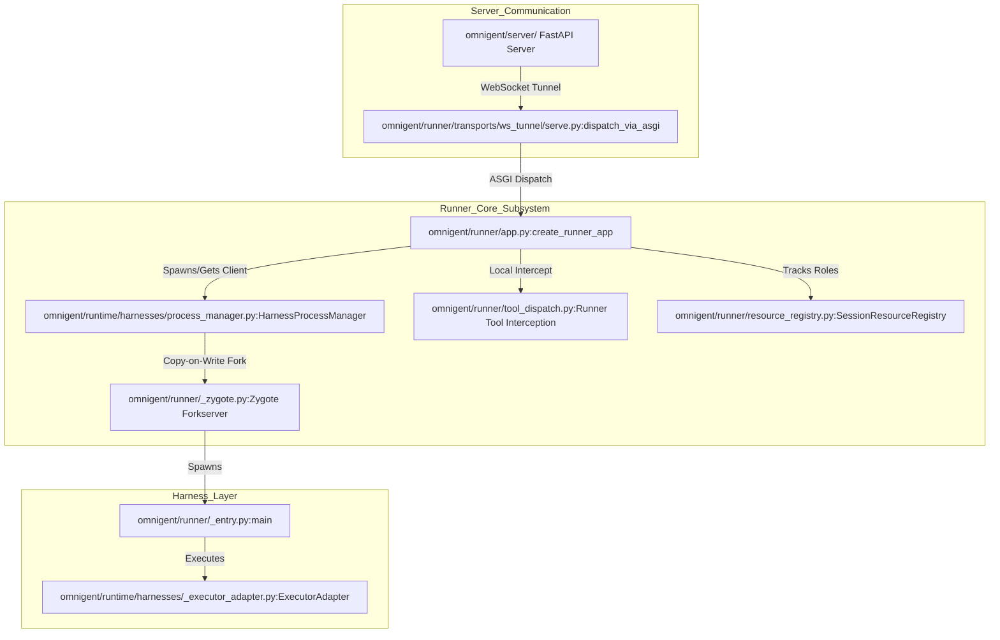
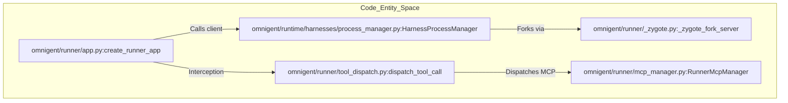

# Runner

Relevant source files

The following files were used as context for generating this wiki page:

- [docs/harness-diagnostics.md](docs/harness-diagnostics.md)
- [docs/images/provider-auth-required.png](docs/images/provider-auth-required.png)
- [docs/tunnel-lifecycle-diagnostics.md](docs/tunnel-lifecycle-diagnostics.md)
- [examples/remy/config.yaml](examples/remy/config.yaml)
- [omnigent/_platform.py](omnigent/_platform.py)
- [omnigent/harnesses/claude_native/failure_telemetry.py](omnigent/harnesses/claude_native/failure_telemetry.py)
- [omnigent/host/runner_zygote.py](omnigent/host/runner_zygote.py)
- [omnigent/inner/_liveness_exec.py](omnigent/inner/_liveness_exec.py)
- [omnigent/inner/_proc.py](omnigent/inner/_proc.py)
- [omnigent/inner/_subprocess_lifecycle.py](omnigent/inner/_subprocess_lifecycle.py)
- [omnigent/inner/model_auth.py](omnigent/inner/model_auth.py)
- [omnigent/native/_native_forwarder_health.py](omnigent/native/_native_forwarder_health.py)
- [omnigent/native/_native_post_delivery.py](omnigent/native/_native_post_delivery.py)
- [omnigent/native/failure_telemetry.py](omnigent/native/failure_telemetry.py)
- [omnigent/onboarding/agent/tools/python/list_builtin_tools.py](omnigent/onboarding/agent/tools/python/list_builtin_tools.py)
- [omnigent/runner/_entry.py](omnigent/runner/_entry.py)
- [omnigent/runner/_zygote.py](omnigent/runner/_zygote.py)
- [omnigent/runner/app.py](omnigent/runner/app.py)
- [omnigent/runner/background_titles/__init__.py](omnigent/runner/background_titles/__init__.py)
- [omnigent/runner/background_titles/claude_native.py](omnigent/runner/background_titles/claude_native.py)
- [omnigent/runner/background_titles/codex_native.py](omnigent/runner/background_titles/codex_native.py)
- [omnigent/runner/background_titles/sdk.py](omnigent/runner/background_titles/sdk.py)
- [omnigent/runner/background_titles/service.py](omnigent/runner/background_titles/service.py)
- [omnigent/runner/identity.py](omnigent/runner/identity.py)
- [omnigent/runner/session_init_protocol.py](omnigent/runner/session_init_protocol.py)
- [omnigent/runner/tool_dispatch.py](omnigent/runner/tool_dispatch.py)
- [omnigent/runner/transports/ws_tunnel/event_delivery.py](omnigent/runner/transports/ws_tunnel/event_delivery.py)
- [omnigent/runner/transports/ws_tunnel/registry.py](omnigent/runner/transports/ws_tunnel/registry.py)
- [omnigent/runner/transports/ws_tunnel/serve.py](omnigent/runner/transports/ws_tunnel/serve.py)
- [omnigent/runner/transports/ws_tunnel/transport.py](omnigent/runner/transports/ws_tunnel/transport.py)
- [omnigent/runtime/prompt.py](omnigent/runtime/prompt.py)
- [omnigent/server/background_session_titles.py](omnigent/server/background_session_titles.py)
- [omnigent/server/child_session_recovery.py](omnigent/server/child_session_recovery.py)
- [omnigent/server/routes/runner_tunnel.py](omnigent/server/routes/runner_tunnel.py)
- [omnigent/server/runner_session_init.py](omnigent/server/runner_session_init.py)
- [omnigent/server/shutdown_state.py](omnigent/server/shutdown_state.py)
- [omnigent/testing/process_reaper.py](omnigent/testing/process_reaper.py)
- [omnigent/tools/builtins/__init__.py](omnigent/tools/builtins/__init__.py)
- [omnigent/tools/builtins/async_inbox.py](omnigent/tools/builtins/async_inbox.py)
- [omnigent/tools/builtins/hindsight.py](omnigent/tools/builtins/hindsight.py)
- [omnigent/tools/builtins/spawn.py](omnigent/tools/builtins/spawn.py)
- [omnigent/tools/manager.py](omnigent/tools/manager.py)
- [tests/e2e/omnigent/test_example_remy.py](tests/e2e/omnigent/test_example_remy.py)
- [tests/e2e/test_claude_native_preflight_delivery_e2e.py](tests/e2e/test_claude_native_preflight_delivery_e2e.py)
- [tests/e2e/test_host_zygote_cwd_e2e.py](tests/e2e/test_host_zygote_cwd_e2e.py)
- [tests/e2e/test_pytest_process_leak_e2e.py](tests/e2e/test_pytest_process_leak_e2e.py)
- [tests/e2e/test_runner_tunnel_mid_turn_reconnect_grace_e2e.py](tests/e2e/test_runner_tunnel_mid_turn_reconnect_grace_e2e.py)
- [tests/e2e/test_subagent_long_handoff_reachable_e2e.py](tests/e2e/test_subagent_long_handoff_reachable_e2e.py)
- [tests/e2e_ui/agents/test_subagent_long_handoff_retrieval.py](tests/e2e_ui/agents/test_subagent_long_handoff_retrieval.py)
- [tests/e2e_ui/chat/test_native_claude_quota_error_in_chat.py](tests/e2e_ui/chat/test_native_claude_quota_error_in_chat.py)
- [tests/e2e_ui/sessions/test_idle_runner_handoff.py](tests/e2e_ui/sessions/test_idle_runner_handoff.py)
- [tests/harnesses/claude_native/forwarder/test_compaction_hooks.py](tests/harnesses/claude_native/forwarder/test_compaction_hooks.py)
- [tests/harnesses/claude_native/forwarder/test_failure_telemetry.py](tests/harnesses/claude_native/forwarder/test_failure_telemetry.py)
- [tests/harnesses/claude_native/forwarder/test_settlement.py](tests/harnesses/claude_native/forwarder/test_settlement.py)
- [tests/harnesses/claude_native/forwarder/test_status.py](tests/harnesses/claude_native/forwarder/test_status.py)
- [tests/harnesses/claude_native/forwarder/test_subagent_delivery.py](tests/harnesses/claude_native/forwarder/test_subagent_delivery.py)
- [tests/harnesses/claude_native/forwarder/test_subagent_status.py](tests/harnesses/claude_native/forwarder/test_subagent_status.py)
- [tests/harnesses/claude_native/forwarder/test_transcript_cursors.py](tests/harnesses/claude_native/forwarder/test_transcript_cursors.py)
- [tests/harnesses/claude_native/forwarder/test_transport.py](tests/harnesses/claude_native/forwarder/test_transport.py)
- [tests/host/test_runner_zygote.py](tests/host/test_runner_zygote.py)
- [tests/inner/test_brokered_auth_abrupt_death.py](tests/inner/test_brokered_auth_abrupt_death.py)
- [tests/inner/test_liveness_exec.py](tests/inner/test_liveness_exec.py)
- [tests/inner/test_model_signer_protocol.py](tests/inner/test_model_signer_protocol.py)
- [tests/inner/test_model_signer_service_units.py](tests/inner/test_model_signer_service_units.py)
- [tests/inner/test_proc_and_platform.py](tests/inner/test_proc_and_platform.py)
- [tests/inner/test_subprocess_lifecycle.py](tests/inner/test_subprocess_lifecycle.py)
- [tests/native/test_failure_telemetry.py](tests/native/test_failure_telemetry.py)
- [tests/onboarding/test_list_builtin_tools.py](tests/onboarding/test_list_builtin_tools.py)
- [tests/runner/test_app_sessions_native_events_lifecycle.py](tests/runner/test_app_sessions_native_events_lifecycle.py)
- [tests/runner/test_background_session_title.py](tests/runner/test_background_session_title.py)
- [tests/runner/test_hindsight_local_dispatch.py](tests/runner/test_hindsight_local_dispatch.py)
- [tests/runner/test_identity.py](tests/runner/test_identity.py)
- [tests/runner/test_native_launch_os_diagnostics.py](tests/runner/test_native_launch_os_diagnostics.py)
- [tests/runner/test_native_terminal_start_error_payload.py](tests/runner/test_native_terminal_start_error_payload.py)
- [tests/runner/test_repop_cost_popup_auth_failure.py](tests/runner/test_repop_cost_popup_auth_failure.py)
- [tests/runner/test_runner_dispatch.py](tests/runner/test_runner_dispatch.py)
- [tests/runner/test_runner_entry.py](tests/runner/test_runner_entry.py)
- [tests/runner/test_suppress_recovery_turn.py](tests/runner/test_suppress_recovery_turn.py)
- [tests/runner/test_terminal_startup_exit.py](tests/runner/test_terminal_startup_exit.py)
- [tests/runner/transports/ws_tunnel/test_event_delivery.py](tests/runner/transports/ws_tunnel/test_event_delivery.py)
- [tests/runner/transports/ws_tunnel/test_registry.py](tests/runner/transports/ws_tunnel/test_registry.py)
- [tests/runner/transports/ws_tunnel/test_serve.py](tests/runner/transports/ws_tunnel/test_serve.py)
- [tests/runner/transports/ws_tunnel/test_serve_extended.py](tests/runner/transports/ws_tunnel/test_serve_extended.py)
- [tests/runner/transports/ws_tunnel/test_transport.py](tests/runner/transports/ws_tunnel/test_transport.py)
- [tests/runtime/test_prompt.py](tests/runtime/test_prompt.py)
- [tests/server/integration/test_runner_reconnect_recovery.py](tests/server/integration/test_runner_reconnect_recovery.py)
- [tests/server/integration/test_runner_tunnel_route.py](tests/server/integration/test_runner_tunnel_route.py)
- [tests/server/integration/test_sessions_external_item_idempotency.py](tests/server/integration/test_sessions_external_item_idempotency.py)
- [tests/server/integration/test_sessions_tunnel_three_layer.py](tests/server/integration/test_sessions_tunnel_three_layer.py)
- [tests/server/routes/test_host_row_offline.py](tests/server/routes/test_host_row_offline.py)
- [tests/server/routes/test_native_failure_output.py](tests/server/routes/test_native_failure_output.py)
- [tests/server/routes/test_sessions_runner_relay.py](tests/server/routes/test_sessions_runner_relay.py)
- [tests/server/routes/test_subagent_status.py](tests/server/routes/test_subagent_status.py)
- [tests/server/test_background_session_titles.py](tests/server/test_background_session_titles.py)
- [tests/server/test_child_session_recovery.py](tests/server/test_child_session_recovery.py)
- [tests/server/test_runner_session_init.py](tests/server/test_runner_session_init.py)
- [tests/server/test_shutdown_state.py](tests/server/test_shutdown_state.py)
- [tests/test_native_attach_client_cleanup.py](tests/test_native_attach_client_cleanup.py)
- [tests/test_native_forwarder_health.py](tests/test_native_forwarder_health.py)
- [tests/test_native_post_delivery.py](tests/test_native_post_delivery.py)
- [tests/testing/test_process_reaper.py](tests/testing/test_process_reaper.py)
- [tests/tools/builtins/test_async_inbox.py](tests/tools/builtins/test_async_inbox.py)
- [tests/tools/builtins/test_hindsight.py](tests/tools/builtins/test_hindsight.py)
- [tests/tools/builtins/test_registry_unified.py](tests/tools/builtins/test_registry_unified.py)
- [tests/tools/builtins/test_spawn.py](tests/tools/builtins/test_spawn.py)
- [tests/tools/builtins/test_sys_session.py](tests/tools/builtins/test_sys_session.py)
- [tests/tools/test_manager.py](tests/tools/test_manager.py)

The `omnigent/runner/` FastAPI application serves as the execution backbone of Omnigent. Its primary responsibility is managing harness subprocesses, executing runner-local tool dispatches, maintaining session resource registries, operating the copy-on-write zygote forkserver, handling WebSocket tunnel transport back to the Omnigent server, and generating non-blocking background session titles.

Sources:
* [omnigent/runner/app.py:1-7]()
* [omnigent/runner/_entry.py:1-7]()

## Architecture and Data Flow

The Runner operates as a FastAPI application launched either standalone via `omnigent/runner/_entry.py` or embedded through in-process adapters. It coordinates the lifecycle of native harnesses (Claude Code, Codex, Cursor, Pi, Qwen, etc.) and SDK executors, acting as an intermediary that bridges server-driven requests to local Unix domain socket (UDS) or TCP-based harness instances.

### Runner Ecosystem and Code Entity Mapping

The following diagram illustrates how natural language architectural concepts map directly to code entities within the `omnigent/runner/` and `omnigent/runtime/` subsystems:

Title: "Runner Architecture and Code Entity Mapping"

Sources:
* [omnigent/runner/app.py:1-7]()
* [omnigent/runner/_entry.py:1-46]()
* [omnigent/runner/_zygote.py:1-41]()
* [omnigent/runner/tool_dispatch.py:1-18]()
* [omnigent/runtime/harnesses/process_manager.py:1-18]()
* [omnigent/runner/transports/ws_tunnel/serve.py:1-12]()

## Key Components and Implementation Details

### Runner FastAPI Application and Entry Point (`app.py` & `_entry.py`)

The runner application is constructed via `create_runner_app` [omnigent/runner/app.py:186-187](). It exposes REST endpoints for session event streaming, background title generation, and health checking. 

When launched via `omnigent/runner/_entry.py`, the runner reads configuration parameters from the environment—such as `RUNNER_SERVER_URL` [omnigent/runner/_entry.py:42-42]() and `OMNIGENT_CONFIG_HOME` [omnigent/runner/_entry.py:47-47]()—and establishes an outbound WebSocket tunnel to the server. It also configures a bounded threadpool (`OMNIGENT_RUNNER_THREADPOOL_MAX_WORKERS`, defaulting to 8) to offload synchronous IPC and terminal operations [omnigent/runner/_entry.py:54-55]().

Sources:
* [omnigent/runner/app.py:1-187]()
* [omnigent/runner/_entry.py:1-67]()

### Harness Process Management (`process_manager.py`)

The `HarnessProcessManager` class in `omnigent/runtime/harnesses/process_manager.py` implements the per-conversation harness subprocess lifecycle [omnigent/runtime/harnesses/process_manager.py:2-8](). 
* **Lazy Spawning**: Subprocesses are spawned lazily upon the first `get_client` call for a conversation ID [omnigent/runtime/harnesses/process_manager.py:4-6]().
* **IPC Isolation**: Each conversation is assigned a dedicated Unix domain socket (POSIX) or loopback TCP listener (Windows) housed within a secure per-instance directory (`_TMP_PARENT`, restricted to `0700` permissions) [omnigent/runtime/harnesses/process_manager.py:55-75]().
* **Idle Reaping & Orphan Sweep**: An idle reaper terminates subprocesses that exceed the timeout defined by `OMNIGENT_HARNESS_IDLE_TIMEOUT_S` (defaulting to 1 hour) [omnigent/runtime/harnesses/process_manager.py:108-118](). An AP-startup orphan sweep inspects the `AP_PID` sentinel file to clean up child processes left behind by previous unexpected crashes [omnigent/runtime/harnesses/process_manager.py:82-90]().

Sources:
* [omnigent/runtime/harnesses/process_manager.py:1-166]()
* [tests/runtime/harnesses/test_process_manager.py:1-143]()

### Runner Zygote and Copy-on-Write Prewarm (`_zygote.py`)

To eliminate the import overhead (`pydantic`, `fastapi`, `httpx`, and internal graph modules) when spawning multiple runner instances, Omnigent implements a copy-on-write forkserver ("zygote") in `omnigent/runner/_zygote.py` [omnigent/runner/_zygote.py:1-9]().
* **Forkserver Protocol**: The zygote imports the runner graph once and listens on an `AF_UNIX` control socket for newline-delimited JSON commands (`ping`, `fork`, `poll`) [omnigent/runner/_zygote.py:14-23]().
* **Memory Efficiency**: On Linux, `os.fork()` leverages copy-on-write pages, reducing memory duplication across concurrent conversation runners [omnigent/runner/_zygote.py:6-9]().
* **Parent-Death Watchdog**: The zygote sets `RUNNER_PARENT_PID` to its own process ID so child runners detect daemon failures and automatically tear themselves down [omnigent/runner/_zygote.py:29-35]().

Sources:
* [omnigent/runner/_zygote.py:1-41]()

### Runner-Local Tool Dispatch (`tool_dispatch.py`)

Per the runner tool dispatch architecture, the runner intercepts and executes specific tool calls locally rather than bouncing them back to the core server [omnigent/runner/tool_dispatch.py:1-8](). Tools are categorized into:
* **OS Environment Tools**: Executed via local `OSEnvironment` instances (`sys_os_*`) [omnigent/runner/tool_dispatch.py:10-10]().
* **REST Tools**: Interfacing with server APIs (`sys_call_async`, `sys_cancel_async`) [omnigent/runner/tool_dispatch.py:11-11]().
* **File & Terminal Tools**: Handling file transfers and runner-local `TerminalRegistry` actions (`sys_terminal_*`, `sys_upload`, `sys_download`) [omnigent/runner/tool_dispatch.py:12-13]().
* **MCP Tools**: Managed via `RunnerMcpManager` and `ProxyMcpManager` [omnigent/runner/tool_dispatch.py:14-16]().

Title: "Tool Dispatch and Process Spawning Code Flow"

Sources:
* [omnigent/runner/tool_dispatch.py:1-18]()
* [omnigent/runner/app.py:1-187]()
* [omnigent/runner/_zygote.py:1-41]()
* [omnigent/runtime/harnesses/process_manager.py:1-166]()

### WebSocket Tunnel Transport (`ws_tunnel/serve.py`)

The runner connects to the Omnigent server via a persistent WebSocket tunnel. The `dispatch_via_asgi` function handles incoming `request` frames from the tunnel and routes them directly into the runner's FastAPI application via ASGI without requiring a local TCP listener loop [omnigent/runner/transports/ws_tunnel/serve.py:1-155](). Responses are framed back using `ResponseHeadFrame`, `ResponseBodyFrame`, and `ResponseEndFrame` [omnigent/runner/transports/ws_tunnel/serve.py:41-44]().

The `serve_tunnel` function [omnigent/runner/transports/ws_tunnel/serve.py:49-50]() manages the WebSocket connection lifecycle, including reconnect logic with exponential backoff and jitter [omnigent/runner/transports/ws_tunnel/serve.py:103-105](). It handles various close codes and HTTP statuses, distinguishing between fatal rejections (e.g., `4001`, `4002`, `4004`, `4500`) [omnigent/runner/transports/ws_tunnel/serve.py:109-109]() and refreshable authentication errors (`401`, `403`) [omnigent/runner/transports/ws_tunnel/serve.py:117-117](). Server-initiated recycles (`1001`, `1012`, `502`) trigger a faster reconnect without escalating backoff [omnigent/runner/transports/ws_tunnel/serve.py:132-133]().

Sources:
* [omnigent/runner/transports/ws_tunnel/serve.py:1-161]()
* [omnigent/runner/transports/ws_tunnel/frames.py:41-44]()

### Background Session Titles (`background_titles/` & `server/background_session_titles.py`)

The runner provides an isolated background title generation service (`/v1/sessions/{session_id}/background-title`) [omnigent/runner/app.py:129-137](). When a new session is initialized, the server requests an automated semantic title by spinning up an isolated, minimal harness subprocess (e.g., using low-effort reasoning tokens and stripped-down tool definitions) to summarize the initial prompt [tests/runner/test_background_session_title.py:107-170]().

Sources:
* [omnigent/runner/background_titles/service.py:1-94]()
* [omnigent/server/background_session_titles.py:1-123]()
* [tests/runner/test_background_session_title.py:107-190]()

## Lifecycle and Inactivity Monitoring

The runner includes an inactivity watchdog (`_run_inactivity_monitor`) governed by `runner.idle_timeout_s` (defaulting to 1 hour) [omnigent/runner/_entry.py:48-49](). If no sessions or requests are active within the window, the watchdog initiates a graceful shutdown, draining in-flight streams and completing WebSocket close handshakes within a bounded grace period (`_GRACEFUL_SHUTDOWN_TUNNEL_TIMEOUT_S`, set to 15s) [omnigent/runner/_entry.py:56-62]().

Sources:
* [omnigent/runner/_entry.py:48-62]()