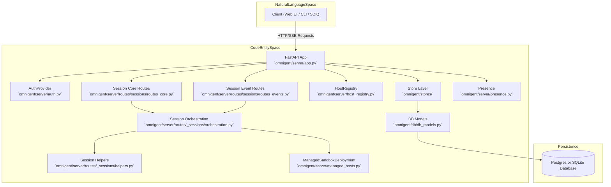
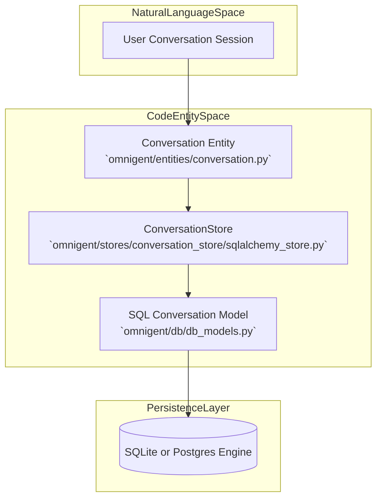

# Server

Relevant source files

The following files were used as context for generating this wiki page:

- [omnigent/server/app.py](omnigent/server/app.py)
- [omnigent/server/routes/_sessions/common.py](omnigent/server/routes/_sessions/common.py)
- [omnigent/server/routes/_sessions/helpers.py](omnigent/server/routes/_sessions/helpers.py)
- [omnigent/server/routes/_sessions/orchestration.py](omnigent/server/routes/_sessions/orchestration.py)
- [omnigent/server/routes/sessions/__init__.py](omnigent/server/routes/sessions/__init__.py)
- [omnigent/server/routes/sessions/routes_core.py](omnigent/server/routes/sessions/routes_core.py)
- [omnigent/server/routes/sessions/routes_events.py](omnigent/server/routes/sessions/routes_events.py)
- [omnigent/server/schemas.py](omnigent/server/schemas.py)
- [openapi.json](openapi.json)
- [tests/server/integration/test_sessions_endpoints.py](tests/server/integration/test_sessions_endpoints.py)
- [tests/server/routes/test_sessions_snapshot.py](tests/server/routes/test_sessions_snapshot.py)
- [tests/server/test_app.py](tests/server/test_app.py)

The `omnigent/server/` FastAPI application serves as the central backend service for Omnigent, orchestrating the lifecycle and interaction of agents, sessions, conversations, user authentication, multi-user account management, managed execution hosts, presence tracking, and data persistence. It acts as the core API gateway that clients (web UI, CLI, SDK) interact with, while coordinating with runner processes and managed hosts to execute agents and workflows [omnigent/server/app.py:1-185](), [omnigent/server/routes/_sessions/orchestration.py:1-197]().

This is a PARENT page. For detailed technical specifics, use the linked child pages:
- [Server REST API Reference](#2.5.1) — Detailed HTTP endpoint definitions covering agents, sessions, conversations, session resources/files, permissions/elicitations, policies, comments, projects, imports, scheduled tasks, and hosts.
- [Database & Stores](#2.5.2) — SQLAlchemy data model definitions, Alembic migrations, and store abstractions for agents, conversations, files, comments, permissions, policies, projects, schedules, and hosts, with Postgres vs SQLite nuances.
- [Hosts, Host Daemon & Managed Sandboxes](#2.5.3) — Host daemon lifecycle, host WebSocket tunnel protocol and framing, host registry, REST host routes, local server mode, and managed sandbox provisioning.

---

## Core Responsibilities

The Omnigent server provides a comprehensive API service that handles internal orchestration and persistence by integrating multiple subsystems. Its main roles include:

- **REST API Endpoint Management**  
  Defines and mounts modular FastAPI routers handling a wide array of resources such as agents, sessions, conversations, files, permissions, policies, comments, projects, imports, and scheduled tasks. These routers are wired in the main app entry point at `omnigent/server/app.py` [omnigent/server/app.py:107-122](), [omnigent/server/routes/builtin_agents.py:1-20]().

- **Session Orchestration and Event Pipelines**  
  Sessions represent active conversations or workflows bound to agents. Orchestration involves managing multi-turn exchanges, forwarding inputs to runners (agent executors), handling session lifecycle events, and coordinating native terminal launches or MCP (Multi-Component Protocol) tool invocations. The orchestration logic composes lower-level primitives for persistence and real-time event streaming [omnigent/server/routes/_sessions/orchestration.py:1-197](), [omnigent/server/routes/_sessions/helpers.py:1-191](), [omnigent/server/routes/sessions/routes_events.py:1-200]().

- **Authentication & Account Management**  
  Supports a flexible auth provider setup enabling single-user mode, local account management (with invites and permissions), and external federation via OIDC. Route access is guarded by authentication dependencies, enforcing permission levels such as read, edit, and owner using helper methods [omnigent/server/app.py:81-86](), [omnigent/server/routes/_sessions/orchestration.py:136-139]().

- **Managed Hosts & Sandboxed Execution**  
  Managed hosts represent remote or locally provisioned execution environments that run harness subprocesses delivering agent runtimes. The server manages host onboarding, lifecycle, and runner WebSocket tunnels via the `HostRegistry`. Cloud providers and local daemons can be orchestrated for on-demand sandbox provisioning [omnigent/server/host_registry.py:1-20](), [omnigent/server/managed_hosts.py:1-20]().

- **Presence & Real-Time Collaboration**  
  Tracks connected clients, active sessions, and collaborative interactions in real time. Multiplexes presence data and other collaboration signals (e.g., typing, co-driving) over Server-Sent Events streams, enabling live updates on session state and participant activity [omnigent/server/presence.py:1-20]().

- **Persistence and Database Layer**  
  Uses SQLAlchemy ORM models (in `omnigent/db/db_models.py`) to persist entities such as agents, sessions, conversation items, comments, files, projects, policies, permissions, scheduled tasks, and hosts. Concrete store implementations isolate Postgres and SQLite differences, and are accessed transparently by the server API routes [omnigent/stores/agent_store.py:1-20](), [omnigent/stores/conversation_store.py:1-20]().

---

## Architecture Overview

The server acts as the orchestrator and facade between client requests and the backend execution environment, integrating multiple functional components for authentication, data persistence, and execution management.

Sources:
- [omnigent/server/app.py:1-185]()
- [omnigent/server/auth.py:1-20]()
- [omnigent/server/routes/_sessions/orchestration.py:1-197]()
- [omnigent/server/routes/_sessions/helpers.py:1-191]()
- [omnigent/server/routes/sessions/routes_core.py:1-202]()
- [omnigent/server/routes/sessions/routes_events.py:1-200]()
- [omnigent/server/host_registry.py:1-20]()
- [omnigent/stores/agent_store.py:1-20]()
- [omnigent/stores/conversation_store.py:1-20]()
- [omnigent/db/db_models.py:1-50]()
- [omnigent/server/presence.py:1-20]()
- [omnigent/server/managed_hosts.py:1-20]()

---

## REST API Routes

The server exposes its functionality primarily via REST API endpoints organized as FastAPI routers. These cover:

- Agent and session management (including session lifecycle control and forking) [omnigent/server/routes/sessions/routes_core.py:1-202]()
- Conversation item CRUD and event streaming [omnigent/server/routes/sessions/routes_events.py:1-200]()
- Session file and resource management [openapi.json:41-47]()
- Permission and elicitation handling for guardrails and approval workflows [omnigent/server/routes/_sessions/orchestration.py:89-92]()
- Policy and comment management [omnigent/server/routes/comments.py:1-20](), [omnigent/server/routes/default_policies.py:1-20]()
- Project organization and import workflows [omnigent/server/routes/projects.py:1-20](), [omnigent/server/routes/imports.py:1-20]()
- Scheduled task orchestration [omnigent/server/routes/scheduled_tasks.py:1-20]()
- Host management routes including host daemon interaction and runner lifecycle [omnigent/server/routes/harnesses.py:1-20]()

The routers are instantiated and mounted in the main app (`omnigent/server/app.py`) [omnigent/server/app.py:107-122](). For endpoint request and response details, see the child page [Server REST API Reference](#2.5.1).

Sources:
- [omnigent/server/routes/sessions/routes_core.py:1-202]()
- [omnigent/server/routes/sessions/routes_events.py:1-200]()
- [openapi.json:41-47]()
- [omnigent/server/routes/_sessions/orchestration.py:89-92]()
- [omnigent/server/routes/comments.py:1-20]()
- [omnigent/server/routes/default_policies.py:1-20]()
- [omnigent/server/routes/projects.py:1-20]()
- [omnigent/server/routes/imports.py:1-20]()
- [omnigent/server/routes/scheduled_tasks.py:1-20]()
- [omnigent/server/routes/harnesses.py:1-20]()
- [omnigent/server/app.py:107-122]()

---

## Authentication and Accounts

Authentication is modular and configurable, leveraging the `AuthProvider` abstraction. Modes include:

- **Single-user local mode:** For simplified setups without complex credential management.
- **Built-in local accounts:** Support traditional username/password-based accounts stored in local DB.
- **OIDC federation:** Support for third-party identity providers (e.g., enterprise SSO).

Permission levels (e.g., `LEVEL_READ`, `LEVEL_EDIT`, `LEVEL_OWNER`) are enforced at the route level using helper dependencies like `_require_access` and `_require_access_and_level` [omnigent/server/routes/_sessions/orchestration.py:169-171](), [omnigent/server/routes/sessions/routes_events.py:109-114](). These enforce access controls tightly integrated with user sessions and resource ownership.

For deeper details on auth modes and multi-user management, see [Authentication & Multi-User Setup](#9.4).

Sources:
- [omnigent/server/routes/_sessions/orchestration.py:169-171]()
- [omnigent/server/routes/sessions/routes_events.py:109-114]()

---

## Managed Hosts & Tunnels

The server manages execution hosts which run harness subprocesses that actually execute steps of an agent conversation or workflow:

- **Host daemon lifecycle:** Hosts connect to the server using a standard WebSocket “tunnel” protocol.
- **Host registry:** The server tracks live host connections and available runners [omnigent/server/host_registry.py:1-20]().
- **Managed sandbox provisioning:** Hosts can be dynamically provisioned on cloud sandbox providers and controlled from the server [omnigent/server/managed_hosts.py:1-20]().
- **Runner session binding:** Sessions bind to runners on hosts to execute session turns [omnigent/server/routes/_sessions/orchestration.py:98-99]().

This host management is critical for scaling and isolating agent execution. The `HostRegistry` and `ManagedSandboxDeployment` implementations encapsulate the lifecycle management and connection protocols. For details, see [Hosts, Host Daemon & Managed Sandboxes](#2.5.3).

Sources:
- [omnigent/server/host_registry.py:1-20]()
- [omnigent/server/managed_hosts.py:1-20]()
- [omnigent/server/routes/_sessions/orchestration.py:98-99]()

---

## Presence and Collaboration

The server tracks real-time presence — which users and clients are connected, what sessions they view, and their collaborative activity (e.g., typing indications, co-driving cursors). This presence data is multiplexed with session SSE event streams to provide live updates in client UIs. Presence management is encapsulated in `omnigent/server/presence.py` [omnigent/server/presence.py:1-20]().

Sources:
- [omnigent/server/presence.py:1-20]()

---

## Database Layer

All persistent state is managed via SQLAlchemy ORM models defined in `omnigent/db/db_models.py`, mapping domain entities like:

- Agents and their configurations [openapi.json:51-126]()
- Conversations and hierarchical conversation items (messages, approvals, function calls) [omnigent/entities/conversation.py:1-20]()
- Files and artifacts associated with sessions [omnigent/entities/conversation.py:1-20]()
- Comments and policies for guardrails [openapi.json:5-40]()
- Projects, imports, and scheduled tasks [omnigent/server/routes/projects.py:1-20](), [omnigent/server/routes/imports.py:1-20](), [omnigent/server/routes/scheduled_tasks.py:1-20]()
- Host and runner metadata [omnigent/server/host_registry.py:1-20]()

Stores provide higher-level abstractions encapsulating CRUD and query logic. The stores are implemented per backend (Postgres/SQLite) to optimize for production or local development environments [omnigent/stores/agent_store.py:1-20](), [omnigent/stores/conversation_store.py:1-20]().

Sources:
- [openapi.json:51-126]()
- [omnigent/entities/conversation.py:1-20]()
- [openapi.json:5-40]()
- [omnigent/server/routes/projects.py:1-20]()
- [omnigent/server/routes/imports.py:1-20]()
- [omnigent/server/routes/scheduled_tasks.py:1-20]()
- [omnigent/server/host_registry.py:1-20]()
- [omnigent/stores/agent_store.py:1-20]()
- [omnigent/stores/conversation_store.py:1-20]()
- [omnigent/db/db_models.py:1-50]()
- [omnigent/stores/conversation_store/sqlalchemy_store.py:1-20]()

---

# Links to Child Pages

- **[Server REST API Reference](#2.5.1)**: In-depth HTTP API endpoint definitions and usage for all server routes.
- **[Database & Stores](#2.5.2)**: Complete specs for SQLAlchemy models, Alembic migrations, and store layering.
- **[Hosts, Host Daemon & Managed Sandboxes](#2.5.3)**: Technical details on host connection protocols, management, and sandbox provisioning.

---

Sources:
- [omnigent/server/app.py:1-185]()
- [omnigent/server/routes/_sessions/orchestration.py:1-197]()
- [omnigent/server/routes/_sessions/helpers.py:1-191]()
- [omnigent/server/routes/sessions/routes_events.py:1-200]()
- [omnigent/server/routes/sessions/routes_core.py:1-202]()
- [omnigent/server/schemas.py:1-178]()
- [openapi.json:1-243]()
- [omnigent/server/routes/_sessions/common.py:1-225]()
- [tests/server/integration/test_sessions_endpoints.py:1-187]()
- [tests/server/test_app.py:1-161]()
- [tests/server/routes/test_sessions_snapshot.py:1-198]()