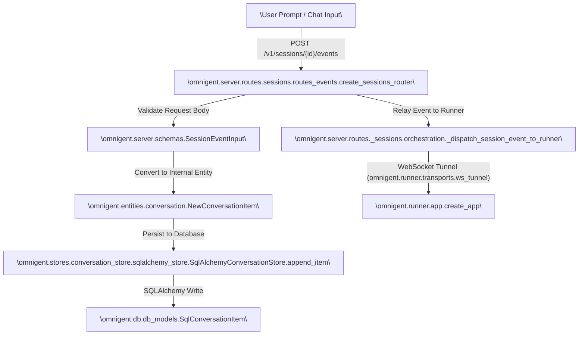
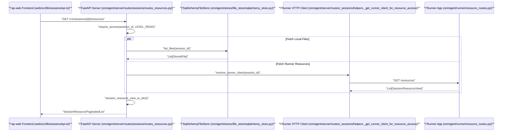

# Server REST API Reference

Relevant source files

The following files were used as context for generating this wiki page:

- [designs/CUSTOM_AGENTS_SETTINGS_UI.md](designs/CUSTOM_AGENTS_SETTINGS_UI.md)
- [designs/PROJECTS_PRD.md](designs/PROJECTS_PRD.md)
- [docs/session-compaction.md](docs/session-compaction.md)
- [feature-map/custom-agents.md](feature-map/custom-agents.md)
- [feature-map/workspace-content-search.md](feature-map/workspace-content-search.md)
- [omnigent/entities/project.py](omnigent/entities/project.py)
- [omnigent/native/input_diagnostics.py](omnigent/native/input_diagnostics.py)
- [omnigent/runner/content_search.py](omnigent/runner/content_search.py)
- [omnigent/runner/environment_filesystem.py](omnigent/runner/environment_filesystem.py)
- [omnigent/runner/resource_routes.py](omnigent/runner/resource_routes.py)
- [omnigent/runtime/pending_inputs.py](omnigent/runtime/pending_inputs.py)
- [omnigent/server/app.py](omnigent/server/app.py)
- [omnigent/server/bundles.py](omnigent/server/bundles.py)
- [omnigent/server/routes/_host_launch.py](omnigent/server/routes/_host_launch.py)
- [omnigent/server/routes/_sessions/common.py](omnigent/server/routes/_sessions/common.py)
- [omnigent/server/routes/_sessions/helpers.py](omnigent/server/routes/_sessions/helpers.py)
- [omnigent/server/routes/_sessions/orchestration.py](omnigent/server/routes/_sessions/orchestration.py)
- [omnigent/server/routes/builtin_agents.py](omnigent/server/routes/builtin_agents.py)
- [omnigent/server/routes/imports.py](omnigent/server/routes/imports.py)
- [omnigent/server/routes/projects.py](omnigent/server/routes/projects.py)
- [omnigent/server/routes/sessions/__init__.py](omnigent/server/routes/sessions/__init__.py)
- [omnigent/server/routes/sessions/routes_core.py](omnigent/server/routes/sessions/routes_core.py)
- [omnigent/server/routes/sessions/routes_events.py](omnigent/server/routes/sessions/routes_events.py)
- [omnigent/server/routes/sessions/routes_resources.py](omnigent/server/routes/sessions/routes_resources.py)
- [omnigent/server/schemas.py](omnigent/server/schemas.py)
- [omnigent/session_import/local.py](omnigent/session_import/local.py)
- [omnigent/session_import/models.py](omnigent/session_import/models.py)
- [omnigent/stores/project_store/__init__.py](omnigent/stores/project_store/__init__.py)
- [omnigent/stores/project_store/sqlalchemy_store.py](omnigent/stores/project_store/sqlalchemy_store.py)
- [omnigent/workspace_fs.py](omnigent/workspace_fs.py)
- [openapi.json](openapi.json)
- [tests/cli/test_import.py](tests/cli/test_import.py)
- [tests/e2e/test_chat_import_e2e.py](tests/e2e/test_chat_import_e2e.py)
- [tests/e2e_ui/sessions/test_custom_agent_edit.py](tests/e2e_ui/sessions/test_custom_agent_edit.py)
- [tests/e2e_ui/sessions/test_import_sessions.py](tests/e2e_ui/sessions/test_import_sessions.py)
- [tests/e2e_ui/sessions/test_project_settings_dialog.py](tests/e2e_ui/sessions/test_project_settings_dialog.py)
- [tests/entities/test_project.py](tests/entities/test_project.py)
- [tests/native/test_input_diagnostics.py](tests/native/test_input_diagnostics.py)
- [tests/runner/test_environment_filesystem.py](tests/runner/test_environment_filesystem.py)
- [tests/runner/test_failure_event_contract.py](tests/runner/test_failure_event_contract.py)
- [tests/runtime/test_pending_inputs.py](tests/runtime/test_pending_inputs.py)
- [tests/runtime/test_pending_shell_inputs.py](tests/runtime/test_pending_shell_inputs.py)
- [tests/server/integration/test_sessions_endpoints.py](tests/server/integration/test_sessions_endpoints.py)
- [tests/server/routes/test_agent_install.py](tests/server/routes/test_agent_install.py)
- [tests/server/routes/test_host_launch.py](tests/server/routes/test_host_launch.py)
- [tests/server/routes/test_imports.py](tests/server/routes/test_imports.py)
- [tests/server/routes/test_native_input_diagnostics.py](tests/server/routes/test_native_input_diagnostics.py)
- [tests/server/routes/test_native_shell_inputs.py](tests/server/routes/test_native_shell_inputs.py)
- [tests/server/routes/test_projects_crud.py](tests/server/routes/test_projects_crud.py)
- [tests/server/routes/test_session_event_batches.py](tests/server/routes/test_session_event_batches.py)
- [tests/server/routes/test_session_resources.py](tests/server/routes/test_session_resources.py)
- [tests/server/routes/test_sessions_snapshot.py](tests/server/routes/test_sessions_snapshot.py)
- [tests/server/routes/test_shell_permission_gate.py](tests/server/routes/test_shell_permission_gate.py)
- [tests/server/test_app.py](tests/server/test_app.py)
- [tests/server/test_bundles.py](tests/server/test_bundles.py)
- [tests/stores/test_project_store.py](tests/stores/test_project_store.py)
- [tests/test_session_import.py](tests/test_session_import.py)
- [tests/test_workspace_fs.py](tests/test_workspace_fs.py)
- [web/src/hooks/useCustomAgents.ts](web/src/hooks/useCustomAgents.ts)
- [web/src/lib/agentsApi.test.ts](web/src/lib/agentsApi.test.ts)
- [web/src/lib/agentsApi.ts](web/src/lib/agentsApi.ts)
- [web/src/lib/projectsApi.test.ts](web/src/lib/projectsApi.test.ts)
- [web/src/lib/projectsApi.ts](web/src/lib/projectsApi.ts)
- [web/src/pages/settings/CustomAgentConfigForm.tsx](web/src/pages/settings/CustomAgentConfigForm.tsx)
- [web/src/pages/settings/SettingsCustomAgentsSection.test.tsx](web/src/pages/settings/SettingsCustomAgentsSection.test.tsx)
- [web/src/pages/settings/SettingsCustomAgentsSection.tsx](web/src/pages/settings/SettingsCustomAgentsSection.tsx)
- [web/src/shell/ContentSearchPanel.test.tsx](web/src/shell/ContentSearchPanel.test.tsx)
- [web/src/shell/ContentSearchPanel.tsx](web/src/shell/ContentSearchPanel.tsx)
- [web/src/shell/ImportSessionsPanel.test.tsx](web/src/shell/ImportSessionsPanel.test.tsx)
- [web/src/shell/ImportSessionsPanel.tsx](web/src/shell/ImportSessionsPanel.tsx)
- [web/src/shell/ProjectSettingsDialog.test.tsx](web/src/shell/ProjectSettingsDialog.test.tsx)
- [web/src/shell/ProjectSettingsDialog.tsx](web/src/shell/ProjectSettingsDialog.tsx)
- [web/src/shell/projectPrefill.test.ts](web/src/shell/projectPrefill.test.ts)
- [web/src/shell/projectPrefill.ts](web/src/shell/projectPrefill.ts)

The Omnigent server (located in `omnigent/server/`) exposes a FastAPI application implementing a comprehensive REST API for interacting with agents, user sessions, conversations, files, resources, permissions, policies, comments, projects, imports, scheduled tasks, and managed hosts. This API powers the `ap-web` frontend, CLI tools, and client SDKs.

---

## Overview of the Server API Architecture

The server application is initialized in `omnigent/server/app.py` [omnigent/server/app.py:17-126](), delegating routing to domain-specific modules:
- **Core Sessions:** `omnigent/server/routes/sessions/routes_core.py` and `routes_events.py` handle lifecycle, events, streaming, and execution [omnigent/server/routes/sessions/routes_core.py:1-25](), [omnigent/server/routes/sessions/routes_events.py:1-20]().
- **Resources & Files:** Managed via session resource handlers and `FileStore` integrations [omnigent/server/app.py:126-143]().
- **Store Abstractions:** `ConversationStore`, `AgentStore`, `CommentStore`, `ProjectStore`, and `ScheduledTaskStore` decouple routing logic from SQLAlchemy models [omnigent/server/app.py:126-143]().
- **Authorization:** Enforced via `require_access` and `require_access_and_level` supporting read, edit, manage, and owner access levels [omnigent/server/routes/_auth_helpers.py:1-112](), [omnigent/server/auth.py:81-125]().

Sources: `omnigent/server/app.py`, `omnigent/server/routes/_auth_helpers.py`, `omnigent/server/routes/sessions/__init__.py`

---

## Agent & Project Management Endpoints

### Agent Endpoints (`/api/agents`)
Agents define the model, harness, tools, and system instructions for sessions.
- `GET /api/agents`: Lists all registered agent bundles via `AgentStore`. Returns paginated summaries including MCP servers and tool specs [openapi.json:51-160]().
- `POST /api/agents`: Uploads or registers a new agent specification bundle.
- `GET /api/agents/{id}`: Retrieves full details of a specific agent.
- `PATCH /api/agents/{id}`: Updates an agent's configuration (description, harness, instructions, model, MCP servers) [openapi.json:127-204]().
- `DELETE /api/agents/{id}`: Deletes a user-defined agent.

### Project Endpoints (`/v1/projects`)
Projects group related sessions via implicit labels (`omni_project`) [omnigent/stores/conversation_store/__init__.py:1-88]().
- `GET /v1/projects`: Lists workspace projects derived from session label metadata.
- `PATCH /v1/projects/{id}`: Renames or updates project groupings.

Sources: `openapi.json`, `omnigent/stores/conversation_store/__init__.py`

---

## Session, Conversation & Event Endpoints

### Session Endpoints (`/v1/sessions`)
Sessions manage the active conversational and execution state bound to an agent [omnigent/server/routes/sessions/__init__.py:3-15]().
- `POST /v1/sessions`: Creates a new session, accepting `agent_id`, `initial_items`, `title`, and `labels` [tests/server/integration/test_sessions_endpoints.py:164-187](). Enforces the persist-before-forward invariant [omnigent/server/routes/sessions/__init__.py:10-14]().
- `GET /v1/sessions`: Lists sessions with cursor-based pagination and filtering options.
- `GET /v1/sessions/{id}`: Retrieves a session snapshot containing current status, usage metadata, and state variables.
- `PATCH /v1/sessions/{id}`: Updates metadata, title, or configuration overrides (such as reasoning effort and model overrides) [omnigent/server/routes/sessions/routes_core.py:1-25]().
- `DELETE /v1/sessions/{id}`: Archives or deletes a session and cleans up associated runner resources.
- `POST /v1/sessions/{id}/fork`: Forks an existing conversation from a specific point, resetting or carrying history based on labels [omnigent/server/routes/sessions/routes_core.py:1-25]().
- `POST /v1/sessions/{id}/switch-agent`: Switches the session's active agent in-place [omnigent/server/routes/sessions/routes_core.py:1-25]().

### Conversation & Event Endpoints
- `GET /v1/conversations/{id}/items`: Fetches paginated conversation items (messages, tool calls, tool outputs, reasoning deltas) using bounded statements [omnigent/server/app.py:126-143]().
- `POST /v1/sessions/{id}/events`: Submits a new user message, tool output, or interrupt event [omnigent/server/routes/sessions/routes_events.py:16-21](). Persists items locally before relaying to the runner over the WebSocket tunnel [omnigent/server/routes/sessions/__init__.py:10-14]().
- `GET /v1/sessions/{id}/stream`: Opens an SSE live event stream for real-time turn feedback [omnigent/server/routes/sessions/routes_events.py:16-21]().

Sources: `omnigent/server/routes/sessions/__init__.py`, `omnigent/server/routes/sessions/routes_events.py`, `omnigent/server/routes/sessions/routes_core.py`

---

## Natural Language to Code Entity Space: Session Event Dispatch

This diagram maps user interactions in Natural Language Space to the precise FastAPI routes, Pydantic schemas, database models, and runner relay mechanisms in Code Entity Space.

Sources: `omnigent/server/routes/sessions/routes_events.py:1-30`, `omnigent/server/schemas.py:1-30`, `omnigent/stores/conversation_store/sqlalchemy_store.py:1-40`, `omnigent/server/routes/_sessions/orchestration.py:1-196`

---

## Session Resources & Files Endpoints

Resources represent files, terminals, and environmental entities associated with a session workspace.
- `GET /v1/sessions/{id}/resources`: Lists unified session resources by merging local `FileStore` records with runner-hosted resource inventories [omnigent/server/routes/sessions/__init__.py:67-68]().
- `POST /v1/sessions/{id}/files`: Uploads files into the session's workspace directory using multipart forms.
- `GET /v1/sessions/{id}/files/{path}`: Downloads or streams the contents of a specific workspace file.
- `DELETE /v1/sessions/{id}/files/{path}`: Deletes a file from the session's workspace.

Sources: `omnigent/server/routes/sessions/__init__.py`, `omnigent/server/app.py`, `omnigent/server/routes/sessions/routes_resources.py`

---

## Natural Language to Code Entity Space: Session Resource Merging

This diagram illustrates how a high-level request for session resources bridges between API client calls, server resource handlers, file stores, and runner HTTP clients.

Sources: `omnigent/server/routes/sessions/__init__.py:67-68`, `omnigent/server/app.py:126-143`, `omnigent/server/routes/sessions/routes_resources.py:1-30`, `omnigent/runner/resource_routes.py:1-30`, `omnigent/server/routes/_sessions/helpers.py:1-191`

---

## Permissions, Elicitations & Policies Endpoints

Policies govern tool executions, cost budgets, and safety boundaries. When a policy emits an `ASK` verdict, an **Elicitation** is created.
- `GET /v1/sessions/{id}/permissions`: Retrieves active session permission rules and trust levels [omnigent/server/routes/sessions/__init__.py:1-188]().
- `POST /v1/sessions/{id}/elicitations/{eid}/resolve`: Submits a human approval decision (allow/deny) for a parked elicitation request [omnigent/server/routes/_sessions/orchestration.py:1-196]().
- `GET /v1/sessions/{id}/policies`: Inspects evaluated guardrail policies and phase constraints [omnigent/server/app.py:100-113]().
- `POST /v1/sessions/{id}/policies`: Adds a new policy to a session.
- `DELETE /v1/sessions/{id}/policies/{policy_id}`: Removes a policy from a session.

Sources: `omnigent/server/routes/_sessions/orchestration.py`, `omnigent/server/routes/sessions/__init__.py`, `omnigent/server/app.py`

---

## Comments & Collaboration Endpoints

Collaborative annotations let users and agents anchor notes to specific file ranges or lines.
- `POST /v1/sessions/{id}/comments`: Adds a new comment anchored to a file path and character range (`start_index`, `end_index`, `anchor_content`) [openapi.json:4-49]().
- `GET /v1/sessions/{id}/comments`: Lists all comments associated with the session workspace.
- `DELETE /v1/sessions/{id}/comments/{comment_id}`: Removes an existing comment.
- `PATCH /v1/sessions/{id}/comments/{comment_id}`: Updates an existing comment.

Sources: `openapi.json`, `omnigent/server/app.py`, `omnigent/server/routes/comments.py`

---

## Scheduled Tasks Endpoints

Scheduled tasks execute agent flows on cron schedules or RRules.
- `POST /v1/scheduled-tasks`: Creates a recurring task bound to an agent and prompt [omnigent/server/app.py:110-143]().
- `GET /v1/scheduled-tasks`: Lists all registered scheduled tasks and their run states.
- `PATCH /v1/scheduled-tasks/{id}`: Modifies schedule expressions or enables/disables execution.
- `DELETE /v1/scheduled-tasks/{id}`: Deletes a scheduled task.

Sources: `omnigent/server/app.py`, `omnigent/stores/scheduled_task_store/__init__.py`, `omnigent/server/routes/scheduled_tasks.py`

---

## Hosts & Imports Endpoints

- `GET /v1/hosts`: Manages registered remote host daemons and managed sandbox pools [omnigent/server/app.py:113-119]().
- `POST /v1/imports`: Imports external CLI coding agent sessions (such as Claude Code or legacy logs) into Omnigent conversation formats [omnigent/server/app.py:106]().
- `GET /v1/imports/{id}`: Retrieves details of a specific import job.
- `DELETE /v1/imports/{id}`: Deletes an import job.

Sources: `omnigent/server/app.py`, `omnigent/server/host_registry.py`, `omnigent/server/routes/imports.py`