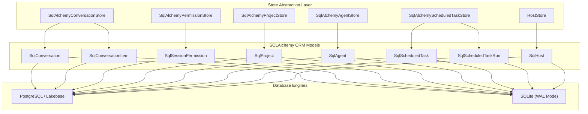
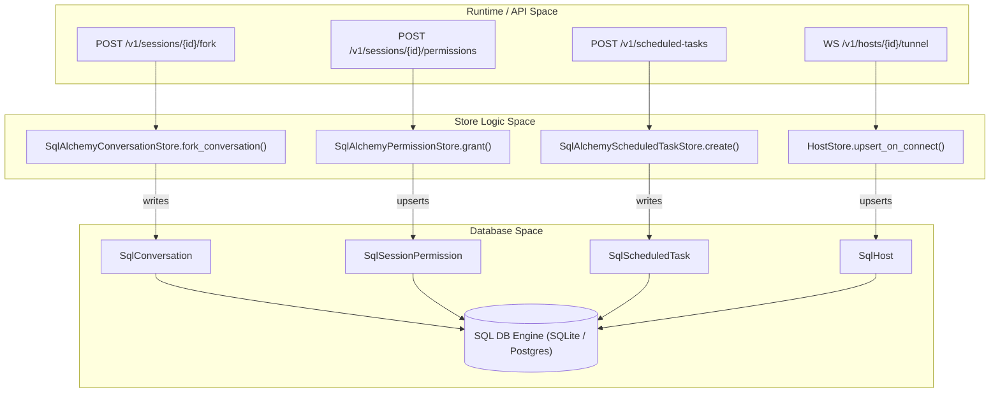

# Database & Stores

<details>
<summary>Relevant source files</summary>

The following files were used as context for generating this wiki page:

- [designs/FEATURE_FLAGS.md](designs/FEATURE_FLAGS.md)
- [designs/REUSABLE_USER_AGENTS.md](designs/REUSABLE_USER_AGENTS.md)
- [docs/AUTOMATIONS.md](docs/AUTOMATIONS.md)
- [omnigent/db/__init__.py](omnigent/db/__init__.py)
- [omnigent/db/converters.py](omnigent/db/converters.py)
- [omnigent/db/db_models.py](omnigent/db/db_models.py)
- [omnigent/db/enum_codecs.py](omnigent/db/enum_codecs.py)
- [omnigent/db/migrations/env.py](omnigent/db/migrations/env.py)
- [omnigent/db/migrations/versions/aa1b2c3d4e5f_split_conversations_to_metadata.py](omnigent/db/migrations/versions/aa1b2c3d4e5f_split_conversations_to_metadata.py)
- [omnigent/db/migrations/versions/bb2c3d4e5f6a_split_agent_configuration_from_conversations.py](omnigent/db/migrations/versions/bb2c3d4e5f6a_split_agent_configuration_from_conversations.py)
- [omnigent/db/migrations/versions/c8e4f2a6b901_add_scheduled_task_dispatch_fields.py](omnigent/db/migrations/versions/c8e4f2a6b901_add_scheduled_task_dispatch_fields.py)
- [omnigent/db/migrations/versions/d4c1b9e6f3a2_policies_scope_index_drop_unique.py](omnigent/db/migrations/versions/d4c1b9e6f3a2_policies_scope_index_drop_unique.py)
- [omnigent/db/migrations/versions/d5e9f1a2b3c4_conversation_search_trgm_indexes.py](omnigent/db/migrations/versions/d5e9f1a2b3c4_conversation_search_trgm_indexes.py)
- [omnigent/db/migrations/versions/e5c8b1f4a2d7_drop_unused_scheduled_tasks_state_index.py](omnigent/db/migrations/versions/e5c8b1f4a2d7_drop_unused_scheduled_tasks_state_index.py)
- [omnigent/db/migrations/versions/f4664ca64ea8_consolidate_scheduled_tasks_user_scope_index.py](omnigent/db/migrations/versions/f4664ca64ea8_consolidate_scheduled_tasks_user_scope_index.py)
- [omnigent/db/migrations/versions/f4a1c8b2d3e6_drop_conversations_timestamp_indexes.py](omnigent/db/migrations/versions/f4a1c8b2d3e6_drop_conversations_timestamp_indexes.py)
- [omnigent/db/migrations/versions/mm1a2b3c4d5e_index_agents_by_owner_created.py](omnigent/db/migrations/versions/mm1a2b3c4d5e_index_agents_by_owner_created.py)
- [omnigent/db/migrations/versions/q1a2b3c4d5e6_add_scope_to_policies.py](omnigent/db/migrations/versions/q1a2b3c4d5e6_add_scope_to_policies.py)
- [omnigent/db/migrations/versions/z5a2b3c4d5e6_drop_partial_indexes.py](omnigent/db/migrations/versions/z5a2b3c4d5e6_drop_partial_indexes.py)
- [omnigent/db/query_context.py](omnigent/db/query_context.py)
- [omnigent/db/utils.py](omnigent/db/utils.py)
- [omnigent/entities/agent.py](omnigent/entities/agent.py)
- [omnigent/entities/policy.py](omnigent/entities/policy.py)
- [omnigent/entities/scheduled_task.py](omnigent/entities/scheduled_task.py)
- [omnigent/server/DBSPEC.md](omnigent/server/DBSPEC.md)
- [omnigent/server/accounts_store.py](omnigent/server/accounts_store.py)
- [omnigent/server/agent_config.py](omnigent/server/agent_config.py)
- [omnigent/server/routes/_auth_helpers.py](omnigent/server/routes/_auth_helpers.py)
- [omnigent/server/routes/scheduled_tasks.py](omnigent/server/routes/scheduled_tasks.py)
- [omnigent/server/routes/session_mcp_servers.py](omnigent/server/routes/session_mcp_servers.py)
- [omnigent/server/routes/sessions/routes_agent.py](omnigent/server/routes/sessions/routes_agent.py)
- [omnigent/server/routes/sessions/routes_permissions.py](omnigent/server/routes/sessions/routes_permissions.py)
- [omnigent/stores/agent_store/__init__.py](omnigent/stores/agent_store/__init__.py)
- [omnigent/stores/agent_store/sqlalchemy_store.py](omnigent/stores/agent_store/sqlalchemy_store.py)
- [omnigent/stores/conversation_store/__init__.py](omnigent/stores/conversation_store/__init__.py)
- [omnigent/stores/conversation_store/sqlalchemy_store.py](omnigent/stores/conversation_store/sqlalchemy_store.py)
- [omnigent/stores/policy_store/sqlalchemy_store.py](omnigent/stores/policy_store/sqlalchemy_store.py)
- [omnigent/stores/scheduled_task_store/__init__.py](omnigent/stores/scheduled_task_store/__init__.py)
- [omnigent/stores/scheduled_task_store/dispatch.py](omnigent/stores/scheduled_task_store/dispatch.py)
- [omnigent/stores/scheduled_task_store/sqlalchemy_store.py](omnigent/stores/scheduled_task_store/sqlalchemy_store.py)
- [tests/db/test_db_models.py](tests/db/test_db_models.py)
- [tests/db/test_enum_codecs.py](tests/db/test_enum_codecs.py)
- [tests/db/test_migration_agents_owner_index.py](tests/db/test_migration_agents_owner_index.py)
- [tests/db/test_migration_agents_session_id.py](tests/db/test_migration_agents_session_id.py)
- [tests/db/test_migration_conversation_search_trgm_indexes.py](tests/db/test_migration_conversation_search_trgm_indexes.py)
- [tests/db/test_migration_drop_conversations_timestamp_indexes.py](tests/db/test_migration_drop_conversations_timestamp_indexes.py)
- [tests/db/test_migration_policy_name_cksum.py](tests/db/test_migration_policy_name_cksum.py)
- [tests/db/test_migration_policy_scope.py](tests/db/test_migration_policy_scope.py)
- [tests/db/test_migration_policy_scope_index.py](tests/db/test_migration_policy_scope_index.py)
- [tests/db/test_migration_scheduled_tasks.py](tests/db/test_migration_scheduled_tasks.py)
- [tests/db/test_migration_title_not_null.py](tests/db/test_migration_title_not_null.py)
- [tests/db/test_migration_unify_user_id.py](tests/db/test_migration_unify_user_id.py)
- [tests/db/test_utils.py](tests/db/test_utils.py)
- [tests/entities/test_policy.py](tests/entities/test_policy.py)
- [tests/server/integration/test_scheduled_tasks_routes.py](tests/server/integration/test_scheduled_tasks_routes.py)
- [tests/server/integration/test_session_agent_owner.py](tests/server/integration/test_session_agent_owner.py)
- [tests/server/integration/test_session_mcp_servers.py](tests/server/integration/test_session_mcp_servers.py)
- [tests/server/routes/test_auth_helpers.py](tests/server/routes/test_auth_helpers.py)
- [tests/server/routes/test_sessions_fork.py](tests/server/routes/test_sessions_fork.py)
- [tests/server/test_account_revocation.py](tests/server/test_account_revocation.py)
- [tests/stores/test_agent_store.py](tests/stores/test_agent_store.py)
- [tests/stores/test_conversation_store.py](tests/stores/test_conversation_store.py)
- [tests/stores/test_conversation_store_split_db.py](tests/stores/test_conversation_store_split_db.py)
- [tests/stores/test_scheduled_task_store.py](tests/stores/test_scheduled_task_store.py)
- [tests/stores/test_session_policy_store.py](tests/stores/test_session_policy_store.py)
- [web/src/lib/scheduledTasksApi.ts](web/src/lib/scheduledTasksApi.ts)

</details>


This section details the database and storage architecture in Omnigent. It covers the core SQLAlchemy models defined in `omnigent/db/db_models.py` [omnigent/db/db_models.py:1-180](), the Alembic database migration system, the modular store abstraction layer managing domain entities across agents, conversations, artifacts, files, comments, permissions, policies, projects, scheduled tasks, and hosts, as well as the configuration distinctions between PostgreSQL (including Databricks Lakebase) and SQLite backend support.

---

## 1. SQLAlchemy Models (`omnigent/db/db_models.py`)

The database schema is defined by SQLAlchemy ORM models centralizing all entities required by the Omnigent server. These models extend two primary shared base classes: `OmnigentBase` for operational data and `ConversationBase` for user-facing chat data [omnigent/db/db_models.py:87-107](). This physical separation allows conversation and chat item data to be hosted on a separate database instance if desired [omnigent/stores/agent_store/sqlalchemy_store.py:63-83]().

### Core Models and Roles

| Class Name | Table Name | Description | Source Reference |
| :--- | :--- | :--- | :--- |
| `SqlAgent` | `agents` | Represents registered agents, distinguishing between `server` and `user` kinds. | [omnigent/db/db_models.py:161-180]() |
| `SqlConversation` | `conversations` | Tracks sessions, including `parent_conversation_id` and `root_conversation_id` for spawn tree tracking. | [omnigent/stores/conversation_store/sqlalchemy_store.py:41-45]() |
| `SqlConversationMetadata` | `omnigent_conversation_metadata` | Stores operational session metadata like `runner_id` pinning, `host_id`, and `external_session_id`. | [omnigent/stores/conversation_store/sqlalchemy_store.py:184-200]() |
| `SqlConversationItem` | `conversation_items` | Individual messages, tool calls, or reasoning blocks, linked via `conversation_id` and ordered by `position`. | [omnigent/stores/conversation_store/sqlalchemy_store.py:41-43]() |
| `SqlFile` | `files` | Metadata for uploaded files tracked by `id` and `filename`. | [omnigent/db/db_models.py:1000-1015]() |
| `SqlUser` | `users` | User accounts, admin status, and argon2id password hashes. | [omnigent/db/db_models.py:1090-1105]() |
| `SqlComment` | `comments` | File-anchored comments used for human-in-the-loop code review. | [omnigent/db/db_models.py:1150-1165]() |
| `SqlPolicy` | `policies` | Guardrail definitions supporting `default` and `session` scopes. | [omnigent/db/db_models.py:1200-1215]() |
| `SqlProject` | `projects` | First-class entity for grouping sessions and carrying owner-private defaults. | [omnigent/db/db_models.py:1250-1265]() |
| `SqlScheduledTask` | `scheduled_tasks` | Defines recurring agent prompts via `rrule`. | [omnigent/db/db_models.py:1300-1315]() |
| `SqlHost` | `hosts` | Persistent storage for host machine registrations and liveness tracking. | [omnigent/db/db_models.py:1400-1415]() |

### Workspace Isolation
Every table includes a `workspace_id` column as the leading member of its composite primary key [omnigent/db/db_models.py:197-215](). The active workspace is managed via a Python `ContextVar` [omnigent/db/db_models.py:124-125]() and the `current_workspace_id()` helper, ensuring multi-tenant isolation without threading identifiers through every function signature [omnigent/db/db_models.py:135-137]().

Sources: [omnigent/db/db_models.py:1-180](), [omnigent/stores/agent_store/sqlalchemy_store.py:63-83]()

---

## 2. Alembic Migrations

Database schema evolution is managed using Alembic (`omnigent/db/migrations/`). Migrations ensure that the database schema stays in sync with SQLAlchemy ORM models across various deployment targets.

- **ID Normalization:** Identifiers are stored as 16 raw bytes (`Uuid16` type) but presented to Python runtime logic as bare 32-character hex strings [omnigent/db/db_models.py:45-85](). Legacy prefixed strings (e.g., `conv_`, `msg_`) are normalized via `uuid_to_bytes` [omnigent/db/db_models.py:74-75]().
- **Item Primary Keys:** Migrations widened the `conversation_items` primary key composite to include `conversation_id`, facilitating efficient partitioning and split-database deployments [omnigent/db/migrations/versions/d5e9f1a2b3c4_conversation_search_trgm_indexes.py:1-10]().
- **Search Optimization:** PostgreSQL deployments utilize `pg_trgm` GIN indexes for efficient text search across `conversation_items` [omnigent/stores/conversation_store/sqlalchemy_store.py:150-161]().

Sources: [omnigent/db/db_models.py:45-85](), [omnigent/db/migrations/versions/d5e9f1a2b3c4_conversation_search_trgm_indexes.py:1-10]()

---

## 3. Store Abstraction Layer

Omnigent structures domain persistence behind a modular set of abstract "Store" classes. This abstraction isolates core application workflows from direct SQL mechanics.

### Store Implementations

| Store Name | Implementation Class | Primary Responsibility | Source Reference |
| :--- | :--- | :--- | :--- |
| **Conversation Store** | `SqlAlchemyConversationStore` | Sessions, items, labels, fork logic, and history tracking. | [omnigent/stores/conversation_store/sqlalchemy_store.py:107-108]() |
| **Agent Store** | `SqlAlchemyAgentStore` | Agent templates, bundles, and session-scoped agent resolution. | [omnigent/stores/agent_store/sqlalchemy_store.py:42-47]() |
| **Permission Store** | `SqlAlchemyPermissionStore` | Multi-user session ACLs and resolve-access caching. | [omnigent/server/routes/sessions/routes_permissions.py:1-10]() |
| **Project Store** | `SqlAlchemyProjectStore` | User projects and stored default session settings. | [omnigent/db/db_models.py:1250-1265]() |
| **Scheduled Task Store** | `SqlAlchemyScheduledTaskStore` | Scheduled tasks, their recurrence rules, and run history. | [omnigent/stores/scheduled_task_store/sqlalchemy_store.py:152-158]() |
| **Host Store** | `HostStore` | Persistent registrations, liveness state, and readiness metadata for hosts. | [omnigent/stores/host_store.py:53-102]() |

### Key Store Operations
- **Forking Logic:** `SqlAlchemyConversationStore.fork_conversation()` handles session branching, dropping ephemeral keys (such as runner pins), and optionally copying item histories [tests/stores/test_conversation_store.py:71-115]().
- **Agent Resolution:** `SqlAlchemyAgentStore._session_id_for_agent()` performs reverse lookups to resolve session-scoped agents to their spawn-tree root conversation ID, securing execution authorization [omnigent/stores/agent_store/sqlalchemy_store.py:89-127]().
- **Scheduled Task Management:** `SqlAlchemyScheduledTaskStore` manages the creation, listing, updating, and execution history of scheduled tasks, including handling `rrule` validation and dispatch cursors [omnigent/stores/scheduled_task_store/sqlalchemy_store.py:190-202]().

Title: Store Architecture and Data Mapping


Sources: [omnigent/stores/conversation_store/sqlalchemy_store.py:107-108](), [omnigent/stores/agent_store/sqlalchemy_store.py:42-47](), [omnigent/stores/scheduled_task_store/sqlalchemy_store.py:152-158]()

---

## 4. PostgreSQL vs SQLite Configuration

Omnigent supports multiple database backends with tailored connection handling in `omnigent/db/utils.py` [omnigent/db/utils.py:1-55]().

- **SQLite WAL Mode:** SQLite engines are instantiated with WAL mode and busy timeouts enabled to support concurrent access across multiple local runner processes [omnigent/db/utils.py:1-55]().
- **Databricks Lakebase & PostgreSQL:** Supports short-lived OAuth token rotation for Databricks Lakebase by installing connection event listeners that mint fresh passwords via the Databricks SDK for every new physical connection [omnigent/db/utils.py:164-168]().
- **Connection Pooling:** Standard PostgreSQL engines apply `pool_pre_ping=True` and a 30-minute pool recycle window (`pool_recycle=1800`), whereas Lakebase deployments lower the recycle interval to 10 minutes (`_LAKEBASE_POOL_RECYCLE_SECONDS = 600`) to prevent credential expiration during idle pooling [omnigent/db/utils.py:75-81]().

Sources: [omnigent/db/utils.py:1-168]()

---

## 5. Natural Language Space to Code Entity Space

### Diagram 1: UI Concepts to Code Entities
This diagram maps high-level user interface concepts to their corresponding Python classes and underlying database tables.

Title: UI Concepts to Code Mapping
```mermaid
graph LR
  subgraph "Natural Language Space"
    Session[""Session (Chat Thread)""]
    Message[""Message (Bubble)""]
    Project[""Project (Sidebar Group)""]
    Permission[""Share (Access Level)""]
    Agent[""Agent (System Prompt/Tools)""]
    ScheduledTask[""Automation (Scheduled Task)""]
    Host[""Connected Host""]
  end

  subgraph "Code Entity Space"
    SqlConv["SqlConversation (Table: conversations)"]
    SqlItem["SqlConversationItem (Table: conversation_items)"]
    SqlProj["SqlProject (Table: projects)"]
    SqlPerm["SqlSessionPermission (Table: session_permissions)"]
    SqlAgent["SqlAgent (Table: agents)"]
    SqlScheduledTask["SqlScheduledTask (Table: scheduled_tasks)"]
    SqlHost["SqlHost (Table: hosts)"]
  end

  Session -->|persisted as| SqlConv
  Message -->|persisted as| SqlItem
  Project -->|persisted as| SqlProj
  Permission -->|persisted as| SqlPerm
  Agent -->|persisted as| SqlAgent
  ScheduledTask -->|persisted as| SqlScheduledTask
  Host -->|persisted as| SqlHost
```

Sources: [omnigent/db/db_models.py:1-180](), [omnigent/entities/scheduled_task.py:24-101]()

---

### Diagram 2: Persistence Data Flow
This diagram illustrates the lifecycle of data moving from REST API entry points through store abstraction handlers down to the underlying database engine.

Title: Data Persistence Flow


Sources: [omnigent/stores/conversation_store/sqlalchemy_store.py:107-108](), [omnigent/server/routes/sessions/routes_permissions.py:1-10](), [omnigent/stores/scheduled_task_store/sqlalchemy_store.py:190-202]()

---

# References

- [omnigent/db/db_models.py:1-180]()
- [omnigent/db/utils.py:1-168]()
- [omnigent/stores/agent_store/sqlalchemy_store.py:42-83]()
- [omnigent/stores/conversation_store/sqlalchemy_store.py:107-108]()
- [omnigent/stores/scheduled_task_store/sqlalchemy_store.py:152-202]()
- [omnigent/entities/scheduled_task.py:24-101]()