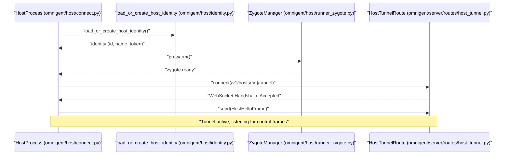
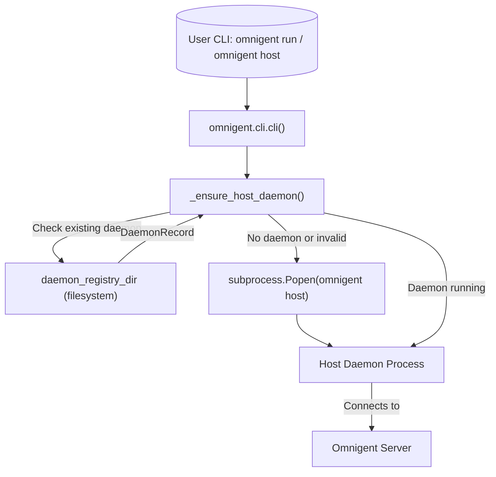
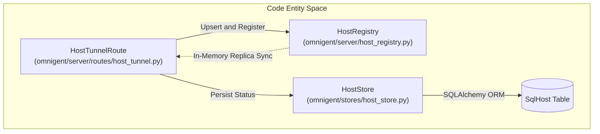
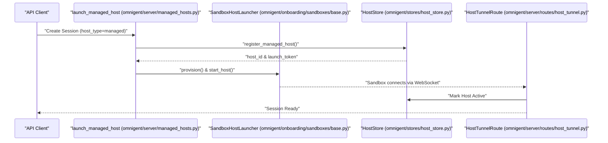

# Hosts, Host Daemon & Managed Sandboxes

Relevant source files

The following files were used as context for generating this wiki page:

- [deploy/README.md](deploy/README.md)
- [deploy/kubernetes/overlays/sandbox-runners/README.md](deploy/kubernetes/overlays/sandbox-runners/README.md)
- [deploy/kubernetes/overlays/sandbox-runners/role.yaml](deploy/kubernetes/overlays/sandbox-runners/role.yaml)
- [deploy/kubernetes/overlays/sandbox-runners/sandbox-config.yaml](deploy/kubernetes/overlays/sandbox-runners/sandbox-config.yaml)
- [docs/extending/sandbox_providers.md](docs/extending/sandbox_providers.md)
- [omnigent/_startup_events.py](omnigent/_startup_events.py)
- [omnigent/cli.py](omnigent/cli.py)
- [omnigent/cli_auth.py](omnigent/cli_auth.py)
- [omnigent/cli_native.py](omnigent/cli_native.py)
- [omnigent/cli_sandbox.py](omnigent/cli_sandbox.py)
- [omnigent/harness_startup_config.py](omnigent/harness_startup_config.py)
- [omnigent/host/__init__.py](omnigent/host/__init__.py)
- [omnigent/host/_daemon_entry.py](omnigent/host/_daemon_entry.py)
- [omnigent/host/connect.py](omnigent/host/connect.py)
- [omnigent/host/daemon_lifecycle.py](omnigent/host/daemon_lifecycle.py)
- [omnigent/host/frames.py](omnigent/host/frames.py)
- [omnigent/host/mcp_tools.py](omnigent/host/mcp_tools.py)
- [omnigent/inner/model_signer.py](omnigent/inner/model_signer.py)
- [omnigent/onboarding/sandboxes/__init__.py](omnigent/onboarding/sandboxes/__init__.py)
- [omnigent/onboarding/sandboxes/base.py](omnigent/onboarding/sandboxes/base.py)
- [omnigent/onboarding/sandboxes/kubernetes.py](omnigent/onboarding/sandboxes/kubernetes.py)
- [omnigent/onboarding/sandboxes/openshell.py](omnigent/onboarding/sandboxes/openshell.py)
- [omnigent/onboarding/sandboxes/registry.py](omnigent/onboarding/sandboxes/registry.py)
- [omnigent/server/host_registry.py](omnigent/server/host_registry.py)
- [omnigent/server/managed_hosts.py](omnigent/server/managed_hosts.py)
- [omnigent/server/routes/host_tunnel.py](omnigent/server/routes/host_tunnel.py)
- [omnigent/server/routes/hosts.py](omnigent/server/routes/hosts.py)
- [tests/cli/test_backend.py](tests/cli/test_backend.py)
- [tests/cli/test_cli.py](tests/cli/test_cli.py)
- [tests/cli/test_cli_auth.py](tests/cli/test_cli_auth.py)
- [tests/cli/test_host_daemon_env.py](tests/cli/test_host_daemon_env.py)
- [tests/conftest.py](tests/conftest.py)
- [tests/e2e/test_openshell_sandbox_create_upload_e2e.py](tests/e2e/test_openshell_sandbox_create_upload_e2e.py)
- [tests/host/test_cli_host.py](tests/host/test_cli_host.py)
- [tests/host/test_connect.py](tests/host/test_connect.py)
- [tests/host/test_daemon_lifecycle.py](tests/host/test_daemon_lifecycle.py)
- [tests/host/test_frames.py](tests/host/test_frames.py)
- [tests/onboarding/sandboxes/test_base.py](tests/onboarding/sandboxes/test_base.py)
- [tests/onboarding/sandboxes/test_kubernetes.py](tests/onboarding/sandboxes/test_kubernetes.py)
- [tests/onboarding/sandboxes/test_openshell.py](tests/onboarding/sandboxes/test_openshell.py)
- [tests/onboarding/sandboxes/test_registry.py](tests/onboarding/sandboxes/test_registry.py)
- [tests/runner/test_native_terminal_interactive.py](tests/runner/test_native_terminal_interactive.py)
- [tests/server/helpers.py](tests/server/helpers.py)
- [tests/server/integration/test_host_session_binding.py](tests/server/integration/test_host_session_binding.py)
- [tests/server/integration/test_host_tunnel_route.py](tests/server/integration/test_host_tunnel_route.py)
- [tests/server/integration/test_session_host_launch.py](tests/server/integration/test_session_host_launch.py)
- [tests/server/test_host_registry.py](tests/server/test_host_registry.py)
- [tests/server/test_managed_hosts.py](tests/server/test_managed_hosts.py)
- [tests/test_harness_startup_config.py](tests/test_harness_startup_config.py)
- [tests/test_startup_events.py](tests/test_startup_events.py)

## Purpose & Scope
This page details the architecture and implementation of Omnigent's host abstraction layer. Hosts represent execution environments—either physical developer machines, remote servers, or server-provisioned cloud sandboxes—where the `omnigent host` daemon runs to spawn and supervise agent runner subprocesses. We examine the host daemon lifecycle, the WebSocket host tunnel protocol and frame definitions, the in-memory host registry, server-side REST routes, local server loopback mode, and server-provisioned managed sandboxes across multiple backend providers.

Sources: [omnigent/host/connect.py:1-35](), [omnigent/server/managed_hosts.py:1-30]()

---

## 1. Host Daemon Lifecycle & Connection Flow

The host daemon is initiated via the CLI command `omnigent host`, managed by the `HostProcess` class in `omnigent/host/connect.py`. Upon startup, the daemon loads or provisions its cryptographic identity (`HostIdentity`), evaluates harness availability, prewarms the runner execution zygote for low-latency process spawning, and opens an outbound WebSocket connection to the Omnigent server.

Diagram: Host Process Startup and Connection Flow

Sources: [omnigent/host/connect.py:1-50](), [omnigent/host/identity.py:1-40](), [omnigent/host/runner_zygote.py:1-30]()

The connection lifecycle incorporates keepalive pings (`PingFrame` / `PongFrame`), periodic quick-probes for installed harness readiness, and graceful exit handlers that terminate active runner subprocesses (`_RunnerHandle`) before closing the WebSocket connection.

Sources: [omnigent/host/connect.py:170-205](), [omnigent/runner/transports/ws_tunnel/frames.py:140-160]()

### Host Daemon Management via CLI
The `omnigent` CLI provides commands to manage the host daemon. The `omnigent host` command starts the daemon, which then connects to the configured Omnigent server. The daemon's lifecycle is managed by `omnigent.cli._ensure_host_daemon` [omnigent/cli.py:102-107](), which handles spawning, reusing, and stopping daemon processes. Daemon records are stored in a registry directory, managed by `omnigent.host.daemon_lifecycle` [omnigent/host/daemon_lifecycle.py:1-30]().

Diagram: CLI Interaction with Host Daemon Lifecycle

Sources: [omnigent/cli.py:71-96](), [omnigent/host/daemon_lifecycle.py:71-96](), [tests/cli/test_backend.py:1-10]()

---

## 2. Host Tunnel WebSocket Protocol & Frames

Communication between the Omnigent server and the host daemon occurs over a dedicated WebSocket tunnel at `/v1/hosts/{host_id}/tunnel`. Unlike runner tunnels which stream conversation sessions and direct tool execution, host tunnels carry purely control-plane messages encapsulated as structured JSON frames.

### Protocol Specification and Versioning
The server enforces strict major version-skew checking using `SUPPORTED_FRAME_PROTOCOL_MAJOR` [omnigent/server/routes/host_tunnel.py:89](). When a host connects, it transmits a `HostHelloFrame` [omnigent/host/frames.py:139]() containing its software version, protocol major version, host name, active live runner IDs, and an inventory of configured harnesses and gateway inference capabilities.

| Frame Kind | Direction | Purpose |
| :--- | :--- | :--- |
| `host.hello` | Host → Server | Initial handshake advertising version, runners, and harness readiness. |
| `host.connection_error` | Host → Server | Reports connection-level errors from the host. |
| `host.harness_readiness` | Host → Server | Dynamic update when harness installations or authentications change. |
| `host.launch_runner` | Server → Host | Command to spawn a new runner subprocess for a session. |
| `host.launch_runner_result` | Host → Server | Response reporting runner process startup status or refusal codes. |
| `host.stop_runner` | Server → Host | Command to terminate an active runner subprocess. |
| `host.stop_runner_result` | Host → Server | Response reporting runner termination status. |
| `host.runner_exited` | Host → Server | Unsolicited notification that a spawned runner died unexpectedly. |
| `host.runner_status` | Server → Host | Request for status of a specific runner. |
| `host.runner_status_result` | Host → Server | Response with runner status. |
| `host.stat` | Server → Host | Request for file system stat information. |
| `host.stat_result` | Host → Server | Response with file system stat information. |
| `host.list_dir` | Server → Host | Request to list directory contents. |
| `host.list_dir_result` | Host → Server | Response with directory contents. |
| `host.create_worktree` | Server → Host | Request to create a Git worktree. |
| `host.create_worktree_result` | Host → Server | Response for Git worktree creation. |
| `host.remove_worktree` | Server → Host | Request to remove a Git worktree. |
| `host.remove_worktree_result` | Host → Server | Response for Git worktree removal. |
| `host.list_worktrees` | Server → Host | Request to list Git worktrees. |
| `host.list_worktrees_result` | Host → Server | Response with list of Git worktrees. |
| `host.create_dir` | Server → Host | Request to create a directory. |
| `host.create_dir_result` | Host → Server | Response for directory creation. |
| `host.install_harness` | Server → Host | Request to install a harness. |
| `host.install_harness_result` | Host → Server | Response for harness installation. |
| `host.refresh_harnesses` | Server → Host | Request to refresh harness configurations. |
| `host.refresh_harnesses_result` | Host → Host | Response for harness refresh. |
| `host.detect_credentials` | Server → Host | Request to detect ambient credentials. |
| `host.detect_credentials_result` | Host → Host | Response with detected credentials. |
| `host.store_secret` | Server → Host | Request to store a secret. |
| `host.store_secret_result` | Host → Host | Response for secret storage. |
| `host.harness_startup` | Server → Host | Request to start a harness. |
| `host.harness_startup_result` | Host → Host | Response for harness startup. |
| `host.model_options` | Server → Host | Request for model options. |
| `host.model_options_result` | Host → Host | Response with model options. |
| `host.mcp_servers` | Server → Host | Request for MCP server information. |
| `host.mcp_servers_result` | Host → Host | Response with MCP server information. |
| `host.mcp_tools` | Server → Host | Request for MCP tool information. |
| `host.mcp_tools_result` | Host → Host | Response with MCP tool information. |
| `host.plugins` | Server → Host | Request for plugin information. |
| `host.plugins_result` | Host → Host | Response with plugin information. |
| `host.skills` | Server → Host | Request for skill information. |
| `host.skills_result` | Host → Host | Response with skill information. |
| `host.skill_content` | Server → Host | Request for skill content. |
| `host.skill_content_result` | Host → Host | Response with skill content. |
| `host.import_local` | Server → Host | Request to import a local session. |
| `host.import_local_by_id` | Server → Host | Request to import a local session by ID. |
| `host.import_local_session_chunk` | Host → Server | Chunk of local session data during import. |
| `host.imported_local_session` | Server → Host | Notification that a local session was imported. |
| `host.import_local_done` | Host → Server | Notification that local session import is complete. |

Sources: [omnigent/host/frames.py:87-163](), [omnigent/server/routes/host_tunnel.py:70-155]()

---

## 3. Host Registry & Database Layer

The server tracks connected hosts via a dual-layer architecture combining an in-memory replica registry (`HostRegistry`) with a persistent database store (`HostStore`).

Diagram: Host Registry and Persistent Store Architecture

Sources: [omnigent/server/routes/host_tunnel.py:60-150](), [omnigent/server/host_registry.py:1-67](), [omnigent/stores/host_store.py:1-50]()

### Host Registry Implementation
`HostRegistry` maintains an active mapping of `HostConnection` instances on the local server replica. It handles connection registration, lookup by host ID, and tracks asynchronous runner exit reports via `RunnerExitReports`. When a host disconnects, the registry marks its connected runners as disconnected and triggers cleanup hooks.

Sources: [omnigent/server/host_registry.py:1-120](), [omnigent/server/routes/host_tunnel.py:77-130]()

---

## 4. REST Host Routes

The server exposes management REST endpoints under `/v1/hosts` implemented in `omnigent/server/routes/hosts.py`. These routes enable clients and operators to:
* List registered hosts and inspect their online/offline presence status.
* Query active runner subprocesses associated with a specific host.
* Trigger remote harness installations (`HostInstallHarnessFrame`) or secret stores (`HostStoreSecretFrame`).
* Initiate managed sandbox provisioning and lifecycle teardown.

Sources: [omnigent/server/routes/hosts.py:1-100](), [omnigent/host/frames.py:112-117]()

---

## 5. Local Server Mode

When running Omnigent in local single-user mode (`omnigent server --local` or via `local_server.py`), the server automatically spins up a local host daemon loopback binding. This bypasses external network handshakes while utilizing the exact same WebSocket tunnel and frame abstractions. It supports single-user privilege elevation and fallback loopback authentication flags (`OMNIGENT_LOCAL_SINGLE_USER`).

The `omnigent.cli.ensure_local_omnigent_server` function [omnigent/cli.py:102]() is responsible for starting and managing the local server process. It checks for an existing healthy local server, starts a new one if needed, and ensures its configuration signature matches the current CLI context.

Sources: [omnigent/host/local_server.py:1-80](), [omnigent/server/routes/host_tunnel.py:119-135](), [omnigent/cli.py:97-108]()

---

## 6. Managed & Server-Provisioned Sandbox Hosts

When a session is created with `host_type="managed"`, Omnigent replaces the external user-operated daemon with a server-provisioned cloud sandbox. The server instantiates a container or microVM, injects a dedicated one-time launch token, and commands the sandbox to run `omnigent host`.

### Sandbox Providers & Launcher Architecture
Managed sandbox providers implement the provider-agnostic `SandboxLauncher` interface in `omnigent/onboarding/sandboxes/base.py`. Supported backends include Modal, Daytona, Kubernetes, E2B, Blaxel, OpenShell, Boxlite, Microsandbox, Islo, and Gensee. The configuration for these providers is parsed from the server's YAML configuration via `omnigent.server.managed_hosts.parse_sandbox_config` [omnigent/server/managed_hosts.py:62]().

Diagram: Managed Sandbox Provisioning Flow

Sources: [omnigent/server/managed_hosts.py:1-55](), [omnigent/onboarding/sandboxes/base.py:1-50](), [omnigent/onboarding/sandboxes/kubernetes.py:1-45]()

### Kubernetes Entrypoint-as-Host Model
The Kubernetes launcher (`omnigent/onboarding/sandboxes/kubernetes.py`) treats the Pod container command directly as `omnigent host`. An init container provisions the workspace (`mkdir` and optional git clone), while a PID-1 supervisor wraps the main host process to ensure graceful termination and child process reaping. Launch tokens and credentials are securely injected via Kubernetes Secrets (`secretKeyRef`) rather than environment command strings.

Sources: [omnigent/onboarding/sandboxes/kubernetes.py:1-50](), [tests/onboarding/sandboxes/test_kubernetes.py:1-97]()