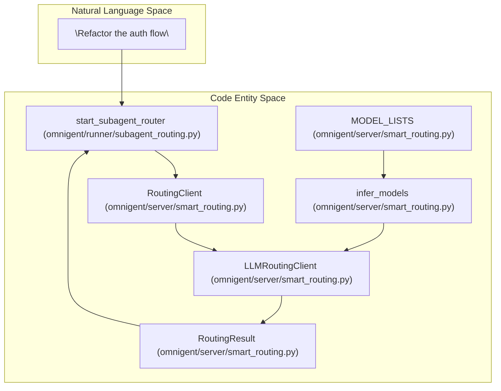
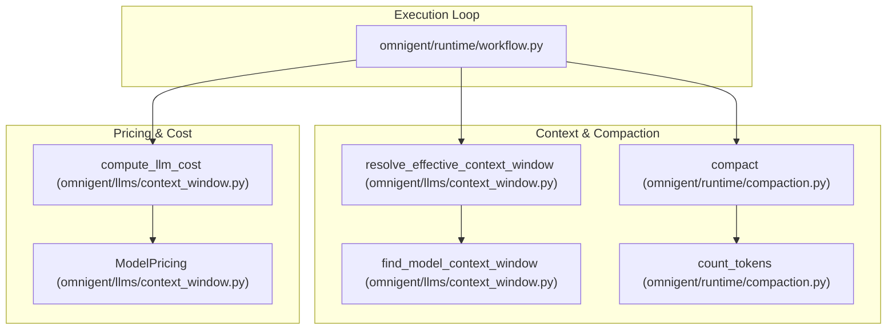

# LLM Client & Model Routing

Relevant source files

The following files were used as context for generating this wiki page:

- [dev/lint/lint_no_hardcoded_models.py](dev/lint/lint_no_hardcoded_models.py)
- [docs/model-hardcoding-plan.md](docs/model-hardcoding-plan.md)
- [omnigent/databricks_ai_gateway.py](omnigent/databricks_ai_gateway.py)
- [omnigent/harnesses/claude_native/main.py](omnigent/harnesses/claude_native/main.py)
- [omnigent/harnesses/opencode_native/bridge.py](omnigent/harnesses/opencode_native/bridge.py)
- [omnigent/harnesses/opencode_native/provider.py](omnigent/harnesses/opencode_native/provider.py)
- [omnigent/inner/antigravity_executor.py](omnigent/inner/antigravity_executor.py)
- [omnigent/inner/antigravity_harness.py](omnigent/inner/antigravity_harness.py)
- [omnigent/llms/adapters/databricks.py](omnigent/llms/adapters/databricks.py)
- [omnigent/llms/context_window.py](omnigent/llms/context_window.py)
- [omnigent/models/model_catalog.py](omnigent/models/model_catalog.py)
- [omnigent/models/model_fallbacks.py](omnigent/models/model_fallbacks.py)
- [omnigent/onboarding/providers/__init__.py](omnigent/onboarding/providers/__init__.py)
- [omnigent/server/smart_routing.py](omnigent/server/smart_routing.py)
- [tests/cli/test_build_routing_client.py](tests/cli/test_build_routing_client.py)
- [tests/dev/lint/test_lint_no_hardcoded_models.py](tests/dev/lint/test_lint_no_hardcoded_models.py)
- [tests/e2e/test_codex_native_routing_compatibility_e2e.py](tests/e2e/test_codex_native_routing_compatibility_e2e.py)
- [tests/e2e/test_task_v3_native_harness_routing.py](tests/e2e/test_task_v3_native_harness_routing.py)
- [tests/e2e_ui/start_session/test_claude_preview_session_config_parity.py](tests/e2e_ui/start_session/test_claude_preview_session_config_parity.py)
- [tests/e2e_ui/start_session/test_unpinned_codex_default_model.py](tests/e2e_ui/start_session/test_unpinned_codex_default_model.py)
- [tests/harnesses/claude_native/test_claude_native.py](tests/harnesses/claude_native/test_claude_native.py)
- [tests/inner/test_antigravity_executor.py](tests/inner/test_antigravity_executor.py)
- [tests/llms/test_context_window.py](tests/llms/test_context_window.py)
- [tests/onboarding/test_providers.py](tests/onboarding/test_providers.py)
- [tests/server/test_codex_native_routing_compatibility.py](tests/server/test_codex_native_routing_compatibility.py)
- [tests/server/test_smart_routing.py](tests/server/test_smart_routing.py)
- [tests/test_model_catalog.py](tests/test_model_catalog.py)
- [tests/test_opencode_native_bridge.py](tests/test_opencode_native_bridge.py)
- [tests/test_opencode_native_provider.py](tests/test_opencode_native_provider.py)

This page provides a high-level overview of Omnigent's multi-provider LLM SDK located in `omnigent/llms/`. It covers the unified client interface, model catalog and routing logic, adapter architecture that normalizes various provider APIs into a unified "Responses API" surface, and runtime context window and pricing management.

Omnigent is architected to seamlessly support many LLM providers, enabling users to "use any model" whether via first-party API keys, subscription services, or managed gateways. It achieves this through a common internal representation that translates provider-specific payloads into a single standardized "Chat Completions" lingua franca for downstream consumption.

For detailed technical information, see the dedicated child pages:
- [LLM Client Design](#3.1)
- [Provider Adapters](#3.2)

Sources:
* [omnigent/llms/context_window.py:1-7]()
* [omnigent/onboarding/providers/__init__.py:1-11]()

## LLM Client Design

The `Client` class forms the core interface for requesting LLM completions. It abstracts complexities of different protocols, authentication schemes, and formats from the user.

Upon receiving a request, the client leverages a **routing layer** to resolve which provider adapter to delegate the call based on the model identifier and configuration. Translation layers transform the normalized "Responses API" request format into provider-specific chat message formats (and vice versa for responses).

Streaming results are returned as an `AsyncIterator` that yields various event types reflecting incremental LLM outputs, such as:
- `ResponseTextDeltaEvent` — text chunks,
- `ResponseReasoningTextDeltaEvent` — reasoning and thought traces.

This design provides a flexible, protocol-agnostic API for both synchronous and streaming LLM interactions.

For comprehensive coverage of the `Client` class, the full request flow (routing → translation → adapter → HTTP), streaming events, context window handling, and pricing mechanisms, refer to the child page [LLM Client Design](#3.1).

Sources:
* [omnigent/llms/_responses_to_chat.py:112-115]()
* [omnigent/llms/types.py:14-20]()
* [omnigent/llms/adapters/base.py:19-19]()

## Provider Adapters

Omnigent supports multiple LLM providers through a well-defined adapter pattern. Each adapter inherits from a `BaseAdapter` and implements provider-specific logic to:

1. **Translate requests:** Convert the canonical message and tool-call format into JSON requests understood by the provider's API.
2. **Translate responses:** Map back provider-specific outputs into the common `Response` format Omnigent consumes.

Significant adapters include:

| Adapter                 | Provider / Service                   | Representative Location                        |
|-------------------------|------------------------------------|-----------------------------------------------|
| `OpenAICompatibleAdapter`| OpenAI, Groq, DeepSeek, OpenRouter, Ollama | `omnigent/llms/adapters/openai.py`         |
| `AnthropicAdapter`       | Anthropic Claude models (Messages API) | `omnigent/llms/adapters/anthropic.py`       |
| `GeminiAdapter`          | Google Gemini (generateContent API)  | `omnigent/llms/adapters/gemini.py`          |
| `DatabricksAdapter`      | Databricks Model Serving             | `omnigent/llms/adapters/databricks.py`      |
| `AntigravityAdapter`     | Antigravity native CLI and SDK       | `omnigent/llms/adapters/antigravity.py`     |

### Native CLI & Pi Integration

For native CLI harnesses like the `claude-native` and `opencode-native` coding agents, Omnigent integrates by synthesizing provider configurations and managing environment variables. For `claude-native`, this involves reading managed settings [omnigent/harnesses/claude_native/main.py:125-133]() and potentially overriding base URLs and API key helpers [tests/test_model_catalog.py:123-130](). For `opencode-native`, it involves writing `opencode.json` files with custom OpenAI-compatible provider configurations, including base URLs and API keys, into the runner-owned `opencode serve`'s config directory [omnigent/harnesses/opencode_native/provider.py:1-18](). This ensures uniform authentication and routing behavior across SDK and CLI clients, preserving features like policy enforcement, history recording, and tool bridging when native CLIs are used.

For implementation details on adapter classes and their request/response translations, see [Provider Adapters](#3.2).

Sources:
* [omnigent/llms/adapters/openai.py:46-46]()
* [omnigent/llms/adapters/anthropic.py:30-30]()
* [omnigent/llms/adapters/gemini.py:50-50]()
* [omnigent/llms/adapters/databricks.py:28-28]()
* [omnigent/llms/_responses_to_chat.py:69-88]()
* [omnigent/llms/_responses_to_chat.py:203-205]()
* [omnigent/harnesses/claude_native/main.py:125-133]()
* [omnigent/harnesses/opencode_native/provider.py:1-18]()
* [tests/test_model_catalog.py:123-130]()

## Intelligent Model Routing

Omnigent implements intelligence on top of the model catalog and provider listings to route requests to the most appropriate LLM.

This "Smart Routing" layer maintains a curated catalog of models organized by **model intents** such as:
- `default`
- `fast`
- `balanced`
- `powerful`

The routing uses provider capability metadata, pricing tiers, and context window information to select the optimal candidate for a given request [omnigent/server/smart_routing.py:11-12](). This system enables dynamic fallbacks and cost-effective dispatch, especially important for sub-agent spawns and multi-provider environments. The `infer_models` function [omnigent/server/smart_routing.py:115-139]() determines available models for a given harness, using both curated lists and current generation endpoints.

Routing decisions are often triggered by native sub-agent spawn flows. The spawn relay waits for the server to provide a routing decision before continuing, ensuring requests go to capable, affordable models.

**Diagram: Bridging User Intent to Routing Decision**

Sources:
* [docs/model-hardcoding-plan.md:49-55]()
* [omnigent/server/smart_routing.py:11-12]()
* [omnigent/server/smart_routing.py:115-139]()

## Context Management & Pricing

Efficient long-running conversations require careful management of token context windows and cost accounting.

Omnigent resolves the active model’s context window size primarily through the MLflow shared model catalog, falling back to local metadata and a conservative 128K token default [omnigent/llms/context_window.py:109-133](). An environment variable override (`AP_CONTEXT_WINDOW_OVERRIDE`) allows forced window sizing when needed. The `find_model_context_window` function [omnigent/llms/context_window.py:63-106]() details the resolution order, including environment overrides, model-id markers, catalog lookups, and `litellm` integration.

For budgeted history compaction, Omnigent prefers explicit spec-declared context windows over catalog defaults to avoid premature compaction for models with large context sizes (e.g., 1M tokens for Anthropic’s beta). The `resolve_effective_context_window` function [omnigent/llms/context_window.py:135-170]() handles this logic, considering spec-declared windows and model overrides.

Cost computation uses pricing tiers from catalog metadata, incorporating fallback ratios for cache reads/writes for providers that omit explicit cache pricing [omnigent/llms/context_window.py:59-60]().

**Diagram: Context Window Resolution and Cost Calculation in the Execution Loop**

Sources:
* [omnigent/llms/context_window.py:109-170]()
* [omnigent/llms/context_window.py:63-106]()
* [omnigent/llms/context_window.py:135-170]()
* [omnigent/llms/context_window.py:59-60]()
* [omnigent/onboarding/providers/__init__.py:4-8]()

---

This page serves as an entry point to Omnigent’s LLM client and model routing system. For a deeper understanding of the `Client` class, exact adapter implementations, and the native CLI integration, see the respective child pages:

- [LLM Client Design](#3.1) — Details about the Client API, response streaming, context windows, and pricing.
- [Provider Adapters](#3.2) — Specification of each provider adapter’s request translation and authentication logic.