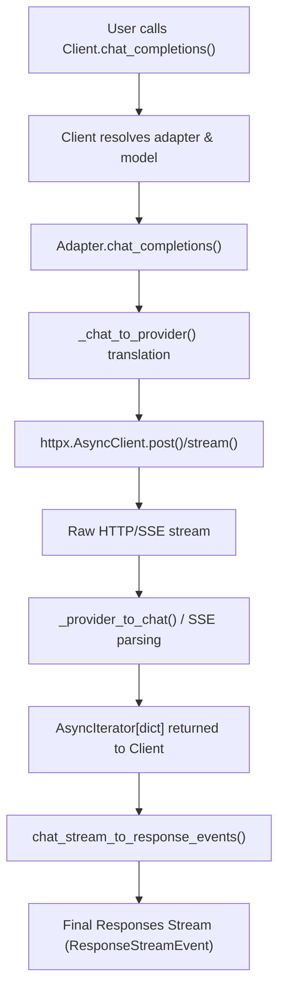
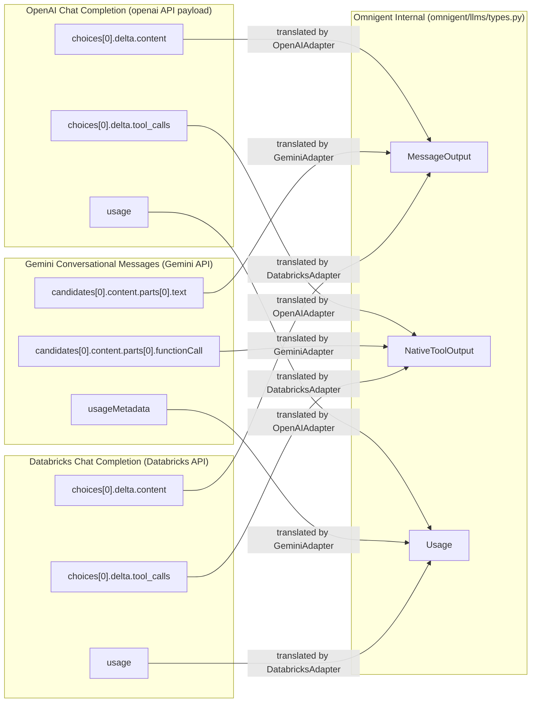

# LLM Client Design

<details>
<summary>Relevant source files</summary>

The following files were used as context for generating this wiki page:

- [dev/lint/lint_no_hardcoded_models.py](dev/lint/lint_no_hardcoded_models.py)
- [docs/model-hardcoding-plan.md](docs/model-hardcoding-plan.md)
- [omnigent/databricks_ai_gateway.py](omnigent/databricks_ai_gateway.py)
- [omnigent/harnesses/claude_native/main.py](omnigent/harnesses/claude_native/main.py)
- [omnigent/harnesses/opencode_native/bridge.py](omnigent/harnesses/opencode_native/bridge.py)
- [omnigent/harnesses/opencode_native/provider.py](omnigent/harnesses/opencode_native/provider.py)
- [omnigent/inner/antigravity_executor.py](omnigent/inner/antigravity_executor.py)
- [omnigent/inner/antigravity_harness.py](omnigent/inner/antigravity_harness.py)
- [omnigent/llms/adapters/databricks.py](omnigent/llms/adapters/databricks.py)
- [omnigent/llms/context_window.py](omnigent/llms/context_window.py)
- [omnigent/models/model_catalog.py](omnigent/models/model_catalog.py)
- [omnigent/models/model_fallbacks.py](omnigent/models/model_fallbacks.py)
- [omnigent/onboarding/providers/__init__.py](omnigent/onboarding/providers/__init__.py)
- [omnigent/server/smart_routing.py](omnigent/server/smart_routing.py)
- [tests/cli/test_build_routing_client.py](tests/cli/test_build_routing_client.py)
- [tests/dev/lint/test_lint_no_hardcoded_models.py](tests/dev/lint/test_lint_no_hardcoded_models.py)
- [tests/e2e/test_codex_native_routing_compatibility_e2e.py](tests/e2e/test_codex_native_routing_compatibility_e2e.py)
- [tests/e2e/test_task_v3_native_harness_routing.py](tests/e2e/test_task_v3_native_harness_routing.py)
- [tests/e2e_ui/start_session/test_claude_preview_session_config_parity.py](tests/e2e_ui/start_session/test_claude_preview_session_config_parity.py)
- [tests/e2e_ui/start_session/test_unpinned_codex_default_model.py](tests/e2e_ui/start_session/test_unpinned_codex_default_model.py)
- [tests/harnesses/claude_native/test_claude_native.py](tests/harnesses/claude_native/test_claude_native.py)
- [tests/inner/test_antigravity_executor.py](tests/inner/test_antigravity_executor.py)
- [tests/llms/test_context_window.py](tests/llms/test_context_window.py)
- [tests/onboarding/test_providers.py](tests/onboarding/test_providers.py)
- [tests/server/test_codex_native_routing_compatibility.py](tests/server/test_codex_native_routing_compatibility.py)
- [tests/server/test_smart_routing.py](tests/server/test_smart_routing.py)
- [tests/test_model_catalog.py](tests/test_model_catalog.py)
- [tests/test_opencode_native_bridge.py](tests/test_opencode_native_bridge.py)
- [tests/test_opencode_native_provider.py](tests/test_opencode_native_provider.py)

</details>


## Purpose and Scope

This page provides a detailed technical overview of Omnigent's Large Language Model (LLM) Client subsystem as implemented primarily in the `omnigent/llms/` package. It covers the core `Client` class structure, the `Responses` API interface, the end-to-end request flow—encompassing multi-provider routing, request translation, adapter dispatch, HTTP communication, and streaming response processing. It also explains the defined streaming event types, context window resolution and management through model catalogs, and pricing calculations for usage metering.

---

## Overview of LLM Client Architecture

Omnigent’s LLM Client subsystem serves as a unified abstraction layer enabling interaction with multiple LLM providers (e.g., OpenAI, Anthropic, Gemini, Bedrock) via a consistent and extensible API. The Client dynamically routes LLM requests to appropriate provider adapters, translates generic request models into provider-specific HTTP payloads, manages HTTP and streaming responses (including SSE parsing), and converts provider-specific response formats into a normalized set of streaming events consumable by downstream components.

### Request Processing Flow



1. The client receives a chat completions request.
2. It resolves the correct model and adapter for the request.
3. The adapter translates the generic Chat Completion request into provider-specific payloads.
4. The adapter initiates an HTTP call (possibly streamed) with `httpx`.
5. The client parses the raw streaming SSE or chunked JSON response.
6. Provider-specific partial responses are normalized into a lingua franca chat dictionary.
7. The response dictionary stream is converted into statically typed Pydantic event objects for consumption.

Sources:
- [omnigent/llms/client.py]()

---

## The `Client` Class and Adapter Layer

The `Client` class (implementation in `omnigent/llms/client.py`) orchestrates request dispatch and provider routing. It maintains a registry of multiple adapters, each implementing provider-specific logic to:

- Inject authentication (API keys, bearer tokens).
- Map generic request fields to provider-specific HTTP/JSON payloads.
- Manage streaming HTTP response parsing and error handling.
- Convert provider responses into the internal event stream.

### Provider Adapters

Adapters derive from the abstract `BaseAdapter` base class (`omnigent/llms/adapters/base.py`). Key adapter implementations include:

| Adapter                  | Supported Providers                                   | Notable Details                                                                                                                        |
|--------------------------|-----------------------------------------------------|----------------------------------------------------------------------------------------------------------------------------------------|
| `OpenAICompatibleAdapter`| OpenAI, Groq, DeepSeek, xAI, OpenRouter, Ollama      | Supports OpenAI-style JSON chat requests and SSE streaming. Converts usage and events per OpenAI standards. [omnigent/llms/adapters/openai.py:46-111]() |
| `AnthropicAdapter`       | Anthropic                                            | Handles Anthropic’s JSON chat completions, tool-call support, token usage fields, and SSE. [omnigent/llms/adapters/anthropic.py:110-150]() |
| `GeminiAdapter`          | Gemini (Google)                                      | Translates OpenAI-style requests to Gemini’s system_instruction and user/model roles. [omnigent/llms/adapters/gemini.py:26-50]()          |
| `DatabricksAdapter`      | Databricks AI Gateway, Databricks Serving Endpoints | Handles Databricks-specific authentication and model routing, including Unity Gateway attribution. [omnigent/llms/adapters/databricks.py]() |

Adapters handle:

- **Authentication Headers:** E.g., OpenAI uses `Authorization: Bearer <token>`, Gemini injects `x-goog-api-key` as a query parameter.
- **Payload Structures:** Remapping parameters such as `max_tokens` to `maxOutputTokens` for Gemini.
- **Response Streaming:** Parsing SSE lines into JSON and normalizing updates.
- **Error Handling:** Eagerly consuming fail-body JSON before exception raising to provide meaningful diagnostics.

Sources:
- [omnigent/llms/client.py]()
- [omnigent/llms/adapters/base.py]()
- [omnigent/llms/adapters/openai.py:46-111]()
- [omnigent/llms/adapters/anthropic.py:110-150]()
- [omnigent/llms/adapters/gemini.py:26-50]()
- [omnigent/llms/adapters/databricks.py]()

---

## Responses API & Streaming Event Types

Omnigent normalizes provider responses into a stable, typed streaming event API defined in `omnigent/llms/types.py`.

### Core Streaming Event Classes

| Event Type Identifier       | Class Name                    | Description                                                    |
|-----------------------------|-------------------------------|----------------------------------------------------------------|
| `response.text.delta`        | `ResponseTextDeltaEvent`       | Incremental text chunk from model output stream [omnigent/llms/types.py:15]() |
| `response.reasoning.delta`   | `ResponseReasoningTextDeltaEvent` | Reasoning or "thinking" token delta [omnigent/llms/types.py:31]()             |
| `response.tool_call_added`   | `NativeToolOutputAddedEvent`  | Inline streaming output from a tool invocation [omnigent/llms/types.py:25]() |
| `response.usage`             | `Usage`                      | Token usage and pricing information at turn completion [omnigent/llms/types.py:34]() |

### Streaming Error Handling

Adapters prioritize capturing detailed JSON error bodies before raising exceptions, ensuring that midway streaming failures (e.g., model not found, invalid auth) surface clear diagnostics rather than timeouts or opaque stream closure [tests/llms/test_openai_adapter.py:150-187]().

The client API returns async iterators yielding normalized response event objects, enabling reactive UI updates, tooling integration, and metered billing.

Sources:
- [omnigent/llms/types.py:15]()
- [omnigent/llms/types.py:25]()
- [omnigent/llms/types.py:31]()
- [omnigent/llms/types.py:34]()
- [tests/llms/test_openai_adapter.py:150-187]()

---

## Context Window Resolution and Cost Computation

### Context Window Handling

Omnigent uses multi-source model context window resolution logic from `omnigent/llms/context_window.py`:

- Environment variable override (`AP_CONTEXT_WINDOW_OVERRIDE`) has ultimate priority. [omnigent/llms/context_window.py:77-78]()
- Encoded window sizes in model IDs (e.g., Anthropic’s `[1m]` 1-million token beta suffix). [omnigent/llms/context_window.py:32-34]()
- Model catalog metadata from MLflow catalog discovery. [omnigent/llms/context_window.py:38-45]()
- Optional local metadata via `litellm.get_model_info()` fallback. [omnigent/llms/context_window.py:85-105]()
- Defaults to a conservative 128,000 token window if unknown. [omnigent/llms/context_window.py:19]()

```python
def get_model_context_window(model: str) -> int
```
[omnigent/llms/context_window.py:109-133]()

returns the recommended token window size, supporting budget-aware compaction and compaction triggered by runtime token limits.

### Cost and Pricing Calculation

Token costs are computed considering cache reads and writes with distinct pricing tiers. Cache read tokens bill at a fraction (e.g., 10%) of normal input token cost, and cache writes at a premium (e.g., 1.25× input token cost) based on catalog pricing metadata [omnigent/llms/context_window.py:59-60](). This accurate cost model avoids overcharging cache hits in usage metering.

Sources:
- [omnigent/llms/context_window.py:19]()
- [omnigent/llms/context_window.py:32-34]()
- [omnigent/llms/context_window.py:38-45]()
- [omnigent/llms/context_window.py:59-60]()
- [omnigent/llms/context_window.py:77-78]()
- [omnigent/llms/context_window.py:85-105]()
- [omnigent/llms/context_window.py:109-133]()

---

## Model Catalog and Discovery

Omnigent maintains a deterministic multi-provider model catalog with live discovery to support routing, validation, and tooling. The `omnigent.models.model_catalog` module is central to this functionality.

### Primary Providers & Methods

| Provider            | Discovery Methods                                                                         |
|---------------------|-------------------------------------------------------------------------------------------|
| **Databricks**       | Queries Unity Catalog or Serving Endpoints APIs with profile-based auth tokens. [tests/test_model_catalog.py:200-205]()           |
| **OpenAI, Anthropic**| Accesses `/v1/models` endpoints for live model listings and metadata. [tests/test_model_catalog.py:206-211]()                     |
| **CLI-Config**       | Uses native CLI-based discovery for Claude and Codex harness models. [tests/test_model_catalog.py:152-154]()                      |
| **Pi Native**        | Generates `models.json` consumed by the Pi CLI to configure models and gateway endpoints. |

The live catalog enumerates models by provider, exposing metadata such as capabilities, cost tiers, token windows, and compatible wire APIs. Model resolution ensures harmony with runtime harness spawn logic [omnigent/models/model_catalog.py:15-30](). The `resolve_model_provider` function determines the appropriate provider configuration for a given agent specification [omnigent/models/model_catalog.py:38]().

Sources:
- [omnigent/models/model_catalog.py:15-30]()
- [omnigent/models/model_catalog.py:38]()
- [tests/test_model_catalog.py:152-154]()
- [tests/test_model_catalog.py:200-205]()
- [tests/test_model_catalog.py:206-211]()

---

## Request Flow: Routing → Translation → Adapter → HTTP

### Step 1: Routing & Adapter Selection

The `Client` dispatches calls to a provider adapter based on resolved provider and model. This routing considers configured defaults, specialized harnesses, and runtime environment cues. The `omnigent.server.smart_routing` module provides server-side intelligent model routing, inferring available models from the session's harness type and delegating routing decisions [omnigent/server/smart_routing.py:1-11](). The `infer_models` function determines available models for a given harness [omnigent/server/smart_routing.py:115-139]().

### Step 2: Outbound Request Translation

Inbound chat completion request data structures are translated into provider-specific JSON/HTTP request bodies.

- **Gemini** merges multiple system messages into a single `system_instruction.parts` array and maps roles: user/system/model. [omnigent/llms/adapters/gemini.py:26-36]()
- **Anthropic** extracts a single system message upfront and formats tool calls inline with the prompt. [omnigent/llms/adapters/anthropic.py:180-190]()
- The core lingua franca conversion uses `responses_input_to_chat_messages()` which flattens complex conversational data into message lists consumable by the chat API [omnigent/llms/_responses_to_chat.py:112-115]().

### Step 3: Adapter HTTP/Streaming Call

Adapters invoke `httpx.AsyncClient.post()` or `.stream()` with the translated payload and relevant headers. The responses may be chunked JSON or SSE event streams.

### Step 4: Receiving & Translating Streaming Response

Adapters parse each line or chunk of the HTTP response stream (_parse_sse_line for OpenAI, similar for Gemini), producing generic chat dictionaries of incremental completions.

### Step 5: Final Internal Event Stream

The generic chat dictionaries are passed through `chat_stream_to_response_events()` which yields typed Pydantic event objects representing textual deltas, reasoning tokens, tool call outputs, and usage summaries.

Sources:
- [omnigent/server/smart_routing.py:1-11]()
- [omnigent/server/smart_routing.py:115-139]()
- [omnigent/llms/adapters/gemini.py:26-36]()
- [omnigent/llms/adapters/anthropic.py:180-190]()
- [omnigent/llms/_responses_to_chat.py:112-115]()

---

## Streaming Event Types and Interactions

| Event Type                  | Meaning                                                    | File Reference               |
|-----------------------------|------------------------------------------------------------|------------------------------|
| `response.text.delta`        | Streamed incremental text content from LLM                 | `omnigent/llms/types.py`     |
| `response.reasoning.delta`   | Reasoning/thinking partial text (for model introspection)  | `omnigent/llms/types.py`     |
| `response.tool_call_added`   | Partial native tool output streamed inline                  | `omnigent/llms/types.py`     |
| `response.usage`             | Token counts and usage costs for completed turns            | `omnigent/llms/types.py`     |

Sources:
- `omnigent/llms/types.py`

---

## LLM Client Design Diagrams

### Diagram 1: LLM Client Request Flow — From Natural Language to Code Entities

This diagram bridges high-level request semantics to concrete code components in Omnigent’s codebase.

```mermaid
graph TD
    subgraph "Runtime Layer"
        RL["omnigent/runtime/workflow.py"]
        RL -->|calls| CL["Client.chat_completions (omnigent/llms/client.py)"]
    end

    subgraph "LLM Client Layer (omnigent/llms)"
        CL -->|routes request to| OA["OpenAICompatibleAdapter (omnigent/llms/adapters/openai.py)"]
        CL -->|routes request to| GA["GeminiAdapter (omnigent/llms/adapters/gemini.py)"]
        CL -->|routes request to| AA["AnthropicAdapter (omnigent/llms/adapters/anthropic.py)"]
        CL -->|routes request to| DA["DatabricksAdapter (omnigent/llms/adapters/databricks.py)"]

        OA -->|calls| OT["_chat_to_openai_payload()"]
        GA -->|calls| GT["_chat_to_gemini()"]
        AA -->|calls| AT["_chat_to_anthropic()"]
        DA -->|calls| DT["_chat_to_databricks()"]
    end

    subgraph "HTTP & SSE Layer"
        OT -->|httpx.stream() with SSE parsing| OSS["_parse_sse_line()"]
        GT -->|httpx.stream() with Gemini chunk translation| GSS["_gemini_stream_chunk_to_chat()"]
        AT -->|httpx.stream() with Anthropic parse| ASS["_anthropic_stream_chunk_to_chat()"]
        DT -->|httpx.stream() with Databricks parse| DSS["_databricks_stream_chunk_to_chat()"]
    end

    subgraph "Response Normalization (omnigent/llms/_responses_to_chat.py)"
        OSS -->|yield dict| NORM["chat_stream_to_response_events()"]
        GSS -->|yield dict| NORM
        ASS -->|yield dict| NORM
        DSS -->|yield dict| NORM
    end

    subgraph "Event Stream Output (omnigent/llms/types.py)"
        NORM --> RESP1["ResponseTextDeltaEvent"]
        NORM --> RESP2["ResponseReasoningTextDeltaEvent"]
        NORM --> RESP3["NativeToolOutputAddedEvent"]
        NORM --> RESP4["Usage"]
    end
```

### Diagram 2: Data Translation Mapping — OpenAI vs Gemini vs Internal Event Representation

This diagram shows the mapping from vendor-specific data structures to Omnigent’s internal event data classes.



---

## Summary

Omnigent’s LLM Client subsystem delivers a robust, extensible foundation for interacting with a diverse ecosystem of LLM providers:

- **Unified `Client` interface:** Async entrypoint consolidating provider dispatch.
- **Modular Adapters:** Each encapsulating specific provider API translation, authentication, and streaming semantics.
- **Lingua Franca Translation:** Translates arbitrary conversation data to/from provider-specific JSON formats.
- **Typed Streaming Events:** Streaming text, reasoning, tooling outputs, and usage events exposed as Pydantic models.
- **Dynamic Model Catalogs & Context-window Handling:** Supporting cost budgeting and adaptive compaction.
- **Pricing-aware Token Accounting:** Including cache-aware cost computation to avoid overcharging.

This design allows Omnigent to uniformly call any supported LLM backend with consistent event streaming and cost calibration.

---

## Sources

- `omnigent/llms/client.py`
- `omnigent/llms/adapters/base.py`
- `omnigent/llms/adapters/openai.py`
- `omnigent/llms/adapters/gemini.py`
- `omnigent/llms/adapters/anthropic.py`
- `omnigent/llms/adapters/databricks.py`
- `omnigent/llms/_responses_to_chat.py`
- `omnigent/llms/types.py`
- `omnigent/llms/context_window.py`
- `omnigent/models/model_catalog.py`
- `omnigent/server/smart_routing.py`
- `omnigent/runtime/compaction.py`
- `tests/llms/test_context_window.py`
- `tests/llms/test_openai_adapter.py`
- `tests/llms/test_gemini_adapter.py`
- `tests/test_model_catalog.py`
- `tests/server/test_smart_routing.py`