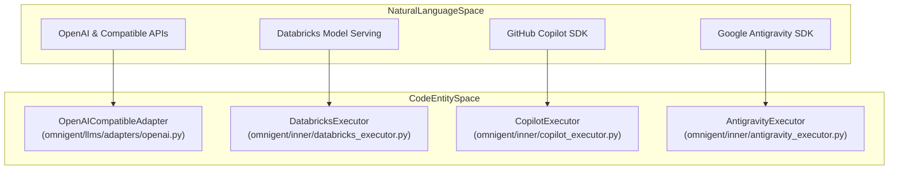
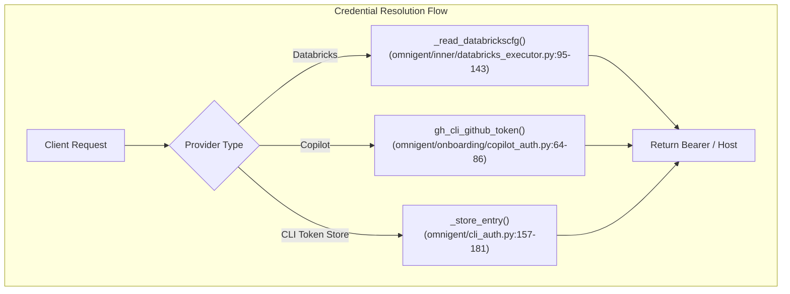

# Provider Adapters

Relevant source files

The following files were used as context for generating this wiki page:

- [dev/lint/lint_no_hardcoded_models.py](dev/lint/lint_no_hardcoded_models.py)
- [docs/model-hardcoding-plan.md](docs/model-hardcoding-plan.md)
- [omnigent/databricks_ai_gateway.py](omnigent/databricks_ai_gateway.py)
- [omnigent/harnesses/claude_native/main.py](omnigent/harnesses/claude_native/main.py)
- [omnigent/harnesses/opencode_native/bridge.py](omnigent/harnesses/opencode_native/bridge.py)
- [omnigent/harnesses/opencode_native/provider.py](omnigent/harnesses/opencode_native/provider.py)
- [omnigent/inner/antigravity_executor.py](omnigent/inner/antigravity_executor.py)
- [omnigent/inner/antigravity_harness.py](omnigent/inner/antigravity_harness.py)
- [omnigent/inner/databricks_executor.py](omnigent/inner/databricks_executor.py)
- [omnigent/inner/databricks_token.py](omnigent/inner/databricks_token.py)
- [omnigent/llms/context_window.py](omnigent/llms/context_window.py)
- [omnigent/models/model_catalog.py](omnigent/models/model_catalog.py)
- [omnigent/onboarding/providers/__init__.py](omnigent/onboarding/providers/__init__.py)
- [tests/cli/test_login_databricks.py](tests/cli/test_login_databricks.py)
- [tests/dev/lint/test_lint_no_hardcoded_models.py](tests/dev/lint/test_lint_no_hardcoded_models.py)
- [tests/e2e/_host_login_workspace.py](tests/e2e/_host_login_workspace.py)
- [tests/e2e/test_codex_gateway_stale_bearer_e2e.py](tests/e2e/test_codex_gateway_stale_bearer_e2e.py)
- [tests/e2e/test_host_auth_prefers_user_over_m2m_sp_e2e.py](tests/e2e/test_host_auth_prefers_user_over_m2m_sp_e2e.py)
- [tests/e2e/test_host_inline_login.py](tests/e2e/test_host_inline_login.py)
- [tests/e2e_ui/start_session/test_claude_preview_session_config_parity.py](tests/e2e_ui/start_session/test_claude_preview_session_config_parity.py)
- [tests/harnesses/claude_native/test_claude_native.py](tests/harnesses/claude_native/test_claude_native.py)
- [tests/inner/test_antigravity_executor.py](tests/inner/test_antigravity_executor.py)
- [tests/inner/test_databricks_auth_command.py](tests/inner/test_databricks_auth_command.py)
- [tests/inner/test_databricks_executor.py](tests/inner/test_databricks_executor.py)
- [tests/llms/test_context_window.py](tests/llms/test_context_window.py)
- [tests/onboarding/test_providers.py](tests/onboarding/test_providers.py)
- [tests/test_model_catalog.py](tests/test_model_catalog.py)
- [tests/test_opencode_native_bridge.py](tests/test_opencode_native_bridge.py)
- [tests/test_opencode_native_provider.py](tests/test_opencode_native_provider.py)
- [tests/test_server_url.py](tests/test_server_url.py)

## Purpose and Scope

This section details the per-provider adapter implementations within Omnigent's LLM client SDK and harness execution subsystems. Provider adapters translate Omnigent’s standardized internal request and response data models into provider-specific API payloads, manage authentication lifecycles, and handle streaming event mappings.

The providers and execution backends covered include:
- **OpenAI and OpenAI-compatible services**: Groq, DeepSeek, xAI, OpenRouter, Ollama.
- **Anthropic**: Claude models via the Messages API and `claude-agent-sdk`.
- **Gemini**: Google's native Gemini API integration.
- **AWS Bedrock**: Amazon managed foundation models.
- **Google Vertex AI**: Google Cloud enterprise AI.
- **Databricks**: Databricks Model Serving and AI Gateway via `DatabricksExecutor` [omnigent/inner/databricks_executor.py:1-13]().
- **Antigravity**: Google agent SDK integration via `AntigravityExecutor` [omnigent/inner/antigravity_executor.py:1-8]().
- **Pi**: Coding agent integration over JSONL streams and RPC modes.
- **GitHub Copilot**: Integration via `CopilotExecutor` using the `github-copilot-sdk` [omnigent/inner/copilot_executor.py:1-22]().

Sources: `omnigent/inner/databricks_executor.py:1-13](), `omnigent/inner/antigravity_executor.py:1-8](), `omnigent/inner/copilot_executor.py:1-22`()

---

## Provider Adapter Architecture Overview

Omnigent employs a modular adapter pattern. The primary responsibilities of each adapter layer include:
- **Request/Response Translation**: Converting normalized `Message` and `ConversationItem` structures into provider JSON schemas.
- **Authentication Injection**: Attaching bearer tokens, API keys, or invoking credential resolution helpers (e.g., Databricks SDK config resolution or `gh` CLI token extraction).
- **Streaming Adaptation**: Normalizing SSE or asynchronous SDK stream iterations into uniform `ExecutorEvent` streams (`TextChunk`, `ReasoningChunk`, `ToolCallRequest`, `TurnComplete`) [omnigent/inner/executor.py:41-52]().

Sources: `omnigent/inner/executor.py:41-52]()

---

## Major Provider Adapters

### 1. OpenAI-Compatible Adapter
- **Scope**: Official OpenAI endpoints and compatible providers (Groq, DeepSeek, xAI, OpenRouter, Ollama).
- **Implementation**: Managed by `OpenAICompatibleAdapter`, mapping chat completion requests, handling Bearer tokens, and parsing SSE chunks.

### 2. Databricks Executor & Adapter
- **Scope**: Databricks Model Serving endpoints and AI Gateway.
- **Implementation**: Driven by `DatabricksExecutor` [omnigent/inner/databricks_executor.py:1-13](). Resolves credentials dynamically through `_read_databrickscfg` [omnigent/inner/databricks_executor.py:95-143]() using the Databricks SDK config resolver, ensuring OAuth tokens are correctly refreshed.

Sources: `omnigent/inner/databricks_executor.py:1-143`()

### 3. GitHub Copilot Executor
- **Scope**: GitHub Copilot SDK integration (`github-copilot-sdk`) [omnigent/inner/copilot_executor.py:1-22]().
- **Implementation**: `CopilotExecutor` maintains a persistent `CopilotClient` and `CopilotSession` per conversation. Tools are bridged in-process, and native tools are governed by permission policies [omnigent/inner/copilot_executor.py:15-43](). Authentication uses ambient GitHub tokens or `gh` CLI credentials [omnigent/onboarding/copilot_auth.py:64-86]().

Sources: `omnigent/inner/copilot_executor.py:1-55](), `omnigent/onboarding/copilot_auth.py:64-86`()

### 4. Antigravity Executor
- **Scope**: Google Antigravity SDK (`google-antigravity`) [omnigent/inner/antigravity_executor.py:1-15]().
- **Implementation**: `AntigravityExecutor` drives an asynchronous step stream via `receive_steps()` mapping step deltas (`content_delta`, `thinking_delta`, `tool_calls`) into Omnigent executor events [omnigent/inner/antigravity_executor.py:18-30]().

Sources: `omnigent/inner/antigravity_executor.py:1-38`()

---

## Code Entity Mapping

The following diagram bridges natural language provider descriptions to their exact code symbols within the codebase.

Sources: `omnigent/inner/databricks_executor.py:1-13](), `omnigent/inner/copilot_executor.py:1-22](), `omnigent/inner/antigravity_executor.py:1-15`()

---

## Authentication and Credential Integration

Authentication varies by provider, ranging from static API keys to dynamic workspace-hosted token refresh routines.

Sources: `omnigent/inner/databricks_executor.py:95-143](), `omnigent/onboarding/copilot_auth.py:64-86](), `omnigent/cli_auth.py:157-181`()

### Credential Summary Table

| Provider | Auth Mechanism | Implementation Reference |
| :--- | :--- | :--- |
| **Databricks** | SDK Config Resolver / OAuth | `_read_databrickscfg()` [omnigent/inner/databricks_executor.py:95-143]() |
| **GitHub Copilot** | GitHub PAT / OAuth / `gh` CLI | `gh_cli_github_token()` [omnigent/onboarding/copilot_auth.py:64-86]() |
| **CLI OIDC / Session** | Stored JWTs in JSON | `_store_entry()` [omnigent/cli_auth.py:157-181]() |
| **Antigravity** | Gemini API Key / Vertex AI | `_ensure_antigravity_sdk()` [omnigent/inner/antigravity_executor.py:117-137]() |

Sources: `omnigent/inner/databricks_executor.py:95-143](), `omnigent/onboarding/copilot_auth.py:64-86](), `omnigent/cli_auth.py:157-181](), `omnigent/inner/antigravity_executor.py:117-137`()