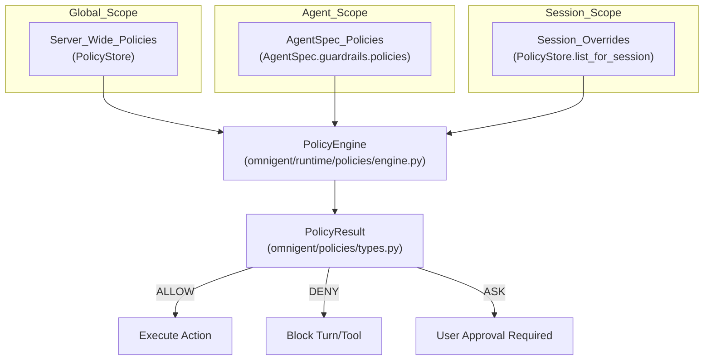
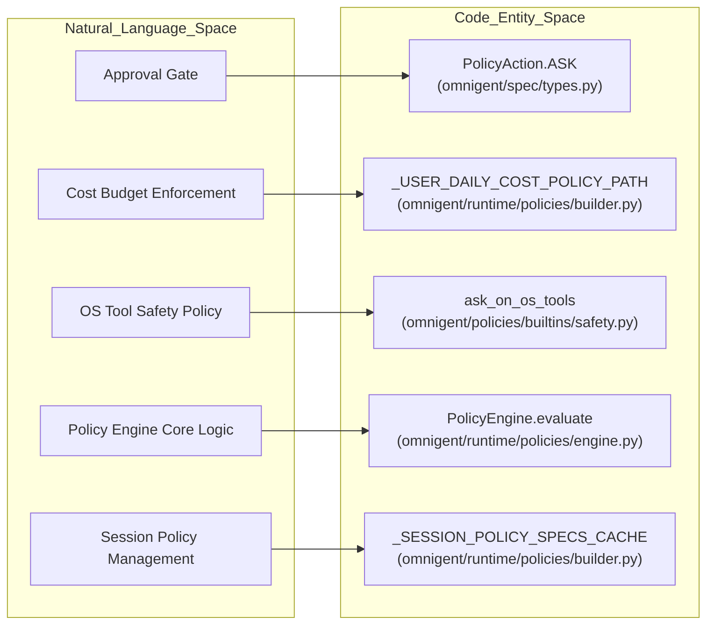

# Policies & Governance

Relevant source files

The following files were used as context for generating this wiki page:

- [omnigent/policies/builtins/safety.py](omnigent/policies/builtins/safety.py)
- [omnigent/policies/registry.py](omnigent/policies/registry.py)
- [omnigent/runtime/policies/builder.py](omnigent/runtime/policies/builder.py)
- [omnigent/server/routes/sessions/routes_elicitations.py](omnigent/server/routes/sessions/routes_elicitations.py)
- [omnigent/server/routes/sessions/routes_hooks.py](omnigent/server/routes/sessions/routes_hooks.py)
- [omnigent/spec/__init__.py](omnigent/spec/__init__.py)
- [omnigent/spec/_omnigent_legacy_shim.py](omnigent/spec/_omnigent_legacy_shim.py)
- [tests/e2e_ui/scheduled/test_agent_scheduled_task_requires_approval.py](tests/e2e_ui/scheduled/test_agent_scheduled_task_requires_approval.py)
- [tests/inner/test_blast_radius_codex_harness_enforcement.py](tests/inner/test_blast_radius_codex_harness_enforcement.py)
- [tests/policies/builtins/test_safety.py](tests/policies/builtins/test_safety.py)
- [tests/runtime/policies/test_builder.py](tests/runtime/policies/test_builder.py)
- [tests/runtime/policies/test_builder_session_policies.py](tests/runtime/policies/test_builder_session_policies.py)
- [tests/runtime/policies/test_scheduled_task_approval_gate.py](tests/runtime/policies/test_scheduled_task_approval_gate.py)
- [tests/runtime/policies/test_subagent_guardrails.py](tests/runtime/policies/test_subagent_guardrails.py)
- [tests/runtime/policies/test_yaml_full_roundtrip.py](tests/runtime/policies/test_yaml_full_roundtrip.py)
- [tests/server/integration/test_pii_guardrail_name_squat_e2e.py](tests/server/integration/test_pii_guardrail_name_squat_e2e.py)
- [tests/server/integration/test_sessions_elicitation_resolve_url.py](tests/server/integration/test_sessions_elicitation_resolve_url.py)
- [tests/server/integration/test_sessions_permission_request_hook.py](tests/server/integration/test_sessions_permission_request_hook.py)
- [tests/server/integration/test_sessions_permissions.py](tests/server/integration/test_sessions_permissions.py)
- [tests/server/integration/test_sessions_policy_evaluate.py](tests/server/integration/test_sessions_policy_evaluate.py)
- [tests/server/routes/test_sessions_mcp_proxy_policy_retry.py](tests/server/routes/test_sessions_mcp_proxy_policy_retry.py)
- [tests/server/routes/test_sessions_policy.py](tests/server/routes/test_sessions_policy.py)
- [tests/server/test_bundle_function_policies.py](tests/server/test_bundle_function_policies.py)

This section provides a high-level overview of Omnigent’s policy and governance system, a critical component that regulates agent behavior, enforces safety measures, and controls resource usage. The system issues one of three verdicts—`ALLOW`, `DENY`, or `ASK`—to decide whether an agent action should proceed, be blocked, or require human approval.

Omnigent employs a layered trust model where policies are scoped at multiple levels: server-wide (global defaults), agent spec, and session. This design enables flexible, enterprise-grade governance that is both centralized and audit-friendly.

---

## Policy Verdicts: ALLOW, DENY, ASK

Omnigent’s policy evaluation is tri-state, designed for precise control over agent operations:

- **ALLOW (`PolicyAction.ALLOW`):** The action complies with all policy constraints and is permitted automatically.
- **DENY (`PolicyAction.DENY`):** The action violates policy constraints and must be blocked immediately.
- **ASK (`PolicyAction.ASK`):** The action requires explicit human approval before proceeding; it is held pending user response.

This tri-state model supports nuanced governance: low-risk actions flow uninterrupted, high-risk actions are blocked outright, and sensitive or ambiguous actions require explicit user decisions. Enforcement is phase-aware, with critical enforcement points like `PHASE_TOOL_CALL` and `PHASE_REQUEST` defined as fail-closed—policy lookup failures or errors here default to blocking to preserve safety.

Sources: [omnigent/spec/types.py:101-103]()

---

## Three-Level Trust Model: Server, Agent Spec, Session

Omnigent enforces policies from three hierarchical scopes, composed dynamically at runtime by the `PolicyEngine`:

1.  **Global Defaults (Server-Wide):** Administrator-managed policies applying broadly to all sessions within a workspace, stored in the persistent `PolicyStore` and cached for efficiency. These are loaded via `_load_default_policy_specs` [omnigent/runtime/policies/builder.py:1639-1641]() and cached in `_DEFAULT_POLICY_SPECS_CACHE` [omnigent/runtime/policies/builder.py:119-122]().
2.  **Agent Spec Policies:** Declared inline within an agent’s YAML spec under the `guardrails.policies` block [omnigent/spec/types.py:22-31](), typically covering workflow- or job-specific governance contracts.
3.  **Session Policies:** Per-session overrides set at runtime via REST API CRUD, supporting flexible, runtime-tailored constraints. These are loaded via `_load_session_policy_specs` [omnigent/runtime/policies/builder.py:1550-1552]() and cached in `_SESSION_POLICY_SPECS_CACHE` [omnigent/runtime/policies/builder.py:132-135]().

When building a policy engine instance for a workflow turn, Omnigent merges these scopes in order—session policies override agent spec policies, which override global defaults. The engine iterates policies in their declared order, short-circuiting on `DENY` and accumulating `ASK` requests.

Sources:
- [omnigent/runtime/policies/builder.py:119-122]()
- [omnigent/runtime/policies/builder.py:132-135]()
- [omnigent/runtime/policies/builder.py:1550-1552]()
- [omnigent/runtime/policies/builder.py:1639-1641]()
- [omnigent/spec/types.py:22-31]()

---

## Policy Architecture Overview

The core policy system centers around the `PolicyEngine` [omnigent/runtime/policies/engine.py:43-122](), a lightweight per-workflow instance constructed at the start of each agent turn via `build_policy_engine` [omnigent/runtime/policies/builder.py:172-1883](). It owns the currently active set of policy instances, label state, session state, usage metrics, and the resolved active model. This encapsulation enables consistent evaluation and stateful handling of policies.

Key architectural elements:

-   **Policy Types:** Policies are primarily implemented as:
    -   *FunctionPolicy*: backed by Python callables accepting a structured `PolicyEvent` [omnigent/policies/schema.py:18-20]() and configuration, returning verdicts synchronously or asynchronously. These are resolved by `resolve_function_policy` [omnigent/policies/function.py:10-100]().
    -   *PromptPolicy*: driven by language model classification prompts (covered in detail in child pages).
    -   *CEL Policies*: (Constraint Expression Language) planned for declarative expression evaluation.

-   **Evaluation Context:** At each enforcement point (phase), the engine receives an `EvaluationContext` [omnigent/policies/types.py:83-171]() that includes:
    -   Phase-specific payload (e.g., user request text, tool call arguments).
    -   The resolved tool name (if applicable).
    -   The recent conversation trajectory for situational awareness.
    -   Actor identity metadata.
    -   Session-scoped mutable state.
    -   Cumulative usage metrics including token counts and cost summaries.
    -   The resolved model name used in that session.

-   **Phases and Hooks:** Policies declare the phases they handle (e.g., `Phase.REQUEST`, `Phase.TOOL_CALL`) [omnigent/spec/types.py:90-99](). The engine evaluates each policy for the current phase in order, respecting short-circuits on deny and cooperative asks. Enforcement occurs at various server routes, such as `POST /v1/sessions/{session_id}/hooks/permission-request` [omnigent/server/routes/sessions/routes_hooks.py:157-187]() and `POST /v1/sessions/{session_id}/policies/evaluate` [omnigent/server/routes/sessions/routes_hooks.py:1000-1002]().

-   **Policy State and Labels:** Policies may write ephemeral per-turn state updates and label changes. The engine validates and applies these writes atomically during enforcement.

-   **Built-in Guards:** Omnigent always injects hardcoded safety policies like `_ASK_ON_ADD_POLICY_SPEC` [omnigent/runtime/policies/builder.py:78-85]() and `_ASK_ON_SCHEDULED_TASK_CHANGE_SPEC` [omnigent/runtime/policies/builder.py:89-96]() that require explicit user approval before new policies can be added dynamically or scheduled tasks are changed, enforcing governance integrity during live sessions.

For full technical details including policy base classes, registry, evaluation engine internals, and approval cycles, see [Policy Architecture](#4.1).

Sources:
- [omnigent/policies/function.py:10-100]()
- [omnigent/policies/schema.py:18-20]()
- [omnigent/policies/types.py:83-171]()
- [omnigent/runtime/policies/builder.py:78-85]()
- [omnigent/runtime/policies/builder.py:89-96]()
- [omnigent/runtime/policies/builder.py:172-1883]()
- [omnigent/runtime/policies/engine.py:43-122]()
- [omnigent/server/routes/sessions/routes_hooks.py:157-187]()
- [omnigent/server/routes/sessions/routes_hooks.py:1000-1002]()
- [omnigent/spec/types.py:90-99]()

---

## Builtin Policies Reference

Omnigent includes a rich collection of builtin policies residing in `omnigent/policies/builtins/` that address key governance concerns:

-   **Cost Budget Policies:** Enforce spending limits by gating LLM calls and tool uses. Examples include `user_daily_cost_budget` and `subagent_cost_budget` [omnigent/runtime/policies/builder.py:62-73](). These policies use soft warning checkpoints that `ASK` for approval and hard limits that `DENY` further usage on expensive models. They track cumulative session, user-daily, or subtree-specific cost runs and operate fail-closed when pricing data is unavailable.
-   **Safety Guards:** Policies like `ask_on_os_tools` [omnigent/policies/builtins/safety.py:300-302]() require approval before executing OS-level tools (`sys_os_read`, `sys_os_write`, `Bash`, `Read`, `Write`, etc.) [omnigent/policies/builtins/safety.py:26-96](). Other safety policies include `max_tool_calls_per_session` [omnigent/policies/builtins/safety.py:100-101]() and `detect_loop` [omnigent/policies/builtins/safety.py:158-160]() to prevent runaway agents.
-   **GitHub Governance:** Controls over GitHub API access via allowlists or routing policies to restrict repository operations and credential usage.
-   **Orchestration/Spawn Bounds:** Policies that limit sub-agent spawning or resource allocation.
-   **Routing & Model Selection:** Policies that gate model selection or input complexity to manage cost and compliance.
-   **Risk Score:** Policies that assign and act upon risk scores for actions.
-   **Working Directory:** Policies that restrict agent operations to specific working directories.
-   **Prompt Hygiene and Context:** Detects changes in session topics and enforces reset recommendations to reduce leakage and improve safety.

These builtins collectively enable out-of-the-box governance with pluggable extensions. For comprehensive documentation of all builtin policies and their configuration schemas, see [Builtin Policies](#4.2).

Sources:
- [omnigent/policies/builtins/safety.py:26-96]()
- [omnigent/policies/builtins/safety.py:100-101]()
- [omnigent/policies/builtins/safety.py:158-160]()
- [omnigent/policies/builtins/safety.py:300-302]()
- [omnigent/runtime/policies/builder.py:62-73]()

---

## Bridging Natural Language Space to Code Entities

The following diagram connects common governance and policy system concepts from the natural language space to their precise codebase corresponding classes, functions, and files. This assists engineers and auditors in tracing policy-related discussions directly to source code.

Sources:
- [omnigent/policies/builtins/safety.py:300-302]()
- [omnigent/runtime/policies/builder.py:57-62]()
- [omnigent/runtime/policies/builder.py:132-135]()
- [omnigent/runtime/policies/engine.py:43-122]()
- [omnigent/spec/types.py:101-103]()

---

## Summary and Next Steps

Omnigent’s policy and governance framework integrates layered policy scopes, tri-state verdicts, and builtin safety checks to provide robust, extensible control over agent behavior and resource use.

| Subsection | Description |
| :--- | :--- |
| [Policy Architecture](#4.1) | Detailed description of policy base classes, registry, function/prompt/CEL policy types, evaluation engine, approval cycles, and enforcement hooks. |
| [Builtin Policies](#4.2) | Comprehensive reference of builtin policies including safety, cost budget, GitHub governance, routing, and prompt handling policies. |

Sources:
- [omnigent/policies/builtins/safety.py:1-990]()
- [omnigent/policies/function.py:1-100]()
- [omnigent/policies/schema.py:1-34]()
- [omnigent/policies/types.py:1-171]()
- [omnigent/runtime/policies/builder.py:1-1883]()
- [omnigent/runtime/policies/engine.py:1-151]()
- [omnigent/spec/types.py:1-103]()