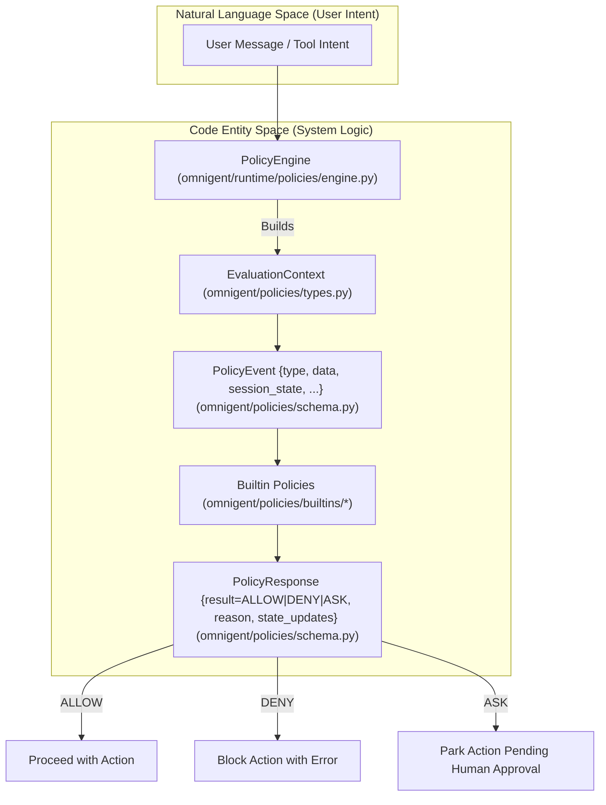

# Builtin Policies

<details>
<summary>Relevant source files</summary>

The following files were used as context for generating this wiki page:

- [omnigent/policies/builtins/_shell.py](omnigent/policies/builtins/_shell.py)
- [omnigent/policies/builtins/cost.py](omnigent/policies/builtins/cost.py)
- [omnigent/policies/builtins/github.py](omnigent/policies/builtins/github.py)
- [omnigent/policies/builtins/working_dir.py](omnigent/policies/builtins/working_dir.py)
- [omnigent/policies/function.py](omnigent/policies/function.py)
- [omnigent/policies/schema.py](omnigent/policies/schema.py)
- [omnigent/policies/types.py](omnigent/policies/types.py)
- [omnigent/runtime/policies/engine.py](omnigent/runtime/policies/engine.py)
- [omnigent/util/ssrf.py](omnigent/util/ssrf.py)
- [tests/e2e/omnigent/TODO_omnigent_coverage.md](tests/e2e/omnigent/TODO_omnigent_coverage.md)
- [tests/e2e/test_shell_policy_nesting_fail_safe.py](tests/e2e/test_shell_policy_nesting_fail_safe.py)
- [tests/e2e_ui/approvals/test_env_split_string_policy.py](tests/e2e_ui/approvals/test_env_split_string_policy.py)
- [tests/e2e_ui/sessions/test_host_badge.py](tests/e2e_ui/sessions/test_host_badge.py)
- [tests/e2e_ui/sessions/test_hosts_changed_push.py](tests/e2e_ui/sessions/test_hosts_changed_push.py)
- [tests/policies/builtins/test_cost.py](tests/policies/builtins/test_cost.py)
- [tests/policies/builtins/test_github.py](tests/policies/builtins/test_github.py)
- [tests/policies/builtins/test_shell_nesting.py](tests/policies/builtins/test_shell_nesting.py)
- [tests/policies/builtins/test_user_daily_cost.py](tests/policies/builtins/test_user_daily_cost.py)
- [tests/policies/builtins/test_working_dir.py](tests/policies/builtins/test_working_dir.py)
- [tests/runtime/policies/test_function_policy.py](tests/runtime/policies/test_function_policy.py)
- [tests/runtime/policies/test_user_daily_cost_routing.py](tests/runtime/policies/test_user_daily_cost_routing.py)
- [tests/server/test_mcp_server_ssrf_rce.py](tests/server/test_mcp_server_ssrf_rce.py)
- [web/src/components/HostBadge.test.tsx](web/src/components/HostBadge.test.tsx)
- [web/src/components/HostBadge.tsx](web/src/components/HostBadge.tsx)

</details>


Omnigent provides a comprehensive set of builtin policies designed to govern agent behavior across safety, cost, operations, and integration domains. These policies evaluate incoming agent actions—primarily tool calls—and produce verdicts of `ALLOW`, `DENY`, or `ASK` (requesting human approval) to enforce guardrails, budgets, and permissions.

Builtin policies conform to the `PolicyCallable` type: Python callables that accept a `PolicyEvent` dictionary describing the runtime event and return a `PolicyResponse` dict containing the verdict and associated metadata [omnigent/policies/schema.py:17-22]().

---

## Policy Execution Architecture

The runtime engine's core policy enforcement takes place in the `PolicyEngine` [omnigent/runtime/policies/engine.py:40-102](). It orchestrates evaluation by dispatching events to registered policies, including `FunctionPolicy` instances wrapping builtin or user-defined callables [omnigent/policies/function.py:17-40]().

The high-level data flow is:



**Sources:** [omnigent/runtime/policies/engine.py:42-102](), [omnigent/policies/schema.py:16-22](), [omnigent/policies/types.py:84-166]()

---

## Safety & Orchestration Policies

### Safety Policies

The `safety` module provides ready-to-use callable policies that gate destructive or sensitive tools, focusing primarily on shell and file operations [omnigent/policies/builtins/safety.py:1-162](). Key features:

- Recognizes a broad set of native tool names across different harnesses (Claude Code, Codex, Cursor, Pi, Hermes, Goose, Opencode) for shell/file operations [omnigent/policies/builtins/safety.py:32-87]().
- Implements `ask_on_os_tools`—a factory producing policies that `ASK` approval on any use of OS-level shell and file tools such as `sys_os_shell`, `Bash`, or `bash` (Pi native) [omnigent/policies/builtins/safety.py:26-87]().
- Implements `max_tool_calls_per_session`—a factory that denies after a specified limit of total tool calls in a session [omnigent/policies/builtins/safety.py:100-141]().
- Implements `detect_loop`—a policy factory that tracks recently repeated tool calls via hashed arguments stored in session state, issuing `ASK` if the same command repeats *threshold* times in a *window* [omnigent/policies/builtins/safety.py:144-162]().

### Orchestration Bounds & Blast-Radius

The `orchestration` module enforces guardrails on potentially destructive commands and spawn bounds for sub-agents [omnigent/policies/builtins/orchestration.py:1-192]():

- Uses regex patterns to classify commands as *catastrophic* (always `DENY`), *dangerous but reversible* (require `ASK`), or harmless and allowed [omnigent/policies/builtins/orchestration.py:69-78]().
- Implements `_shell_statements` to split complex shell command strings into tokenized statements for pattern detection [omnigent/policies/builtins/orchestration.py:140-167]().
- Protects critical directories by denying recursive deletes on system paths like `/etc`, `/usr`, and `/boot` [omnigent/policies/builtins/orchestration.py:80-104]().
- Handles various shell wrappers (`sudo`, `env`, `timeout`) and shell interpreters (`bash -c`) to robustly extract real commands [omnigent/policies/builtins/_shell.py:41-129]().
- Provides `spawn_bounds` policies ensuring sub-agent spawns respect limits on fanout and recursion depth [omnigent/policies/builtins/orchestration.py:27-28]().

**Sources:** [omnigent/policies/builtins/safety.py:26-162](), [omnigent/policies/builtins/orchestration.py:1-192](), [omnigent/policies/builtins/_shell.py:41-129]()

---

## Cost & Budget Policies

The `cost` builtin module introduces budget-aware policies that gate agent LLM usage based on accumulated spend [omnigent/policies/builtins/cost.py:1-67]().

- `cost_budget` policy tracks cumulative cost in USD across a session and applies soft ASK thresholds and hard DENY limits [omnigent/policies/builtins/cost.py:9-29]().
- It can downgrade sessions stuck on expensive models and deny/ask on unpriced models [omnigent/policies/builtins/cost.py:30-41]().
- These policies leverage session state keys like `SESSION_COST_ASK_APPROVED_STATE_KEY` and `SESSION_COST_UNPRICED_APPROVED_KEY` for persistence and to manage approval states [omnigent/policies/schema.py:92-117]().
- The policy checks `event["context"]["usage"]["total_cost_usd"]` and `event["context"]["model"]` to make decisions [omnigent/policies/builtins/cost.py:30-33]().
- If token usage is present but `total_cost_usd` is absent, it fails closed (DENY) to prevent unpriced spend from bypassing the cap [omnigent/policies/builtins/cost.py:36-41](), [omnigent/policies/builtins/cost.py:114-137]().

**Sources:** [omnigent/policies/builtins/cost.py:1-67](), [omnigent/policies/schema.py:92-117]()

---

## GitHub Integration and Access Control

### GitHub Policy Overview

Omnigent's `github_policy` enforces allowlist-based access control to GitHub repositories and branches via both the MCP protocol and shell commands [omnigent/policies/builtins/github.py:1-154]().

- Supports filtering *read* and *write* operations to configured lists of repositories (`read_repos`, `write_repos`) and branches (`write_branches`) [omnigent/policies/builtins/github.py:25-28]().
- Recognizes tool calls with or without MCP prefixes like `mcp__github__` or `github__` [omnigent/policies/builtins/github.py:92-93]().
- Analyzes shell command strings dispatched via the OS shell (e.g., `git push origin main`, `gh pr create`) by parsing actual commands using `unwrap_shell_command` from shared shell utilities [omnigent/policies/builtins/github.py:78-85](), [omnigent/policies/builtins/_shell.py:1-147]().

If the policy cannot resolve the target repo or branch in a shell command, it issues `ASK` to prevent accidental or unauthorized remote writes, ensuring safe human review [omnigent/policies/builtins/github.py:29-35]().

```mermaid
graph LR
    A["MCP ToolCall Event (type=tool_call)"] -->|Check tool name prefix| B["Canonical GitHub tool name"]
    B --> C{"Is read operation?"}
    C -->|Yes| D["Check read repos allowlist"]
    C -->|No (write)| E["Check write repos and branches allowlist"]
    D --> F{"Allowed?"}
    E --> F
    F -->|Yes| AL["ALLOW"]
    F -->|No| DN["DENY or ASK"]
    G["sys_os_shell command"] -->|Parse shell commands| H["unwrap_shell_command (omnigent/policies/builtins/_shell.py)"]
    H --> B
```

**Sources:** [omnigent/policies/builtins/github.py:1-154](), [omnigent/policies/builtins/_shell.py:1-147](), [tests/policies/builtins/test_github.py:1-161]()

---

## Working Directory Enforcement

The `working_dir` policy handles `sys_os_shell` commands that change the current working directory or add git worktrees [omnigent/policies/builtins/working_dir.py:1-70]().

- Uses shared shell parsing primitives from `_shell.py` to extract real invocations and arguments from shell command strings [omnigent/policies/builtins/working_dir.py:55-63]().
- Checks `cd`, `pushd`, `popd`, and `git worktree` commands [omnigent/policies/builtins/working_dir.py:67-72](). Specifically, it gates `_CD_COMMANDS` (`cd`, `chdir`, `pushd`, `popd`) and `_WORKTREE_SWITCH_SUBCMDS` (`add`, `move`, `remove`) [omnigent/policies/builtins/working_dir.py:67-72]().
- Ensures directory changes stay within a configured set of allowed paths using `_is_under_allowed` [omnigent/policies/builtins/working_dir.py:128-145]().
- Denies or asks approval if commands attempt to set the working directory outside permitted roots [omnigent/policies/builtins/working_dir.py:128-145]().

This policy is crucial to prevent agents from jumping outside of sandboxed or expected worktrees.

**Sources:** [omnigent/policies/builtins/working_dir.py:1-70](), [omnigent/policies/builtins/_shell.py:1-147]()

---

## CEL-based Expression Policy

Omnigent includes a built-in CEL (Common Expression Language) policy factory allowing user-specified CEL expressions as first-class policies [omnigent/policies/builtins/cel.py:1-179]().

- The expression receives the entire `PolicyEvent` as a variable `event` [omnigent/policies/builtins/cel.py:100-101]().
- It returns a map containing `result` (`ALLOW`, `DENY`, or `ASK`), optional `reason`, and optional `state_updates` [omnigent/policies/builtins/cel.py:102-104]().
- The CEL evaluator compiles and runs the expression safely: no infinite loops, side-effects, or file I/O [omnigent/policies/builtins/cel.py:105-106]().
- Can be statically configured in agent YAML or dynamically registered on a running session [omnigent/policies/builtins/cel.py:107-108]().
- Errors in CEL parsing or evaluation cause the policy to abstain (default allow) [omnigent/policies/builtins/cel.py:109-110]().

This policy enables powerful declarative policy expressions without Python coding.

**Sources:** [omnigent/policies/builtins/cel.py:1-179]()

---

## Routing & Context Policies

The runtime uses routing and context policies to guide model invocation and session management.

- The `deny_trivial_to_expensive_model` policy uses runtime classification to detect trivial user requests and deny routing them to expensive LLM models [omnigent/policies/builtins/routing.py:107-180]().
- The `detect_task_switch` policy detects user messages indicating switches to unrelated tasks, recommending session restarts to maintain context cleanliness [omnigent/policies/builtins/context.py:122-173]().

These policies work off semantic analysis of user input stored in session state and contribute to cost efficiency and interaction quality.

**Sources:** [omnigent/policies/builtins/routing.py:107-180](), [omnigent/policies/builtins/context.py:122-173]()

---

## Prompt Policies

The `prompt` module provides policies for validating and transforming prompts.

- `block_prompt_injection` policy aims to detect and block prompt injection attempts by analyzing the prompt content.
- `enforce_prompt_template` policy can enforce specific prompt structures or templates, ensuring consistency and adherence to guidelines.

These policies help maintain the integrity and security of LLM interactions.

**Sources:** [omnigent/policies/builtins/__init__.py:46]() (references `omnigent.policies.builtins.prompt`)

---

## Risk Score Policies

The `risk_score` module provides policies that assign a risk score to actions, allowing for dynamic policy enforcement based on the perceived risk.

- Policies in this module can evaluate various factors of a `PolicyEvent` to compute a numerical risk score.
- This score can then be used to trigger `ASK` or `DENY` verdicts, or to adjust other policy parameters.

**Sources:** [omnigent/policies/builtins/__init__.py:42]() (references `omnigent.policies.builtins.risk_score`)

---

## Summary: Builtin Policy Modules & Their Role

```mermaid
graph LR
    subgraph "Builtin Policy Implementations (omnigent/policies/builtins/)"
        SAF["safety.py"] --- A1["ask_on_os_tools", "max_tool_calls_per_session", "detect_loop"]
        ORCH["orchestration.py"] --- B1["blast_radius", "spawn_bounds"]
        GH["github.py"] --- C1["github_policy"]
        COST["cost.py"] --- D1["cost_budget"]
        WD["working_dir.py"] --- E1["block_working_dir_changes"]
        CEL["cel.py"] --- F1["cel_policy"]
        ROUT["routing.py"] --- G1["deny_trivial_to_expensive_model"]
        CONTEXT["context.py"] --- H1["detect_task_switch"]
        PROMPT["prompt.py"] --- I1["block_prompt_injection", "enforce_prompt_template"]
        RISK["risk_score.py"] --- J1["risk_score_policy"]
    end
    
    subgraph "Runtime & Evaluation"
        PE["PolicyEngine (omnigent/runtime/policies/engine.py)"]
        EVT["PolicyEvent (omnigent/policies/schema.py)"]
        RESP["PolicyResponse (omnigent/policies/schema.py)"]
        CTX["EvaluationContext (omnigent/policies/types.py)"]
    end

    PE --> EVT
    EVT -->|evaluates| SAF & ORCH & GH & COST & WD & CEL & ROUT & CONTEXT & PROMPT & RISK
    SAF & ORCH & GH & COST & WD & CEL & ROUT & CONTEXT & PROMPT & RISK --> RESP
    RESP --> PE
```

**Sources:** [omnigent/policies/builtins/__init__.py:37-52]()

---

## Legacy Compatibility Shim

The module `omnigent.inner.nessie.policies` re-exposes a subset of orchestration and blast-radius policies under legacy handler paths to maintain backwards compatibility with older agent configs [omnigent/inner/nessie/policies.py:1-22]().

This shim registers policies like `spawn_bounds`, `blast_radius`, `worktree_guard` to allow legacy references without client or spec changes, easing migration.

**Sources:** [omnigent/inner/nessie/policies.py:1-22](), [omnigent/policies/builtins/orchestration.py:1-8]()

---

# References

|Policy|Description|File Source|
|-|-|-|
|Safety Policies|File/shell/shell-tool gating, rate limiting, loop detection|`omnigent/policies/builtins/safety.py`|
|Orchestration|Shell command blast radius, spawn bounds, destructive command detection|`omnigent/policies/builtins/orchestration.py`|
|GitHub Policy|MCP + shell GitHub access gating by repo/branch allowlists|`omnigent/policies/builtins/github.py`|
|WorkingDir|Gating directory/worktree changes outside allowed paths|`omnigent/policies/builtins/working_dir.py`|
|CEL Policy|Expression language policy factory for dynamic policies|`omnigent/policies/builtins/cel.py`|
|Cost Budget|Session-level LLM cost gating and downgrade|`omnigent/policies/builtins/cost.py`|
|Routing|LLM routing based on request complexity and user intent|`omnigent/policies/builtins/routing.py`|
|Context Switch Detection|Detects user task-switching events to recommend context resets|`omnigent/policies/builtins/context.py`|
|Prompt Policies|Validating and transforming prompts, blocking injection|`omnigent/policies/builtins/prompt.py`|
|Risk Score Policies|Assigning risk scores to actions for dynamic enforcement|`omnigent/policies/builtins/risk_score.py`|
|Legacy Shim|Re-exports orchestration policies for backwards compatibility|`omnigent/inner/nessie/policies.py`|

**Complete source citations** are embedded inline per section.

# End of Builtin Policies documentation.