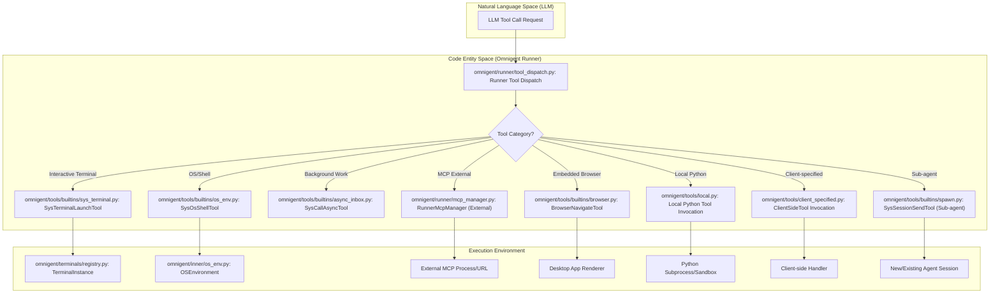
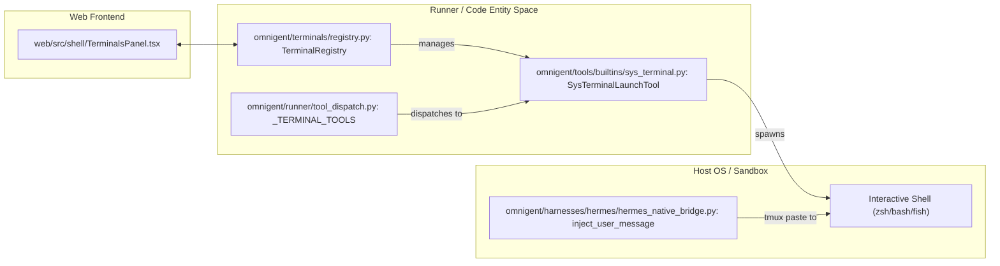

# Tools System

Relevant source files

The following files were used as context for generating this wiki page:

- [examples/remy/config.yaml](examples/remy/config.yaml)
- [omnigent/onboarding/agent/tools/python/list_builtin_tools.py](omnigent/onboarding/agent/tools/python/list_builtin_tools.py)
- [omnigent/runner/app.py](omnigent/runner/app.py)
- [omnigent/runner/tool_dispatch.py](omnigent/runner/tool_dispatch.py)
- [omnigent/runtime/prompt.py](omnigent/runtime/prompt.py)
- [omnigent/tools/builtins/__init__.py](omnigent/tools/builtins/__init__.py)
- [omnigent/tools/builtins/async_inbox.py](omnigent/tools/builtins/async_inbox.py)
- [omnigent/tools/builtins/hindsight.py](omnigent/tools/builtins/hindsight.py)
- [omnigent/tools/builtins/spawn.py](omnigent/tools/builtins/spawn.py)
- [omnigent/tools/manager.py](omnigent/tools/manager.py)
- [tests/e2e/omnigent/test_example_remy.py](tests/e2e/omnigent/test_example_remy.py)
- [tests/e2e/test_subagent_long_handoff_reachable_e2e.py](tests/e2e/test_subagent_long_handoff_reachable_e2e.py)
- [tests/e2e_ui/agents/test_subagent_long_handoff_retrieval.py](tests/e2e_ui/agents/test_subagent_long_handoff_retrieval.py)
- [tests/onboarding/test_list_builtin_tools.py](tests/onboarding/test_list_builtin_tools.py)
- [tests/runner/test_app_sessions_native_events_lifecycle.py](tests/runner/test_app_sessions_native_events_lifecycle.py)
- [tests/runner/test_hindsight_local_dispatch.py](tests/runner/test_hindsight_local_dispatch.py)
- [tests/runner/test_runner_dispatch.py](tests/runner/test_runner_dispatch.py)
- [tests/runtime/test_prompt.py](tests/runtime/test_prompt.py)
- [tests/tools/builtins/test_async_inbox.py](tests/tools/builtins/test_async_inbox.py)
- [tests/tools/builtins/test_hindsight.py](tests/tools/builtins/test_hindsight.py)
- [tests/tools/builtins/test_registry_unified.py](tests/tools/builtins/test_registry_unified.py)
- [tests/tools/builtins/test_spawn.py](tests/tools/builtins/test_spawn.py)
- [tests/tools/builtins/test_sys_session.py](tests/tools/builtins/test_sys_session.py)
- [tests/tools/test_manager.py](tests/tools/test_manager.py)

The Omnigent Tools System provides a unified interface for agents to interact with their environment, whether that environment is a local shell, a remote sandbox, an external API via the Model Context Protocol (MCP), or other agents. Tools are declared in the agent's YAML specification and are dispatched through a centralized runtime that handles execution, policy enforcement, and result routing.

## Tool Architecture and Dispatch

Omnigent treats tools as first-class entities managed by the `ToolManager` [omnigent/tools/manager.py:100-106](). When an LLM generates a tool call, the `Runner` or `Harness` intercepts the request. The system supports a diverse range of tool types:

*   **Builtin Tools:** Core capabilities like filesystem access (`sys_os_*`), shell execution, and interactive terminal management [omnigent/tools/builtins/__init__.py:26-73]().
*   **MCP Tools:** External tools provided by servers implementing the Model Context Protocol, managed by the `RunnerMcpManager`. For details, see [MCP & External Tools](#5.2).
*   **Local Python Tools:** `@tool`-decorated Python functions loaded from the agent's workspace [omnigent/tools/manager.py:166-166]().
*   **Sub-agent Tools:** The ability for an orchestrator to spawn and manage other agent sessions via `sys_session_send` [omnigent/tools/builtins/spawn.py:65-87]().
*   **Client-specified Tools:** Tools injected dynamically by the client/harness during a session via `ClientSideToolSpec` [omnigent/tools/manager.py:167-167]().
*   **Browser Tools:** A set of `browser_*` tools (e.g., `browser_navigate`, `browser_snapshot`) that drive the Omnigent desktop app's embedded browser [tests/tools/test_manager.py:88-93]().

### The Dispatch Flow

The following diagram illustrates how a tool call moves from the LLM's "Natural Language Space" into the "Code Entity Space" for execution.

**Tool Execution Path**

**Sources:** [omnigent/tools/manager.py:147-182](), [tests/tools/test_manager.py:88-93](), [omnigent/runner/tool_dispatch.py:9-18]()

---

## Tool Declaration

Tools are declared within the `AgentSpec` via the `tools` field in the agent YAML [omnigent/spec/types.py:AgentSpec]().

| Tool Type | Declaration Syntax (YAML) | Implementation Class / Logic |
| :--- | :--- | :--- |
| **Builtin** | `builtins: [...]` | `ToolManager._register_builtin_tools` [omnigent/tools/manager.py:159-159]() |
| **MCP** | `mcp_servers: [...]` | `RunnerMcpManager` (Runner-owned) [omnigent/runner/mcp_manager.py]() |
| **Python** | `local_tools: [...]` | `load_local_python_tools` [omnigent/tools/manager.py:166-166]() |
| **Client Side** | Dynamic | `ClientSideTool` [omnigent/tools/client_specified.py:29-29]() |
| **Sub-agent** | `agents: [...]` or `spawn: true` | `ToolManager._register_sub_agent_tools` [omnigent/tools/manager.py:160-160]() |

### Local Python Tools
Custom Python tools are defined using the `@tool` decorator. These tools are loaded from the agent's workspace. For security and stability, they can be executed within an `OSEnvironment` that supports sandboxing via `srt` or `uv` [omnigent/tools/manager.py:151-152]().

**Sources:** [omnigent/tools/manager.py:111-167](), [omnigent/spec/types.py:AgentSpec]()

---

## Builtin Tools

Omnigent includes a library of "Builtin" tools that provide foundational capabilities. These are often dispatched locally by the `Runner` to ensure low latency and direct access to the host or sandbox environment.

*   **OS Environment (`sys_os_*`)**: File reads, writes, edits, and shell commands [omnigent/tools/builtins/os_env.py]().
*   **Terminal (`sys_terminal_*`)**: Persistent, interactive terminal sessions managed via the runner's `TerminalRegistry` [omnigent/tools/builtins/sys_terminal.py]().
*   **Memory (Hindsight)**: Long-term memory tools (`hindsight_retain`, `hindsight_recall`, `hindsight_reflect`) allow agents to persist facts across sessions [omnigent/tools/builtins/__init__.py:209-215](). These tools are only available if the `hindsight-client` SDK is installed [omnigent/onboarding/agent/tools/python/list_builtin_tools.py:33-37]().
*   **Embedded Browser**: Tools like `browser_navigate` and `browser_click` allow agents to drive the desktop application's UI [tests/tools/test_manager.py:88-93]().
*   **Async Inbox**: Managing background tasks and inter-agent communication via `sys_call_async` and `sys_read_inbox` [omnigent/tools/builtins/__init__.py:33-37]().
*   **Sub-agents**: The `sys_session_send` tool enables recursive agent orchestration [omnigent/tools/builtins/__init__.py:65-66]().
*   **Scheduled Tasks**: Tools like `sys_scheduled_task_create` allow agents to manage recurring runs [omnigent/tools/builtins/__init__.py:52-57]().
*   **Web Tools**: `web_search` and `web_read` provide capabilities for searching the web and fetching page content. `web_read` supports various backends like Nimble, Firecrawl, and Jina [omnigent/tools/builtins/web_read.py:1-33](), [omnigent/tools/builtins/web_read_nimble.py:1-24](), [omnigent/tools/builtins/web_read_firecrawl.py:1-19]().

For a complete list of available builtins, see [Builtin Tools Reference](#5.1).

**Sources:** [omnigent/tools/manager.py:21-50](), [omnigent/tools/builtins/__init__.py:75-106](), [omnigent/onboarding/agent/tools/python/list_builtin_tools.py:33-37](), [tests/tools/test_manager.py:88-93](), [omnigent/tools/builtins/web_read.py:1-33](), [omnigent/tools/builtins/web_read_nimble.py:1-24](), [omnigent/tools/builtins/web_read_firecrawl.py:1-19]()

---

## MCP and External Tools

Omnigent supports the **Model Context Protocol (MCP)**, allowing it to connect to external tool ecosystems. The MCP lifecycle is owned by the Runner rather than the `ToolManager` [omnigent/tools/manager.py:4-5](). MCP tools are declared in the agent's `config.yaml` either inline or as sidecar YAML files in `tools/mcp/` [omnigent/spec/types.py:MCPServerConfig](), [examples/remy/config.yaml:10-15]().

*   **Model Awareness**: The `sys_list_models` tool allows agents to discover which models are available by resolving provider credentials [omnigent/tools/builtins/__init__.py:39-39]().
*   **Native Forwarding**: For native harnesses like `hermes`, Omnigent provides a forwarder that mirrors TUI transcripts and tool calls back into the web-UI session.

For details on configuring MCP servers and external APIs, see [MCP & External Tools](#5.2).

**Sources:** [omnigent/tools/manager.py:103-109](), [omnigent/spec/types.py:MCPServerConfig](), [examples/remy/config.yaml:10-15]()

---

## Interactive Terminals

One of Omnigent's most advanced tool systems is the Terminal system. It allows agents to launch and interact with persistent interactive sessions [omnigent/tools/manager.py:163-163]().

**Terminal Entity Bridge**

**Sources:** [omnigent/tools/manager.py:163-163]()

*   **Native Terminal Bridges**: Special integration for tools like `hermes` to run in their own native terminal UIs. The `HermesExecutor` spawns the CLI, while the `hermes_native_bridge` injects web-UI messages into the tmux pane.
*   **Policy Enforcement**: Native tool calls are intercepted via shell hooks (e.g., `omnigent-policy-hook.sh`) to evaluate them against the Omnigent policy engine before execution.