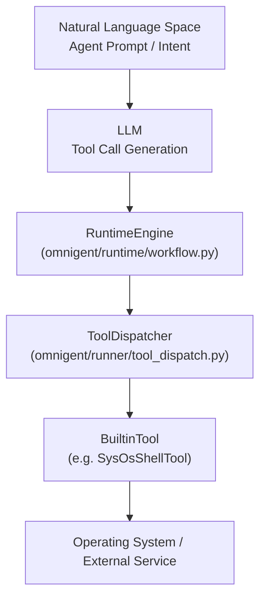
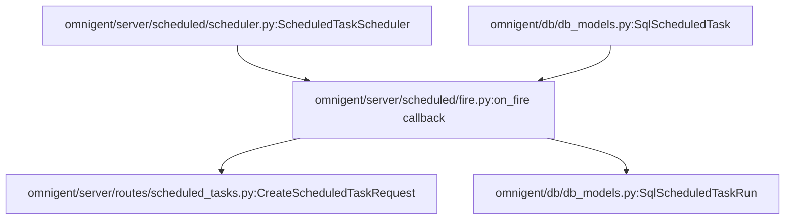
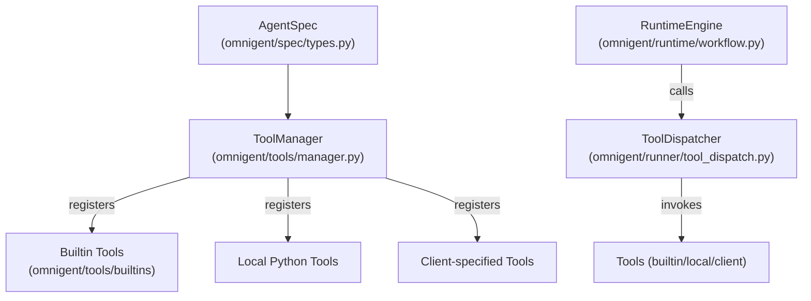

# Builtin Tools Reference

Relevant source files

The following files were used as context for generating this wiki page:

- [designs/FEATURE_FLAGS.md](designs/FEATURE_FLAGS.md)
- [docs/AUTOMATIONS.md](docs/AUTOMATIONS.md)
- [examples/remy/config.yaml](examples/remy/config.yaml)
- [omnigent/db/enum_codecs.py](omnigent/db/enum_codecs.py)
- [omnigent/entities/scheduled_task.py](omnigent/entities/scheduled_task.py)
- [omnigent/onboarding/agent/tools/python/list_builtin_tools.py](omnigent/onboarding/agent/tools/python/list_builtin_tools.py)
- [omnigent/runner/app.py](omnigent/runner/app.py)
- [omnigent/runner/tool_dispatch.py](omnigent/runner/tool_dispatch.py)
- [omnigent/runtime/prompt.py](omnigent/runtime/prompt.py)
- [omnigent/server/accounts_store.py](omnigent/server/accounts_store.py)
- [omnigent/server/routes/scheduled_tasks.py](omnigent/server/routes/scheduled_tasks.py)
- [omnigent/stores/scheduled_task_store/__init__.py](omnigent/stores/scheduled_task_store/__init__.py)
- [omnigent/stores/scheduled_task_store/dispatch.py](omnigent/stores/scheduled_task_store/dispatch.py)
- [omnigent/stores/scheduled_task_store/sqlalchemy_store.py](omnigent/stores/scheduled_task_store/sqlalchemy_store.py)
- [omnigent/tools/builtins/__init__.py](omnigent/tools/builtins/__init__.py)
- [omnigent/tools/builtins/async_inbox.py](omnigent/tools/builtins/async_inbox.py)
- [omnigent/tools/builtins/hindsight.py](omnigent/tools/builtins/hindsight.py)
- [omnigent/tools/builtins/spawn.py](omnigent/tools/builtins/spawn.py)
- [omnigent/tools/manager.py](omnigent/tools/manager.py)
- [tests/db/test_enum_codecs.py](tests/db/test_enum_codecs.py)
- [tests/e2e/omnigent/test_example_remy.py](tests/e2e/omnigent/test_example_remy.py)
- [tests/e2e/test_subagent_long_handoff_reachable_e2e.py](tests/e2e/test_subagent_long_handoff_reachable_e2e.py)
- [tests/e2e_ui/agents/test_subagent_long_handoff_retrieval.py](tests/e2e_ui/agents/test_subagent_long_handoff_retrieval.py)
- [tests/onboarding/test_list_builtin_tools.py](tests/onboarding/test_list_builtin_tools.py)
- [tests/runner/test_app_sessions_native_events_lifecycle.py](tests/runner/test_app_sessions_native_events_lifecycle.py)
- [tests/runner/test_hindsight_local_dispatch.py](tests/runner/test_hindsight_local_dispatch.py)
- [tests/runner/test_runner_dispatch.py](tests/runner/test_runner_dispatch.py)
- [tests/runtime/test_prompt.py](tests/runtime/test_prompt.py)
- [tests/server/integration/test_scheduled_tasks_routes.py](tests/server/integration/test_scheduled_tasks_routes.py)
- [tests/server/test_account_revocation.py](tests/server/test_account_revocation.py)
- [tests/stores/test_scheduled_task_store.py](tests/stores/test_scheduled_task_store.py)
- [tests/tools/builtins/test_async_inbox.py](tests/tools/builtins/test_async_inbox.py)
- [tests/tools/builtins/test_hindsight.py](tests/tools/builtins/test_hindsight.py)
- [tests/tools/builtins/test_registry_unified.py](tests/tools/builtins/test_registry_unified.py)
- [tests/tools/builtins/test_spawn.py](tests/tools/builtins/test_spawn.py)
- [tests/tools/builtins/test_sys_session.py](tests/tools/builtins/test_sys_session.py)
- [tests/tools/test_manager.py](tests/tools/test_manager.py)
- [web/src/lib/scheduledTasksApi.ts](web/src/lib/scheduledTasksApi.ts)

This page provides a detailed technical reference for the builtin tools provided by Omnigent. These tools are implemented in the `omnigent/tools/builtins/` directory and provide agents with core capabilities such as OS environment access, sub-agent orchestration, terminal management, web fetch and search, file upload/download, async inbox handling, hindsight integration, scheduled task management, session rename, policy inspection, and skill loading.

## Overview

Builtin tools are Python classes registered and managed through the Omnigent `ToolManager` [omnigent/tools/manager.py:103-182](). They provide core primitives that enable agents to perform system-level operations, orchestrate sub-agents, interact with terminals, perform web operations, and handle scheduled tasks and asynchronous workflows.

The `RuntimeEngine` or the runner dispatches tool calls to these implementations, ensuring proper policy enforcement and result serialization.

### Tool Call Execution Flow

- The agent's natural language intent is transformed into a JSON tool call by the LLM.
- The `RuntimeEngine` invokes the `ToolDispatcher` in the runner.
- The dispatcher calls the appropriate builtin tool class.
- The tool executes the request, often interacting with the OS or external services and returns results.

Sources: `[omnigent/runner/tool_dispatch.py:164-172]()` `[omnigent/tools/manager.py:111-182]()` `[omnigent/runner/app.py:1-193]()`

---

## Tool Categories and Details

### 1. OS & Environment Tools (`os_env`, `spawn`, `sys_terminal`)

These foundational tools provide agents with low-level capabilities for interacting with the OS, spawning and managing sub-agents, and terminal session I/O.

#### OS Environment Tools (`os_env`)

- Implements file and shell operations.
- Key classes:
  - `SysOsShellTool`: Executes shell commands with a default timeout of 120 seconds [omnigent/runner/tool_dispatch.py:84-86]().
  - `SysOsReadTool`, `SysOsWriteTool`, `SysOsEditTool`: Provide file read, write, and edit capabilities respectively [omnigent/tools/builtins/os_env.py:82-170]().

These tools use a shared or independently created `OSEnvironment` object to abstract shell interaction [omnigent/inner/os_env.py]().

#### Sub-Agent Management (`spawn`)

- Sub-agents are full Omnigent sessions representing child agents.
- `SysSessionSendTool` supports:
  - Named sub-agent creation or continuation via `(agent, title)` pairs.
  - Sending messages to existing child sessions by `session_id`.
- The tool handles concurrency and status monitoring of sub-agents [omnigent/tools/builtins/spawn.py:66-149]().
- Sub-agent processes are managed via the runner harness infrastructure, with lifecycle events tracked.

#### Terminal Management (`sys_terminal`)

- Manages interactive terminal sessions.
- Tools include:
  - `SysTerminalLaunchTool`: Launches new terminals.
  - `SysTerminalSendTool`: Sends inputs to terminals.
  - `SysTerminalReadTool`: Reads terminal outputs.
  - `SysTerminalListTool`: Lists active terminals.
  - `SysTerminalCloseTool`: Closes terminal sessions [omnigent/runner/tool_dispatch.py:102-108]().
- Uses the `TerminalRegistry` for centralized terminal lifecycle management.

| Tool Name          | Class                  | Purpose                        |
|--------------------|------------------------|--------------------------------|
| `sys_os_shell`      | `SysOsShellTool`       | Execute shell commands        |
| `sys_os_read`       | `SysOsReadTool`        | Read file contents            |
| `sys_os_write`      | `SysOsWriteTool`       | Write to files                |
| `sys_session_send`  | `SysSessionSendTool`   | Create/continue sub-agents    |
| `sys_terminal_send` | `SysTerminalSendTool`  | Send input to terminals       |

Sources: `[omnigent/runner/tool_dispatch.py:73-99]()`, `[omnigent/tools/builtins/spawn.py:66-149]()`, `[omnigent/tools/manager.py:111-182]()`, `[omnigent/tools/builtins/os_env.py:82-170]()`, `[omnigent/runner/tool_dispatch.py:84-86]()`, `[omnigent/runner/tool_dispatch.py:102-108]()`

---

### 2. File Upload/Download & Workspace Management

Omnigent manages files scoped to conversations and sessions.

- `UploadFileTool` and `DownloadFileTool` handle file transfer across the runner and server boundaries.
- Uploads are carefully sandboxed using safe path resolution (`safe_resolve`) to prevent directory traversal [omnigent/tools/builtins/upload_file.py:116-116]().
- `ListFilesTool` enumerates files associated with the current conversation/session.
- File data often moves from client upload → server store → runner/workspace → agent tool consumption.

The runner enforces a read budget for server file POST requests, held at a one-day timeout (86400s) to accommodate human approval delays [omnigent/runner/tool_dispatch.py:181-185]().

Sources: `[omnigent/tools/builtins/upload_file.py:110-150]()` `[omnigent/runner/tool_dispatch.py:10-13]()` `[omnigent/tools/builtins/upload_file.py:116-116]()`

---

### 3. Web Fetch & Search Tools

Agents require live data from the web for research workflows.

- `WebSearchTool` unifies multiple search providers (`google`, `perplexity`, `tavily`, `nimble`, `keenable`) under a single interface [omnigent/tools/builtins/web_search.py:65-75]().
- `web_fetch` tools allow agents to fetch raw HTML or payload data from URLs. These include `WebReadTool`, `WebReadFirecrawlTool`, `WebReadJinaTool`, and `WebReadNimbleTool` [omnigent/tools/builtins/web_read.py:28-35]().
- These tools are schema-only in the runner but leverage external HTTP APIs or embedded browser capabilities.

Sources: `[omnigent/tools/builtins/web_search.py:65-75]()`, `[omnigent/runner/tool_dispatch.py:10-10]()`, `[omnigent/tools/builtins/web_read.py:28-35]()`

---

### 4. Async Inbox & Timers

Supports asynchronous scheduling and background task management for non-blocking agent workflows.

- `SysCallAsyncTool` dispatches background tool calls [omnigent/tools/builtins/async_inbox.py:64-70]().
- `SysReadInboxTool` reads the outputs of these async tasks.
- `SysCancelAsyncTool` cancels running async tasks.
- Timer tools `SysTimerSetTool` and `SysTimerCancelTool` allow agents to set and cancel timers used for delayed execution or wake notifications [omnigent/tools/builtins/timer.py:70-75]().

These tools use a topic-based event stream (`async_work_complete`) and unify with the `pending_elicitations` queue system for coordination.

Sources: `[omnigent/tools/builtins/async_inbox.py:63-70]()`, `[omnigent/tools/builtins/timer.py:68-75]()`

---

### 5. Scheduled Tasks (Automation)

Scheduled tasks enable agents to create recurring automation through RFC 5545 recurrence rules.

- Tools:
  - `sys_scheduled_task_create`, `sys_scheduled_task_list`, `sys_scheduled_task_update`, `sys_scheduled_task_delete` allow full CRUD of scheduled tasks [omnigent/tools/builtins/__init__.py:52-57]().
- Schedule data models persist to `SqlScheduledTask` and historical runs to `SqlScheduledTaskRun` in the database [omnigent/stores/scheduled_task_store/sqlalchemy_store.py:19-20]().
- When a scheduled task fires, the server creates a session bound to the task's agent, applies user grants, launches the runner, sends the prompt, and records run metadata [omnigent/server/scheduled/fire.py:1-153]().
- Scheduled tasks can pin execution to a connected host and workspace; otherwise fallback defaults are resolved.

Sources: `[omnigent/stores/scheduled_task_store/__init__.py:21-180]()`, `[omnigent/stores/scheduled_task_store/sqlalchemy_store.py:1-202]()`, `[omnigent/server/scheduled/fire.py:1-153]()`, `[omnigent/server/routes/scheduled_tasks.py:56-84]()`, `[omnigent/tools/builtins/__init__.py:52-57]()`, `[omnigent/db/db_models.py:19-20]()`

---

### 6. Session Rename, Policy & Skill Tools

- `SysSessionRenameTool` lets the LLM update the session title dynamically [omnigent/tools/builtins/session_rename.py:45-57]().
- Policy tools expose the registry and allow adding policies at runtime.
- Skill tools include:
  - `LoadSkillTool`: Loads skill instructions by name.
  - `ReadSkillFileTool`: Reads files from a skill's `references/` directory.
  - The helpers `any_skill_has_resources` and `list_skill_resources` inform whether resource files exist and list them [omnigent/tools/builtins/__init__.py:40-51]().
- Hindsight tools (`HindsightRetainTool`, `HindsightRecallTool`) optionally interface with the `hindsight-client` SDK for long-term memory [omnigent/tools/builtins/__init__.py:200-221]().

Sources: `[omnigent/tools/builtins/__init__.py:1-113]()`, `[omnigent/tools/builtins/session_rename.py:45-57]()`, `[omnigent/tools/builtins/__init__.py:200-221]()`

---

## Technical Details: Tool Registration and Dispatching

### ToolManager Class

- Central registry for tools used by an agent execution.
- Registers:
  - Skill tools if any skills are specified.
  - Builtin tools (the core system-provided).
  - Local Python tools found in extracted bundles.
  - Client-specified tools declared at request time.
- MCP (Multi-Client Proxy) tools are registered and run in the runner process, separate from `ToolManager` [omnigent/tools/manager.py:103-180]().

### Builtin Tool Registration

- Tools are registered conditionally based on the agent spec.
- Some tools are always registered (e.g., `sys_cancel_task`, comment tools, session discovery). For example, `sys_session_rename` is registered for every agent [tests/tools/test_manager.py:125-129]().
- Async inbox tools register only if async is enabled on the agent spec.
- `ToolManager` keeps a dictionary of tool name → tool instance for dispatching at runtime.

### Dispatch Flow

- When the agent's execution loop issues a tool call, the runner's tool dispatcher receives it.
- It categorizes the tool into:
  - OS environment tools.
  - REST-dispatched tools (like async call management).
  - File manipulation tools.
  - Terminal tools.
  - MCP tools (dynamic).
  - Client-specified tools (deferred to client).
- The dispatcher invokes the tool's `invoke()` method and streams or returns the response [omnigent/runner/tool_dispatch.py:1-189]().

Sources: `[omnigent/tools/manager.py:103-180]()`, `[omnigent/runner/tool_dispatch.py:1-189]()`, `[omnigent/tools/builtins/__init__.py:1-113]()`, `[omnigent/spec/types.py]()`, `[tests/tools/test_manager.py:125-129]()`

---

## Summary

Omnigent provides a rich set of builtin tools covering essential domains:

| Category               | Primary Modules & Tools                                | Description                                              |
|------------------------|-------------------------------------------------------|----------------------------------------------------------|
| OS Env & Spawn         | `os_env`, `spawn` (`SysOsShellTool`, `SysSessionSendTool`) | Shell commands, file I/O, sub-agent orchestration       |
| Terminal Management    | `sys_terminal` (launch, send, read, list, close)      | Interactive terminal sessions management                 |
| File Upload/Download   | `upload_file`, `download_file`, `list_files`          | File transfer, workspace data management                 |
| Web Fetch & Search     | `web_search`, `web_read` (`WebReadTool`, `WebReadFirecrawlTool`, `WebReadJinaTool`, `WebReadNimbleTool`) | Web research via multiple providers                       |
| Async & Timers         | `sys_call_async`, `sys_read_inbox`, `sys_cancel_async`, `sys_timer_set`, `sys_timer_cancel` | Background tasks, timers, delayed events                |
| Scheduled Tasks        | `sys_scheduled_task_*`                                | Recurring agent automations, schedule management         |
| Session Rename & Policy | `sys_session_rename`, policy tools                    | Dynamic session title updates, policy inspection         |
| Skill Management       | `load_skill`, `read_skill_file`                      | Skill instruction retrieval and resource file access     |
| Hindsight (optional)   | `hindsight_retain`, `hindsight_recall`               | Long-term memory integration via hindsight SDK           |

This integrated tool suite equips agents with rich capabilities spanning local OS control to complex multi-agent workflows and scheduled automation.

---

This completes the detailed reference for builtin tools in the Omnigent codebase.

Sources:
`omnigent/runner/tool_dispatch.py:1-189`
`omnigent/tools/manager.py:103-180`
`omnigent/tools/builtins/spawn.py:1-150`
`omnigent/tools/builtins/__init__.py:1-113`
`omnigent/tools/builtins/async_inbox.py:60-80`
`omnigent/tools/builtins/timer.py:65-75`
`omnigent/tools/builtins/web_search.py:60-80`
`omnigent/tools/builtins/web_read.py:28-35`
`omnigent/tools/builtins/upload_file.py:110-150`
`omnigent/stores/scheduled_task_store/sqlalchemy_store.py:1-202`
`omnigent/server/scheduled/fire.py:1-153`
`omnigent/server/routes/scheduled_tasks.py:40-70`
`omnigent/runner/app.py:1-193`
`omnigent/tools/builtins/os_env.py:82-170`
`omnigent/runner/tool_dispatch.py:185-185`
`omnigent/tools/builtins/session_rename.py:45-57`
`omnigent/spec/types.py`
`tests/tools/test_manager.py:125-129`