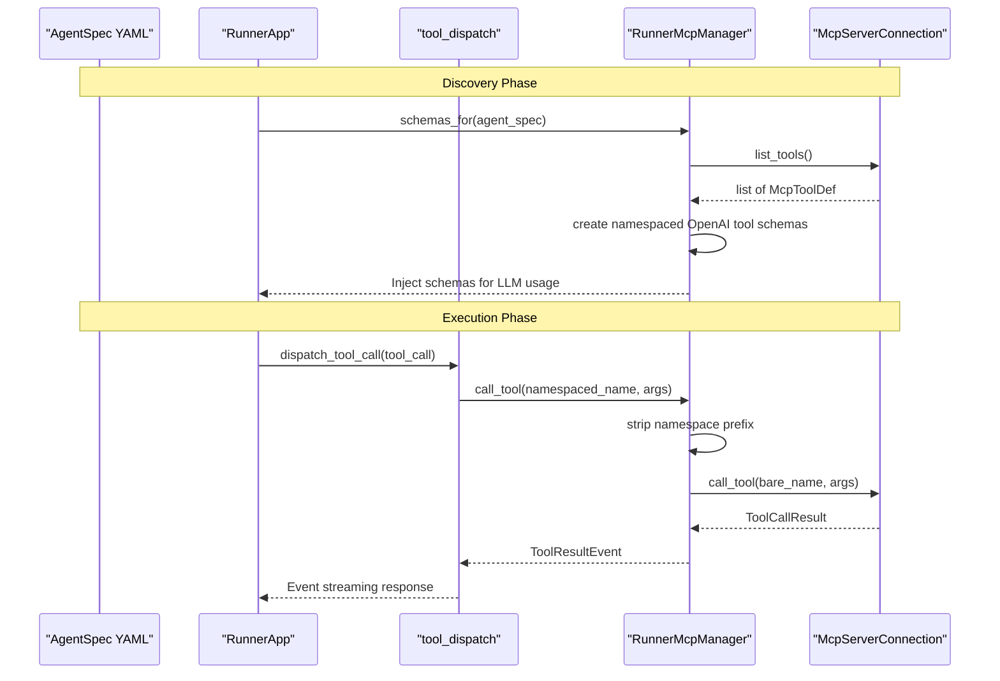
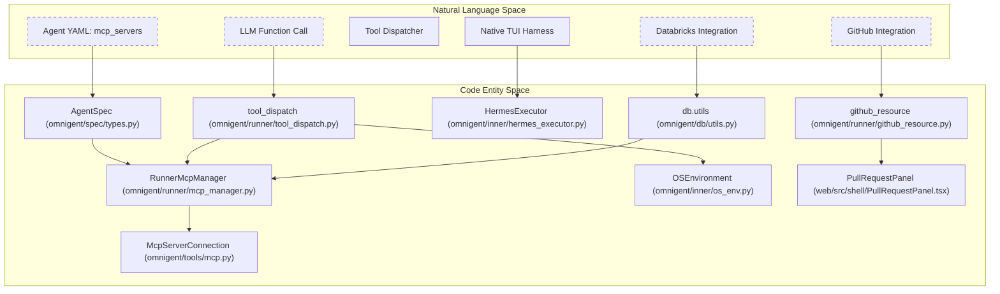

# MCP & External Tools

Relevant source files

The following files were used as context for generating this wiki page:

- [omnigent/db/converters.py](omnigent/db/converters.py)
- [omnigent/db/migrations/versions/d4c1b9e6f3a2_policies_scope_index_drop_unique.py](omnigent/db/migrations/versions/d4c1b9e6f3a2_policies_scope_index_drop_unique.py)
- [omnigent/db/migrations/versions/q1a2b3c4d5e6_add_scope_to_policies.py](omnigent/db/migrations/versions/q1a2b3c4d5e6_add_scope_to_policies.py)
- [omnigent/db/migrations/versions/z5a2b3c4d5e6_drop_partial_indexes.py](omnigent/db/migrations/versions/z5a2b3c4d5e6_drop_partial_indexes.py)
- [omnigent/entities/agent.py](omnigent/entities/agent.py)
- [omnigent/entities/policy.py](omnigent/entities/policy.py)
- [omnigent/runner/git_providers/__init__.py](omnigent/runner/git_providers/__init__.py)
- [omnigent/runner/github_resource.py](omnigent/runner/github_resource.py)
- [omnigent/server/agent_config.py](omnigent/server/agent_config.py)
- [omnigent/server/routes/session_mcp_servers.py](omnigent/server/routes/session_mcp_servers.py)
- [omnigent/server/routes/sessions/routes_agent.py](omnigent/server/routes/sessions/routes_agent.py)
- [omnigent/server/routes/sessions/routes_permissions.py](omnigent/server/routes/sessions/routes_permissions.py)
- [omnigent/stores/agent_store/__init__.py](omnigent/stores/agent_store/__init__.py)
- [omnigent/stores/agent_store/sqlalchemy_store.py](omnigent/stores/agent_store/sqlalchemy_store.py)
- [omnigent/stores/policy_store/sqlalchemy_store.py](omnigent/stores/policy_store/sqlalchemy_store.py)
- [tests/db/test_migration_agents_session_id.py](tests/db/test_migration_agents_session_id.py)
- [tests/db/test_migration_policy_name_cksum.py](tests/db/test_migration_policy_name_cksum.py)
- [tests/db/test_migration_policy_scope.py](tests/db/test_migration_policy_scope.py)
- [tests/db/test_migration_policy_scope_index.py](tests/db/test_migration_policy_scope_index.py)
- [tests/db/test_migration_title_not_null.py](tests/db/test_migration_title_not_null.py)
- [tests/e2e_ui/github/_gh_shim.py](tests/e2e_ui/github/_gh_shim.py)
- [tests/e2e_ui/github/test_check_outcomes_cancelled_skipped.py](tests/e2e_ui/github/test_check_outcomes_cancelled_skipped.py)
- [tests/e2e_ui/github/test_github_tab.py](tests/e2e_ui/github/test_github_tab.py)
- [tests/e2e_ui/github/test_pr_without_checks_permission.py](tests/e2e_ui/github/test_pr_without_checks_permission.py)
- [tests/entities/test_policy.py](tests/entities/test_policy.py)
- [tests/runner/test_github_resource.py](tests/runner/test_github_resource.py)
- [tests/runner/test_github_reviewers.py](tests/runner/test_github_reviewers.py)
- [tests/server/integration/test_session_agent_owner.py](tests/server/integration/test_session_agent_owner.py)
- [tests/server/integration/test_session_mcp_servers.py](tests/server/integration/test_session_mcp_servers.py)
- [tests/stores/test_agent_store.py](tests/stores/test_agent_store.py)
- [tests/stores/test_session_policy_store.py](tests/stores/test_session_policy_store.py)
- [web/src/hooks/usePullRequests.ts](web/src/hooks/usePullRequests.ts)
- [web/src/shell/PullRequestPanel.test.tsx](web/src/shell/PullRequestPanel.test.tsx)
- [web/src/shell/PullRequestPanel.tsx](web/src/shell/PullRequestPanel.tsx)

Omnigent supports integration with **Model Context Protocol (MCP)** servers, enabling agents to discover and invoke external tools dynamically. This system allows agents to access tools such as local filesystems, Databricks APIs, GitHub integrations, and other external services in a flexible, dynamically loaded manner.

Additionally, Omnigent manages multiple tool categories, including MCP tools, native harness tools, client-side tunneled tools, and external integrations like GitHub and Databricks connections. This page provides a deep technical overview of how MCP tools are declared, managed, and dispatched inside the Omnigent runner environment, how client-specified tools are routed, and how GitHub and Databricks connections are integrated.

---

## 1. MCP Tool Declaration in Agent YAML

MCP tools are declared in the agent's YAML configuration under the `mcp_servers` key within an `AgentSpec`. Each entry specifies how to connect to or spawn the MCP server and which subset of tools to enable.

### Example YAML Structure

Each MCP server is defined with fields such as:

- **`name`**: Unique MCP server identifier.
- **`transport`**: Communication mode, `"stdio"` for a local subprocess, or `"http"` for a remote SSE web endpoint.
- **`command` / `args`**: Command to launch the server process (for stdio).
- **`url`**: Endpoint URL (for http transport).
- **`allowed`**: Optional list of tool names whitelisted for exposure from that server.

This declarative design allows multiple MCP servers per agent and supports fine-grained control over which external capabilities an agent can invoke.

Sources: [omnigent/server/routes/session_mcp_servers.py:54-59]()

---

## 2. MCP Management Architecture in the Runner

### 2.1 RunnerMcpManager: Managing MCP Servers & Tool Schemas

The `RunnerMcpManager` class in `omnigent.runner.mcp_manager` owns the lifecycle and client pooling of MCP servers referenced by an AgentSpec.

- It uses two hashing functions to identify MCP servers and their connection specs:
  - `compute_spec_hash(spec: AgentSpec) -> str`: Computes a stable hash over all MCP servers in a spec, ensuring uniqueness of the declared toolset.
  - `compute_server_hash(server: McpServerSpec) -> str`: Computes a hash for an individual MCP server connection, ignoring fields like the user-visible `name` and tool allow-list, enabling connection sharing across different agent specs that target the same server.

- **Connection Pooling**: The manager maintains a pool of live MCP connections keyed by the server hashes to optimize resource use and avoid duplicate connections.

- **Schema Retrieval**: The function `schemas_for(spec: AgentSpec)` enumerates declared MCP servers, connects to them, and retrieves their tool schemas. These are merged and injected as OpenAI-format function definitions for the LLM's context.

- **Tool Dispatch**: The manager's `call_tool(spec, namespaced_tool_name, args)` handles execution requests from the runner's tool dispatcher. It parses namespaced tool names (e.g. `"myserver__list_files"`) to identify the MCP server and bare tool to call, strips the namespace prefix, forwards the call to the MCP connection, and then returns a result event.

### 2.2 Tool Name Namespacing and Filtering

- MCP tools in the runner are namespaced as `{server_name}__{bare_tool_name}` using a double underscore delimiter to avoid collisions between different MCP servers providing tools with identical names.

- The `allowed` field defined per-server in the spec restricts exposure to a subset of MCP tools; any tools not in this allow-list are filtered out. This ensures security and clear control over which external capabilities an agent can invoke.

### 2.3 Integration with Runner Tool Dispatch

- The runner's tool dispatch intercepts calls in `tool_dispatch.py`. If a tool call matches the MCP namespace pattern, it is dispatched through the `RunnerMcpManager` instance; otherwise, it proceeds to other local or builtin tool handlers.

Sources: [omnigent/server/routes/session_mcp_servers.py:54-59]()

---

## 3. MCP Tool Data Flow and Lifecycle

This diagram illustrates the end-to-end lifecycle of MCP tools from agent YAML declaration, through runner management, to invocation via the tool dispatcher.

### MCP Tool Lifecycle Sequence Diagram

Sources: [omnigent/server/routes/session_mcp_servers.py:147-167]()

---

## 4. External & Client-Specified Tools Handling

### 4.1 Tool Categories in the Runner

The runner classifies tools into categories and dispatches accordingly in `tool_dispatch.py`:

- **OS Environment Tools**: Executed locally inside the runner using the `OSEnvironment` helper. Includes commands like `sys_os_shell`, `sys_os_read`, `sys_os_write`.
- **REST & File System Tools**: Invoke server REST APIs asynchronously, e.g. `sys_call_async`, `sys_upload`.
- **Terminal Tools**: Runner-local terminal sessions managed by `TerminalRegistry`.
- **MCP Tools**: Dynamically declared via `AgentSpec` and dispatched through `RunnerMcpManager`.
- **Client-Side Tools**: Tools that require client-side intervention or UI rendering are tunneled via the REPL interface and deferred for later dispatch.

### 4.2 Native Harness Tool Bridging

Native harnesses provide specialized runtime environments for coding agents, such as Claude Code or Codex, with unique tooling integration requirements.

- The **Hermes Native Harness** is a prime example. It uses a `hermes_native_bridge.py` shim to inject messages (including tool calls) into its `tmux` terminal pane, ensuring tool invocations conform to Omnigent's expectations.
- A read-only forwarder `hermes_native_forwarder.py` watches the SQLite conversation store and mirrors updates to the web UI in real-time.
- Native harnesses enforce policies by invoking hooks like `pre_tool_call` to evaluate tool call permissions against the global policy engine before proceeding.

This bridging architecture isolates native harness concerns from the runner's general tool dispatch logic while preserving access control.

---

## 5. GitHub and Databricks Connections

Omnigent integrates tightly with GitHub for session workspace management and Databricks for execution environments via MCP protocols.

- **GitHub**:
  - The runner runs `gh` CLI commands directly in the workspace root, bypassing sandboxed shells to preserve user authentication (except in managed sandboxes where the environment is scrubbed for security) [omnigent/runner/github_resource.py:5-45]().
  - The `github_resource` module provides functions like `github_info`, `github_changed_files`, `github_pr_diff`, and `github_file_diff` to interact with GitHub. These functions handle subprocess execution of `gh` and `git` commands, including timeouts and environment variable management [omnigent/runner/github_resource.py:106-156]().
  - The integration exposes details such as PR number, title, state, CI results, and a unified diff view of the branch's changes. This data is surfaced in the web UI's Pull Request panel via REST calls to the runner's read-only GitHub resource API. The `web/src/shell/PullRequestPanel.tsx` component is responsible for rendering this information [web/src/shell/PullRequestPanel.tsx:1-22]().
  - GitHub state always uses GitHub-computed data instead of local `git` diffs, avoiding stale or incomplete metadata [omnigent/runner/github_resource.py:25-27](). The `WorkspaceReader` in `omnigent/workspace_fs.py` provides a read-only view of the workspace filesystem, which can be used by the host to serve file panel data when the runner is offline, including git-tracked changes.

- **Databricks**:
  - MCP specification supports declaring Databricks connections as MCP servers, enabling agent tooling like Databricks SQL query execution and job control.
  - The `omnigent.db.utils` module includes functionality for connecting to Databricks Lakebase, which uses short-lived OAuth tokens as Postgres passwords. The `_databricks_lakebase_token_provider` function mints these tokens using the Databricks SDK.
  - The runner's MCP manager handles the start and dispatch of such connections transparently to the agent.

Sources: [omnigent/runner/github_resource.py:1-156](), [web/src/shell/PullRequestPanel.tsx:1-22](), [omnigent/runner/github_resource.py:25-27]()

---

## 6. Mapping "Natural Language Space" to "Code Entity Space"

The following diagram associates system components from the architecturally descriptive "natural language" perspective with their concrete code implementations. This helps to bridge conceptual understanding with precision source code locations.

### Natural Language to Code Entity Mapping

Sources: [omnigent/runner/mcp_manager.py](), [omnigent/runner/tool_dispatch.py](), [omnigent/runner/github_resource.py](), [web/src/shell/PullRequestPanel.tsx:1-22](), [omnigent/db/utils.py]()

---

## 7. Key Classes and Functions Summary

| Class / Function | Location | Responsibility |
|---|---|---|
| `RunnerMcpManager` | `omnigent/runner/mcp_manager.py` | Manages MCP server lifecycle, caching, connection pooling, schema retrieval, and tool dispatch |
| `compute_spec_hash` | `omnigent/runner/mcp_manager.py` | Computes a unique hash for the MCP servers declared in an AgentSpec |
| `compute_server_hash` | `omnigent/runner/mcp_manager.py` | Computes stable hash for an individual MCP server ignoring non-connection fields |
| `schemas_for` | `omnigent/runner/mcp_manager.py` | Retrieves OpenAI function schemas for MCP tools declared in an AgentSpec |
| `call_tool` | `omnigent/runner/mcp_manager.py` | Executes a namespaced MCP tool call by routing to the corresponding MCP server connection |
| `dispatch_tool_call` | `omnigent/runner/tool_dispatch.py` | Intercepts tool calls in the runner and routes MCP tool calls to `RunnerMcpManager` |
| `HermesExecutor` | `omnigent/inner/hermes_executor.py` | Runs turns on the Hermes native harness with policy enforcement hooks |
| `OSEnvironment` | `omnigent/inner/os_env.py` | Executes OS environment-based builtin tools locally |
| `github_info` | [omnigent/runner/github_resource.py:200-200]() | Retrieves GitHub repository and PR information for the current workspace |
| `_databricks_lakebase_token_provider` | `omnigent/db/utils.py` | Mints short-lived OAuth tokens for Databricks Lakebase connections |
| `WorkspaceReader` | `omnigent/workspace_fs.py` | Provides a read-only view of a workspace directory, used for file panel data |
| `PullRequestPanel` | [web/src/shell/PullRequestPanel.tsx:141-144]() | React component for displaying GitHub PR information in the web UI |

---

# Summary

This technical overview covers how MCP tools are declared in agent YAML, managed and pooled by the Runner's `RunnerMcpManager`, dispatched through the runner's intercepting `tool_dispatch` system, and integrated with native harnesses and client-specified tools. The GitHub and Databricks MCP integrations are also part of this broader external tool support, enabling sophisticated tooling for Omnigent agents.

For detailed implementation and deeper understanding, see the referenced source files.

---

Sources:
- [omnigent/db/utils.py]()
- [omnigent/runner/github_resource.py:1-1855]()
- [omnigent/runner/mcp_manager.py]()
- [omnigent/runner/tool_dispatch.py]()
- [omnigent/server/routes/session_mcp_servers.py:1-761]()
- [omnigent/workspace_fs.py]()
- [web/src/shell/PullRequestPanel.tsx:1-1917]()