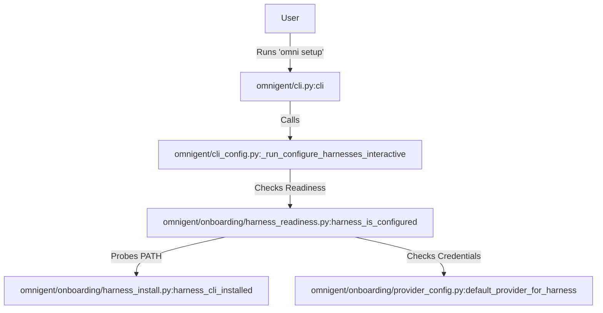
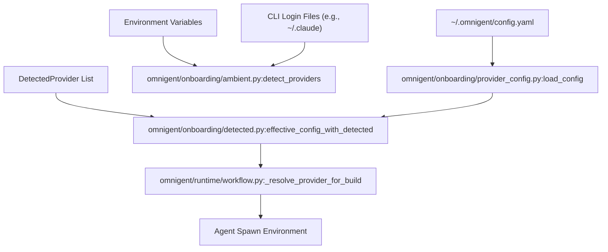

# Onboarding & Provider Configuration

<details>
<summary>Relevant source files</summary>

The following files were used as context for generating this wiki page:

- [omnigent/cli_config.py](omnigent/cli_config.py)
- [omnigent/harness_aliases.py](omnigent/harness_aliases.py)
- [omnigent/onboarding/ambient.py](omnigent/onboarding/ambient.py)
- [omnigent/onboarding/configure_models.py](omnigent/onboarding/configure_models.py)
- [omnigent/onboarding/detected.py](omnigent/onboarding/detected.py)
- [omnigent/onboarding/harness_install.py](omnigent/onboarding/harness_install.py)
- [omnigent/onboarding/harness_readiness.py](omnigent/onboarding/harness_readiness.py)
- [omnigent/onboarding/provider_config.py](omnigent/onboarding/provider_config.py)
- [omnigent/runtime/harnesses/__init__.py](omnigent/runtime/harnesses/__init__.py)
- [omnigent/runtime/workflow.py](omnigent/runtime/workflow.py)
- [tests/cli/test_configure_models.py](tests/cli/test_configure_models.py)
- [tests/e2e/omnigent/test_run_harness_without_agent_e2e.py](tests/e2e/omnigent/test_run_harness_without_agent_e2e.py)
- [tests/inner/conftest.py](tests/inner/conftest.py)
- [tests/inner/test_seccomp.py](tests/inner/test_seccomp.py)
- [tests/onboarding/test_ambient.py](tests/onboarding/test_ambient.py)
- [tests/onboarding/test_detected.py](tests/onboarding/test_detected.py)
- [tests/onboarding/test_harness_install.py](tests/onboarding/test_harness_install.py)
- [tests/onboarding/test_harness_readiness.py](tests/onboarding/test_harness_readiness.py)
- [tests/onboarding/test_provider_config.py](tests/onboarding/test_provider_config.py)
- [tests/runtime/test_openai_agents_sdk_spawn_env.py](tests/runtime/test_openai_agents_sdk_spawn_env.py)
- [tests/runtime/test_provider_spawn_env.py](tests/runtime/test_provider_spawn_env.py)
- [tests/test_harness_aliases.py](tests/test_harness_aliases.py)

</details>


The Omnigent onboarding system bridges local development environments with secure agent execution. It provides a guided setup experience that handles credential discovery, provider configuration, and the provisioning of execution environments (sandboxes). This system ensures that agents have the necessary "fuel" (model access) and "workspace" (compute) to operate.

## Setup Wizard & Discovery

When a user first runs `omnigent` or `omni`, the system initiates an interactive setup process. The setup flow, primarily driven by `omnigent setup`, performs automated discovery of existing credentials by scanning environment variables (e.g., `ANTHROPIC_API_KEY`) and existing CLI configurations for tools like Claude Code or Codex [omnigent/onboarding/harness_install.py:1-34](). The `omnigent/cli_config.py` module manages the interactive prompts and writes the results to the global config [omnigent/cli_config.py:1-16]().

The configuration system supports a **three-level** picker. The first level presents every available harness on a single compact row, indicating its installation status. Selecting a harness drills into the second level, which displays its configured credentials and options to add new ones. The third level allows actions on a specific credential, such as making it the default or removing it [tests/cli/test_configure_models.py:11-31]().

For details on the discovery logic and the interactive CLI implementation, see [Credential & Provider Management](#6.1).

### Onboarding & Readiness Flow
The following diagram illustrates how the onboarding subsystems interact to detect credentials and verify the environment.

**Onboarding Logic Flow**

Sources: [omnigent/onboarding/harness_readiness.py:1-23](), [omnigent/onboarding/harness_install.py:8-14](), [omnigent/onboarding/provider_config.py:65-67]()

## Harness Installation & Auth

Omnigent distinguishes between in-process SDK harnesses and CLI-wrapping harnesses (e.g., `claude-native`, `codex-native`). The `omnigent/onboarding/harness_install.py` module defines the `HarnessInstallSpec` for each tool, including its npm package name, binary name, and minimum version requirements [omnigent/onboarding/harness_install.py:36-116]().

The system manages harness-specific authentication, allowing users to trigger `login`/`logout` commands (like `claude auth login` or `codex login`) directly through the Omnigent configuration surface [omnigent/onboarding/harness_install.py:16-34](). It also enforces version floors to ensure compatibility with runtime features like native policy hooks or non-interactive approval modes [omnigent/onboarding/harness_install.py:81-124]().

| Feature | Description | Code Entity |
| :--- | :--- | :--- |
| **Install Spec** | Metadata for CLI binaries (npm package, min version) | `HarnessInstallSpec` [omnigent/harness_install_spec.py:1-1]() |
| **Setup Steps** | Ordered checklist (Install -> Auth) | `SetupStep` [omnigent/harness_install_spec.py:1-1]() |
| **Version Floor** | Enforced minimum CLI versions (e.g., Claude 2.1.161) | `_CLAUDE_MIN_VERSION` [omnigent/onboarding/harness_install.py:127-127]() |

Sources: [omnigent/onboarding/harness_install.py:1-130](), [tests/onboarding/test_harness_install.py:45-52]()

## Provider Configuration & Storage

Omnigent stores model provider configurations in `~/.omnigent/config.yaml`. This configuration includes details such as the provider `kind` (e.g., `key`, `subscription`, `gateway`, `local`, `databricks`, `cli-config`, `bedrock`), associated `families` (e.g., `anthropic`, `openai`, `gemini`), and secret references [omnigent/onboarding/provider_config.py:1-135]().

The `ProviderEntry` dataclass [omnigent/onboarding/provider_config.py:68-74]() represents a single provider configuration, which can be explicitly named or set as a default for a specific model family. This allows for flexible model routing, where an agent can either specify a provider directly or rely on the system's default resolution logic [omnigent/runtime/workflow.py:69-70]().

The system also supports ambient detection of credentials from environment variables (e.g., `ANTHROPIC_API_KEY`, `OPENAI_API_KEY`) and existing CLI logins (e.g., Claude, Codex). These detected providers are merged with the explicit configuration to form an effective configuration [omnigent/onboarding/detected.py:1-10](), [omnigent/onboarding/ambient.py:1-22]().

### Provider Configuration Flow
This diagram illustrates how provider configurations are loaded, detected, and resolved for use by the runtime.


Sources: [omnigent/onboarding/provider_config.py:73-74](), [omnigent/onboarding/provider_config.py:65-67](), [omnigent/onboarding/ambient.py:96-129](), [omnigent/onboarding/detected.py:55-56](), [omnigent/runtime/workflow.py:49-49]()

## Model Catalog

Omnigent maintains a model catalog that stores information about available models, their capabilities, and context window sizes. This catalog is used for smart routing and ensuring that agents select appropriate models for their tasks. The `omnigent/models/model_catalog.py` module is responsible for resolving models from this catalog [omnigent/models/model_catalog.py:1-1]() and is integrated into the `LLMClient` [omnigent/llms/client.py:1-1]().

The model catalog is integrated into the provider configuration, allowing providers to specify which models they offer. When an agent requests a model, the system resolves it against the catalog, considering the active provider and any specified model overrides [omnigent/runtime/workflow.py:47-48]().

## Harness Readiness

Readiness is evaluated along two axes: **configured** (valid model credentials) and **installed** (binary on PATH) [omnigent/onboarding/harness_install.py:3-10](). The `harness_is_configured` function in `omnigent/onboarding/harness_readiness.py` provides the source of truth for the host daemon, ensuring that an agent launch only proceeds if the environment is fully prepared [omnigent/onboarding/harness_readiness.py:1-23]().

The readiness check performs the following:
*   **SDK Harnesses**: Generally "fail open" as credentials resolve at runtime [omnigent/onboarding/harness_readiness.py:14-20]().
*   **CLI Harnesses**: Gated on binary presence via `shutil.which` [tests/onboarding/test_harness_readiness.py:160-162]().
*   **Auth-Aware Harnesses**: Check for file-based credentials (e.g., Gemini OAuth, Kimi credentials) [omnigent/onboarding/harness_readiness.py:83-98]().

Sources: [omnigent/onboarding/harness_readiness.py:1-150](), [tests/onboarding/test_harness_readiness.py:1-17]()

## Sandbox Providers

For remote execution, Omnigent uses a provider-agnostic interface to provision sandboxes per session. When a session is created with `host_type="managed"`, the server provisions a cloud sandbox and starts `omnigent host` inside it.

Managed sandboxes are configured in the `sandbox:` section of the server YAML, supporting multiple backends like Modal, E2B, Daytona, and Kubernetes. Each provider can specify a custom host image and environment variables.

For details on specific cloud sandbox implementations, see [Sandbox Providers](#6.2).

### Sandbox & Host Entity Mapping
This diagram maps high-level sandbox concepts to the specific code entities that manage them.

**Sandbox Execution Mapping**
```mermaid
graph LR
    subgraph "Natural Language Space"
        "Cloud Sandbox"
        "Managed Host"
        "Sandbox Launcher"
    end

    subgraph "Code Entity Space"
        MSD["omnigent/server/managed_hosts.py:ManagedSandboxDeployment"]
        MHT["omnigent/server/managed_hosts.py:ManagedLaunchTracker"]
        SL["omnigent/onboarding/sandboxes/base.py:SandboxLauncher"]
    end

    "Cloud Sandbox" --> MSD
    "Managed Host" --> MHT
    "Sandbox Launcher" --> SL
```
Sources: [omnigent/server/managed_hosts.py](), [omnigent/onboarding/sandboxes/base.py]()

---

## Child Pages
*   [Credential & Provider Management](#6.1) — Detailed look at `ProviderEntry`, credential detection, and the interactive setup wizard.
*   [Sandbox Providers](#6.2) — Configuration and implementation details for Modal, E2B, Daytona, and Kubernetes isolation.