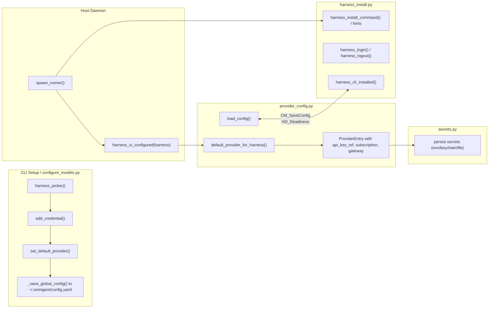

# Credential & Provider Management

<details>
<summary>Relevant source files</summary>

The following files were used as context for generating this wiki page:

- [omnigent/cli_config.py](omnigent/cli_config.py)
- [omnigent/harness_aliases.py](omnigent/harness_aliases.py)
- [omnigent/inner/copilot_executor.py](omnigent/inner/copilot_executor.py)
- [omnigent/inner/copilot_harness.py](omnigent/inner/copilot_harness.py)
- [omnigent/onboarding/ambient.py](omnigent/onboarding/ambient.py)
- [omnigent/onboarding/antigravity_auth.py](omnigent/onboarding/antigravity_auth.py)
- [omnigent/onboarding/configure_models.py](omnigent/onboarding/configure_models.py)
- [omnigent/onboarding/copilot_auth.py](omnigent/onboarding/copilot_auth.py)
- [omnigent/onboarding/cursor_auth.py](omnigent/onboarding/cursor_auth.py)
- [omnigent/onboarding/detected.py](omnigent/onboarding/detected.py)
- [omnigent/onboarding/extra_install.py](omnigent/onboarding/extra_install.py)
- [omnigent/onboarding/harness_install.py](omnigent/onboarding/harness_install.py)
- [omnigent/onboarding/harness_readiness.py](omnigent/onboarding/harness_readiness.py)
- [omnigent/onboarding/provider_config.py](omnigent/onboarding/provider_config.py)
- [omnigent/runtime/harnesses/__init__.py](omnigent/runtime/harnesses/__init__.py)
- [omnigent/runtime/workflow.py](omnigent/runtime/workflow.py)
- [tests/cli/test_configure_models.py](tests/cli/test_configure_models.py)
- [tests/e2e/omnigent/test_antigravity_lifecycle_e2e.py](tests/e2e/omnigent/test_antigravity_lifecycle_e2e.py)
- [tests/e2e/omnigent/test_antigravity_streaming_e2e.py](tests/e2e/omnigent/test_antigravity_streaming_e2e.py)
- [tests/e2e/omnigent/test_per_harness_antigravity.py](tests/e2e/omnigent/test_per_harness_antigravity.py)
- [tests/e2e/omnigent/test_per_harness_cursor.py](tests/e2e/omnigent/test_per_harness_cursor.py)
- [tests/e2e/omnigent/test_run_harness_without_agent_e2e.py](tests/e2e/omnigent/test_run_harness_without_agent_e2e.py)
- [tests/e2e_ui/onboarding/__init__.py](tests/e2e_ui/onboarding/__init__.py)
- [tests/e2e_ui/onboarding/test_import_review_modal.py](tests/e2e_ui/onboarding/test_import_review_modal.py)
- [tests/inner/conftest.py](tests/inner/conftest.py)
- [tests/inner/test_copilot_executor.py](tests/inner/test_copilot_executor.py)
- [tests/inner/test_seccomp.py](tests/inner/test_seccomp.py)
- [tests/onboarding/test_ambient.py](tests/onboarding/test_ambient.py)
- [tests/onboarding/test_antigravity_auth.py](tests/onboarding/test_antigravity_auth.py)
- [tests/onboarding/test_copilot_auth.py](tests/onboarding/test_copilot_auth.py)
- [tests/onboarding/test_cursor_auth.py](tests/onboarding/test_cursor_auth.py)
- [tests/onboarding/test_detected.py](tests/onboarding/test_detected.py)
- [tests/onboarding/test_extra_install.py](tests/onboarding/test_extra_install.py)
- [tests/onboarding/test_harness_install.py](tests/onboarding/test_harness_install.py)
- [tests/onboarding/test_harness_readiness.py](tests/onboarding/test_harness_readiness.py)
- [tests/onboarding/test_provider_config.py](tests/onboarding/test_provider_config.py)
- [tests/runtime/test_copilot_spawn_env.py](tests/runtime/test_copilot_spawn_env.py)
- [tests/runtime/test_openai_agents_sdk_spawn_env.py](tests/runtime/test_openai_agents_sdk_spawn_env.py)
- [tests/runtime/test_provider_spawn_env.py](tests/runtime/test_provider_spawn_env.py)
- [tests/test_harness_aliases.py](tests/test_harness_aliases.py)
- [web/src/components/onboarding/HostImportReview.test.tsx](web/src/components/onboarding/HostImportReview.test.tsx)
- [web/src/components/onboarding/HostImportReview.tsx](web/src/components/onboarding/HostImportReview.tsx)
- [web/src/components/onboarding/ImportContextModal.stories.tsx](web/src/components/onboarding/ImportContextModal.stories.tsx)
- [web/src/components/onboarding/ImportContextModal.test.tsx](web/src/components/onboarding/ImportContextModal.test.tsx)
- [web/src/components/onboarding/ImportContextModal.tsx](web/src/components/onboarding/ImportContextModal.tsx)
- [web/src/components/onboarding/ImportContextPreview.tsx](web/src/components/onboarding/ImportContextPreview.tsx)
- [web/src/components/onboarding/harnessBrand.tsx](web/src/components/onboarding/harnessBrand.tsx)
- [web/src/components/onboarding/importContextMock.ts](web/src/components/onboarding/importContextMock.ts)
- [web/src/components/ui/checkbox.tsx](web/src/components/ui/checkbox.tsx)
- [web/src/hooks/useHarnessInventory.test.tsx](web/src/hooks/useHarnessInventory.test.tsx)
- [web/src/hooks/useHarnessInventory.ts](web/src/hooks/useHarnessInventory.ts)
- [web/src/pages/settings/HarnessCatalog.tsx](web/src/pages/settings/HarnessCatalog.tsx)
- [web/src/pages/settings/SettingsHarnessesSection.test.tsx](web/src/pages/settings/SettingsHarnessesSection.test.tsx)
- [web/src/pages/settings/SettingsHarnessesSection.tsx](web/src/pages/settings/SettingsHarnessesSection.tsx)

</details>


Omnigent centralizes management of credentials, provider configurations, and harness readiness, enabling unified detection, configuration, and secure storage of secrets for multiple AI model providers and agent harnesses. This page details provider detection/configuration/storage, harness installation/readiness, provider-specific authentication flows (Copilot, Cursor, Antigravity, Hermes, ACP), model catalogs, Databricks workspace configuration, and the interactive CLI setup wizard.

---

## 1. Provider Detection and Configuration

### 1.1 Provider Families and Kinds

Omnigent groups model providers by **family** and **kind** for consistent resolution and configuration:

- **Families** represent the API surface served:
  - `anthropic` — Anthropic Messages API (served by Claude SDK, native Claude).
  - `openai` — OpenAI Chat and Responses API (served by Codex, OpenAI-Agents).
  - `gemini` — Google Gemini API (used mainly by antigravity SDK).
- **Kinds** describe the authentication method:
  - `key` — API key (often environment variable or secret reference).
  - `subscription` — CLI login (e.g., `claude` or `codex` CLI authenticated session).
  - `gateway` — OpenAI/Anthropic-compatible proxies (OpenRouter, LiteLLM).
  - `local` — Self-hosted endpoints (e.g. Ollama).
  - `databricks` — Databricks profiles.
  - `cli-config` — Providers managed and authenticated through a CLI's config file (e.g. Codex's `~/.codex/config.toml`).
  - `bedrock` — AWS Bedrock-specific kind.

This classification is defined and used for parsing/validating the user config stored in `~/.omnigent/config.yaml`, the single source of truth for provider configuration and active defaults per family [omnigent/onboarding/provider_config.py:1-143]().

### 1.2 Provider Config Format and Secret References

Provider entries in the config YAML have a structure keyed by family, with typed `kind` fields. Providers with an API key support referencing credentials indirectly:

- `api_key_ref` supports `env:<VAR>` or `keychain:<name>` schemes to avoid embedding secrets inline.
- Inline `api_key` fields are also supported, allowing direct integration of environment variables or static keys.

The `secrets.py` module abstracts secret storage, leveraging OS keyrings or falling back to a file-based backend when needed (e.g., testing or headless environments with `OMNIGENT_DISABLE_KEYRING`) [tests/cli/test_configure_models.py:70-107]().

### 1.3 Ambient Credential Detection

Omnigent performs ambient detection of available credentials on startup, exposing seamless one-click setup experiences. Detection covers:

- Environment variables for known providers (`ANTHROPIC_API_KEY`, `OPENAI_API_KEY`, `GEMINI_API_KEY` etc.) including prefixed variants `OMNIGENT_*` [omnigent/onboarding/ambient.py:1-128]().
- CLI login sessions for `claude` or `codex` by inspecting platform-specific credential stores (e.g., macOS Keychain via `claude auth status` subprocess [omnigent/onboarding/harness_install.py:22-33]()).
- Local endpoint availability such as a listening Ollama instance at `localhost:11434`.

Each detected credential is wrapped in a `DetectedProvider` data class indicating the kind (`key`, `subscription`, or `local`), family, and source name, sorted by detection priority for the user [omnigent/onboarding/ambient.py:97-128]().

---

## 2. Harness Installation & Readiness

Harnesses are the gateway to provider capabilities and are gated by two independent axes:

- **Configured:** A usable credential exists for the harness's family (resolved from the provider config).
- **Installed:** The harness CLI or binary is present on the user's `PATH`.

### 2.1 Harness Installation Metadata

The `harness_install.py` module owns harness identification, installation commands, and login/logout flows.

- Native coding harnesses like `claude`, `codex`, `pi`, and `qwen` are usually installed via npm packages or custom vendors ([omnigent/onboarding/harness_install.py:61-100]()). For example, `claude` is installed via a cURL installer from `https://claude.ai/install.sh`.
- Other harnesses like `cursor`, `kimi`, and `goose` have custom installers (curl scripts or native packages) and no npm package [omnigent/onboarding/harness_install.py:69-140]().
- Minimum CLI version checks prevent launching with incompatible versions, important for native policy hooks and bridge protocol compatibility [omnigent/onboarding/harness_install.py:121-130]().
- Commands to install or upgrade a harness are abstracted for consistent prompting (`harness_install_command()`) and display (`harness_install_display()`).
- Harness login/logout and CLI login status detection are implemented here — they are harness-specific and check the CLI's own status command or token files, not just config presence, to avoid platform-specific inaccuracies [omnigent/onboarding/harness_install.py:1-60]().

### 2.2 Harness Readiness Checks

`harness_readiness.py` determines whether a harness can be launched safely:

- SDK-based harnesses (`claude-sdk`, `openai-agents`, `antigravity`) resolve credentials dynamically at runtime and are never gated on CLI binaries (always considered configured) [omnigent/onboarding/harness_readiness.py:96-98]().
- Native CLI harnesses (`claude-native`, `codex-native`, `pi-native`, `cursor-native`, `hermes`, ACP CLI harnesses) gate on the presence of their native binaries and the availability of credentials (binary presence + credentials or CLI login status). [omnigent/onboarding/harness_readiness.py:115-142]()
- Some harness families use file-based credential checks (e.g., `agy` for antigravity accepts `GEMINI_API_KEY` or an OAuth token file). Checks are dynamically resolved via lambdas to allow runtime monkeypatching/testing [omnigent/onboarding/harness_readiness.py:110-113]().
- Readiness checks are used at multiple points: by the host daemon for session orchestration; by the web UI for picker warnings; and before launching runners to intercept misconfigurations early [omnigent/onboarding/harness_readiness.py:1-23]().

#### Harness Install and Readiness Flow

```mermaid
graph TD
    subgraph HostDaemon["Omnigent Host Daemon Process"]
        HD_CheckReadiness["harness_is_configured(harness)"]
        HD_CheckInstall["harness_cli_installed(harness)"]
        HD_CheckReadiness --> HD_CheckInstall
        HD_MapReady["configured_harness_map()"]
        HD_MapReady --> HD_CheckReadiness
    end

    subgraph CLISetup("CLI Setup Wizard")
        CLI_Configure["configure harnesses picker"]
        CLI_Configure -- calls --> HD_CheckReadiness
    end

    subgraph Runner("Omnigent Runner Process")
        RunnerLaunch["resolve harness and provider"]
        RunnerLaunch -- uses --> HD_MapReady
        RunnerExec["executes harness with resolved auth"]
    end

    HD_CheckInstall -.-> RunnerExec
```
Sources:
- `omnigent/onboarding/harness_readiness.py:1-23`
- `omnigent/onboarding/harness_readiness.py:96-98`
- `omnigent/onboarding/harness_readiness.py:110-113`
- `omnigent/onboarding/harness_readiness.py:115-142`

### 2.3 CLI Setup Wizard

The interactive CLI setup flow (`omnigent setup --no-internal-beta`) orchestrates harness and credential management. Implemented under `configure_models.py` and exercised in `tests/cli/test_configure_models.py`, the wizard presents:

- A three-level picker:
  1. Listing all harnesses with install status (✓/✗), ranked by priority (Claude, Codex, Cursor, Copilot, etc.).
  2. Credentials configured per harness including adding new ones.
  3. Actions on credentials (make default / remove).

- Credential addition is scoped to the chosen harness, prompting for required info like API keys or subscriptions.
- Defaults are enforced per family: each family may have at most one default provider [tests/cli/test_configure_models.py:11-35]().

Sources:
- `tests/cli/test_configure_models.py:11-35`

---

## 3. Auth Flows for Key Harnesses

### 3.1 Copilot Authentication

The Copilot harness is special:

- Uses the `github-copilot-sdk` package running an SDK-driven persistent client per conversation.
- Authentication is via a GitHub token with "Copilot Requests" permission, resolved via explicit config or environment variables (`COPILOT_GITHUB_TOKEN`, `GH_TOKEN`, `GITHUB_TOKEN`) [omnigent/inner/copilot_executor.py:97-101]().
- Native tools (`create`, `view`, `edit`, `bash`) execute inside the SDK with policy evaluation; bridged Omnigent tools route asynchronously into the executor.
- Copilot CLI commands for login/logout are triggered via harness install module, abstracting away the details [omnigent/onboarding/harness_install.py:7-30]().

Sources:
- `omnigent/inner/copilot_executor.py:97-101`
- `omnigent/onboarding/harness_install.py:7-30`

### 3.2 Cursor Harness Authentication

- Cursor runs a native TUI CLI (`cursor-agent`), gated on the binary presence and a `CURSOR_API_KEY` environment variable or config.
- Cursor authentication is handled separately by `cursor_auth.py`. Harness readiness gates on key presence and binary availability.

Sources:
- `omnigent/onboarding/harness_install.py:69-73`
- `omnigent/onboarding/harness_readiness.py:135-141`

### 3.3 Antigravity and Hermes Auth

- Antigravity supports two kinds of auth: an SDK mode accepting `GEMINI_API_KEY` or a native CLI (`agy`) mode with OAuth tokens stored on disk.
- Hermes and ACP CLI harnesses have their own auth mechanisms in `hermes_auth.py` and `acp_auth.py` respectively (outside this page's scope). Harness readiness considers these auth flows through file presence or CLI login status.

Sources:
- `omnigent/onboarding/harness_install.py:125`
- `omnigent/onboarding/harness_readiness.py:110-113`
- `omnigent/onboarding/harness_readiness.py:147-148`

---

## 4. Model Catalog & Databricks Workspace Configuration

Omnigent provides uniform model catalogs to enable agents to discover and route model requests intelligently.

- Model catalogs normalize capabilities across different providers and architectures (e.g., Anthropic, OpenAI, Gemini, Bedrock) [omnigent/llms/model_catalog.py]().
- For Databricks, workspace configuration includes minting access tokens transparently from `~/.databrickscfg` profiles and resolving serving endpoints via Databricks APIs [omnigent/onboarding/databricks_config.py]().
- The interactive wizard helps configure these workspaces and catalog sources, integrating credentials and capability records for all supported models.

Sources:
- `omnigent/llms/model_catalog.py`
- `omnigent/onboarding/databricks_config.py`

---

## 5. Credential & Provider Management Architecture


Sources:
- `omnigent/onboarding/configure_models.py`
- `omnigent/onboarding/provider_config.py`
- `omnigent/onboarding/harness_install.py`
- `omnigent/onboarding/harness_readiness.py`
- `omnigent/cli_config.py`

---

## 6. Key Functions and Classes

### 6.1 Provider Config Management (`provider_config.py`)

- `load_config()` — Reads the user's global config file for providers [omnigent/onboarding/provider_config.py:72-74]().
- `default_provider_for_harness(harness_surface: str)` — Returns the default provider entry for a harness, respecting family and fallback rules including cross-family mapping for Pi [omnigent/onboarding/provider_config.py:69-70]().
- `describe_active_credential()` — Returns a human-readable description of the active credential for UI display.

Sources:
- `omnigent/onboarding/provider_config.py:69-70`
- `omnigent/onboarding/provider_config.py:72-74`

### 6.2 Harness Installation (`harness_install.py`)

- `harness_install_spec(key: str) -> HarnessInstallSpec | None` — Returns metadata for a harness including binary name, package name, install commands, and CLI login commands [omnigent/onboarding/harness_install.py:53-131]().
- `harness_cli_installed(harness_key: str) -> bool` — Checks if the CLI executable is in PATH with version checks where applicable.
- `harness_login(harness_key: str) -> bool` and `harness_logout(harness_key: str) -> bool` — Drive CLI login/logout commands per harness.
- `harness_setup_hint(harness_key: str) -> str` — Returns an install hint for missing harnesses, e.g., npm install commands or curl installer URLs.

Sources:
- `omnigent/onboarding/harness_install.py:53-131`

### 6.3 Harness Readiness (`harness_readiness.py`)

- `harness_is_configured(harness: str) -> bool` — Determines if the harness is ready based on CLI binary presence (if applicable) and credential presence/status.
- `configured_harness_map() -> dict[str, HarnessAvailability]` — Returns readiness statuses for all known harnesses. It considers special cases like file-backed credentials (Antigravity, Kimi) and SDK harnesses not gated on binaries [omnigent/onboarding/harness_readiness.py:1-147]().

Sources:
- `omnigent/onboarding/harness_readiness.py:1-147`

### 6.4 CLI Interactive Configuration (`cli_config.py`, `configure_models.py`)

- Helpers under `cli_config.py` are used by `omnigent.cli` for the interactive setup command. They check dependencies (node, tmux versions), harness installation status, and provide prompts for credentials and defaults [omnigent/cli_config.py:20-172]().
- The configured providers persist into YAML at `~/.omnigent/config.yaml`, and secrets into the secure store. The `configure_models.py` tests cover the CLI input flows with three-level menus for harness > credential > actions [tests/cli/test_configure_models.py:1-36]().

Sources:
- `omnigent/cli_config.py:20-172`
- `tests/cli/test_configure_models.py:1-36`

---

## 7. Interactive Wizard: Harnesses and Default Provider Selection

The interactive CLI setup (e.g., `omnigent setup --no-internal-beta`) offers the user:

- A full list of all available harnesses with install status (✓/✗) and actionable hints (`npm install` or curl installer command). Harnesses are ranked and include: Claude, Codex, Cursor, Copilot, Antigravity, Hermes, ACP, and ACP CLI harnesses.
- The ability to add credentials per harness in a focused manner (e.g., entering API keys or performing CLI login flows).
- Managing default providers per family with clear semantics: only one default per family allowed; selecting a new default replaces the previous. There is co-existence of defaults per family (e.g., different defaults for Anthropic and OpenAI).
- Credential removal and default reassignment.
- The three-level menu is compact and driven with numeric inputs or TTY selectors [tests/cli/test_configure_models.py:11-37]().

Sources:
- `tests/cli/test_configure_models.py:11-37`

---

## 8. Databricks Workspace Configuration

Omnigent supports Databricks AI Gateway profiles:

- Workspace tokens are minted automatically from the user's `~/.databrickscfg` profile using Databricks token mint API calls.
- The Databricks provider config supports workspace URL, profile name, and token caching.
- The setup wizard integrates workspace profile setup as a credential addition step, populating the `providers.databricks` section of the config [omnigent/runtime/workflow.py:50-52]().

Sources:
- `omnigent/runtime/workflow.py:50-52`

---

## Summary

This page summarized Omnigent’s comprehensive credential and provider management subsystem:

- Provider config storage and secret management.
- Ambient detection of existing environment keys and CLI logins.
- Harness readiness gating on installation and credential presence.
- Interactive CLI setup with three-level pickers for harnesses and credentials.
- Provider-specific auth flows including Copilot, Cursor, Antigravity, Hermes, ACP.
- Model catalog resolution and Databricks workspace integration.

Together, these components enable robust, user-friendly onboarding and runtime credential resolution to support Omnigent’s multitenant and multiprovider LLM orchestration.

---

**Sources:**

- `omnigent/cli_config.py:20-172`
- `omnigent/inner/copilot_executor.py:97-101`
- `omnigent/llms/model_catalog.py`
- `omnigent/onboarding/ambient.py:1-128`
- `omnigent/onboarding/configure_models.py`
- `omnigent/onboarding/databricks_config.py`
- `omnigent/onboarding/harness_install.py:1-143`
- `omnigent/onboarding/harness_install.py:22-33`
- `omnigent/onboarding/harness_install.py:53-131`
- `omnigent/onboarding/harness_install.py:61-100`
- `omnigent/onboarding/harness_install.py:69-140`
- `omnigent/onboarding/harness_install.py:7-30`
- `omnigent/onboarding/harness_install.py:121-130`
- `omnigent/onboarding/harness_install.py:125`
- `omnigent/onboarding/harness_readiness.py:1-147`
- `omnigent/onboarding/harness_readiness.py:1-23`
- `omnigent/onboarding/harness_readiness.py:110-113`
- `omnigent/onboarding/harness_readiness.py:115-142`
- `omnigent/onboarding/harness_readiness.py:135-141`
- `omnigent/onboarding/harness_readiness.py:147-148`
- `omnigent/onboarding/harness_readiness.py:96-98`
- `omnigent/onboarding/provider_config.py:1-143`
- `omnigent/onboarding/provider_config.py:69-70`
- `omnigent/onboarding/provider_config.py:72-74`
- `omnigent/runtime/workflow.py:50-52`
- `tests/cli/test_configure_models.py:1-36`
- `tests/cli/test_configure_models.py:11-35`
- `tests/cli/test_configure_models.py:11-37`
- `tests/cli/test_configure_models.py:70-107`