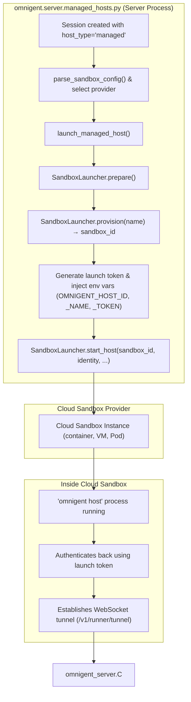
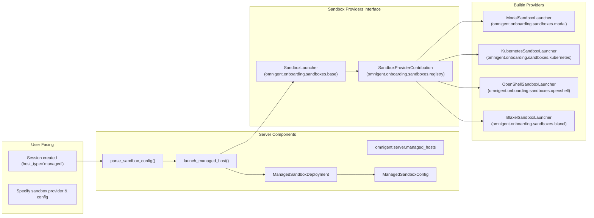

# Sandbox Providers

<details>
<summary>Relevant source files</summary>

The following files were used as context for generating this wiki page:

- [.github/scripts/oss-publish-images/maxver.py](.github/scripts/oss-publish-images/maxver.py)
- [.github/scripts/oss-publish-images/reconcile_targets.py](.github/scripts/oss-publish-images/reconcile_targets.py)
- [.github/workflows/docker-build.yml](.github/workflows/docker-build.yml)
- [.github/workflows/oss-publish-images.yml](.github/workflows/oss-publish-images.yml)
- [.github/workflows/web-tests.yml](.github/workflows/web-tests.yml)
- [deploy/README.md](deploy/README.md)
- [deploy/cwsandbox/README.md](deploy/cwsandbox/README.md)
- [deploy/islo/README.md](deploy/islo/README.md)
- [deploy/kubernetes/overlays/sandbox-runners/README.md](deploy/kubernetes/overlays/sandbox-runners/README.md)
- [deploy/kubernetes/overlays/sandbox-runners/deployment-patch.yaml](deploy/kubernetes/overlays/sandbox-runners/deployment-patch.yaml)
- [deploy/kubernetes/overlays/sandbox-runners/kustomization.yaml](deploy/kubernetes/overlays/sandbox-runners/kustomization.yaml)
- [deploy/kubernetes/overlays/sandbox-runners/namespace-sandboxes.yaml](deploy/kubernetes/overlays/sandbox-runners/namespace-sandboxes.yaml)
- [deploy/kubernetes/overlays/sandbox-runners/role.yaml](deploy/kubernetes/overlays/sandbox-runners/role.yaml)
- [deploy/kubernetes/overlays/sandbox-runners/rolebinding.yaml](deploy/kubernetes/overlays/sandbox-runners/rolebinding.yaml)
- [deploy/kubernetes/overlays/sandbox-runners/sandbox-config.yaml](deploy/kubernetes/overlays/sandbox-runners/sandbox-config.yaml)
- [deploy/kubernetes/overlays/sandbox-runners/serviceaccount-runner.yaml](deploy/kubernetes/overlays/sandbox-runners/serviceaccount-runner.yaml)
- [deploy/modal/README.md](deploy/modal/README.md)
- [deploy/openshell/README.md](deploy/openshell/README.md)
- [docs/extending/sandbox_providers.md](docs/extending/sandbox_providers.md)
- [omnigent/cli_sandbox.py](omnigent/cli_sandbox.py)
- [omnigent/host/__init__.py](omnigent/host/__init__.py)
- [omnigent/onboarding/sandboxes/__init__.py](omnigent/onboarding/sandboxes/__init__.py)
- [omnigent/onboarding/sandboxes/base.py](omnigent/onboarding/sandboxes/base.py)
- [omnigent/onboarding/sandboxes/islo.py](omnigent/onboarding/sandboxes/islo.py)
- [omnigent/onboarding/sandboxes/kubernetes.py](omnigent/onboarding/sandboxes/kubernetes.py)
- [omnigent/onboarding/sandboxes/openshell.py](omnigent/onboarding/sandboxes/openshell.py)
- [omnigent/onboarding/sandboxes/registry.py](omnigent/onboarding/sandboxes/registry.py)
- [omnigent/server/managed_hosts.py](omnigent/server/managed_hosts.py)
- [tests/e2e/test_openshell_sandbox_create_upload_e2e.py](tests/e2e/test_openshell_sandbox_create_upload_e2e.py)
- [tests/onboarding/sandboxes/test_base.py](tests/onboarding/sandboxes/test_base.py)
- [tests/onboarding/sandboxes/test_islo.py](tests/onboarding/sandboxes/test_islo.py)
- [tests/onboarding/sandboxes/test_kubernetes.py](tests/onboarding/sandboxes/test_kubernetes.py)
- [tests/onboarding/sandboxes/test_openshell.py](tests/onboarding/sandboxes/test_openshell.py)
- [tests/onboarding/sandboxes/test_registry.py](tests/onboarding/sandboxes/test_registry.py)
- [tests/server/helpers.py](tests/server/helpers.py)
- [tests/server/integration/test_host_session_binding.py](tests/server/integration/test_host_session_binding.py)
- [tests/server/test_managed_hosts.py](tests/server/test_managed_hosts.py)

</details>


Omnigent supports executing agents in isolated, cloud-hosted environments through **Sandbox Providers**. This capability enables the server to provision **managed hosts** on-demand, allowing agents to run in clean, disposable environments without requiring local runners or dedicated physical machines. The sandbox abstraction is realized via a unified plugin system that covers providers such as Modal, E2B, Daytona, Boxlite, CoreWeave, OpenShell, Blaxel, Islo, Microsandbox, and Kubernetes [omnigent/server/managed_hosts.py:38-42](), [omnigent/onboarding/sandboxes/base.py:1-17]().

## Purpose and Scope

This page details Omnigent’s sandbox provider abstraction, including the:

- Provider interface and key classes (`SandboxLauncher`, `SandboxCapabilities`).
- Managed host lifecycle orchestration by the server (`managed_hosts.py`).
- Plugin & registry mechanism for built-in and community providers.
- Supported providers, configuration options, and capability sets.
- Implementation notes on select providers (notably Kubernetes and OpenShell).
- Data flow diagrams bridging user workflows, code entities, and sandbox providers.

This is a LEAF page in the Onboarding & Provider Configuration section, focusing on cloud sandbox execution in full technical detail.

---

## Sandbox Provider Abstraction

### `SandboxLauncher` Interface

The core abstraction for a sandbox provider is the `SandboxLauncher` abstract base class. It defines the minimal set of primitives needed to manage sandbox lifecycle and interaction from the server or CLI:

- `prepare()`: Validate credentials and tooling, ensuring the environment is ready for sandbox provisioning.
- `provision(name: str) -> str`: Create a sandbox instance, returning a provider-specific sandbox ID.
- `run(sandbox_id: str, command: str, *, check: bool = True)`: Execute a command synchronously inside the sandbox.
- `run_background(...)`: Run a background process inside the sandbox.
- `put(sandbox_id: str, local_path: Path, remote_path: str)`: Upload local files into the sandbox filesystem.
- `terminate(sandbox_id: str)`: Delete or release the sandbox instance.

Providers implement either:

- **Exec-Model Host Launcher**: Sandboxes already running, with execution via commands inside the container or VM. Such providers include Modal and OpenShell. They use the `ExecModelHostLauncher` subclass, which provides reusable implementations for sequential workspace creation, git clones, and background launching of the `omnigent host` process.

- **Entrypoint-As-Host Model**: The sandbox starts with `omnigent host` as the main container process. The Kubernetes provider follows this model, implemented by subclassing `SandboxHostLauncher`.

This interface ensures a consistent experience across diverse providers despite their varying APIs and runtime models [omnigent/onboarding/sandboxes/base.py:28-175]().

### `SandboxCapabilities`

Each provider declares supported capabilities using the `SandboxCapabilities` dataclass to express feature support precisely. Key capabilities include:

| Capability              | Description                                                                                               |
|-------------------------|-----------------------------------------------------------------------------------------------------------|
| `cli_bootstrap`         | Supports CLI bootstrap commands (`sandbox create`, `connect`).                                           |
| `managed_launch`        | Supports server-managed sessions with `host_type="managed"`.                                             |
| `local_port_forward`    | Supports forwarding a local port into the sandbox (useful for inbound callbacks like OAuth).             |
| `resume_stopped`        | Supports resuming stopped sandboxes without full reprovisioning.                                         |
| `programmatic_terminate`| Supports terminating sandboxes via API calls (instead of manual/CLI).                                    |
| `file_copy`             | Supports uploading files to the sandbox environment.                                                    |
| `streaming_exec`        | Supports streaming execution with live STDOUT/STDERR output.                                            |
| `foreground_exec`       | Supports long-lived foreground execution with inheriting local stdio pipelines.                          |

Providers declare these to enable Omnigent core to tailor execution flows, optimize session management, and conditionally enable features. For example, OpenShell disables local port forwarding, while Kubernetes supports resume and programmatic termination [omnigent/onboarding/sandboxes/types.py:1-20](), [omnigent/onboarding/sandboxes/openshell.py:140-160](), [omnigent/onboarding/sandboxes/base.py:350-375]().

---

## Managed Host Lifecycle (Data Flow)

### Overview

The **Managed Host** abstraction allows the Omnigent server to provision and control sandbox instances tightly coupled to user sessions. The lifecycle sequence is:

1.  **Session Request and Configuration Parsing**: When a session requests `host_type="managed"`, the server reads the sandbox configuration (`sandbox:` YAML section) and selects the appropriate provider, creating a corresponding deployment configuration [omnigent/server/managed_hosts.py:30-42]().

2.  **Prepare Provider Launcher**: The server calls the provider's `prepare()` method to check credential validity and required tool availability [omnigent/onboarding/sandboxes/base.py:300-310]().

3.  **Provision Sandbox**: The server calls `provision(name)` on the sandbox launcher, which creates or reserves a sandbox in the cloud and returns a sandbox ID [omnigent/onboarding/sandboxes/base.py:202-210]().

4.  **Launch Token Generation**: The server generates a sandbox launch token — a cryptographically secure ephemeral token — which is injected into the sandbox's environment as `OMNIGENT_HOST_TOKEN` along with `OMNIGENT_HOST_ID` and `OMNIGENT_HOST_NAME`. This token authenticates the host back to the server API [omnigent/server/managed_hosts.py:17-23]().

5.  **Host Start**: The launcher runs `omnigent host` inside the sandbox, either by exec'ing a background command (exec-model providers) or relying on container entrypoint (entrypoint-as-host model in Kubernetes) [omnigent/onboarding/sandboxes/kubernetes.py:11-19](), [omnigent/onboarding/sandboxes/openshell.py:150-160]().

6.  **Host Authentication and Runner Tunnel**: The host process dials back over a WebSocket to the server's runner tunnel endpoint `/v1/runner/tunnel`, authenticated with the launch token [omnigent/server/managed_hosts.py:6-9]().

7.  **Lifecycle Management**: The server maintains the lifecycle of the sandbox host including termination, possible resume (if supported), and garbage collection of stale sandboxes via a reaper process configured at the deployment level [omnigent/server/managed_hosts.py:47-51]().

This model ensures session sandbox lifecycle is transactionally bound to server state, enabling efficient multi-provider sandbox usage transparently.



**Sources:** [omnigent/server/managed_hosts.py:1-60](), [omnigent/onboarding/sandboxes/base.py:25-60](), [omnigent/onboarding/sandboxes/kubernetes.py:10-20](), [omnigent/onboarding/sandboxes/openshell.py:150-165]()

---

## Supported Providers and Their Code Entities

Omnigent includes built-in support for a rich set of sandbox providers, spanning cloud-serverless, Kubernetes, VM/container-based SDKs, and self-hosted gateways.

| Provider     | Description                                        | Launcher Class (Code Entity)                       | Managed Host Support | Config Section (YAML)  |
|--------------|----------------------------------------------------|----------------------------------------------------|---------------------|------------------------|
| Modal        | Serverless containers                              | `modal.ModalSandboxLauncher`                       | Yes                 | `sandbox.modal`        |
| E2B          | Specialized agentic sandboxes                      | `e2b.E2BSandboxLauncher`                           | Yes                 | `sandbox.e2b`          |
| Daytona      | Managed environments on cloud hosts                | `daytona.DaytonaSandboxLauncher`                   | Yes                 | `sandbox.daytona`      |
| Boxlite      | Lightweight sandbox/container                      | `boxlite.BoxliteSandboxLauncher`                   | Yes                 | `sandbox.boxlite`      |
| CoreWeave    | CoreWeave sandbox SDK                              | `cwsandbox.CoreWeaveSandboxLauncher`               | Yes                 | `sandbox.cwsandbox`    |
| OpenShell    | Self-hosted GPU sandboxes with gRPC control        | `openshell.OpenShellSandboxLauncher`               | Yes                 | `sandbox.openshell`    |
| Blaxel       | Cloud sandbox SDK                                  | `blaxel.BlaxelSandboxLauncher`                     | Yes                 | `sandbox.blaxel`       |
| Islo         | Cloud sandbox provider                             | `islo.IsloSandboxLauncher`                         | Yes                 | `sandbox.islo`         |
| Microsandbox | MicroVM sandboxes (local libkrun microVMs)         | `microsandbox.MicroSandboxLauncher`                | Yes                 | `sandbox.microsandbox` |
| Kubernetes   | Runner Pods managed in a Kubernetes cluster        | `kubernetes.KubernetesSandboxLauncher`             | Yes                 | `sandbox.kubernetes`   |
| Lakebox      | Databricks Lakebox native sandboxes (config parse only) | N/A                                            | Parses config only  | `sandbox.lakebox`      |
| Gensee       | Managed ephemeral sandboxes                        | `gensee.GenseeSandboxLauncher`                     | Yes                 | `sandbox.gensee`       |

### Provider Registry and Plugin System

Third-party and community sandbox providers can be integrated via the `omnigent.sandbox_providers` entrypoint group. All community providers must be contained under the namespace prefix `omnigent.community.sandbox` to avoid collisions.

Core built-in providers are registered in the `omnigent.onboarding.sandboxes.registry` module. The registry defines:

- `SandboxProviderMetadata`: metadata describing each provider and its launcher class.
- `SandboxProviderContribution`: represents a provider package contributing one or more providers.
- Auto-discovery logic that validates namespace restrictions, loads provider classes lazily, and provides factory functions (`instantiate`) to create launchers.

The `get_launcher()` function in `omnigent/onboarding/sandboxes/__init__.py` queries the registry and instantiates the appropriate sandbox launcher by name, passing CLI options such as `workspace_host` and `server_url` for providers that require them [omnigent/onboarding/sandboxes/registry.py:20-70](), [omnigent/onboarding/sandboxes/__init__.py:90-129]().

---

## Configuration in Server YAML

The server configures sandbox providers via the `sandbox:` section in its YAML configuration or environment variable `OMNIGENT_CONFIG` [omnigent/server/managed_hosts.py:30-120]().

Example configuration with multiple providers and a reaper policy:

```yaml
sandbox:
  server_url: https://omnigent.example.com
  reaper:
    enabled: true
    terminate_after_offline_days: 30
    sweep_interval_s: 86400  # 1 day
  providers:
    - provider: modal
      image: ghcr.io/omnigent-ai/omnigent-host:latest
      secrets: [omnigent-llm]
    - provider: daytona
      image: docker.io/me/omnigent-host:latest
      env: [OPENAI_API_KEY, GIT_TOKEN]
    - provider: kubernetes
      image: ghcr.io/omnigent-ai/omnigent-host:latest
      namespace: omnigent-sandboxes
```

### Key Configurations Per Provider

- `image`: Docker image used for the sandbox host container — defaults to the official Omnigent host image but can be overridden [omnigent/onboarding/sandboxes/base.py:47-54]().
- `env` / `secrets`: Environment variable names passed from the server environment to the sandbox environment (e.g., API keys) [omnigent/server/managed_hosts.py:75-77]().
- Provider-specific resource requests such as CPU, memory, disk size [omnigent/server/managed_hosts.py:80-81](), [omnigent/server/managed_hosts.py:90-91](), [omnigent/server/managed_hosts.py:100-102](), [omnigent/server/managed_hosts.py:113-114]().
- Host config blob: Arbitrary YAML snippets installed into the sandbox at `~/.omnigent/config.yaml` for user config or overrides [omnigent/server/managed_hosts.py:53-70]().
- Multiple providers may be defined as a list under `providers:` with the server choosing the default or per-session selection [omnigent/server/managed_hosts.py:42-43]().

### Reaper Settings

The `reaper` block governs deployment-wide sandbox cleanup:

- Controls whether to terminate offline sandboxes after a specified number of days [omnigent/server/managed_hosts.py:49]().
- Defines sweep intervals for periodic cleanup [omnigent/server/managed_hosts.py:50]().
- Applies uniformly across all sandbox providers in the deployment [omnigent/server/managed_hosts.py:47]().

The reaper prevents buildup of unused sandbox hosts and helps manage cloud resource costs.

---

## Example: Kubernetes Provider

The Kubernetes sandbox provider stands out as the principal entrypoint-as-host implementation:

- Each managed host runs inside a Kubernetes **batch/v1 Job**, whose single Pod runs the `omnigent host` process as its main container command [omnigent/onboarding/sandboxes/kubernetes.py:11-19](), [tests/onboarding/sandboxes/test_kubernetes.py:87-100]().
- An **init container** prepares the workspace directory, cloning specified Git repositories as needed [tests/onboarding/sandboxes/test_kubernetes.py:109-127]().
- The server creates a per-Job Kubernetes Secret containing the sandbox launch token, injected into the Pod as an environment variable using `secretKeyRef`, avoiding exposure via Pod specs or logs [omnigent/onboarding/sandboxes/kubernetes.py:23-26](), [tests/onboarding/sandboxes/test_kubernetes.py:128-133]().
- The Pod uses a non-root user (`sandbox`), mounts an `emptyDir` volume as a writable home directory, and passes environment variables including the launch token [omnigent/onboarding/sandboxes/kubernetes.py:27-33]().
- The Pod is labeled with `omnigent.ai/agent` if the agent is a genuine built-in with a valid Kubernetes label-safe name. This allows admission controllers or credential injection policies to target Pods securely per agent identity [omnigent/server/managed_hosts.py:48-51]().
- The server maintains concerns like automatic restart on failure (`restartPolicy: OnFailure`), backoff limits, and active deadline seconds to enforce sandbox lifecycle limits [tests/onboarding/sandboxes/test_kubernetes.py:74-78](), [tests/onboarding/sandboxes/test_kubernetes.py:81-84]().
- No need for `pods/exec` permissions because the host process starts as the container entrypoint [omnigent/onboarding/sandboxes/kubernetes.py:17-19](). This reduces attack surface and complexity.
- Supports resuming stopped sandboxes and programmatic termination via the Kubernetes API [omnigent/onboarding/sandboxes/kubernetes.py:19-20]().

---

## Example: OpenShell Provider

OpenShell is a self-hosted GPU sandbox solution controlled via gRPC:

- The `OpenShellSandboxLauncher` wraps the OpenShell SDK, exposing sandbox lifecycle via a protobuf-based `SandboxSpec` [omnigent/onboarding/sandboxes/openshell.py:140-168]().
- It supports provisioning sandboxes with customized container images, environment variables, and workspace setup [tests/onboarding/sandboxes/test_openshell.py:108-173]().
- File upload is implemented by streaming file contents into a `cat` command executed inside the sandbox because OpenShell has no dedicated file copy RPC [omnigent/onboarding/sandboxes/openshell.py:28-30]().
- Executes `omnigent host` as a foreground command, managing a pidfile to facilitate clean termination via signals [omnigent/onboarding/sandboxes/openshell.py:94-98]().
- Local port forwarding is not supported, so OAuth callbacks requiring inbound connections are disabled [omnigent/onboarding/sandboxes/openshell.py:31-34]().
- Supports resume operations if the installed SDK version exposes the appropriate API [omnigent/onboarding/sandboxes/openshell.py:114-127]().
- Gateway selection is configured via `OPENSHELL_GATEWAY` environment variable or CLI gateway selection commands [omnigent/onboarding/sandboxes/openshell.py:78-80]().
- Environment variables for credential injection are configurable to ensure seamless access to API tokens inside the sandbox [omnigent/onboarding/sandboxes/openshell.py:74-76]().

---

## Summary Diagram: Natural Language to Code Entities



---

## Summary Table of Key Classes and Functions

| Symbol / Class                                    | File Location                                 | Responsibility                                                    |
|--------------------------------------------------|-----------------------------------------------|-------------------------------------------------------------------|
| `SandboxLauncher`                                | `omnigent/onboarding/sandboxes/base.py`      | Abstract base class defining sandbox provision & exec methods.    |
| `SandboxHostLauncher`                            | `omnigent/onboarding/sandboxes/base.py`      | Base class for entrypoint-as-host providers like Kubernetes.      |
| `ExecModelHostLauncher`                          | `omnigent/onboarding/sandboxes/base.py`      | Base class for exec-into-running sandboxes (Modal, OpenShell).    |
| `SandboxCapabilities`                            | `omnigent/onboarding/sandboxes/types.py`     | Defines supported sandbox features and capabilities.              |
| `ManagedSandboxConfig`                           | `omnigent/server/managed_hosts.py`            | Encapsulates per-provider managed sandbox configuration.          |
| `ManagedSandboxDeployment`                       | `omnigent/server/managed_hosts.py`            | Aggregates all provider configs for deployment.                    |
| `launch_managed_host()`                          | `omnigent/server/managed_hosts.py`            | Server-side function to launch a managed sandbox host.             |
| `parse_sandbox_config()`                         | `omnigent/server/managed_hosts.py`            | Parses server YAML config into structured sandbox deployments.     |
| `SandboxProviderContribution`                    | `omnigent/onboarding/sandboxes/registry.py`  | Registry abstraction for sandbox provider plugins.                 |
| `get_launcher()`                                 | `omnigent/onboarding/sandboxes/__init__.py`  | Retrieves launcher instances by provider name from registry.       |
| `KubernetesSandboxLauncher`                      | `omnigent/onboarding/sandboxes/kubernetes.py`| Kubernetes batch Job launcher implementation.                       |
| `OpenShellSandboxLauncher`                       | `omnigent/onboarding/sandboxes/openshell.py` | OpenShell SDK-based sandbox launcher.                              |

---

## Conclusion

Omnigent's sandbox provider subsystem is a foundational part of its multi-provider architecture, enabling agents to run in isolated, disposable cloud sandboxes or containers. The system provides a clean abstraction over heterogeneous environments and APIs. It supports both exec-based sandboxes (Modal, OpenShell) and entrypoint-based sandboxes (Kubernetes), ensuring flexibility in deployment needs from serverless to managed clusters to on-prem environments.

By defining capabilities clearly and maintaining a robust plugin registry, Omnigent enables extensibility for new cloud providers and evolving cloud environments. The managed host model couples sandbox lifecycle tightly to user sessions via secure launch tokens and sandbox orchestration to deliver seamless user experiences with strong security and scalability.

---

**Sources:**  
- omnigent/server/managed_hosts.py:1-118  
- tests/server/test_managed_hosts.py:1-193  
- .github/workflows/oss-publish-images.yml:1-150  
- tests/server/integration/test_host_session_binding.py:1-195  
- omnigent/onboarding/sandboxes/base.py:1-162  
- omnigent/onboarding/sandboxes/kubernetes.py:1-151  
- deploy/README.md:1-134  
- tests/server/helpers.py:1-181  
- omnigent/onboarding/sandboxes/openshell.py:1-168  
- .github/workflows/docker-build.yml:1-172  
- tests/onboarding/sandboxes/test_kubernetes.py:1-176  
- tests/onboarding/sandboxes/test_openshell.py:1-191  
- omnigent/onboarding/sandboxes/__init__.py:90-129  
- omnigent/onboarding/sandboxes/registry.py:20-70  
- omnigent/onboarding/sandboxes/types.py:1-20