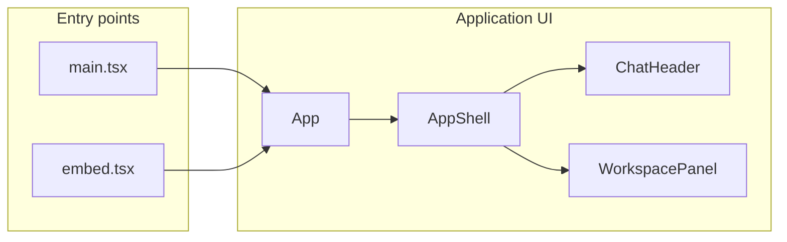
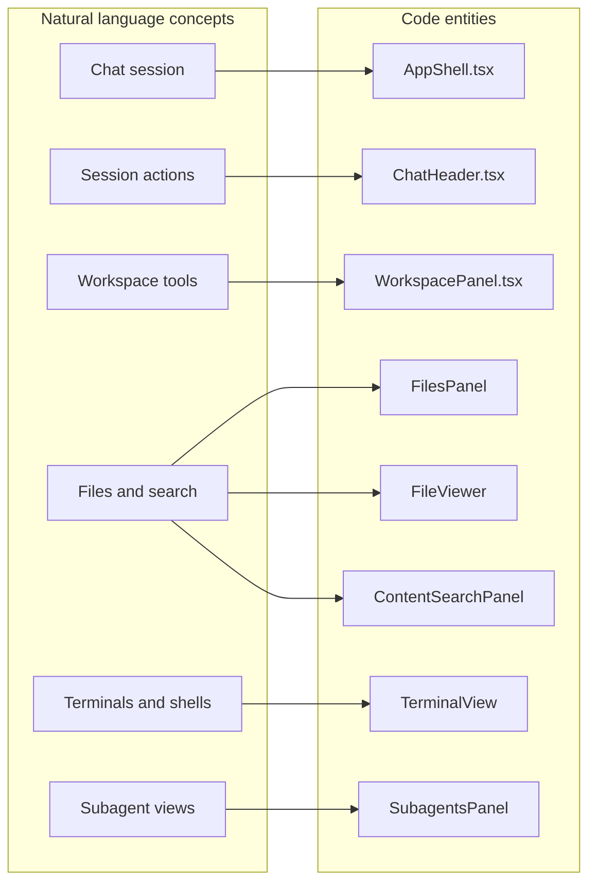

# Web Frontend (ap-web)

Relevant source files

The following files were used as context for generating this wiki page:

- [tests/browser_ui/files/test_workspace_tab_overflow.py](tests/browser_ui/files/test_workspace_tab_overflow.py)
- [tests/e2e_ui/sessions/test_header_session_menu.py](tests/e2e_ui/sessions/test_header_session_menu.py)
- [tests/e2e_ui/sessions/test_new_session_hotkey.py](tests/e2e_ui/sessions/test_new_session_hotkey.py)
- [tests/e2e_ui/sessions/test_ui_fit_and_finish.py](tests/e2e_ui/sessions/test_ui_fit_and_finish.py)
- [web/src/components/KeyboardShortcut.tsx](web/src/components/KeyboardShortcut.tsx)
- [web/src/components/KeyboardShortcutsDialog.test.tsx](web/src/components/KeyboardShortcutsDialog.test.tsx)
- [web/src/components/KeyboardShortcutsDialog.tsx](web/src/components/KeyboardShortcutsDialog.tsx)
- [web/src/embed.test.tsx](web/src/embed.test.tsx)
- [web/src/embed.tsx](web/src/embed.tsx)
- [web/src/hooks/useNewSessionHotkey.test.tsx](web/src/hooks/useNewSessionHotkey.test.tsx)
- [web/src/hooks/useNewSessionHotkey.ts](web/src/hooks/useNewSessionHotkey.ts)
- [web/src/hooks/useRenameSessionHotkey.test.tsx](web/src/hooks/useRenameSessionHotkey.test.tsx)
- [web/src/hooks/useRenameSessionHotkey.ts](web/src/hooks/useRenameSessionHotkey.ts)
- [web/src/index.css](web/src/index.css)
- [web/src/index.css.test.ts](web/src/index.css.test.ts)
- [web/src/lib/sessionWorkspaceState.test.ts](web/src/lib/sessionWorkspaceState.test.ts)
- [web/src/lib/sessionWorkspaceState.ts](web/src/lib/sessionWorkspaceState.ts)
- [web/src/lib/workspaceTabPreferences.test.ts](web/src/lib/workspaceTabPreferences.test.ts)
- [web/src/lib/workspaceTabPreferences.ts](web/src/lib/workspaceTabPreferences.ts)
- [web/src/main.tsx](web/src/main.tsx)
- [web/src/shell/AppShell.test.tsx](web/src/shell/AppShell.test.tsx)
- [web/src/shell/AppShell.tsx](web/src/shell/AppShell.tsx)
- [web/src/shell/ChatHeader.test.tsx](web/src/shell/ChatHeader.test.tsx)
- [web/src/shell/ChatHeader.tsx](web/src/shell/ChatHeader.tsx)
- [web/src/shell/HeaderConversationMenu.test.tsx](web/src/shell/HeaderConversationMenu.test.tsx)
- [web/src/shell/HeaderConversationMenu.tsx](web/src/shell/HeaderConversationMenu.tsx)
- [web/src/shell/HeaderTitle.test.tsx](web/src/shell/HeaderTitle.test.tsx)
- [web/src/shell/HeaderTitle.tsx](web/src/shell/HeaderTitle.tsx)
- [web/src/shell/WorkspacePanel.test.tsx](web/src/shell/WorkspacePanel.test.tsx)
- [web/src/shell/WorkspacePanel.tsx](web/src/shell/WorkspacePanel.tsx)
- [web/src/shell/WorkspaceTabsScroller.tsx](web/src/shell/WorkspaceTabsScroller.tsx)
- [web/src/shell/railTabs.ts](web/src/shell/railTabs.ts)

## Purpose and scope

The `web/` directory contains Omnigent’s React/TypeScript interface: a standalone application and an embeddable app entry point. At a high level, the frontend connects page routing and shared providers to the application shell, chat and workspace UI, client-side state, and platform-specific integrations. This parent page maps those areas; implementation details are covered in the child pages. [web/src/main.tsx:1-19](), [web/src/embed.tsx:1-26]()

Sources: [web/src/main.tsx:1-19](), [web/src/embed.tsx:1-26]()

## Frontend structure

`main.tsx` is the standalone entry point. It creates the React root and installs shared providers for routing, queries, capabilities, theming, session updates, and extensions. `embed.tsx` provides an alternative entry point for rendering the app inside a host React tree, with host-configurable routing and transport. [web/src/main.tsx:1-19](), [web/src/embed.tsx:3-19](), [web/src/embed.tsx:90-124]()

`AppShell` is the central UI layout component. It brings together navigation, the chat header, and workspace panels; `WorkspacePanel` groups workspace-oriented views such as files, search, terminals, pull requests, and subagents. The shell adjusts how sidebars and panels are presented for mobile layouts. [web/src/shell/AppShell.tsx:114-150](), [web/src/shell/AppShell.tsx:157-161](), [web/src/shell/WorkspacePanel.tsx:64-94]()

**Diagram: Frontend entry points and shell**

Sources for this diagram: [web/src/main.tsx:1-19](), [web/src/embed.tsx:3-19](), [web/src/shell/AppShell.tsx:114-150](), [web/src/shell/WorkspacePanel.tsx:64-94]()

Sources: [web/src/main.tsx:1-19](), [web/src/embed.tsx:3-19](), [web/src/shell/AppShell.tsx:114-150](), [web/src/shell/WorkspacePanel.tsx:64-94]()

## Pages & Application Shell

`AppShell` provides the shared layout around routed content and coordinates the sidebar, `ChatHeader`, and workspace UI. The header presents session context and actions; the workspace panel collects tools for working with files, terminals, and related session views. The child page covers the main pages, routing, navigation, and shell behavior in detail. [web/src/shell/AppShell.tsx:114-150](), [web/src/shell/ChatHeader.tsx:34-51](), [web/src/shell/WorkspacePanel.tsx:64-94]()

For details, see [Pages & Application Shell](#7.1).

Sources: [web/src/shell/AppShell.tsx:114-150](), [web/src/shell/ChatHeader.tsx:34-51](), [web/src/shell/WorkspacePanel.tsx:64-94]()

## Chat Shell & Editor Components

The chat experience sits within the application shell, with `ChatHeader` providing session-level controls and `WorkspacePanel` hosting the adjoining workspace views. The workspace panel includes file viewing, file lists, content search, terminal, browser, pull-request, and subagent components. The child page covers transcript rendering, the composer, approval and editor components, and the detailed panel behavior. [web/src/shell/ChatHeader.tsx:34-51](), [web/src/shell/WorkspacePanel.tsx:64-94]()

For details, see [Chat Shell & Editor Components](#7.2).

Sources: [web/src/shell/ChatHeader.tsx:34-51](), [web/src/shell/WorkspacePanel.tsx:64-94]()

## Hooks & State Management

The frontend combines shared providers with hooks and stores. The standalone entry point creates a TanStack Query client and initializes `chatStore` with that client; the embed entry point creates its own query client. The app also installs `SessionUpdatesProvider` and `QueueFlushProvider` in its provider stack. `AppShell` consumes hooks for session, workspace, and panel-related state. The child page covers the individual stores, hooks, and update flows. [web/src/main.tsx:12-19](), [web/src/main.tsx:43-58](), [web/src/embed.tsx:78-86](), [web/src/shell/AppShell.tsx:1-2](), [web/src/shell/AppShell.tsx:80-95]()

For details, see [Hooks & State Management](#7.3).

Sources: [web/src/main.tsx:12-19](), [web/src/main.tsx:43-58](), [web/src/embed.tsx:78-86](), [web/src/shell/AppShell.tsx:1-2](), [web/src/shell/AppShell.tsx:80-95]()

## Theming & Component Library

`index.css` imports Tailwind, shadcn’s Tailwind stylesheet, generated theme palettes, and shared font assets; it defines UI tokens such as foreground, background, borders, status colors, and radii. The standalone entry point applies saved custom themes and palettes before rendering. The UI also uses shared components such as buttons, menus, tabs, and tooltips. [web/src/index.css:1-6](), [web/src/index.css:20-50](), [web/src/main.tsx:109-112](), [web/src/shell/WorkspacePanel.tsx:51-63]()

For details, see [VS Code Extension & Theming](#7.5).

Sources: [web/src/index.css:1-6](), [web/src/index.css:20-50](), [web/src/main.tsx:109-112](), [web/src/shell/WorkspacePanel.tsx:51-63]()

## Desktop and Mobile Shells

The web UI includes platform detection and native-bridge integration points. `AppShell` imports shell-detection and bridge helpers, while `main.tsx` applies native insets and platform-specific setup before mounting the router. The embed entry point separately describes rendering within a host application. The child page covers the Electron, iOS, and Android wrappers and their native integration. [web/src/shell/AppShell.tsx:38-50](), [web/src/main.tsx:22-25](), [web/src/embed.tsx:3-19]()

For details, see [Electron Desktop App, iOS Shell & Android Shell](#7.4).

Sources: [web/src/shell/AppShell.tsx:38-50](), [web/src/main.tsx:22-25](), [web/src/embed.tsx:3-19]()

## VS Code Extension & Theming

The web frontend’s theme foundation is defined in `index.css` and initialized by `main.tsx`; the VS Code extension and theme integration are covered in the child page. [web/src/index.css:1-6](), [web/src/main.tsx:109-112]()

For details, see [VS Code Extension & Theming](#7.5).

Sources: [web/src/index.css:1-6](), [web/src/main.tsx:109-112]()

## From user concepts to code entities

This diagram links common frontend concepts to the code entities that organize them. [web/src/shell/AppShell.tsx:114-150](), [web/src/shell/WorkspacePanel.tsx:64-94](), [web/src/shell/ChatHeader.tsx:34-51]()

**Diagram: Frontend concepts mapped to UI components**

Sources for this diagram: [web/src/shell/AppShell.tsx:114-150](), [web/src/shell/WorkspacePanel.tsx:64-94](), [web/src/shell/ChatHeader.tsx:34-51]()

Sources: [web/src/shell/AppShell.tsx:114-150](), [web/src/shell/WorkspacePanel.tsx:64-94](), [web/src/shell/ChatHeader.tsx:34-51]()

## Navigation

These child pages provide detailed coverage of the frontend’s main areas:

- [Pages & Application Shell](#7.1) — Main pages, routing, navigation, and shell layout.
- [Chat Shell & Editor Components](#7.2) — Chat rendering, composer, editor components, and workspace panels.
- [Hooks & State Management](#7.3) — Client state, data hooks, and live session updates.
- [Electron Desktop App, iOS Shell & Android Shell](#7.4) — Native wrappers and bridge integration.
- [VS Code Extension & Theming](#7.5) — Editor extension and theming details.

Sources: [web/src/main.tsx:1-19](), [web/src/embed.tsx:3-19](), [web/src/shell/AppShell.tsx:114-150](), [web/src/shell/WorkspacePanel.tsx:64-94](), [web/src/index.css:1-6]()