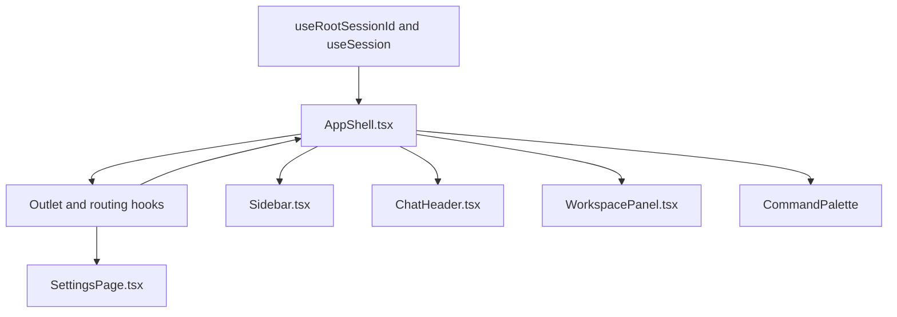
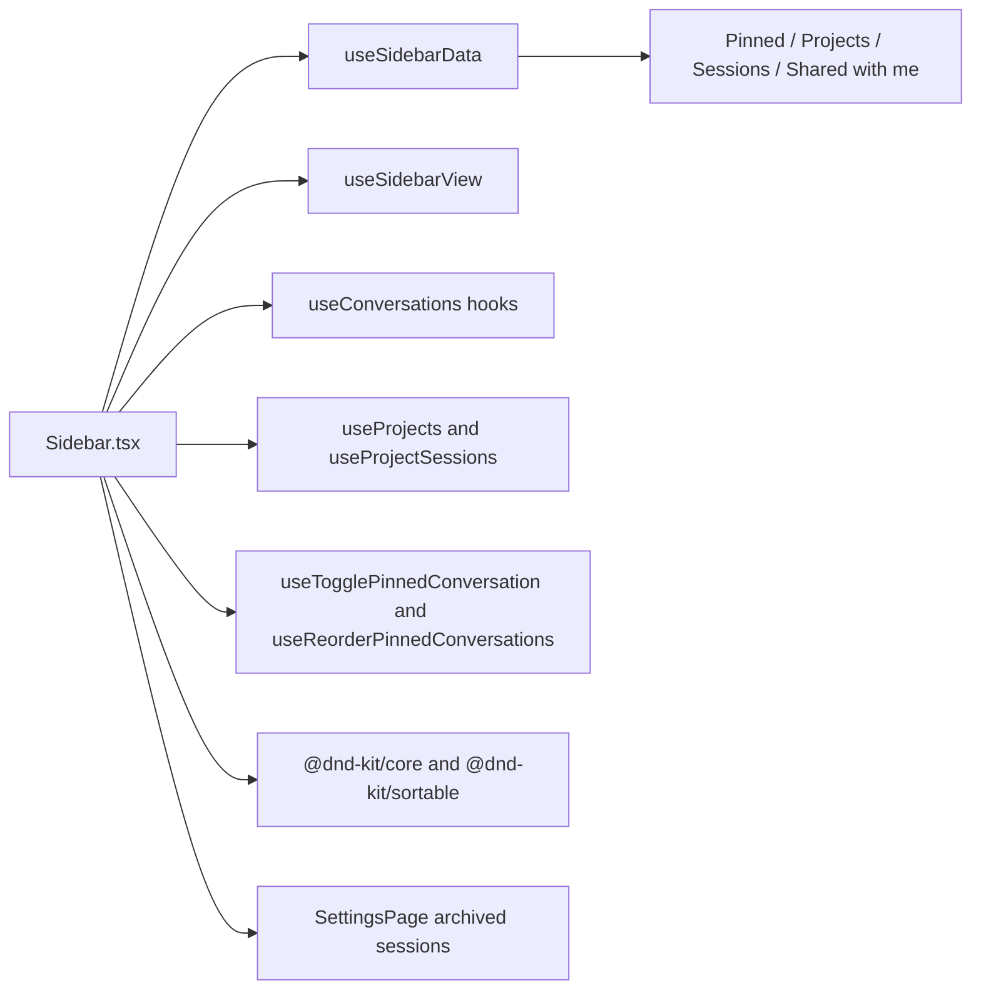
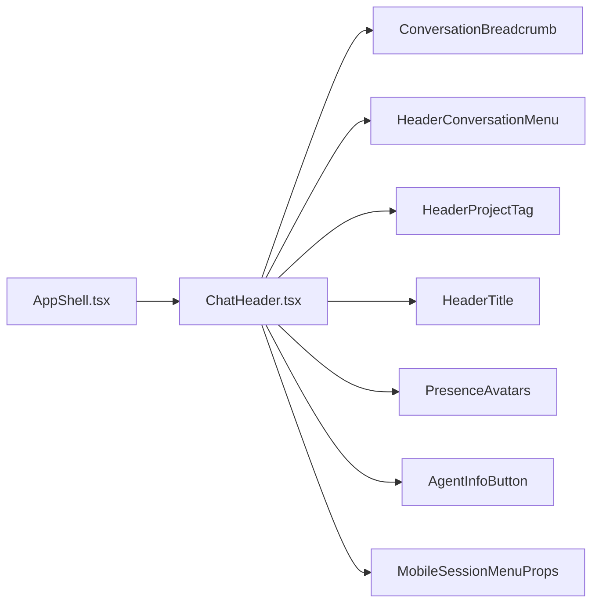
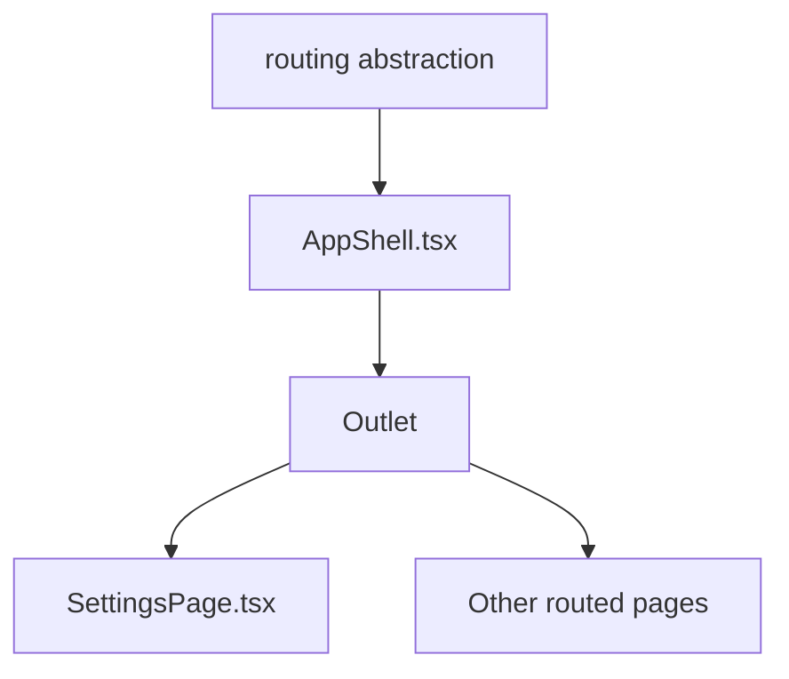

# Pages & Application Shell

Relevant source files

The following files were used as context for generating this wiki page:

- [docs/DATA_DIR_LAYOUT.md](docs/DATA_DIR_LAYOUT.md)
- [omnigent/runtime/agent_cache.py](omnigent/runtime/agent_cache.py)
- [omnigent/server/feature_flags.py](omnigent/server/feature_flags.py)
- [omnigent/server/routes/_workspace_validation.py](omnigent/server/routes/_workspace_validation.py)
- [omnigent/server/routes/sharing.py](omnigent/server/routes/sharing.py)
- [omnigent/server/sharing_settings.py](omnigent/server/sharing_settings.py)
- [tests/browser_ui/files/test_workspace_tab_overflow.py](tests/browser_ui/files/test_workspace_tab_overflow.py)
- [tests/e2e/test_host_daemon_legacy_stdio_e2e.py](tests/e2e/test_host_daemon_legacy_stdio_e2e.py)
- [tests/e2e_ui/agents/test_damaged_agent_cache.py](tests/e2e_ui/agents/test_damaged_agent_cache.py)
- [tests/e2e_ui/approvals/test_inbox_unread.py](tests/e2e_ui/approvals/test_inbox_unread.py)
- [tests/e2e_ui/collaboration/test_default_public_sessions.py](tests/e2e_ui/collaboration/test_default_public_sessions.py)
- [tests/e2e_ui/comments/test_comment_inbox.py](tests/e2e_ui/comments/test_comment_inbox.py)
- [tests/e2e_ui/mobile/test_rename_keeps_sidebar_sessions_reachable.py](tests/e2e_ui/mobile/test_rename_keeps_sidebar_sessions_reachable.py)
- [tests/e2e_ui/scheduled/test_scheduled_tasks_page.py](tests/e2e_ui/scheduled/test_scheduled_tasks_page.py)
- [tests/e2e_ui/sessions/test_agent_cache_wipe_recovery.py](tests/e2e_ui/sessions/test_agent_cache_wipe_recovery.py)
- [tests/e2e_ui/sessions/test_agent_info_hover.py](tests/e2e_ui/sessions/test_agent_info_hover.py)
- [tests/e2e_ui/sessions/test_header_session_menu.py](tests/e2e_ui/sessions/test_header_session_menu.py)
- [tests/e2e_ui/sessions/test_sidebar_bulk_actions.py](tests/e2e_ui/sessions/test_sidebar_bulk_actions.py)
- [tests/e2e_ui/sessions/test_sidebar_pinned_project_flyout.py](tests/e2e_ui/sessions/test_sidebar_pinned_project_flyout.py)
- [tests/e2e_ui/sessions/test_sidebar_projects.py](tests/e2e_ui/sessions/test_sidebar_projects.py)
- [tests/e2e_ui/sessions/test_sidebar_toggle_hotkeys.py](tests/e2e_ui/sessions/test_sidebar_toggle_hotkeys.py)
- [tests/e2e_ui/start_session/test_windows_workspace_picker.py](tests/e2e_ui/start_session/test_windows_workspace_picker.py)
- [tests/e2e_ui/start_session/test_workspace_picker_breadcrumbs.py](tests/e2e_ui/start_session/test_workspace_picker_breadcrumbs.py)
- [tests/e2e_ui/test_embed_service_worker.py](tests/e2e_ui/test_embed_service_worker.py)
- [tests/e2e_ui/visual/snapshots/test_chat_snapshot/test_chat_conversation_matches_baseline/test_chat_conversation_matches_baseline[chromium][linux].png](tests/e2e_ui/visual/snapshots/test_chat_snapshot/test_chat_conversation_matches_baseline/test_chat_conversation_matches_baseline[chromium][linux].png)
- [tests/e2e_ui/visual/snapshots/test_chat_turn_rail_snapshot/test_chat_turn_rail_matches_baseline/test_chat_turn_rail_matches_baseline[chromium][linux].png](tests/e2e_ui/visual/snapshots/test_chat_turn_rail_snapshot/test_chat_turn_rail_matches_baseline/test_chat_turn_rail_matches_baseline[chromium][linux].png)
- [tests/e2e_ui/visual/snapshots/test_landing_snapshot/test_empty_landing_matches_baseline/test_empty_landing_matches_baseline[chromium][linux].png](tests/e2e_ui/visual/snapshots/test_landing_snapshot/test_empty_landing_matches_baseline/test_empty_landing_matches_baseline[chromium][linux].png)
- [tests/e2e_ui/visual/snapshots/test_sidebar_flyout_snapshot/test_pinned_project_flyout_matches_baseline/test_pinned_project_flyout_matches_baseline[chromium][linux].png](tests/e2e_ui/visual/snapshots/test_sidebar_flyout_snapshot/test_pinned_project_flyout_matches_baseline/test_pinned_project_flyout_matches_baseline[chromium][linux].png)
- [tests/e2e_ui/visual/snapshots/test_sidebar_snapshot/test_populated_sidebar_matches_baseline/test_populated_sidebar_matches_baseline[chromium][linux].png](tests/e2e_ui/visual/snapshots/test_sidebar_snapshot/test_populated_sidebar_matches_baseline/test_populated_sidebar_matches_baseline[chromium][linux].png)
- [tests/runtime/test_agent_cache.py](tests/runtime/test_agent_cache.py)
- [tests/server/integration/test_app.py](tests/server/integration/test_app.py)
- [tests/server/integration/test_hosts_create_directory.py](tests/server/integration/test_hosts_create_directory.py)
- [tests/server/integration/test_utility_endpoints.py](tests/server/integration/test_utility_endpoints.py)
- [tests/server/routes/test_workspace_validation_helpers.py](tests/server/routes/test_workspace_validation_helpers.py)
- [tests/server/test_feature_flags.py](tests/server/test_feature_flags.py)
- [web/.oxlintrc.json](web/.oxlintrc.json)
- [web/index.html](web/index.html)
- [web/src/components/blocks/ApprovalCard.test.tsx](web/src/components/blocks/ApprovalCard.test.tsx)
- [web/src/components/blocks/ApprovalCard.tsx](web/src/components/blocks/ApprovalCard.tsx)
- [web/src/components/scheduled/CreateScheduledTaskDialog.test.tsx](web/src/components/scheduled/CreateScheduledTaskDialog.test.tsx)
- [web/src/components/scheduled/CreateScheduledTaskDialog.tsx](web/src/components/scheduled/CreateScheduledTaskDialog.tsx)
- [web/src/components/scheduled/Label.tsx](web/src/components/scheduled/Label.tsx)
- [web/src/components/scheduled/ScheduleFields.tsx](web/src/components/scheduled/ScheduleFields.tsx)
- [web/src/components/scheduled/ScheduledTaskRow.test.tsx](web/src/components/scheduled/ScheduledTaskRow.test.tsx)
- [web/src/components/scheduled/ScheduledTaskRow.tsx](web/src/components/scheduled/ScheduledTaskRow.tsx)
- [web/src/components/ui/button.test.tsx](web/src/components/ui/button.test.tsx)
- [web/src/components/ui/button.tsx](web/src/components/ui/button.tsx)
- [web/src/components/ui/input.tsx](web/src/components/ui/input.tsx)
- [web/src/hooks/useHostFilesystem.test.ts](web/src/hooks/useHostFilesystem.test.ts)
- [web/src/hooks/useHostFilesystem.ts](web/src/hooks/useHostFilesystem.ts)
- [web/src/hooks/useRenameSessionHotkey.test.tsx](web/src/hooks/useRenameSessionHotkey.test.tsx)
- [web/src/hooks/useRenameSessionHotkey.ts](web/src/hooks/useRenameSessionHotkey.ts)
- [web/src/hooks/useScheduledTasks.test.tsx](web/src/hooks/useScheduledTasks.test.tsx)
- [web/src/hooks/useScheduledTasks.ts](web/src/hooks/useScheduledTasks.ts)
- [web/src/hooks/useSharing.ts](web/src/hooks/useSharing.ts)
- [web/src/index.css](web/src/index.css)
- [web/src/index.css.test.ts](web/src/index.css.test.ts)
- [web/src/lib/blockStream.ts](web/src/lib/blockStream.ts)
- [web/src/lib/blocks.ts](web/src/lib/blocks.ts)
- [web/src/lib/capabilities.test.ts](web/src/lib/capabilities.test.ts)
- [web/src/lib/capabilities.ts](web/src/lib/capabilities.ts)
- [web/src/lib/inbox.test.ts](web/src/lib/inbox.test.ts)
- [web/src/lib/inbox.ts](web/src/lib/inbox.ts)
- [web/src/lib/inboxFilterPreferences.test.ts](web/src/lib/inboxFilterPreferences.test.ts)
- [web/src/lib/inboxFilterPreferences.ts](web/src/lib/inboxFilterPreferences.ts)
- [web/src/lib/lastAssistantText.test.ts](web/src/lib/lastAssistantText.test.ts)
- [web/src/lib/lastAssistantText.ts](web/src/lib/lastAssistantText.ts)
- [web/src/lib/renderItems.test.ts](web/src/lib/renderItems.test.ts)
- [web/src/lib/renderItems.ts](web/src/lib/renderItems.ts)
- [web/src/lib/scheduleBuilder.test.ts](web/src/lib/scheduleBuilder.test.ts)
- [web/src/lib/scheduleBuilder.ts](web/src/lib/scheduleBuilder.ts)
- [web/src/lib/scheduleText.test.ts](web/src/lib/scheduleText.test.ts)
- [web/src/lib/scheduleText.ts](web/src/lib/scheduleText.ts)
- [web/src/lib/sessionWorkspaceState.test.ts](web/src/lib/sessionWorkspaceState.test.ts)
- [web/src/lib/sessionWorkspaceState.ts](web/src/lib/sessionWorkspaceState.ts)
- [web/src/lib/viteProxy.test.ts](web/src/lib/viteProxy.test.ts)
- [web/src/lib/workspaceTabPreferences.test.ts](web/src/lib/workspaceTabPreferences.test.ts)
- [web/src/lib/workspaceTabPreferences.ts](web/src/lib/workspaceTabPreferences.ts)
- [web/src/pages/InboxPage.test.tsx](web/src/pages/InboxPage.test.tsx)
- [web/src/pages/InboxPage.tsx](web/src/pages/InboxPage.tsx)
- [web/src/pages/SettingsPage.test.tsx](web/src/pages/SettingsPage.test.tsx)
- [web/src/pages/SettingsPage.tsx](web/src/pages/SettingsPage.tsx)
- [web/src/pages/SharingPage.test.tsx](web/src/pages/SharingPage.test.tsx)
- [web/src/pages/SharingPage.tsx](web/src/pages/SharingPage.tsx)
- [web/src/pages/TasksPage.test.tsx](web/src/pages/TasksPage.test.tsx)
- [web/src/pages/TasksPage.tsx](web/src/pages/TasksPage.tsx)
- [web/src/shell/AppShell.test.tsx](web/src/shell/AppShell.test.tsx)
- [web/src/shell/AppShell.tsx](web/src/shell/AppShell.tsx)
- [web/src/shell/ChatHeader.test.tsx](web/src/shell/ChatHeader.test.tsx)
- [web/src/shell/ChatHeader.tsx](web/src/shell/ChatHeader.tsx)
- [web/src/shell/HeaderConversationMenu.test.tsx](web/src/shell/HeaderConversationMenu.test.tsx)
- [web/src/shell/HeaderConversationMenu.tsx](web/src/shell/HeaderConversationMenu.tsx)
- [web/src/shell/HeaderTitle.test.tsx](web/src/shell/HeaderTitle.test.tsx)
- [web/src/shell/HeaderTitle.tsx](web/src/shell/HeaderTitle.tsx)
- [web/src/shell/Sidebar.archive.test.tsx](web/src/shell/Sidebar.archive.test.tsx)
- [web/src/shell/Sidebar.bulkActionLayout.test.tsx](web/src/shell/Sidebar.bulkActionLayout.test.tsx)
- [web/src/shell/Sidebar.delete.test.tsx](web/src/shell/Sidebar.delete.test.tsx)
- [web/src/shell/Sidebar.mobileDrawer.test.tsx](web/src/shell/Sidebar.mobileDrawer.test.tsx)
- [web/src/shell/Sidebar.pinnedAutoExpand.test.tsx](web/src/shell/Sidebar.pinnedAutoExpand.test.tsx)
- [web/src/shell/Sidebar.projectHeaderChevron.test.tsx](web/src/shell/Sidebar.projectHeaderChevron.test.tsx)
- [web/src/shell/Sidebar.rowActions.test.tsx](web/src/shell/Sidebar.rowActions.test.tsx)
- [web/src/shell/Sidebar.shiftSelect.test.tsx](web/src/shell/Sidebar.shiftSelect.test.tsx)
- [web/src/shell/Sidebar.stop.test.tsx](web/src/shell/Sidebar.stop.test.tsx)
- [web/src/shell/Sidebar.subagentHighlight.test.tsx](web/src/shell/Sidebar.subagentHighlight.test.tsx)
- [web/src/shell/Sidebar.test.tsx](web/src/shell/Sidebar.test.tsx)
- [web/src/shell/Sidebar.tsx](web/src/shell/Sidebar.tsx)
- [web/src/shell/SidebarHeaderActions.tsx](web/src/shell/SidebarHeaderActions.tsx)
- [web/src/shell/WorkspacePanel.test.tsx](web/src/shell/WorkspacePanel.test.tsx)
- [web/src/shell/WorkspacePanel.tsx](web/src/shell/WorkspacePanel.tsx)
- [web/src/shell/WorkspacePicker.test.tsx](web/src/shell/WorkspacePicker.test.tsx)
- [web/src/shell/WorkspacePicker.tsx](web/src/shell/WorkspacePicker.tsx)
- [web/src/shell/WorkspaceTabsScroller.tsx](web/src/shell/WorkspaceTabsScroller.tsx)
- [web/src/shell/railTabs.ts](web/src/shell/railTabs.ts)
- [web/src/shell/settingsNav.test.tsx](web/src/shell/settingsNav.test.tsx)
- [web/src/shell/settingsNav.tsx](web/src/shell/settingsNav.tsx)
- [web/vite.config.ts](web/vite.config.ts)

## Purpose and scope

Section 7.1 describes the web application’s page-and-shell layer: the persistent `AppShell`, its sidebar and chat header, the Settings view, and how shell-level navigation and controls fit together. The available source excerpts establish the shell’s major collaborators and Settings’ role within it; they do not show the route definitions or the implementations of every page named in this section’s scope.[web/src/shell/AppShell.tsx:16-30]()[web/src/shell/AppShell.tsx:114-150]()[web/src/pages/SettingsPage.tsx:1-29]()

Sources: `web/src/shell/AppShell.tsx`, `web/src/pages/SettingsPage.tsx`

## Application Shell (`AppShell`)

`AppShell` is the top-level layout component for the interactive application. It imports routing primitives including `Outlet`, and brings together `Sidebar`, `ChatHeader`, `CommandPalette`, `WorkspacePanel`, and other session panels and dialogs.[web/src/shell/AppShell.tsx:16-30]()[web/src/shell/AppShell.tsx:114-150]()

The shell also imports hooks for sidebar and command-palette hotkeys, session and agent state, and responsive panel sizing. Native-shell and embedded-app integrations are represented by imports from `nativeBridge`, `embedded`, and related modules.[web/src/shell/AppShell.tsx:23-30]()[web/src/shell/AppShell.tsx:39-50]()[web/src/shell/AppShell.tsx:102-113]()

### Core hooks and features

| Area | Shell integration |
|---|---|
| Routing | `Outlet`, `useLocation`, `useParams`, `useRebasePath`, and `useSearchParams` are imported from the routing abstraction.[web/src/shell/AppShell.tsx:16-16]() |
| Navigation hotkeys | The shell imports `useSidebarToggleHotkeys`, `useCommandPaletteHotkey`, `useNewSessionHotkey`, `useNewShellHotkey`, and `useSettingsHotkey`.[web/src/shell/AppShell.tsx:23-28]() |
| Session context | `useRootSessionId` and `useSession` are imported alongside session action restrictions and liveness hooks.[web/src/shell/AppShell.tsx:108-111]()[web/src/shell/AppShell.tsx:130-131]() |
| Main navigation and header | `Sidebar`, `SidebarHeaderActions`, and `ChatHeader` are imported as shell-level UI components.[web/src/shell/AppShell.tsx:114-128]() |
| Workspace and session panels | The shell imports `WorkspacePanel`, `TerminalsPanel`, `SubagentsPanel`, `ExecutionLogsPanel`, and related panel components.[web/src/shell/AppShell.tsx:114-150]() |
| Command and dialog surfaces | `CommandPalette`, `KeyboardShortcutsDialog`, `CloseShellDialog`, and `ForkSessionDialog` are imported into the shell.[web/src/shell/AppShell.tsx:137-145]() |
| Responsive/native integration | The shell imports `useIOSViewportLock`, native-shell detection functions, and hooks for resizable sidebars and inline panels.[web/src/shell/AppShell.tsx:34-46]()[web/src/shell/AppShell.tsx:112-113]() |

Sources: `web/src/shell/AppShell.tsx`

### Shell composition and data flow

The shell combines route context, session state, shared navigation, and panel components. Its imports show the principal integration points: route state is exposed through the routing abstraction; session-related hooks supply session context; and shell-owned components provide navigation, header, workspace, and dialog surfaces.[web/src/shell/AppShell.tsx:16-30]()[web/src/shell/AppShell.tsx:114-150]()

**Diagram: AppShell concepts mapped to code entities**

Sources: `web/src/shell/AppShell.tsx`, `web/src/pages/SettingsPage.tsx`

---

## Sidebar navigation

`Sidebar` imports navigation primitives from the routing abstraction, sidebar data hooks, conversation and project hooks, and session-state helpers. Its imports also identify support for pinned conversations, archived sessions, project ordering, and grid-session navigation.[web/src/shell/Sidebar.tsx:1-12]()[web/src/shell/Sidebar.tsx:107-117]()[web/src/shell/Sidebar.tsx:156-178]()

The sidebar uses `useSidebarData` and `useSidebarView` for sidebar data and view state, and imports `useArchivedSessions` for archived-session data. Conversation and project interactions are wired through hooks such as `useArchiveConversation`, `useBulkArchiveConversations`, `useBulkDeleteConversations`, `useBulkMoveToProject`, `useProjects`, `useProjectSessions`, `useMoveToProject`, `useRenameProject`, and `useRenameConversation`.[web/src/shell/Sidebar.tsx:10-12]()[web/src/shell/Sidebar.tsx:156-178]()

Pinned conversation state and ordering are represented by `useTogglePinnedConversation`, `useReorderPinnedConversations`, and `setConversationPinned`. The component also imports drag-and-drop primitives from `@dnd-kit/core` and `@dnd-kit/sortable`, as well as project-order hooks.[web/src/shell/Sidebar.tsx:84-106]()[web/src/shell/Sidebar.tsx:107-109]()[web/src/shell/Sidebar.tsx:170-178]()

The sidebar integration tests describe the rendered session-list categories as **Pinned**, **Projects**, **Sessions**, and **Shared with me**. They also document that archived sessions are excluded from this list and are instead presented on the Settings page.[web/src/shell/Sidebar.test.tsx:6-11]()

### Sidebar data flow

Sidebar data is assembled from sidebar-specific hooks and conversation/project hooks. User actions have corresponding mutation hooks available to the component, including archive, delete, move, rename, pin, stop, and leave-session operations.[web/src/shell/Sidebar.tsx:10-12]()[web/src/shell/Sidebar.tsx:156-178]()

**Diagram: Sidebar navigation concepts mapped to code entities**

Sources: `web/src/shell/Sidebar.tsx`, `web/src/shell/Sidebar.test.tsx`

---

## Main pages overview

### Chat page and conversation view

The shell imports `ChatHeader` and session-related hooks, and provides an `Outlet` for routed content. Those integration points place conversation-specific UI and routed page content within the broader shell. The available excerpts do not include the `ChatPage` implementation or its route declaration.[web/src/shell/AppShell.tsx:16-16]()[web/src/shell/AppShell.tsx:108-114]()

Sources: `web/src/shell/AppShell.tsx`

### Inbox, policies, members, tasks, and sharing

The provided source excerpts identify `InboxPage`, `PoliciesPage`, `MembersPage`, `TasksPage`, and `SharingPage` as part of this page’s scope, but do not show their implementations or the route configuration that mounts them. The available shell excerpt does show that routed content is represented by `Outlet`; it does not establish the individual URL paths for these pages.[web/src/shell/AppShell.tsx:16-16]()

Sources: `web/src/shell/AppShell.tsx`

### Settings page

`SettingsPage` documents that it renders into the `AppShell` chat outlet, allowing the conversation sidebar to remain in place while the main area displays Settings. Its section navigation selects a content panel, and a Back link returns to the composer.[web/src/pages/SettingsPage.tsx:1-8]()

The page describes these Settings sections:

| Section | Documented purpose |
|---|---|
| General | App-wide behavior preferences.[web/src/pages/SettingsPage.tsx:10-15]() |
| Appearance | Theme mode, terminal theme, transcript view, workspace-panel and tab defaults, and UI/code font controls.[web/src/pages/SettingsPage.tsx:12-15]() |
| Git | The default for using a random worktree and the default base branch for a new worktree branch.[web/src/pages/SettingsPage.tsx:16-17]() |
| Keyboard shortcuts | An inline shortcuts reference.[web/src/pages/SettingsPage.tsx:18-18]() |
| Account | Auth-dependent identity, password, and sign-out controls.[web/src/pages/SettingsPage.tsx:19-21]() |
| Members and Policies | Admin-only server-management surfaces in accounts deployments, presented as Settings subcategories.[web/src/pages/SettingsPage.tsx:22-26]() |
| Archived sessions | Archived-session management, including Delete and Unarchive actions.[web/src/pages/SettingsPage.tsx:27-29]() |

The Settings implementation imports hooks and utilities for identity, server capabilities, conversations, navigation, theme controls, and user preferences.[web/src/pages/SettingsPage.tsx:45-46]()[web/src/pages/SettingsPage.tsx:75-83]()[web/src/pages/SettingsPage.tsx:120-137]()[web/src/pages/SettingsPage.tsx:139-205]()

Sources: `web/src/pages/SettingsPage.tsx`

---

## Command palette

`AppShell` imports and mounts the `CommandPalette` component and imports `useCommandPaletteHotkey` as a shell-level hotkey hook.[web/src/shell/AppShell.tsx:25-25]()[web/src/shell/AppShell.tsx:140-141]()

The provided excerpts establish the palette’s shell integration but do not include its command registry, filtering behavior, or keyboard shortcut implementation. Those details should be verified in the `CommandPalette` and `useCommandPaletteHotkey` definitions.[web/src/shell/AppShell.tsx:25-25]()[web/src/shell/AppShell.tsx:140-141]()

Sources: `web/src/shell/AppShell.tsx`

---

## Header menus and `ChatHeader`

`ChatHeader` is imported by `AppShell`, which provides the shell-level location for the conversation header.[web/src/shell/AppShell.tsx:114-114]()

The header component imports `ConversationBreadcrumb`, `HeaderConversationMenu`, `HeaderProjectTag`, `HeaderTitle`, and `PresenceAvatars`. Its props include conversation identity and title, project name and icon, permissions, bound agent data, sidebar state, and callbacks for opening sidebar or mobile panels.[web/src/shell/ChatHeader.tsx:34-45]()[web/src/shell/ChatHeader.tsx:116-168]()

`ChatHeader` also defines a `MobileSessionMenuProps` interface for mobile workspace entries and their state, including Files, Changes, Shells, Agents, Pull Requests, side chats, and execution logs.[web/src/shell/ChatHeader.tsx:55-114]()

**Diagram: Conversation header concepts mapped to code entities**

Sources: `web/src/shell/AppShell.tsx`, `web/src/shell/ChatHeader.tsx`

---

## Routing

`AppShell` imports `Outlet` and routing hooks from `@/lib/routing`. `SettingsPage` explicitly documents that it renders into the shell’s chat outlet. The available source excerpts do not include the route tree, so exact route paths and page-to-route mappings cannot be established here.[web/src/shell/AppShell.tsx:16-16]()[web/src/pages/SettingsPage.tsx:1-8]()

**Diagram: Routing concepts and known route integration**

Sources: `web/src/shell/AppShell.tsx`, `web/src/pages/SettingsPage.tsx`

---

## Layout and viewport management

The shell imports `useResizableSidebar` and `useResizableInlinePanel`, along with `useIOSViewportLock` and native-shell detection functions. These imports indicate that sidebar sizing, inline-panel sizing, iOS viewport behavior, and native-wrapper integration are part of the shell’s layout responsibilities.[web/src/shell/AppShell.tsx:34-46]()[web/src/shell/AppShell.tsx:112-113]()

`Sidebar` imports `useIsMobileViewport`, and `ChatHeader` imports the same viewport hook. The header’s mobile-menu interface describes mobile-specific panel entries and open handlers.[web/src/shell/Sidebar.tsx:215-215]()[web/src/shell/ChatHeader.tsx:44-44]()[web/src/shell/ChatHeader.tsx:55-114]()

| Concern | Code entity |
|---|---|
| Sidebar resizing | `useResizableSidebar` imported by `AppShell`.[web/src/shell/AppShell.tsx:112-113]() |
| Inline panel resizing | `useResizableInlinePanel` imported by `AppShell`.[web/src/shell/AppShell.tsx:112-113]() |
| Mobile viewport detection | `useIsMobileViewport` imported by `Sidebar` and `ChatHeader`.[web/src/shell/Sidebar.tsx:215-215]()[web/src/shell/ChatHeader.tsx:44-44]() |
| iOS viewport handling | `useIOSViewportLock` imported by `AppShell`.[web/src/shell/AppShell.tsx:34-34]() |
| Native-shell integration | Shell detection and bridge functions are imported from `nativeBridge`.[web/src/shell/AppShell.tsx:39-46]() |

Sources: `web/src/shell/AppShell.tsx`, `web/src/shell/Sidebar.tsx`, `web/src/shell/ChatHeader.tsx`

---

## Summary

`AppShell` is the integration point for routed content, persistent navigation, the conversation header, keyboard hooks, and workspace/session panels. `Sidebar` combines sidebar data and view hooks with conversation and project operations, while `ChatHeader` receives conversation, project, permission, and agent context through its props. `SettingsPage` is documented as rendering in the shell outlet so that the sidebar remains present while Settings content changes.[web/src/shell/AppShell.tsx:16-30]()[web/src/shell/AppShell.tsx:114-150]()[web/src/shell/Sidebar.tsx:10-12]()[web/src/shell/Sidebar.tsx:156-178]()[web/src/shell/ChatHeader.tsx:116-168]()[web/src/pages/SettingsPage.tsx:1-8]()

Sources: `web/src/shell/AppShell.tsx`, `web/src/shell/Sidebar.tsx`, `web/src/shell/ChatHeader.tsx`, `web/src/pages/SettingsPage.tsx`