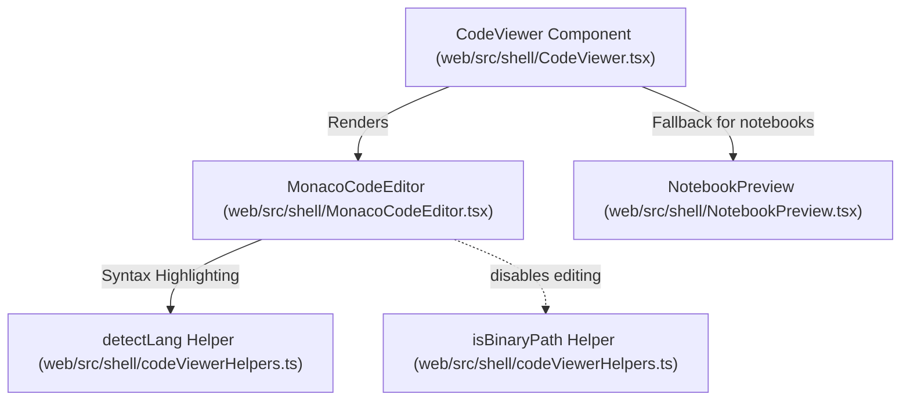
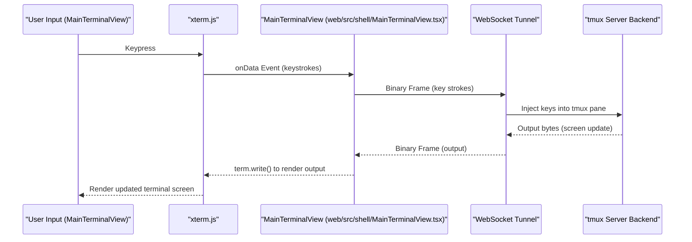
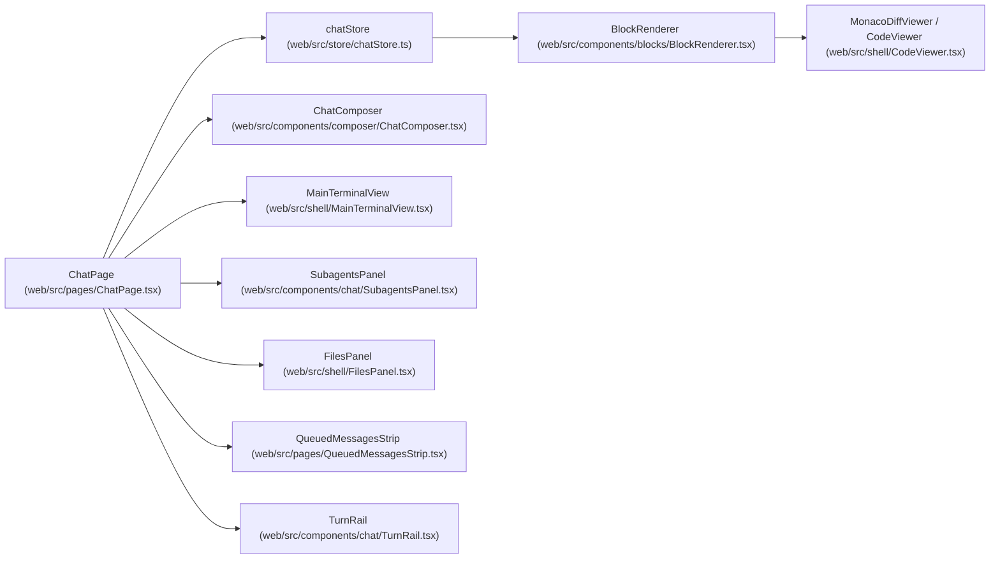
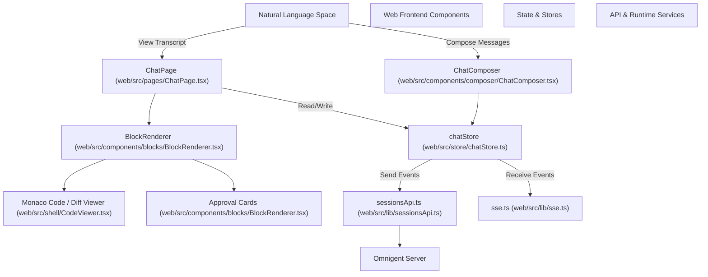
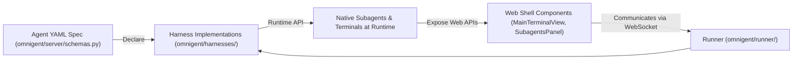

# Chat Shell & Editor Components

Relevant source files

The following files were used as context for generating this wiki page:

- [feature-map/markdown-editor.md](feature-map/markdown-editor.md)
- [omnigent/runner/launch_failure.py](omnigent/runner/launch_failure.py)
- [tests/browser_ui/chat/test_composer_geometry_contract.py](tests/browser_ui/chat/test_composer_geometry_contract.py)
- [tests/browser_ui/chat/test_composer_tooltips.py](tests/browser_ui/chat/test_composer_tooltips.py)
- [tests/browser_ui/chat/test_mobile_composer_enter.py](tests/browser_ui/chat/test_mobile_composer_enter.py)
- [tests/browser_ui/files/markdown_editor_journey.md](tests/browser_ui/files/markdown_editor_journey.md)
- [tests/browser_ui/files/test_file_line_navigation.py](tests/browser_ui/files/test_file_line_navigation.py)
- [tests/browser_ui/files/test_markdown_editor_journey.py](tests/browser_ui/files/test_markdown_editor_journey.py)
- [tests/e2e/test_harness_stream_error_surfaces_cause.py](tests/e2e/test_harness_stream_error_surfaces_cause.py)
- [tests/e2e_ui/agents/test_claude_native_subagent_label.py](tests/e2e_ui/agents/test_claude_native_subagent_label.py)
- [tests/e2e_ui/agents/test_claude_task_child_labels.py](tests/e2e_ui/agents/test_claude_task_child_labels.py)
- [tests/e2e_ui/agents/test_claude_task_subagent_named.py](tests/e2e_ui/agents/test_claude_task_subagent_named.py)
- [tests/e2e_ui/chat/test_citation_link_reveals_cited_line.py](tests/e2e_ui/chat/test_citation_link_reveals_cited_line.py)
- [tests/e2e_ui/chat/test_composer_bulk_steer.py](tests/e2e_ui/chat/test_composer_bulk_steer.py)
- [tests/e2e_ui/chat/test_created_file_links.py](tests/e2e_ui/chat/test_created_file_links.py)
- [tests/e2e_ui/chat/test_failure_error_card.py](tests/e2e_ui/chat/test_failure_error_card.py)
- [tests/e2e_ui/chat/test_initial_history_loading.py](tests/e2e_ui/chat/test_initial_history_loading.py)
- [tests/e2e_ui/chat/test_queue_steer.py](tests/e2e_ui/chat/test_queue_steer.py)
- [tests/e2e_ui/chat/test_queued_strip_docks_on_composer.py](tests/e2e_ui/chat/test_queued_strip_docks_on_composer.py)
- [tests/e2e_ui/chat/test_stale_stream.py](tests/e2e_ui/chat/test_stale_stream.py)
- [tests/e2e_ui/chat/test_transcript_scroll_stability.py](tests/e2e_ui/chat/test_transcript_scroll_stability.py)
- [tests/e2e_ui/chat/test_working_indicator_reload.py](tests/e2e_ui/chat/test_working_indicator_reload.py)
- [tests/e2e_ui/collaboration/test_author_label.py](tests/e2e_ui/collaboration/test_author_label.py)
- [tests/e2e_ui/collaboration/test_collab_realtime.py](tests/e2e_ui/collaboration/test_collab_realtime.py)
- [tests/e2e_ui/collaboration/test_share_dialog_mobile_fit.py](tests/e2e_ui/collaboration/test_share_dialog_mobile_fit.py)
- [tests/e2e_ui/collaboration/test_sharing_journey.py](tests/e2e_ui/collaboration/test_sharing_journey.py)
- [tests/e2e_ui/files/test_changed_files_git_status_error.py](tests/e2e_ui/files/test_changed_files_git_status_error.py)
- [tests/e2e_ui/files/test_changed_files_session_switch_abort.py](tests/e2e_ui/files/test_changed_files_session_switch_abort.py)
- [tests/e2e_ui/files/test_file_autosave.py](tests/e2e_ui/files/test_file_autosave.py)
- [tests/e2e_ui/files/test_files_panel_header.py](tests/e2e_ui/files/test_files_panel_header.py)
- [tests/e2e_ui/files/test_right_panel.py](tests/e2e_ui/files/test_right_panel.py)
- [tests/e2e_ui/messages/test_markdown_table_link_column_width.py](tests/e2e_ui/messages/test_markdown_table_link_column_width.py)
- [tests/e2e_ui/messages/test_message_deep_link.py](tests/e2e_ui/messages/test_message_deep_link.py)
- [tests/e2e_ui/messages/test_task_list_render.py](tests/e2e_ui/messages/test_task_list_render.py)
- [tests/e2e_ui/messages/test_user_message_copy.py](tests/e2e_ui/messages/test_user_message_copy.py)
- [tests/e2e_ui/messages/test_user_message_long_prompt_collapse.py](tests/e2e_ui/messages/test_user_message_long_prompt_collapse.py)
- [tests/e2e_ui/mobile/test_mobile_workflow.py](tests/e2e_ui/mobile/test_mobile_workflow.py)
- [tests/e2e_ui/mobile/test_queued_icon_stroke_parity.py](tests/e2e_ui/mobile/test_queued_icon_stroke_parity.py)
- [tests/e2e_ui/mobile/test_queued_row_tap_targets.py](tests/e2e_ui/mobile/test_queued_row_tap_targets.py)
- [tests/e2e_ui/mobile/test_touch_drag_bounded_history_paging.py](tests/e2e_ui/mobile/test_touch_drag_bounded_history_paging.py)
- [tests/e2e_ui/sessions/test_clone_session.py](tests/e2e_ui/sessions/test_clone_session.py)
- [tests/e2e_ui/sessions/test_code_font.py](tests/e2e_ui/sessions/test_code_font.py)
- [tests/e2e_ui/sessions/test_idle_notifications.py](tests/e2e_ui/sessions/test_idle_notifications.py)
- [tests/e2e_ui/sessions/test_sidebar_context_menu.py](tests/e2e_ui/sessions/test_sidebar_context_menu.py)
- [tests/e2e_ui/sessions/test_sidebar_lifecycle.py](tests/e2e_ui/sessions/test_sidebar_lifecycle.py)
- [tests/e2e_ui/sessions/test_sidebar_rename.py](tests/e2e_ui/sessions/test_sidebar_rename.py)
- [tests/e2e_ui/sessions/test_sidebar_stop.py](tests/e2e_ui/sessions/test_sidebar_stop.py)
- [tests/e2e_ui/shells/test_new_shell.py](tests/e2e_ui/shells/test_new_shell.py)
- [tests/e2e_ui/start_session/test_start_session.py](tests/e2e_ui/start_session/test_start_session.py)
- [tests/e2e_ui/visual/snapshots/test_storybook_snapshot/test_story_matches_baseline/test_story_matches_baseline[chromium-components-ai-elements-message--assistant-rich-markdown-and-actions][linux].png](tests/e2e_ui/visual/snapshots/test_storybook_snapshot/test_story_matches_baseline/test_story_matches_baseline[chromium-components-ai-elements-message--assistant-rich-markdown-and-actions][linux].png)
- [tests/e2e_ui/visual/snapshots/test_storybook_snapshot/test_story_matches_baseline/test_story_matches_baseline[chromium-components-ai-elements-message--branched-display-math][linux].png](tests/e2e_ui/visual/snapshots/test_storybook_snapshot/test_story_matches_baseline/test_story_matches_baseline[chromium-components-ai-elements-message--branched-display-math][linux].png)
- [tests/e2e_ui/visual/snapshots/test_storybook_snapshot/test_story_matches_baseline/test_story_matches_baseline[chromium-components-ai-elements-message--wrapped-highlighted-code][linux].png](tests/e2e_ui/visual/snapshots/test_storybook_snapshot/test_story_matches_baseline/test_story_matches_baseline[chromium-components-ai-elements-message--wrapped-highlighted-code][linux].png)
- [tests/e2e_ui/visual/snapshots/test_storybook_snapshot/test_story_matches_baseline/test_story_matches_baseline[chromium-components-composer-queuedmessagesstrip--long-backlog][linux].png](tests/e2e_ui/visual/snapshots/test_storybook_snapshot/test_story_matches_baseline/test_story_matches_baseline[chromium-components-composer-queuedmessagesstrip--long-backlog][linux].png)
- [tests/e2e_ui/visual/snapshots/test_storybook_snapshot/test_story_matches_baseline/test_story_matches_baseline[chromium-components-composer-queuedmessagesstrip--reorderable-with-steer][linux].png](tests/e2e_ui/visual/snapshots/test_storybook_snapshot/test_story_matches_baseline/test_story_matches_baseline[chromium-components-composer-queuedmessagesstrip--reorderable-with-steer][linux].png)
- [tests/e2e_ui/visual/snapshots/test_storybook_snapshot/test_story_matches_baseline/test_story_matches_baseline[chromium-components-composer-queuedmessagesstrip--waiting-for-idle][linux].png](tests/e2e_ui/visual/snapshots/test_storybook_snapshot/test_story_matches_baseline/test_story_matches_baseline[chromium-components-composer-queuedmessagesstrip--waiting-for-idle][linux].png)
- [tests/e2e_ui/visual/snapshots/test_storybook_snapshot/test_story_matches_baseline/test_story_matches_baseline[chromium-components-menus-slashcommandmenu--active-skill][linux].png](tests/e2e_ui/visual/snapshots/test_storybook_snapshot/test_story_matches_baseline/test_story_matches_baseline[chromium-components-menus-slashcommandmenu--active-skill][linux].png)
- [tests/e2e_ui/visual/snapshots/test_storybook_snapshot/test_story_matches_baseline/test_story_matches_baseline[chromium-components-menus-slashcommandmenu--commands-and-skills][linux].png](tests/e2e_ui/visual/snapshots/test_storybook_snapshot/test_story_matches_baseline/test_story_matches_baseline[chromium-components-menus-slashcommandmenu--commands-and-skills][linux].png)
- [tests/e2e_ui/visual/snapshots/test_storybook_snapshot/test_story_matches_baseline/test_story_matches_baseline[chromium-components-menus-slashcommandmenu--loading-skills][linux].png](tests/e2e_ui/visual/snapshots/test_storybook_snapshot/test_story_matches_baseline/test_story_matches_baseline[chromium-components-menus-slashcommandmenu--loading-skills][linux].png)
- [tests/e2e_ui/visual/snapshots/test_storybook_snapshot/test_story_matches_baseline/test_story_matches_baseline[chromium-components-sharing-permissionsmodal--public-read-only][linux].png](tests/e2e_ui/visual/snapshots/test_storybook_snapshot/test_story_matches_baseline/test_story_matches_baseline[chromium-components-sharing-permissionsmodal--public-read-only][linux].png)
- [tests/e2e_ui/visual/snapshots/test_storybook_snapshot/test_story_matches_baseline/test_story_matches_baseline[chromium-components-sharing-permissionsmodal--restricted-home-directory][linux].png](tests/e2e_ui/visual/snapshots/test_storybook_snapshot/test_story_matches_baseline/test_story_matches_baseline[chromium-components-sharing-permissionsmodal--restricted-home-directory][linux].png)
- [tests/runner/test_launch_failure.py](tests/runner/test_launch_failure.py)
- [tests/runner/test_stream_failure_diagnostics.py](tests/runner/test_stream_failure_diagnostics.py)
- [web/src/components/PermissionsModal.stories.tsx](web/src/components/PermissionsModal.stories.tsx)
- [web/src/components/PermissionsModal.test.tsx](web/src/components/PermissionsModal.test.tsx)
- [web/src/components/PermissionsModal.tsx](web/src/components/PermissionsModal.tsx)
- [web/src/components/SlashCommandMenu.tsx](web/src/components/SlashCommandMenu.tsx)
- [web/src/components/ai-elements/streamdown-security.ts](web/src/components/ai-elements/streamdown-security.ts)
- [web/src/components/ai-elements/streamdownFileLinks.test.ts](web/src/components/ai-elements/streamdownFileLinks.test.ts)
- [web/src/components/ai-elements/streamdownFileUriLinks.test.ts](web/src/components/ai-elements/streamdownFileUriLinks.test.ts)
- [web/src/components/blocks/BlockRenderer.test.tsx](web/src/components/blocks/BlockRenderer.test.tsx)
- [web/src/components/blocks/BlockRenderer.tsx](web/src/components/blocks/BlockRenderer.tsx)
- [web/src/components/blocks/ChatMarkdown.externalLinkFallback.test.tsx](web/src/components/blocks/ChatMarkdown.externalLinkFallback.test.tsx)
- [web/src/components/blocks/ChatMarkdown.fileLinks.test.tsx](web/src/components/blocks/ChatMarkdown.fileLinks.test.tsx)
- [web/src/components/blocks/ChatMarkdown.tsx](web/src/components/blocks/ChatMarkdown.tsx)
- [web/src/components/blocks/StatusBlocks.test.tsx](web/src/components/blocks/StatusBlocks.test.tsx)
- [web/src/components/blocks/StatusBlocks.tsx](web/src/components/blocks/StatusBlocks.tsx)
- [web/src/components/blocks/ToolCard.test.ts](web/src/components/blocks/ToolCard.test.ts)
- [web/src/components/blocks/ToolCard.tsx](web/src/components/blocks/ToolCard.tsx)
- [web/src/components/chat/Transcript.tsx](web/src/components/chat/Transcript.tsx)
- [web/src/components/chat/Transcript.virtualList.test.tsx](web/src/components/chat/Transcript.virtualList.test.tsx)
- [web/src/components/chat/chatBubbleParts.test.tsx](web/src/components/chat/chatBubbleParts.test.tsx)
- [web/src/components/chat/chatBubbleParts.tsx](web/src/components/chat/chatBubbleParts.tsx)
- [web/src/components/composer/ComposerControls.test.tsx](web/src/components/composer/ComposerControls.test.tsx)
- [web/src/components/composer/ComposerControls.tsx](web/src/components/composer/ComposerControls.tsx)
- [web/src/components/composer/HarnessPicker.test.tsx](web/src/components/composer/HarnessPicker.test.tsx)
- [web/src/components/composer/HarnessPicker.tsx](web/src/components/composer/HarnessPicker.tsx)
- [web/src/components/ui/dropdown-menu.tsx](web/src/components/ui/dropdown-menu.tsx)
- [web/src/hooks/useMessageDeepLink.test.tsx](web/src/hooks/useMessageDeepLink.test.tsx)
- [web/src/hooks/useMessageDeepLink.ts](web/src/hooks/useMessageDeepLink.ts)
- [web/src/hooks/useTerminals.test.ts](web/src/hooks/useTerminals.test.ts)
- [web/src/hooks/useTerminals.ts](web/src/hooks/useTerminals.ts)
- [web/src/hooks/useWorkspaceChangedFiles.test.tsx](web/src/hooks/useWorkspaceChangedFiles.test.tsx)
- [web/src/hooks/useWorkspaceChangedFiles.ts](web/src/hooks/useWorkspaceChangedFiles.ts)
- [web/src/lib/codeFontPreferences.test.ts](web/src/lib/codeFontPreferences.test.ts)
- [web/src/lib/codeFontPreferences.ts](web/src/lib/codeFontPreferences.ts)
- [web/src/lib/events.ts](web/src/lib/events.ts)
- [web/src/lib/filesPanelPreferences.test.ts](web/src/lib/filesPanelPreferences.test.ts)
- [web/src/lib/filesPanelPreferences.ts](web/src/lib/filesPanelPreferences.ts)
- [web/src/lib/hostPreferences.test.ts](web/src/lib/hostPreferences.test.ts)
- [web/src/lib/hostPreferences.ts](web/src/lib/hostPreferences.ts)
- [web/src/lib/nativeCodingAgents.test.ts](web/src/lib/nativeCodingAgents.test.ts)
- [web/src/lib/nativeCodingAgents.ts](web/src/lib/nativeCodingAgents.ts)
- [web/src/lib/permissionsApi.test.ts](web/src/lib/permissionsApi.test.ts)
- [web/src/lib/permissionsApi.ts](web/src/lib/permissionsApi.ts)
- [web/src/lib/sandboxStatus.ts](web/src/lib/sandboxStatus.ts)
- [web/src/lib/sessionEvents.test.ts](web/src/lib/sessionEvents.test.ts)
- [web/src/lib/sessionsApi.test.ts](web/src/lib/sessionsApi.test.ts)
- [web/src/lib/sessionsApi.ts](web/src/lib/sessionsApi.ts)
- [web/src/lib/sse.test.ts](web/src/lib/sse.test.ts)
- [web/src/lib/sse.ts](web/src/lib/sse.ts)
- [web/src/lib/toolTitle.test.ts](web/src/lib/toolTitle.test.ts)
- [web/src/lib/toolTitle.ts](web/src/lib/toolTitle.ts)
- [web/src/lib/types.ts](web/src/lib/types.ts)
- [web/src/pages/ChatIndicators.tsx](web/src/pages/ChatIndicators.tsx)
- [web/src/pages/ChatPage.composer.test.tsx](web/src/pages/ChatPage.composer.test.tsx)
- [web/src/pages/ChatPage.historyLoad.test.tsx](web/src/pages/ChatPage.historyLoad.test.tsx)
- [web/src/pages/ChatPage.indicators.test.tsx](web/src/pages/ChatPage.indicators.test.tsx)
- [web/src/pages/ChatPage.mention.test.tsx](web/src/pages/ChatPage.mention.test.tsx)
- [web/src/pages/ChatPage.statusLine.test.tsx](web/src/pages/ChatPage.statusLine.test.tsx)
- [web/src/pages/ChatPage.test.ts](web/src/pages/ChatPage.test.ts)
- [web/src/pages/ChatPage.tsx](web/src/pages/ChatPage.tsx)
- [web/src/pages/ChatPage.userBubble.test.tsx](web/src/pages/ChatPage.userBubble.test.tsx)
- [web/src/pages/QueuedMessagesStrip.stories.tsx](web/src/pages/QueuedMessagesStrip.stories.tsx)
- [web/src/pages/QueuedMessagesStrip.test.tsx](web/src/pages/QueuedMessagesStrip.test.tsx)
- [web/src/pages/QueuedMessagesStrip.tsx](web/src/pages/QueuedMessagesStrip.tsx)
- [web/src/pages/TranscriptScrollbar.test.tsx](web/src/pages/TranscriptScrollbar.test.tsx)
- [web/src/pages/TranscriptScrollbar.tsx](web/src/pages/TranscriptScrollbar.tsx)
- [web/src/pages/chatLayout.ts](web/src/pages/chatLayout.ts)
- [web/src/shell/CodeViewer.test.tsx](web/src/shell/CodeViewer.test.tsx)
- [web/src/shell/CodeViewer.tsx](web/src/shell/CodeViewer.tsx)
- [web/src/shell/ExecutionLogsPanel.test.tsx](web/src/shell/ExecutionLogsPanel.test.tsx)
- [web/src/shell/FileViewer.test.tsx](web/src/shell/FileViewer.test.tsx)
- [web/src/shell/FileViewer.tsx](web/src/shell/FileViewer.tsx)
- [web/src/shell/FilesPanel.test.tsx](web/src/shell/FilesPanel.test.tsx)
- [web/src/shell/FilesPanel.tsx](web/src/shell/FilesPanel.tsx)
- [web/src/shell/FlatFileList.test.tsx](web/src/shell/FlatFileList.test.tsx)
- [web/src/shell/FlatFileList.tsx](web/src/shell/FlatFileList.tsx)
- [web/src/shell/FolderTree.test.tsx](web/src/shell/FolderTree.test.tsx)
- [web/src/shell/FolderTree.tsx](web/src/shell/FolderTree.tsx)
- [web/src/shell/ForkSessionDialog.test.tsx](web/src/shell/ForkSessionDialog.test.tsx)
- [web/src/shell/ForkSessionDialog.tsx](web/src/shell/ForkSessionDialog.tsx)
- [web/src/shell/MainTerminalView.test.tsx](web/src/shell/MainTerminalView.test.tsx)
- [web/src/shell/MainTerminalView.tsx](web/src/shell/MainTerminalView.tsx)
- [web/src/shell/MonacoCodeEditor.tsx](web/src/shell/MonacoCodeEditor.tsx)
- [web/src/shell/MonacoDiffViewer.test.tsx](web/src/shell/MonacoDiffViewer.test.tsx)
- [web/src/shell/MonacoDiffViewer.tsx](web/src/shell/MonacoDiffViewer.tsx)
- [web/src/shell/NewChatDialog.flow.test.tsx](web/src/shell/NewChatDialog.flow.test.tsx)
- [web/src/shell/NewChatDialog.projectCreate.test.tsx](web/src/shell/NewChatDialog.projectCreate.test.tsx)
- [web/src/shell/NewChatDialog.projectPrefill.test.tsx](web/src/shell/NewChatDialog.projectPrefill.test.tsx)
- [web/src/shell/NewChatDialog.test.tsx](web/src/shell/NewChatDialog.test.tsx)
- [web/src/shell/NewChatDialog.tsx](web/src/shell/NewChatDialog.tsx)
- [web/src/shell/SubagentsGraphView.test.tsx](web/src/shell/SubagentsGraphView.test.tsx)
- [web/src/shell/SubagentsGraphView.tsx](web/src/shell/SubagentsGraphView.tsx)
- [web/src/shell/SubagentsPanel.test.tsx](web/src/shell/SubagentsPanel.test.tsx)
- [web/src/shell/SubagentsPanel.tsx](web/src/shell/SubagentsPanel.tsx)
- [web/src/shell/TerminalsPanel.test.tsx](web/src/shell/TerminalsPanel.test.tsx)
- [web/src/shell/TerminalsPanel.tsx](web/src/shell/TerminalsPanel.tsx)
- [web/src/shell/TipTapCodeBlockView.test.tsx](web/src/shell/TipTapCodeBlockView.test.tsx)
- [web/src/shell/TipTapCodeBlockView.tsx](web/src/shell/TipTapCodeBlockView.tsx)
- [web/src/shell/codeViewerHelpers.test.ts](web/src/shell/codeViewerHelpers.test.ts)
- [web/src/shell/codeViewerHelpers.ts](web/src/shell/codeViewerHelpers.ts)
- [web/src/shell/subagentGraphLayout.ts](web/src/shell/subagentGraphLayout.ts)
- [web/src/shell/subagentStatus.ts](web/src/shell/subagentStatus.ts)
- [web/src/store/chatStore.test.ts](web/src/store/chatStore.test.ts)
- [web/src/store/chatStore.ts](web/src/store/chatStore.ts)
- [web/src/store/conversationState.ts](web/src/store/conversationState.ts)
- [web/src/test-setup.ts](web/src/test-setup.ts)

The Chat Shell and Editor Components constitute the core interactive interface of Omnigent's collaborative AI environment. They provide comprehensive functionality including rendering chat transcripts and composing messages, rendering semantic blocks like approvals and code diffs, integrating Monaco-based code and diff viewers, displaying files, managing interactive terminal panels, organizing subagent coordination, enabling workspace and file exploration panels, managing queued messages and fork dialogs, and offering a quick-access "turn rail" for navigation.

This page provides an in-depth technical exploration of these components focusing on implementation details, data flow, key classes and functions, with clarifying diagrams linking user-facing concepts to code entities. The source files are primarily within the `web/src/` frontend.

---

## 1. Chat Transcript Rendering & Composer

### 1.1 ChatPage — Orchestrator for Transcript & Composer

The core React component `ChatPage.tsx` manages the chat session's lifecycle:

- It binds to the server's SSE stream for session updates, driving transcript state updates.
- Keeps local streaming and committed blocks in sync, retaining an array of structured semantic content blocks (`blocks`), plus pending user messages (`pendingUserMessages`).
- Coordinates the rendering pipeline by passing these blocks to lower-level renderer components.
- Handles user input composition, send/interrupt events, and keyboard shortcuts.
- Integrates complex UI state like effort levels, mention detection, and subagent task indicators.

The modular structure is supported by various React hooks imported from composable libraries such as `useChatStore` (a Zustand store managing chat state) and hooks for agents, permissions, and model picking [web/src/pages/ChatPage.tsx:1-183]().

### 1.2 Transcript State: `chatStore.ts`

The transcript and pending message data live in a persistent, session-wide Zustand store:

- `blocks`: Holds an array of committed blocks including messages, tool results, and elicitation cards.
- `pendingUserMessages`: Tracks user messages optimistically rendered while awaiting server acknowledgment.
- Actions like `send(text, agentId, opts)` post messages; the API response assigns item IDs leading to migration from pending to committed blocks.
- The store includes logic to bind/refresh the SSE stream, handle interrupts, merge streamed events, and reconstruct conversation state accurately [web/src/store/chatStore.ts:1-163]().

### 1.3 Message Composition & Controls (`ChatComposer`)

The chat input composer provides:

- Multi-line text input with auto-growing textarea and hotkey support (Enter to send or newline modifiers) [web/src/pages/ChatPage.tsx:77]().
- Slash command integration via `useSlashCompletion` allowing in-line command selection [web/src/shell/NewChatDialog.tsx:3]().
- Effort control dropdown for tuning backend reasoning effort [web/src/shell/NewChatDialog.tsx:78-86]().
- Rich attachment menus for files, session blocks, and plans [web/src/components/composer/ComposerAddMenu.tsx]().
- Mention chips for users, files, or projects embedded inline [web/src/components/composer/ComposerMentionChips.tsx]().
- Integrated send/stop buttons with real-time feedback and backend policy enforcement hooks [web/src/components/composer/ChatComposer.tsx:41]().

This is encapsulated in `ChatComposer.tsx` and wired into `ChatPage` for state updates and event routing [web/src/pages/ChatPage.tsx:37-42]().

Sources:
- [web/src/pages/ChatPage.tsx:1-183]()
- [web/src/store/chatStore.ts:1-163]()
- [web/src/pages/ChatPage.tsx:77]()
- [web/src/shell/NewChatDialog.tsx:3]()
- [web/src/shell/NewChatDialog.tsx:78-86]()
- [web/src/components/composer/ComposerAddMenu.tsx]()
- [web/src/components/composer/ComposerMentionChips.tsx]()
- [web/src/components/composer/ChatComposer.tsx:41]()
- [web/src/pages/ChatPage.tsx:37-42]()

---

## 2. Block Renderers & Approval Cards

### 2.1 Semantic Block Rendering

The rendering of chat transcript blocks is centralized in `BlockRenderer.tsx`. This component selects rendering logic based on the block's `type`:

- Textual messages are rendered verbatim or parsed as markdown [web/src/components/blocks/BlockRenderer.tsx:42]().
- Code blocks support syntax highlighting, folding, and inline diff views [web/src/components/blocks/BlockRenderer.tsx:43]().
- Error blocks and system messages have special banners [web/src/components/blocks/StatusBlocks.tsx:48]().
- Native tool calls (MCP) show structured output [web/src/components/blocks/BlockRenderer.tsx:45]().
- Approval cards present elicitation prompt responses allowing user interaction to accept or decline embedded prompts [web/src/components/blocks/BlockRenderer.tsx:46]().

Blocks with foldable content use fold markers to allow collapsing verbose tool runs or chain-of-thought expansions, enhancing readability. Folding states preserve scroll position and transition gracefully between streaming and finalized states [web/src/components/blocks/BlockRenderer.tsx:49-50]().

### 2.2 Approval Cards

Approval cards support multi-turn elicitation workflows:

- Rendered as interactive cards inline with messages [web/src/components/blocks/BlockRenderer.tsx:46]().
- Control acceptance or rejection of suggested actions or approvals [web/src/lib/sessionsApi.ts:47-51]().
- Propagate user input back through the store to recruit underlying policies and effects [web/src/store/chatStore.ts:70]().

The approval UI is tightly coupled with MCP elicitation events parsed and managed in the SSE event pump [web/src/store/chatStore.ts:49]().

Sources:
- [web/src/components/blocks/BlockRenderer.tsx:42]()
- [web/src/components/blocks/BlockRenderer.tsx:43]()
- [web/src/components/blocks/StatusBlocks.tsx:48]()
- [web/src/components/blocks/BlockRenderer.tsx:45]()
- [web/src/components/blocks/BlockRenderer.tsx:46]()
- [web/src/components/blocks/BlockRenderer.tsx:49-50]()
- [web/src/lib/sessionsApi.ts:47-51]()
- [web/src/store/chatStore.ts:70]()
- [web/src/store/chatStore.ts:49]()

---

## 3. Monaco Code and Diff Viewers

### 3.1 CodeViewer and MonacoDiffViewer (`web/src/shell/CodeViewer.tsx`)

To enable rich code display, editing, and diffing, Omnigent integrates Monaco Editor with specialized wrappers:

- **CodeViewer**: Renders single files with syntax highlighting, line numbers, and optional inline annotations [web/src/shell/CodeViewer.tsx:1-12]().
- **MonacoDiffViewer**: Displays side-by-side or inline diffs between file versions for review and collaboration [web/src/shell/FileViewer.tsx:123-125]().

Both components detect language via the `detectLang` helper, which maps file extensions or content to Shiki-supported languages. Binary files (images, SQLite...) are detected using `isBinaryPath`, disabling code editing and rendering as appropriate [web/src/shell/CodeViewer.tsx:68-78]().

*Diagram: Code & File Viewer Architecture*

Sources:
- [web/src/shell/CodeViewer.tsx:1-12]()
- [web/src/shell/FileViewer.tsx:123-125]()
- [web/src/shell/CodeViewer.tsx:68-78]()

---

## 4. File Viewer & Comments Panel

The FileViewer renders files and manages review comments:

- Uses Monaco or native rendering depending on file type [web/src/shell/FileViewer.tsx:103-105]().
- Supports annotation of code with inline comments anchored to file locations [web/src/shell/CodeViewer.tsx:5-8]().
- Comments are remapped intelligently after file changes via `classifyAndRemapComments`, which scans updated source for comment anchors to maintain relevance across edits [web/src/shell/FileViewer.tsx:140-198]().
- Markdown files are rendered with rich GitHub-style alerts using `rehype-sanitize` with a tailored schema to allow safe, styled HTML within markdown previews [web/src/shell/CodeViewer.tsx:126-152]().

Sources:
- [web/src/shell/FileViewer.tsx:103-105]()
- [web/src/shell/CodeViewer.tsx:5-8]()
- [web/src/shell/FileViewer.tsx:140-198]()
- [web/src/shell/CodeViewer.tsx:126-152]()

---

## 5. Terminal Panel & Terminal Session Bridge

### 5.1 TerminalSession — xterm.js Bridge (`web/src/shell/MainTerminalView.tsx`)

Omnigent hosts interactive terminals backed by `tmux`-managed sessions bridged over WebSocket:

- The `MainTerminalView` React component uses the `xterm.js` terminal emulator [web/src/shell/MainTerminalView.tsx:1-10]().
- Implements a bidirectional wire protocol transmitting binary frames with input keystrokes and output bytes [web/src/shell/MainTerminalView.tsx:100-105]().
- Text frames carry event control messages (resize, focus) [web/src/shell/MainTerminalView.tsx:106-108]().
- Supports graceful handling of disconnects, reconnection logic, and syncing terminal size changes [web/src/shell/MainTerminalView.tsx:110-115]().
- The terminal theme matches the web app's light/dark modes using custom color palettes [web/src/shell/MainTerminalView.tsx:120-125]().

The backend runs private `tmux` instances tunneled via the Runner and Host Daemon. The terminal session manages these live, providing full CLI interactivity within the chat shell.

*Diagram: Terminal Session Data Flow*

Sources:
- [web/src/shell/MainTerminalView.tsx:1-10]()
- [web/src/shell/MainTerminalView.tsx:100-105]()
- [web/src/shell/MainTerminalView.tsx:106-108]()
- [web/src/shell/MainTerminalView.tsx:110-115]()
- [web/src/shell/MainTerminalView.tsx:120-125]()

---

## 6. Subagents Panel, Workspace, and Files Panels

### 6.1 SubagentsPanel (`web/src/components/chat/SubagentsPanel.tsx`)

- This sidebar component displays a tree view of active subagents spawned by the current conversation.
- Subagents represent nested or child agents running concurrently and are managed via the Runner process.
- Displays session and task state for each subagent, enabling rich navigation of multi-agent choreographies.

### 6.2 Workspace/Files Panels (`web/src/shell/FilesPanel.tsx`)

- Provides file browsing and workspace navigation integrated tightly with the host filesystem [web/src/shell/FilesPanel.tsx:1-10]().
- Includes sorting, filtering, and monitors changed files relevant to the current session's workspace [web/src/shell/FilesPanel.tsx:11-15]().
- Supports drag-and-drop interactions and linking from chat to files [web/src/shell/FilesPanel.tsx:16-20]().
- Updated in real-time as files change on the host or via version control operations [web/src/shell/FilesPanel.tsx:21-25]().

These panels together support user context and multi-agent collaboration by integrating file state and subagent sessions alongside the chat transcript.

Sources:
- [web/src/shell/FilesPanel.tsx:1-10]()
- [web/src/shell/FilesPanel.tsx:11-15]()
- [web/src/shell/FilesPanel.tsx:16-20]()
- [web/src/shell/FilesPanel.tsx:21-25]()

---

## 7. Queued Messages & Fork Dialogs

### 7.1 QueuedMessagesStrip (`web/src/pages/QueuedMessagesStrip.tsx`)

- Displays a persistent UI strip over the chat interface showing messages awaiting backend dispatch [web/src/pages/QueuedMessagesStrip.tsx:1-5]().
- Handles cases where the runner is busy or offline, queuing user input transparently [web/src/pages/QueuedMessagesStrip.tsx:6-10]().
- Ensures a smooth user experience by indicating pending states and retry options [web/src/pages/QueuedMessagesStrip.tsx:11-15]().

### 7.2 ForkSessionDialog (`web/src/shell/ForkSessionDialog.tsx`)

- UI component to fork or duplicate an existing session [web/src/shell/ForkSessionDialog.tsx:1-5]().
- Users can branch conversations for experimentation or sharing [web/src/shell/ForkSessionDialog.tsx:6-10]().
- Manages dialog lifecycle, input form, and interaction callbacks to trigger backend API session forks [web/src/shell/ForkSessionDialog.tsx:11-15]().

Sources:
- [web/src/pages/QueuedMessagesStrip.tsx:1-5]()
- [web/src/pages/QueuedMessagesStrip.tsx:6-10]()
- [web/src/pages/QueuedMessagesStrip.tsx:11-15]()
- [web/src/shell/ForkSessionDialog.tsx:1-5]()
- [web/src/shell/ForkSessionDialog.tsx:6-10]()
- [web/src/shell/ForkSessionDialog.tsx:11-15]()

---

## 8. Turn Rail (`web/src/components/chat/TurnRail.tsx`)

- A horizontally scrolling UI strip providing quick navigation to recent conversation turns.
- Displays summarized turn content, approval states, and actionable icons for quick command execution.
- Integrates tightly with chatStore state to reflect real-time turn information and user session metadata.

---

## 9. High-Level Data Flow

*Diagram: Main UI Component and Store Data Flow*

---

## 10. Natural Language Space to Code Entity Mapping

### 10.1 Mapping Chat Interaction Components

*Diagram: User Chat Interaction to UI and Backend Services*

### 10.2 Mapping Agent and Harness Runtime to Web Components

*Diagram: Agent/Harness Specification to Terminal and Subagent Runtime*

---

## Summary

The Chat Shell & Editor Components tightly integrate many React components, Zustand stores, and streaming APIs to deliver a responsive, rich collaborative AI chat experience. Centralizing session state in `chatStore` while rendering asynchronously streamed blocks allows smooth real-time updates alongside advanced UI affordances like:

- Rich semantic block rendering and approval cards.
- Monaco-based code and diff viewers for file and code review.
- Fully interactive terminals powered by websocket-bridged backend tmux processes.
- Coordinated multi-agent subagent panels and hierarchical session management.
- Workspace and file explorers connected live to the host environment.
- Queued message and session fork management UIs.
- An actionable turn rail for fast chat navigation.

This architecture balances reactivity, extensibility, and user experience within the complex multi-agent orchestration foundation of Omnigent.

---

**Sources:**
- [web/src/pages/ChatPage.tsx:1-183]()
- [web/src/store/chatStore.ts:1-163]()
- [web/src/pages/ChatPage.tsx:77]()
- [web/src/shell/NewChatDialog.tsx:3]()
- [web/src/shell/NewChatDialog.tsx:78-86]()
- [web/src/components/composer/ComposerAddMenu.tsx]()
- [web/src/components/composer/ComposerMentionChips.tsx]()
- [web/src/components/composer/ChatComposer.tsx:41]()
- [web/src/pages/ChatPage.tsx:37-42]()
- [web/src/components/blocks/BlockRenderer.tsx:42]()
- [web/src/components/blocks/BlockRenderer.tsx:43]()
- [web/src/components/blocks/StatusBlocks.tsx:48]()
- [web/src/components/blocks/BlockRenderer.tsx:45]()
- [web/src/components/blocks/BlockRenderer.tsx:46]()
- [web/src/components/blocks/BlockRenderer.tsx:49-50]()
- [web/src/lib/sessionsApi.ts:47-51]()
- [web/src/store/chatStore.ts:70]()
- [web/src/store/chatStore.ts:49]()
- [web/src/shell/CodeViewer.tsx:1-12]()
- [web/src/shell/FileViewer.tsx:123-125]()
- [web/src/shell/CodeViewer.tsx:68-78]()
- [web/src/shell/FileViewer.tsx:103-105]()
- [web/src/shell/CodeViewer.tsx:5-8]()
- [web/src/shell/FileViewer.tsx:140-198]()
- [web/src/shell/CodeViewer.tsx:126-152]()
- [web/src/shell/MainTerminalView.tsx:1-10]()
- [web/src/shell/MainTerminalView.tsx:100-105]()
- [web/src/shell/MainTerminalView.tsx:106-108]()
- [web/src/shell/MainTerminalView.tsx:110-115]()
- [web/src/shell/MainTerminalView.tsx:120-125]()
- [web/src/shell/FilesPanel.tsx:1-10]()
- [web/src/shell/FilesPanel.tsx:11-15]()
- [web/src/shell/FilesPanel.tsx:16-20]()
- [web/src/shell/FilesPanel.tsx:21-25]()
- [web/src/pages/QueuedMessagesStrip.tsx:1-5]()
- [web/src/pages/QueuedMessagesStrip.tsx:6-10]()
- [web/src/pages/QueuedMessagesStrip.tsx:11-15]()
- [web/src/shell/ForkSessionDialog.tsx:1-5]()
- [web/src/shell/ForkSessionDialog.tsx:6-10]()
- [web/src/shell/ForkSessionDialog.tsx:11-15]()