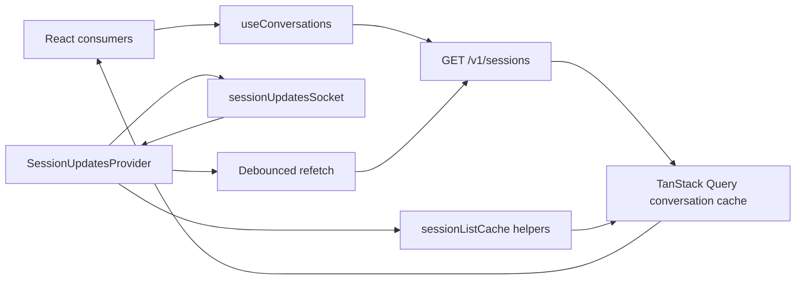
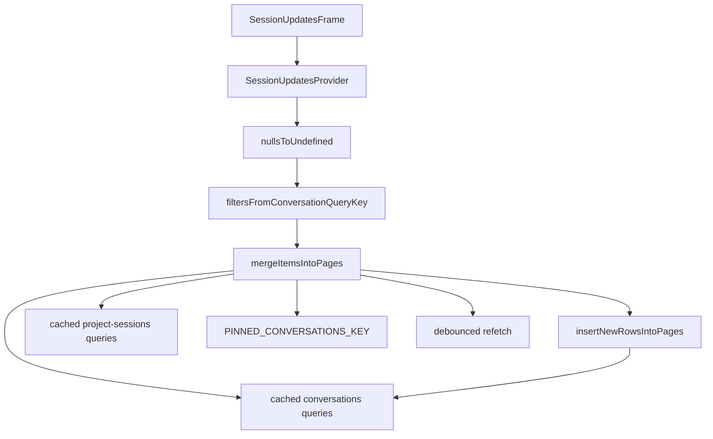
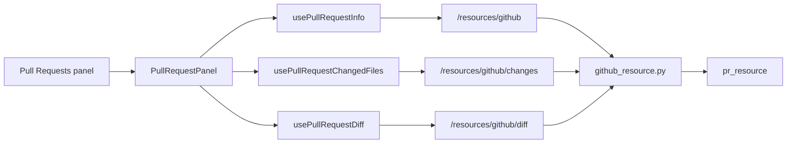
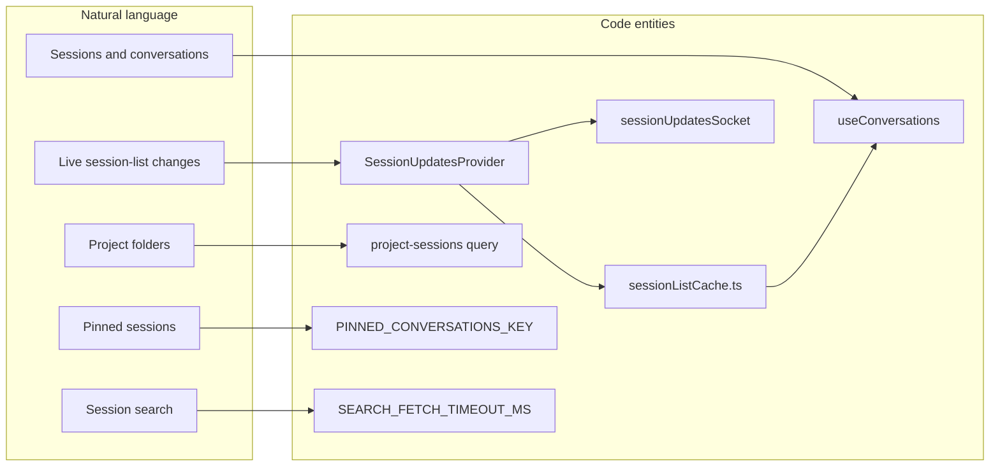
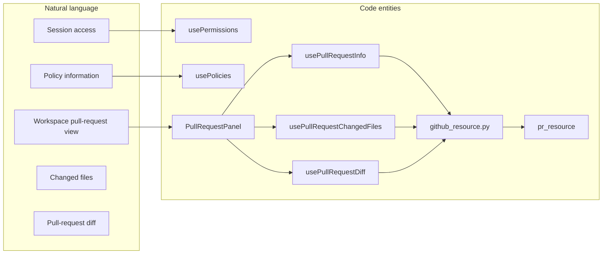

# Hooks & State Management

Relevant source files

The following files were used as context for generating this wiki page:

- [omnigent/runner/git_providers/__init__.py](omnigent/runner/git_providers/__init__.py)
- [omnigent/runner/github_resource.py](omnigent/runner/github_resource.py)
- [omnigent/runner/transports/ws_tunnel/frames.py](omnigent/runner/transports/ws_tunnel/frames.py)
- [omnigent/server/routes/default_policies.py](omnigent/server/routes/default_policies.py)
- [omnigent/server/routes/session_policies.py](omnigent/server/routes/session_policies.py)
- [omnigent/telemetry/anon.py](omnigent/telemetry/anon.py)
- [omnigent/telemetry/client.py](omnigent/telemetry/client.py)
- [omnigent/telemetry/environment.py](omnigent/telemetry/environment.py)
- [omnigent/telemetry/events.py](omnigent/telemetry/events.py)
- [omnigent/telemetry/request_headers.py](omnigent/telemetry/request_headers.py)
- [tests/e2e_ui/github/_gh_shim.py](tests/e2e_ui/github/_gh_shim.py)
- [tests/e2e_ui/github/test_check_outcomes_cancelled_skipped.py](tests/e2e_ui/github/test_check_outcomes_cancelled_skipped.py)
- [tests/e2e_ui/github/test_github_tab.py](tests/e2e_ui/github/test_github_tab.py)
- [tests/e2e_ui/github/test_pr_without_checks_permission.py](tests/e2e_ui/github/test_pr_without_checks_permission.py)
- [tests/e2e_ui/sessions/test_project_rename_broadcast.py](tests/e2e_ui/sessions/test_project_rename_broadcast.py)
- [tests/runner/test_github_resource.py](tests/runner/test_github_resource.py)
- [tests/runner/test_github_reviewers.py](tests/runner/test_github_reviewers.py)
- [tests/runner/transports/ws_tunnel/test_frames.py](tests/runner/transports/ws_tunnel/test_frames.py)
- [tests/server/routes/test_default_policies.py](tests/server/routes/test_default_policies.py)
- [tests/server/routes/test_session_policies_crud.py](tests/server/routes/test_session_policies_crud.py)
- [tests/server/routes/test_session_updates_ws.py](tests/server/routes/test_session_updates_ws.py)
- [tests/test_telemetry.py](tests/test_telemetry.py)
- [web/src/components/AgentInfo.test.tsx](web/src/components/AgentInfo.test.tsx)
- [web/src/components/AgentInfo.tsx](web/src/components/AgentInfo.tsx)
- [web/src/components/ModelValueCombobox.test.tsx](web/src/components/ModelValueCombobox.test.tsx)
- [web/src/hooks/SessionUpdatesProvider.test.tsx](web/src/hooks/SessionUpdatesProvider.test.tsx)
- [web/src/hooks/SessionUpdatesProvider.tsx](web/src/hooks/SessionUpdatesProvider.tsx)
- [web/src/hooks/useConversations.test.ts](web/src/hooks/useConversations.test.ts)
- [web/src/hooks/useConversations.ts](web/src/hooks/useConversations.ts)
- [web/src/hooks/useDefaultPolicies.ts](web/src/hooks/useDefaultPolicies.ts)
- [web/src/hooks/usePullRequests.ts](web/src/hooks/usePullRequests.ts)
- [web/src/hooks/useScopeCache.ts](web/src/hooks/useScopeCache.ts)
- [web/src/hooks/useSidebarData.policy.test.tsx](web/src/hooks/useSidebarData.policy.test.tsx)
- [web/src/hooks/useSidebarData.tsx](web/src/hooks/useSidebarData.tsx)
- [web/src/lib/sessionListCache.test.ts](web/src/lib/sessionListCache.test.ts)
- [web/src/lib/sessionListCache.ts](web/src/lib/sessionListCache.ts)
- [web/src/lib/sessionUpdatesSocket.test.ts](web/src/lib/sessionUpdatesSocket.test.ts)
- [web/src/lib/sessionUpdatesSocket.ts](web/src/lib/sessionUpdatesSocket.ts)
- [web/src/lib/sidebarData.test.ts](web/src/lib/sidebarData.test.ts)
- [web/src/lib/sidebarData.ts](web/src/lib/sidebarData.ts)
- [web/src/pages/MembersPage.test.tsx](web/src/pages/MembersPage.test.tsx)
- [web/src/pages/MembersPage.tsx](web/src/pages/MembersPage.tsx)
- [web/src/pages/PoliciesPage.test.tsx](web/src/pages/PoliciesPage.test.tsx)
- [web/src/pages/PoliciesPage.tsx](web/src/pages/PoliciesPage.tsx)
- [web/src/shell/PullRequestPanel.test.tsx](web/src/shell/PullRequestPanel.test.tsx)
- [web/src/shell/PullRequestPanel.tsx](web/src/shell/PullRequestPanel.tsx)
- [web/src/shell/Sidebar.bulkDeleteBranch.test.tsx](web/src/shell/Sidebar.bulkDeleteBranch.test.tsx)

## Purpose and scope

The `ap-web` frontend combines TanStack Query for server-backed data, cache helpers for session-list updates, a shared WebSocket provider for session freshness, and a Zustand chat store for chat-related client state. This page describes the implementations visible in the supplied source excerpts, including session queries, push updates, and GitHub pull-request data. The supplied excerpts do not include the implementations of the host, permission, policy, terminal, workspace-file, scheduled-task, presence, or idle-notification hooks, so their internal data flows are not specified here.

Sources: [web/src/hooks/useConversations.ts:1-22](), [web/src/hooks/SessionUpdatesProvider.tsx:1-18](), [web/src/lib/sessionListCache.ts:1-10](), [web/src/shell/PullRequestPanel.tsx:1-22]()

## State management overview

`useConversations` wraps session-list retrieval in TanStack Query infinite queries and pairs it with mutation hooks. Its comments distinguish optimistic rename and delete—which patch cached lists in place—from other successful mutations, which invalidate the conversation list. The session API uses session-aliased routes while retaining the wire object name `"conversation"` and conversation-oriented TypeScript names. [web/src/hooks/useConversations.ts:5-17]()

The session-updates WebSocket complements those queries: `SessionUpdatesProvider` derives a watch set from cached conversation IDs, applies incoming frames to relevant caches, and schedules refetches where the server’s list structure or ordering cannot be reconstructed locally. `sessionListCache.ts` holds pure helpers for applying those updates, keeping merge logic independent of React runtime imports. [web/src/hooks/SessionUpdatesProvider.tsx:3-18](), [web/src/lib/sessionListCache.ts:1-10]()

The available code also shows two other state-management patterns: `useChatStore` is imported by the conversation hooks, while the pull-request panel obtains resource data through dedicated `usePullRequest...` hooks. The excerpts do not show the implementation details of the chat store or pull-request hooks. [web/src/hooks/useConversations.ts:58-73](), [web/src/shell/PullRequestPanel.tsx:87-101]()

### Data flow architecture

**Diagram: Session-list query and push-update flow**

Sources: [web/src/hooks/useConversations.ts:5-17](), [web/src/hooks/SessionUpdatesProvider.tsx:3-18](), [web/src/hooks/SessionUpdatesProvider.tsx:20-42](), [web/src/lib/sessionListCache.ts:1-17]()

## Session and conversation management

### `useConversations`

`useConversations` is the session-list hook. Its options include sort order, refresh interval, snapshot mode, whether to reconcile while the update stream is connected, an `enabled` switch, and `notifyOnChangeProps` for controlling which query-result changes notify a consumer. [web/src/hooks/useConversations.ts:115-132]()

The hook’s documented contract distinguishes rename and delete from other mutations: rename and delete are optimistic and patch cached lists in place, avoiding a refetch that could race asynchronous search reindexing; remaining mutations invalidate the conversation list on success. The same comments explain that the server orders results by descending `updated_at` and that an in-memory active-chat override prevents sends from reordering the active row. [web/src/hooks/useConversations.ts:5-22]()

The hook defines separate polling intervals for connected and disconnected update streams: 60 seconds when connected and 45 seconds when disconnected. Tests confirm that the default connected case does not poll, that callers can explicitly request connected-stream reconciliation, and that the disconnected fallback uses the 45-second interval. [web/src/hooks/useConversations.ts:72-76](), [web/src/hooks/useConversations.test.ts:138-189]()

The hook also defines a 10-second client timeout for search-page fetches and identifies timeout errors so the query layer does not retry them. Ordinary list pagination is not subject to that search timeout. [web/src/hooks/useConversations.ts:78-100]()

`Conversation` mirrors the session-list wire shape while retaining `object: "conversation"` and fields such as `id`, `title`, timestamps, labels, permission level, runner ID, and host ID. [web/src/hooks/useConversations.ts:151-165]()

### Session-list cache helpers

`sessionListCache.ts` defines the `ConversationsInfiniteData` cache type and reserved label keys for project membership, pinned state, and archive time. It also defines the shared pin-write mutation key and filter dimensions for search, archived inclusion, project, and visibility. [web/src/lib/sessionListCache.ts:16-70]()

A WebSocket wire item is represented as a partial `Conversation` with a required ID. Since stream frames carry explicit `null` values while list responses represent empty fields as absent, `nullsToUndefined` converts null values to `undefined` before cache overlays. The helper’s documented reason includes avoiding an incorrect interpretation of `permission_level: null` as the full-access sentinel. [web/src/lib/sessionListCache.ts:73-103]()

`changedWireFields` compares incoming fields against a cached row and compares `labels` structurally, avoiding cache rewrites when a snapshot restates unchanged data. [web/src/lib/sessionListCache.ts:105-131]()

### `SessionUpdatesProvider`

`SessionUpdatesProvider` is app-level wiring for the `WS /v1/sessions/updates` stream. Its documented responsibilities are opening the shared stream, deriving the watch set from cached conversation IDs, applying snapshot/changed/removed frames, and using debounced refetches for structural or membership changes and sorting that cannot be reconstructed locally. The provider is intended to replace frequent list polling while retaining low-rate HTTP reconciliation for sessions created elsewhere. [web/src/hooks/SessionUpdatesProvider.tsx:3-18]()

The provider uses a 250 ms debounce for bursts of structural changes and watch-set recomputations. It also defines fixed filters for project-folder queries, which are non-archived and unsearched. [web/src/hooks/SessionUpdatesProvider.tsx:45-55]()

`applyItemsToCache` begins by building a per-ID map of incoming items. It skips sessions marked as deleting, treats sessions currently being archived as archived in the incoming overlay, and converts explicit nulls to undefined. It then finds cached conversation-query variants and merges the items using filters decoded from each query key. [web/src/hooks/SessionUpdatesProvider.tsx:65-96](), [web/src/hooks/SessionUpdatesProvider.tsx:97-117]()

For missing rows, the provider attempts local insertion into cached pages. Newly inserted, unfiled sessions are marked recently created so an intervening refetch does not drop them before they are searchable. The provider also merges into project-folder caches and overlays updates into the pinned-conversations query. [web/src/hooks/SessionUpdatesProvider.tsx:97-117](), [web/src/hooks/SessionUpdatesProvider.tsx:119-152]()

**Diagram: WebSocket frame overlay into cached session lists**

Sources: [web/src/hooks/SessionUpdatesProvider.tsx:20-42](), [web/src/hooks/SessionUpdatesProvider.tsx:65-117](), [web/src/hooks/SessionUpdatesProvider.tsx:119-152](), [web/src/lib/sessionListCache.ts:73-103]()

## Chat and transient client state

`useConversations.ts` imports `releaseConversation` and `useChatStore`, showing that session-list operations are connected to the chat store. The supplied excerpt does not include the store definition or enough call sites to document its state shape or action behavior. [web/src/hooks/useConversations.ts:58-73]()

The earlier description of the store as containing streaming blocks, queued messages, and SSE lifecycle behavior is not substantiated by the supplied store source excerpt; those implementation details are therefore not expanded here.

Sources: [web/src/hooks/useConversations.ts:58-73]()

## GitHub pull-request state

`PullRequestPanel` consumes pull-request data through hooks defined in `web/src/hooks/usePullRequests.ts`, including `usePullRequestInfo`, `usePullRequestChangedFiles`, and `usePullRequestDiff`. The panel also imports hooks for PR preferences and session associations. [web/src/shell/PullRequestPanel.tsx:87-101]()

The panel’s source comments describe the data boundary: the runner-backed read-only PR resource API supplies PR information, changed files, and a whole-PR unified diff. The panel parses the diff client-side into per-file diffs, and lazily fetches full file contents when a reader expands unchanged context. [web/src/shell/PullRequestPanel.tsx:4-22]()

The supplied runner implementation describes `github_resource.py` as delegating GitHub operations to `pr_resource`. Its documented responsibilities include PR details, changed files, patches, and attach checks; it also notes that unavailable-resource payloads allow the UI to show explanatory states rather than generic errors. [omnigent/runner/github_resource.py:1-10](), [omnigent/runner/github_resource.py:47-52]()

**Diagram: Pull-request UI names mapped to resource and runner entities**

Sources: [web/src/shell/PullRequestPanel.tsx:4-22](), [web/src/shell/PullRequestPanel.tsx:87-101](), [omnigent/runner/github_resource.py:1-10]()

### GitHub authentication and availability behavior

The runner source documents that GitHub CLI commands run in the workspace root and that sandboxed environments remove ambient `GH_TOKEN` and `GITHUB_TOKEN` variables so they do not override the broker identity configured for the host. It also documents request timeouts and fallback behavior for GitHub check data when the token lacks Checks permission. [omnigent/runner/github_resource.py:12-24](), [omnigent/runner/github_resource.py:47-52]()

## Other hook and store areas

The page’s stated scope includes hosts, permissions, policies, terminals, workspace files, scheduled tasks, presence, and idle notifications. The supplied material names some related files and imports—for example, `usePermissions`, `usePolicies`, and `useWorkspaceChangedFiles`—but does not provide their implementations or line-numbered excerpts. Accordingly, this page does not infer their query keys, mutation semantics, polling strategies, or store behavior. [web/src/components/AgentInfo.tsx:30-38](), [web/src/hooks/useConversations.ts:58-73](), [web/src/shell/PullRequestPanel.tsx:77-101]()

Sources: [web/src/components/AgentInfo.tsx:30-38](), [web/src/hooks/useConversations.ts:58-73](), [web/src/shell/PullRequestPanel.tsx:77-101]()

## Natural-language concepts mapped to code entities

**Diagram: Session-list concepts mapped to frontend entities**

Sources: [web/src/hooks/useConversations.ts:75-100](), [web/src/hooks/SessionUpdatesProvider.tsx:3-18](), [web/src/hooks/SessionUpdatesProvider.tsx:119-152](), [web/src/lib/sessionListCache.ts:1-17]()

**Diagram: Collaboration and pull-request concepts mapped to code entities**

Sources: [web/src/components/AgentInfo.tsx:30-38](), [web/src/shell/PullRequestPanel.tsx:4-22](), [web/src/shell/PullRequestPanel.tsx:87-101](), [omnigent/runner/github_resource.py:1-10]()

## References

The principal implementation files represented in the supplied excerpts are `web/src/hooks/useConversations.ts`, `web/src/hooks/SessionUpdatesProvider.tsx`, `web/src/lib/sessionListCache.ts`, `web/src/shell/PullRequestPanel.tsx`, and `omnigent/runner/github_resource.py`. [web/src/hooks/useConversations.ts:1-17](), [web/src/hooks/SessionUpdatesProvider.tsx:1-18](), [web/src/lib/sessionListCache.ts:1-10](), [web/src/shell/PullRequestPanel.tsx:1-22](), [omnigent/runner/github_resource.py:1-10]()

Sources: [web/src/hooks/useConversations.ts:1-17](), [web/src/hooks/SessionUpdatesProvider.tsx:1-18](), [web/src/lib/sessionListCache.ts:1-10](), [web/src/shell/PullRequestPanel.tsx:1-22](), [omnigent/runner/github_resource.py:1-10]()