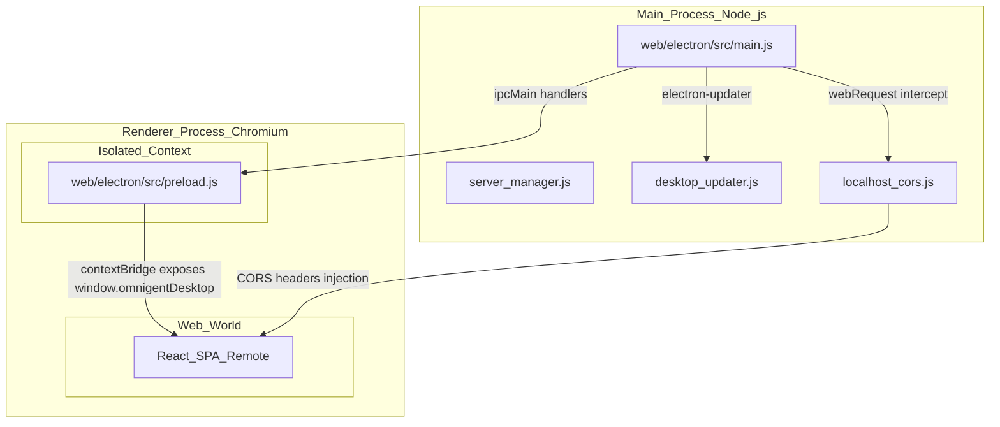
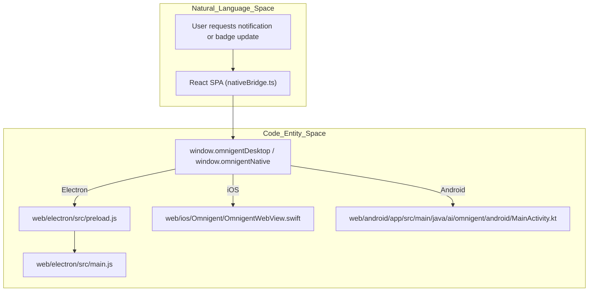
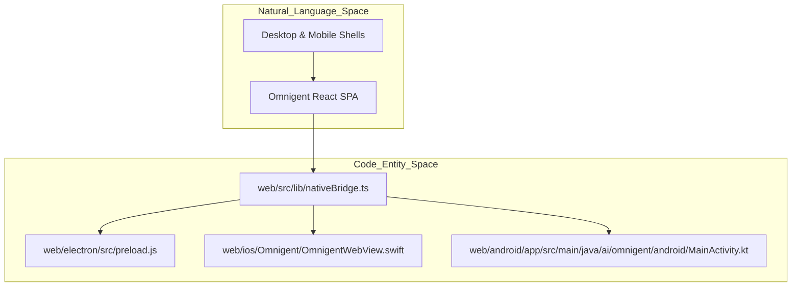

# Electron Desktop App, iOS Shell & Android Shell

Relevant source files

The following files were used as context for generating this wiki page:

- [web/android/README.md](web/android/README.md)
- [web/android/app/build.gradle.kts](web/android/app/build.gradle.kts)
- [web/android/app/src/main/AndroidManifest.xml](web/android/app/src/main/AndroidManifest.xml)
- [web/android/app/src/main/java/ai/omnigent/android/ConnectActivity.kt](web/android/app/src/main/java/ai/omnigent/android/ConnectActivity.kt)
- [web/android/app/src/main/java/ai/omnigent/android/DatabricksLoginManager.kt](web/android/app/src/main/java/ai/omnigent/android/DatabricksLoginManager.kt)
- [web/android/app/src/main/java/ai/omnigent/android/DatabricksOAuthAttempt.kt](web/android/app/src/main/java/ai/omnigent/android/DatabricksOAuthAttempt.kt)
- [web/android/app/src/main/java/ai/omnigent/android/DatabricksOAuthClient.kt](web/android/app/src/main/java/ai/omnigent/android/DatabricksOAuthClient.kt)
- [web/android/app/src/main/java/ai/omnigent/android/DatabricksOAuthConfiguration.kt](web/android/app/src/main/java/ai/omnigent/android/DatabricksOAuthConfiguration.kt)
- [web/android/app/src/main/java/ai/omnigent/android/MainActivity.kt](web/android/app/src/main/java/ai/omnigent/android/MainActivity.kt)
- [web/android/app/src/main/java/ai/omnigent/android/NativeBridgeScript.kt](web/android/app/src/main/java/ai/omnigent/android/NativeBridgeScript.kt)
- [web/android/app/src/main/java/ai/omnigent/android/OAuthCallbackHandoff.kt](web/android/app/src/main/java/ai/omnigent/android/OAuthCallbackHandoff.kt)
- [web/android/app/src/main/java/ai/omnigent/android/OAuthSupport.kt](web/android/app/src/main/java/ai/omnigent/android/OAuthSupport.kt)
- [web/android/app/src/main/java/ai/omnigent/android/OAuthTransport.kt](web/android/app/src/main/java/ai/omnigent/android/OAuthTransport.kt)
- [web/android/app/src/main/java/ai/omnigent/android/OmnigentBridgeListener.kt](web/android/app/src/main/java/ai/omnigent/android/OmnigentBridgeListener.kt)
- [web/android/app/src/main/java/ai/omnigent/android/OmnigentWebViewClient.kt](web/android/app/src/main/java/ai/omnigent/android/OmnigentWebViewClient.kt)
- [web/android/app/src/main/java/ai/omnigent/android/Origins.kt](web/android/app/src/main/java/ai/omnigent/android/Origins.kt)
- [web/android/app/src/main/java/ai/omnigent/android/ServerManifest.kt](web/android/app/src/main/java/ai/omnigent/android/ServerManifest.kt)
- [web/android/app/src/main/java/ai/omnigent/android/ServerStore.kt](web/android/app/src/main/java/ai/omnigent/android/ServerStore.kt)
- [web/android/app/src/main/java/ai/omnigent/android/UserConnectRequests.kt](web/android/app/src/main/java/ai/omnigent/android/UserConnectRequests.kt)
- [web/android/app/src/main/res/layout/activity_connect.xml](web/android/app/src/main/res/layout/activity_connect.xml)
- [web/android/app/src/main/res/values/strings.xml](web/android/app/src/main/res/values/strings.xml)
- [web/android/app/src/test/java/ai/omnigent/android/DatabricksLoginManagerTest.kt](web/android/app/src/test/java/ai/omnigent/android/DatabricksLoginManagerTest.kt)
- [web/android/app/src/test/java/ai/omnigent/android/DatabricksOAuthAttemptTest.kt](web/android/app/src/test/java/ai/omnigent/android/DatabricksOAuthAttemptTest.kt)
- [web/android/app/src/test/java/ai/omnigent/android/DatabricksOAuthClientTest.kt](web/android/app/src/test/java/ai/omnigent/android/DatabricksOAuthClientTest.kt)
- [web/android/app/src/test/java/ai/omnigent/android/DatabricksOAuthConfigurationTest.kt](web/android/app/src/test/java/ai/omnigent/android/DatabricksOAuthConfigurationTest.kt)
- [web/android/app/src/test/java/ai/omnigent/android/MainActivityTest.kt](web/android/app/src/test/java/ai/omnigent/android/MainActivityTest.kt)
- [web/android/app/src/test/java/ai/omnigent/android/OmnigentBridgeListenerTest.kt](web/android/app/src/test/java/ai/omnigent/android/OmnigentBridgeListenerTest.kt)
- [web/android/app/src/test/java/ai/omnigent/android/OmnigentWebViewClientTest.kt](web/android/app/src/test/java/ai/omnigent/android/OmnigentWebViewClientTest.kt)
- [web/android/app/src/test/java/ai/omnigent/android/ServerAuthenticationTest.kt](web/android/app/src/test/java/ai/omnigent/android/ServerAuthenticationTest.kt)
- [web/android/app/src/test/java/ai/omnigent/android/ServerStoreTest.kt](web/android/app/src/test/java/ai/omnigent/android/ServerStoreTest.kt)
- [web/android/app/src/test/java/ai/omnigent/android/UserConnectRequestsTest.kt](web/android/app/src/test/java/ai/omnigent/android/UserConnectRequestsTest.kt)
- [web/android/docs/databricks-oauth.md](web/android/docs/databricks-oauth.md)
- [web/electron/.gitignore](web/electron/.gitignore)
- [web/electron/README.md](web/electron/README.md)
- [web/electron/dev-app-update.yml](web/electron/dev-app-update.yml)
- [web/electron/setup/index.html](web/electron/setup/index.html)
- [web/electron/src/browserIpc.js](web/electron/src/browserIpc.js)
- [web/electron/src/chromeCookieStore.js](web/electron/src/chromeCookieStore.js)
- [web/electron/src/desktop_updater.js](web/electron/src/desktop_updater.js)
- [web/electron/src/dev_preferences.js](web/electron/src/dev_preferences.js)
- [web/electron/src/main.js](web/electron/src/main.js)
- [web/electron/src/preload.js](web/electron/src/preload.js)
- [web/electron/src/workspace-chrome.js](web/electron/src/workspace-chrome.js)
- [web/electron/test/browserIpc.test.js](web/electron/test/browserIpc.test.js)
- [web/electron/test/chromeCookieImportPrompt.test.js](web/electron/test/chromeCookieImportPrompt.test.js)
- [web/electron/test/chromeCookieStore.test.js](web/electron/test/chromeCookieStore.test.js)
- [web/electron/test/desktop_updater.test.js](web/electron/test/desktop_updater.test.js)
- [web/electron/test/dev_preferences.test.js](web/electron/test/dev_preferences.test.js)
- [web/electron/test/main.test.js](web/electron/test/main.test.js)
- [web/electron/test/setup_connect.test.js](web/electron/test/setup_connect.test.js)
- [web/electron/test/update-main.test.js](web/electron/test/update-main.test.js)
- [web/ios/Omnigent.xcodeproj/project.pbxproj](web/ios/Omnigent.xcodeproj/project.pbxproj)
- [web/ios/Omnigent/AppRootView.swift](web/ios/Omnigent/AppRootView.swift)
- [web/ios/Omnigent/DatabricksCredentialStore.swift](web/ios/Omnigent/DatabricksCredentialStore.swift)
- [web/ios/Omnigent/DatabricksLoginManager.swift](web/ios/Omnigent/DatabricksLoginManager.swift)
- [web/ios/Omnigent/DatabricksOAuthAttempt.swift](web/ios/Omnigent/DatabricksOAuthAttempt.swift)
- [web/ios/Omnigent/DatabricksOAuthClient.swift](web/ios/Omnigent/DatabricksOAuthClient.swift)
- [web/ios/Omnigent/DatabricksOAuthConfiguration.swift](web/ios/Omnigent/DatabricksOAuthConfiguration.swift)
- [web/ios/Omnigent/DatabricksSessionClient.swift](web/ios/Omnigent/DatabricksSessionClient.swift)
- [web/ios/Omnigent/DatabricksTokenManager.swift](web/ios/Omnigent/DatabricksTokenManager.swift)
- [web/ios/Omnigent/DatabricksWebContext.swift](web/ios/Omnigent/DatabricksWebContext.swift)
- [web/ios/Omnigent/DatabricksWorkspaceBootstrap.swift](web/ios/Omnigent/DatabricksWorkspaceBootstrap.swift)
- [web/ios/Omnigent/DeepLink.swift](web/ios/Omnigent/DeepLink.swift)
- [web/ios/Omnigent/OmnigentWebView.swift](web/ios/Omnigent/OmnigentWebView.swift)
- [web/ios/Omnigent/ServerURL.swift](web/ios/Omnigent/ServerURL.swift)
- [web/ios/Omnigent/SettingsStore.swift](web/ios/Omnigent/SettingsStore.swift)
- [web/ios/Omnigent/WebShellView.swift](web/ios/Omnigent/WebShellView.swift)
- [web/ios/Omnigent/WebViewModel.swift](web/ios/Omnigent/WebViewModel.swift)
- [web/ios/OmnigentTests/ConnectionErrorTests.swift](web/ios/OmnigentTests/ConnectionErrorTests.swift)
- [web/ios/OmnigentTests/DatabricksCredentialStoreTests.swift](web/ios/OmnigentTests/DatabricksCredentialStoreTests.swift)
- [web/ios/OmnigentTests/DatabricksLoginManagerTests.swift](web/ios/OmnigentTests/DatabricksLoginManagerTests.swift)
- [web/ios/OmnigentTests/DatabricksOAuthClientTests.swift](web/ios/OmnigentTests/DatabricksOAuthClientTests.swift)
- [web/ios/OmnigentTests/DatabricksOAuthTests.swift](web/ios/OmnigentTests/DatabricksOAuthTests.swift)
- [web/ios/OmnigentTests/DatabricksTokenManagerTests.swift](web/ios/OmnigentTests/DatabricksTokenManagerTests.swift)
- [web/ios/OmnigentTests/DatabricksWorkspaceBootstrapTests.swift](web/ios/OmnigentTests/DatabricksWorkspaceBootstrapTests.swift)
- [web/ios/OmnigentTests/DeepLinkTests.swift](web/ios/OmnigentTests/DeepLinkTests.swift)
- [web/ios/OmnigentTests/ServerSwitcherVisibilityTests.swift](web/ios/OmnigentTests/ServerSwitcherVisibilityTests.swift)
- [web/ios/README.md](web/ios/README.md)
- [web/ios/docs/databricks-oauth.md](web/ios/docs/databricks-oauth.md)
- [web/src/components/BrowserPane/BrowserPane.test.tsx](web/src/components/BrowserPane/BrowserPane.test.tsx)
- [web/src/components/BrowserPane/BrowserPane.tsx](web/src/components/BrowserPane/BrowserPane.tsx)
- [web/src/components/UpdateBanner.test.tsx](web/src/components/UpdateBanner.test.tsx)
- [web/src/components/UpdateBanner.tsx](web/src/components/UpdateBanner.tsx)
- [web/src/lib/nativeBridge.test.ts](web/src/lib/nativeBridge.test.ts)
- [web/src/lib/nativeBridge.ts](web/src/lib/nativeBridge.ts)
- [web/src/pages/onboarding/LandingStep.test.tsx](web/src/pages/onboarding/LandingStep.test.tsx)
- [web/src/pages/onboarding/LandingStep.tsx](web/src/pages/onboarding/LandingStep.tsx)
- [web/src/pages/onboarding/RunnerStep.tsx](web/src/pages/onboarding/RunnerStep.tsx)
- [web/src/pages/onboarding/ServerSelectStep.render.test.tsx](web/src/pages/onboarding/ServerSelectStep.render.test.tsx)
- [web/src/pages/onboarding/ServerSelectStep.tsx](web/src/pages/onboarding/ServerSelectStep.tsx)
- [web/src/pages/onboarding/ServerSelectorV2.test.tsx](web/src/pages/onboarding/ServerSelectorV2.test.tsx)
- [web/src/pages/onboarding/ServerSelectorV2.tsx](web/src/pages/onboarding/ServerSelectorV2.tsx)
- [web/src/pages/onboarding/SetupTerminalStep.test.tsx](web/src/pages/onboarding/SetupTerminalStep.test.tsx)
- [web/src/pages/onboarding/SetupTerminalStep.tsx](web/src/pages/onboarding/SetupTerminalStep.tsx)
- [web/src/pages/onboarding/mockSetup.ts](web/src/pages/onboarding/mockSetup.ts)
- [web/src/server-selector-v2.tsx](web/src/server-selector-v2.tsx)
- [web/src/shell/SidebarServerPicker.test.tsx](web/src/shell/SidebarServerPicker.test.tsx)
- [web/src/shell/SidebarServerPicker.tsx](web/src/shell/SidebarServerPicker.tsx)
- [web/update-overlay.html](web/update-overlay.html)

This page details the implementation of Omnigent's native wrappers for desktop (Electron) and mobile (iOS and Android). These shells embed the Omnigent web frontend and integrate platform-specific native features such as notifications, badging, system menus, authentication handling, and secure IPC bridges.

---

## 1. Electron Desktop App

The Electron application serves as a thin native wrapper around the Omnigent web UI, enabling enhanced desktop integration without duplicating the UI code. The real SPA is always served by the Omnigent server — the Electron shell merely hosts it in a native window with additional OS-level capabilities.

### 1.1 Architecture and Data Flow

Electron uses a multi-process model coordinating tasks across Node.js and Chromium:

- **Main Process (Node.js)**: Controlled by `web/electron/src/main.js`, managing window lifecycle, native menus, desktop notifications, auto-updates via `electron-updater`, and IPC communication.
- **Renderer Process (Chromium)**: Loads the remote SPA served from the Omnigent server or local setup files.
- **Preload Script**: Defined in `web/electron/src/preload.js`, using `contextBridge` to expose a frozen `window.omnigentDesktop` API to the web UI under strict context isolation.

**Title: Electron Multi-Process Architecture & IPC Flow**
Sources: [web/electron/src/main.js:1-122](), [web/electron/src/preload.js:1-53]()

### 1.2 Main Process (`main.js`)

The main process script orchestrates startup and OS integration:
- **Window Management**: Instantiates the primary `BrowserWindow`. If no server URL is saved, it loads either the classic setup page or `server-selector-v2.html` [web/electron/src/main.js:123-176](). Otherwise, it connects directly to the saved Omnigent server URL.
- **Permissions and Media**: Automatically grants permissions for voice dictation (`media`, `audioCapture`), clipboard access, and secure local network probes [web/electron/src/main.js:20-33]().
- **CORS Shim**: Intercepts requests destined for the local runner or server via `webRequest` handlers to inject appropriate CORS headers [web/electron/src/main.js:45-45]().
- **Notifications & Badging**: Leverages native `Notification` APIs and `app.setBadgeCount` for unread session badging and taskbar/dock alerts [web/electron/src/main.js:20-33]().

Sources: [web/electron/src/main.js:16-122](), [web/electron/src/preload.js:1-68]()

### 1.3 Preload Script & IPC Bridge

The preload script at `web/electron/src/preload.js` acts as the security boundary between the untrusted remote SPA and the Node.js host:
- Exposes `window.omnigentDesktop` with methods such as `setBadgeCount`, `notify`, `onNotificationActivated`, `onOpenPath`, `getServerPicker`, `switchServer`, and `controlHost` [web/electron/src/preload.js:52-135]().
- Validates all incoming navigation paths to ensure they begin with `/` as a defense-in-depth measure against cross-origin injections [web/electron/src/preload.js:75-101]().

Sources: [web/electron/src/preload.js:1-151](), [web/src/lib/nativeBridge.ts:1-76]()

---

## 2. iOS Shell (SwiftUI & WKWebView)

Omnigent's iOS shell (`web/ios/`) embeds the SPA inside a native `WKWebView` managed by SwiftUI lifecycle components.

### 2.1 Overview & Key Classes

- **`OmnigentWebView`**: A `UIViewRepresentable` struct embedding `WKWebView`, configuring user content controllers, user scripts, and navigation delegates [web/ios/Omnigent/OmnigentWebView.swift:6-68]().
- **`WebViewModel`**: An observable state holder tracking web state and navigation history [web/ios/Omnigent/WebViewModel.swift:1-10]().
- **`SettingsStore`**: Persists local user settings and preferences [web/ios/Omnigent/OmnigentWebView.swift:9-9]().
- **`NativeNotificationManager`**: Coordinates local notifications and background triggers on iOS [web/ios/Omnigent/NativeNotificationManager.swift:1-10]().

Sources: [web/ios/Omnigent/OmnigentWebView.swift:6-101](), [web/ios/Omnigent/Omnigent.xcodeproj/project.pbxproj:10-31]()

### 2.2 Native Bridge & Viewport Handling

The iOS shell injects a startup script (`nativeBridgeScript`) into the `WKWebView` via `WKUserContentController` [web/ios/Omnigent/OmnigentWebView.swift:51-60]():
- Automatically injects and observes viewport configuration, ensuring `viewport-fit=cover` is preserved so safe area insets are respected [web/ios/Omnigent/OmnigentWebView.swift:116-169]().
- Exposes `window.omnigentNative` to bridge events such as sidebar drag fractions (`onSidebarDrag`), inset tracking (`onNativeInsets`), and server switcher visibility [web/src/lib/nativeBridge.ts:63-144]().

Sources: [web/ios/Omnigent/OmnigentWebView.swift:51-169](), [web/src/lib/nativeBridge.ts:63-144]()

---

## 3. Android Shell (WebView)

The Android wrapper (`web/android/`) hosts the SPA in an Activity-managed `WebView` with custom client interception and native communication bridges.

### 3.1 Architecture & Key Classes

- **`MainActivity`**: The core activity hosting the `WebView`, initializing `NativeNotificationManager`, managing permissions, and coordinating OIDC/OAuth login flows [web/android/app/src/main/java/ai/omnigent/android/MainActivity.kt:78-115]().
- **`OmnigentWebViewClient`**: Subclass of `WebViewClient` that monitors main-frame loads, handles off-origin login redirects, guards against workspace root loops, and catches renderer process crashes (`onRenderProcessGone`) to rebuild the view rather than terminating the app [web/android/app/src/main/java/ai/omnigent/android/OmnigentWebViewClient.kt:34-115]().
- **`NativeBridgeScript`**: Supplies the JavaScript snippet injected at document start to establish `window.omnigentNative` [web/android/app/src/main/java/ai/omnigent/android/NativeBridgeScript.kt:1-20]().

Sources: [web/android/app/src/main/java/ai/omnigent/android/MainActivity.kt:78-136](), [web/android/app/src/main/java/ai/omnigent/android/OmnigentWebViewClient.kt:34-115]()

### 3.2 Build & Signing

Managed via Gradle (`web/android/app/build.gradle.kts`):
- Configures compile SDK 37, target SDK 36, minimum SDK 28, and Java 17 compatibility [web/android/app/build.gradle.kts:60-123]().
- Handles release signing configuration dynamically via `keystore.properties` or environment variables [web/android/app/build.gradle.kts:17-32]().
- Integrates Google Play Publisher plugin for internal track distribution [web/android/app/build.gradle.kts:150-167]().

Sources: [web/android/app/build.gradle.kts:1-168]()

---

## 4. Native Bridge & Theme Synchronization

The web application detects native runner wrappers at runtime by inspecting `window.omnigentDesktop` or `window.omnigentNative` [web/src/lib/nativeBridge.ts:16-20]().

**Title: Natural Language Space to Code Entity Space Bridge for Native Integration**
Sources: [web/src/lib/nativeBridge.ts:1-76](), [web/electron/src/preload.js:52-68](), [web/ios/Omnigent/OmnigentWebView.swift:51-60](), [web/android/app/src/main/java/ai/omnigent/android/MainActivity.kt:78-100]()

---

## 5. Mobile Safe Areas & Layout Insets

Both mobile shells handle system UI decorations and safe areas:
- **iOS**: Uses `viewport-fit=cover` and native inset observers to pass top/bottom bar dimensions into web CSS variables [web/ios/Omnigent/OmnigentWebView.swift:145-165](), [web/src/lib/nativeBridge.ts:140-144]().
- **Android**: Configures edge-to-edge window flags and extracts window insets to prevent UI elements from colliding with gesture bars or status displays [web/android/app/src/main/java/ai/omnigent/android/MainActivity.kt:40-45]().

Sources: [web/ios/Omnigent/OmnigentWebView.swift:145-165](), [web/src/lib/nativeBridge.ts:140-144](), [web/android/app/src/main/java/ai/omnigent/android/MainActivity.kt:40-45]()

---

## Summary: Cross-Platform Native Shell Mapping

**Title: Cross-Platform Native Shell Code Entity Mapping**
Sources: [web/src/lib/nativeBridge.ts:1-20](), [web/electron/src/preload.js:1-12](), [web/ios/Omnigent/OmnigentWebView.swift:51-60](), [web/android/app/src/main/java/ai/omnigent/android/MainActivity.kt:78-85]()