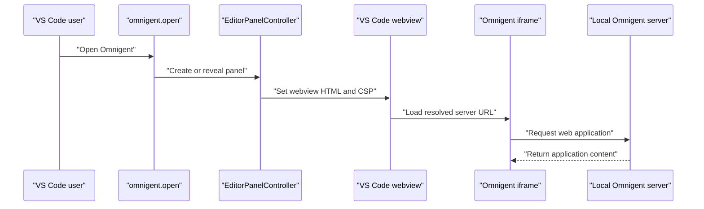
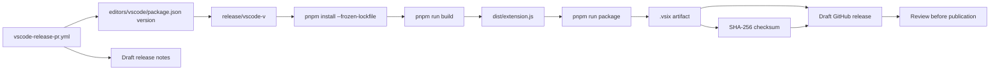
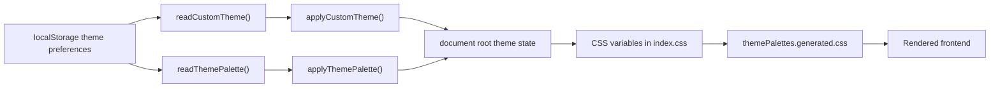
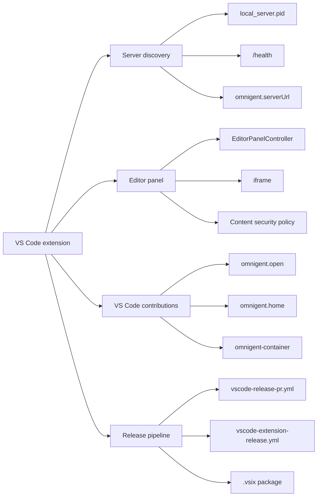
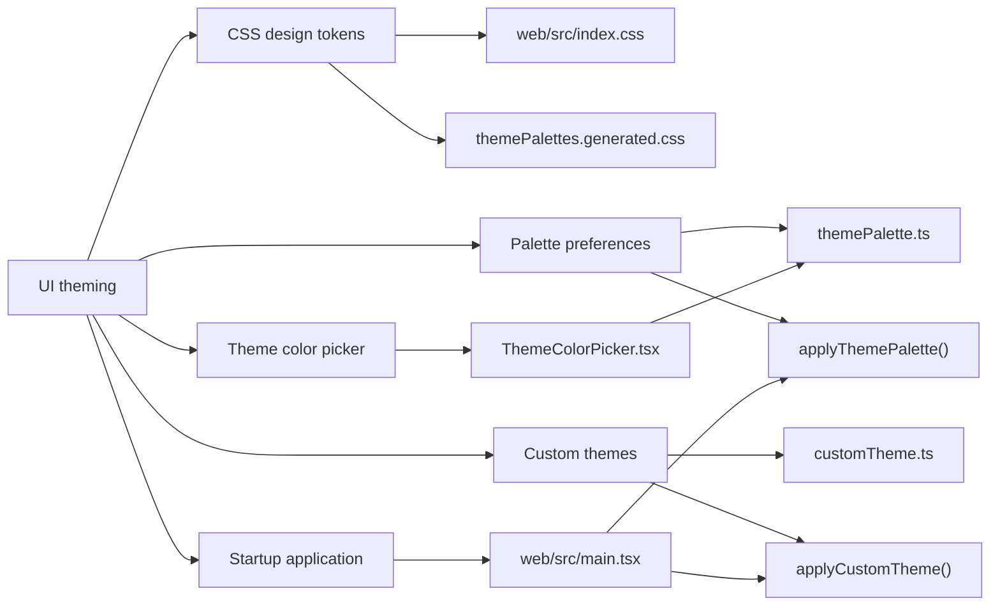

# VS Code Extension & Theming

<details>
<summary>Relevant source files</summary>

The following files were used as context for generating this wiki page:

- [tests/browser_ui/files/test_workspace_tab_overflow.py](tests/browser_ui/files/test_workspace_tab_overflow.py)
- [tests/e2e_ui/sessions/test_header_session_menu.py](tests/e2e_ui/sessions/test_header_session_menu.py)
- [tests/e2e_ui/sessions/test_new_session_hotkey.py](tests/e2e_ui/sessions/test_new_session_hotkey.py)
- [tests/e2e_ui/sessions/test_ui_fit_and_finish.py](tests/e2e_ui/sessions/test_ui_fit_and_finish.py)
- [web/src/components/KeyboardShortcut.tsx](web/src/components/KeyboardShortcut.tsx)
- [web/src/components/KeyboardShortcutsDialog.test.tsx](web/src/components/KeyboardShortcutsDialog.test.tsx)
- [web/src/components/KeyboardShortcutsDialog.tsx](web/src/components/KeyboardShortcutsDialog.tsx)
- [web/src/embed.test.tsx](web/src/embed.test.tsx)
- [web/src/embed.tsx](web/src/embed.tsx)
- [web/src/hooks/useNewSessionHotkey.test.tsx](web/src/hooks/useNewSessionHotkey.test.tsx)
- [web/src/hooks/useNewSessionHotkey.ts](web/src/hooks/useNewSessionHotkey.ts)
- [web/src/hooks/useRenameSessionHotkey.test.tsx](web/src/hooks/useRenameSessionHotkey.test.tsx)
- [web/src/hooks/useRenameSessionHotkey.ts](web/src/hooks/useRenameSessionHotkey.ts)
- [web/src/index.css](web/src/index.css)
- [web/src/index.css.test.ts](web/src/index.css.test.ts)
- [web/src/lib/customTheme.test.ts](web/src/lib/customTheme.test.ts)
- [web/src/lib/customTheme.ts](web/src/lib/customTheme.ts)
- [web/src/lib/sessionWorkspaceState.test.ts](web/src/lib/sessionWorkspaceState.test.ts)
- [web/src/lib/sessionWorkspaceState.ts](web/src/lib/sessionWorkspaceState.ts)
- [web/src/lib/themePalette.test.ts](web/src/lib/themePalette.test.ts)
- [web/src/lib/themePalette.ts](web/src/lib/themePalette.ts)
- [web/src/lib/workspaceTabPreferences.test.ts](web/src/lib/workspaceTabPreferences.test.ts)
- [web/src/lib/workspaceTabPreferences.ts](web/src/lib/workspaceTabPreferences.ts)
- [web/src/main.tsx](web/src/main.tsx)
- [web/src/shell/AppShell.test.tsx](web/src/shell/AppShell.test.tsx)
- [web/src/shell/AppShell.tsx](web/src/shell/AppShell.tsx)
- [web/src/shell/ChatHeader.test.tsx](web/src/shell/ChatHeader.test.tsx)
- [web/src/shell/ChatHeader.tsx](web/src/shell/ChatHeader.tsx)
- [web/src/shell/HeaderConversationMenu.test.tsx](web/src/shell/HeaderConversationMenu.test.tsx)
- [web/src/shell/HeaderConversationMenu.tsx](web/src/shell/HeaderConversationMenu.tsx)
- [web/src/shell/HeaderTitle.test.tsx](web/src/shell/HeaderTitle.test.tsx)
- [web/src/shell/HeaderTitle.tsx](web/src/shell/HeaderTitle.tsx)
- [web/src/shell/WorkspacePanel.test.tsx](web/src/shell/WorkspacePanel.test.tsx)
- [web/src/shell/WorkspacePanel.tsx](web/src/shell/WorkspacePanel.tsx)
- [web/src/shell/WorkspaceTabsScroller.tsx](web/src/shell/WorkspaceTabsScroller.tsx)
- [web/src/shell/railTabs.ts](web/src/shell/railTabs.ts)
- [web/src/themePalettes.generated.css](web/src/themePalettes.generated.css)

</details>


## Purpose and scope

This page documents the Omnigent VS Code extension in `editors/vscode/` and the web frontend’s theming system in `web/src/`. It covers local server discovery, the `EditorPanelController` webview, extension commands and release packaging, and the CSS tokens, palette preferences, custom themes, and theme picker.

Sources: [editors/vscode/README.md:1-61](), [web/src/index.css:1-142](), [web/src/main.tsx:94-112]()

---

## Omnigent VS Code Extension

The extension connects VS Code to a local Omnigent server and displays the Omnigent web application in an editor panel. Its integration includes server discovery, a webview-hosted iframe, contributed commands and views, and a build-and-release pipeline.

Sources: [editors/vscode/README.md:1-61](), [editors/vscode/PUBLISHING.md:1-24]()

### 1. Server discovery

The extension resolves a server URL before opening its UI:

- **Manual URL:** `omnigent.serverUrl` can specify a local server URL. The extension restricts this override to localhost targets.
- **Local server lookup:** When no override is supplied, discovery checks the local Omnigent configuration directory for `local_server.pid`.
- **Health probe:** A candidate server is checked at `/health` before it is used. A missing or unhealthy server prevents a successful connection and prompts the user to resolve the server state.

The local server’s PID-file location is defined by the local server implementation; the extension’s README documents the setting and connection behavior. [omnigent/host/local_server.py:80-84](), [editors/vscode/README.md:10-30]()

#### Diagram: Server discovery flow

```mermaid
flowchart TD
    START["Open Omnigent in VS Code"] --> SETTING["Read omnigent.serverUrl"]
    SETTING -->| "Manual URL configured" | VALIDATE["Validate localhost target"]
    VALIDATE -->| "Allowed" | MANUAL["Use configured server URL"]
    VALIDATE -->| "Rejected" | REMOTE_ERROR["Report invalid remote URL"]
    SETTING -->| "No manual URL" | PID["Check ~/.omnigent/local_server.pid"]
    PID -->| "PID file available" | PROBE["Probe candidate /health"]
    PID -->| "No PID file" | NOT_FOUND["Report no local server"]
    PROBE -->| "Healthy" | DISCOVERED["Use discovered server URL"]
    PROBE -->| "Unhealthy or timed out" | HEALTH_ERROR["Report server unavailable"]
```

Sources: [editors/vscode/README.md:10-30](), [omnigent/host/local_server.py:80-84]()

### 2. UI surface and `EditorPanelController`

`EditorPanelController` manages the VS Code editor panel that hosts the Omnigent UI. The panel’s webview HTML contains an iframe loading the resolved server URL, allowing the web application to run inside the VS Code shell. The extension documents CSP restrictions for the embedded content and describes limitations on forwarding certain macOS keyboard shortcuts into the iframe. [editors/vscode/README.md:19-38](), [editors/vscode/README.md:55-61]()

| Concern | Implementation role |
|---|---|
| Panel lifecycle | `EditorPanelController` manages the editor panel and its visibility/disposal behavior. [editors/vscode/README.md:55-61]() |
| Web UI rendering | The webview embeds an iframe pointing at the Omnigent server. [editors/vscode/README.md:19-22]() |
| Content restrictions | The webview CSP limits permitted iframe and script origins to the target server. [editors/vscode/README.md:55-61]() |
| Keyboard behavior | Some native shortcuts, including `Cmd+A`, `Cmd+C`, and `Cmd+V` on macOS, may not reach the iframe; in-page controls remain available. [editors/vscode/README.md:31-38]() |

#### Diagram: VS Code panel request path



Sources: [editors/vscode/README.md:19-22](), [editors/vscode/README.md:55-61]()

### 3. Command palette and Activity Bar integration

The extension contributes an `omnigent.open` command and an Omnigent Activity Bar container. The container includes an `omnigent.home` view with a welcome affordance to open the application; the extension also exposes an editor-title entry point for opening the panel. [editors/vscode/README.md:19-22](), [editors/vscode/README.md:55-61]()

| VS Code surface | Contribution | Purpose |
|---|---|---|
| Command palette | `omnigent.open` | Opens the Omnigent editor panel. [editors/vscode/README.md:19-22]() |
| Activity Bar | `omnigent-container` | Provides an Omnigent navigation container. [editors/vscode/README.md:19-22]() |
| View | `omnigent.home` | Hosts the extension’s home/welcome view. [editors/vscode/README.md:55-61]() |
| Welcome view | “Open Omnigent” action | Offers a direct launch from the home view. [editors/vscode/README.md:19-22]() |
| Editor title | Open action | Provides an editor-level shortcut to the panel. [editors/vscode/README.md:19-22]() |

Sources: [editors/vscode/README.md:19-22](), [editors/vscode/README.md:55-61]()

### 4. Build and release workflow

The extension release process separates release preparation from artifact creation and publishing.

#### 4.1 Release PR workflow

The release PR workflow validates the requested semantic version, updates the extension package version, and drafts release notes from merged pull requests and relevant changelog entries. The workflow can use generated text with a fallback when drafting is unavailable. [/.github/workflows/vscode-release-pr.yml:68-161]()

#### 4.2 Extension release workflow

The extension release workflow checks out the frozen `release/vscode-v<version>` branch, installs dependencies with the frozen lockfile, builds the extension, and packages it as a `.vsix`. It computes a SHA-256 checksum and uploads the artifact to a draft GitHub release for review. Marketplace publishing is handled separately. [/.github/workflows/vscode-extension-release.yml:65-156](), [editors/vscode/PUBLISHING.md:1-24]()

#### Diagram: Release preparation to artifact



Sources: [/.github/workflows/vscode-release-pr.yml:68-161](), [/.github/workflows/vscode-extension-release.yml:65-156](), [editors/vscode/PUBLISHING.md:1-24]()

### 5. Packaging and publishing

The extension package scripts build the extension and use VS Code packaging tooling to produce a `.vsix`. Release automation generates a checksum for the package. Marketplace and Open VSX publication are performed separately in a controlled environment so publishing credentials are not exposed through the repository workflow. [editors/vscode/README.md:41-50](), [editors/vscode/PUBLISHING.md:1-24]()

Sources: [editors/vscode/README.md:41-50](), [editors/vscode/PUBLISHING.md:1-24]()

---

## UI Theming System

The frontend’s theme system combines CSS custom properties, generated palette CSS, persisted palette preferences, optional custom-theme settings, and a picker in the appearance UI. The standalone application applies stored font and color preferences during startup before rendering, reducing the chance of a first-paint flash in the default theme. [web/src/main.tsx:94-112]()

Sources: [web/src/main.tsx:94-112](), [web/src/index.css:1-118]()

### 1. CSS design tokens (`web/src/index.css`)

`index.css` imports Tailwind, typography and animation support, shadcn styling, the Geist Mono font, and `themePalettes.generated.css`. It defines Tailwind theme mappings that expose CSS variables as utility colors, including surface, text, border, status, chart, and sidebar tokens. It also establishes typography, radius, and shadow tokens. [web/src/index.css:1-118]()

Examples of token groups include:

| Token group | Examples | Role |
|---|---|---|
| Surfaces and text | `--background`, `--foreground`, `--card`, `--popover` | Page and component surfaces, plus foreground text. [web/src/index.css:85-97]() |
| Borders and controls | `--border`, `--border-weak`, `--border-strong`, `--button-border`, `--input`, `--ring` | Dividers, control outlines, and focus indication. [web/src/index.css:46-54]() |
| Status and brand | `--success`, `--warning`, `--info`, `--session-active`, `--brand-accent` | Semantic status and brand-specific accents. [web/src/index.css:55-74]() |
| Sidebar | `--sidebar`, `--sidebar-foreground`, `--sidebar-primary`, `--sidebar-accent` | Sidebar surfaces and states. [web/src/index.css:33-40]() |
| Typography and shape | `--font-sans`, `--font-mono`, `--text-ui`, `--text-sm`, radius variables | Shared font, size, and corner-radius conventions. [web/src/index.css:20-32](), [web/src/index.css:98-103](), [web/src/index.css:120-138]() |
| Elevation | `--shadow-composer`, `--shadow-menu`, `--shadow-card`, `--shadow-dialog` | Consistent component shadow treatments. [web/src/index.css:105-117]() |

The stylesheet also defines a `dark` custom variant and includes generated palette CSS, allowing palette-specific variables to work with the base theme system. [web/src/index.css:1-18]()

Sources: [web/src/index.css:1-118](), [web/src/index.css:120-138]()

### 2. Theme palettes (`themePalette.ts` and generated CSS)

The palette module owns the palette selection model and preference operations. Palette styles are supplied by `themePalettes.generated.css`, which is imported by `index.css`; palette application uses the document’s `data-theme` attribute. The startup path reads and applies the stored palette before the first render. [web/src/main.tsx:109-112](), [web/src/index.css:1-6]()

The available palette metadata and exact palette identifiers are defined in the palette module. The default palette represents the base Omnigent styling; selecting a non-default palette applies its theme selector, while selecting the default restores the base styling. [web/src/lib/themePalette.ts:1-200]()

Sources: [web/src/lib/themePalette.ts:1-200](), [web/src/themePalettes.generated.css:1-213](), [web/src/index.css:1-6](), [web/src/main.tsx:109-112]()

### 3. Custom theme editing

The custom-theme module defines user-editable theme state, validation and normalization, and the conversion of custom settings into CSS variables. It supports a base palette, light/dark accent and tint values, contrast adjustment, and a translucent-sidebar option. Stored custom theme data is reconciled with defaults so older or incomplete preferences can be normalized. [web/src/lib/customTheme.ts:1-221]()

The startup code reads custom-theme state and applies it before applying the selected palette. This makes the custom settings available at startup alongside built-in palette preferences. [web/src/main.tsx:109-112]()

Sources: [web/src/lib/customTheme.ts:1-221](), [web/src/lib/customTheme.test.ts:1-184](), [web/src/main.tsx:109-112]()

### 4. Theme palette preference API

The palette API provides functions to read, write, and apply the selected theme. The preference is stored in browser storage, validated against known selections, and reflected in the document theme attribute. The palette tests cover preference handling and DOM application. [web/src/lib/themePalette.ts:1-200](), [web/src/lib/themePalette.test.ts:1-170]()

At application startup, `main.tsx` calls `readThemePalette()` and passes its result to `applyThemePalette()`. It also reads and applies custom-theme state in the same startup block. [web/src/main.tsx:109-112]()

#### Diagram: Preference-to-render path



Sources: [web/src/main.tsx:109-112](), [web/src/lib/themePalette.ts:1-200](), [web/src/lib/customTheme.ts:1-221](), [web/src/index.css:1-6]()

### 5. Theme color picker UI

`ThemeColorPicker` is the appearance UI for choosing a palette and accessing theme customization. It uses palette metadata to present the available choices and applies a selection through the palette API. The component’s exact rendering and interaction details are defined in its implementation; the end-to-end theme test covers the user-facing theme selection flow. [web/src/components/theme/ThemeColorPicker.tsx:1-200](), [tests/e2e_ui/sessions/test_color_theme.py:1-164]()

Sources: [web/src/components/theme/ThemeColorPicker.tsx:1-200](), [web/src/lib/themePalette.ts:1-200](), [tests/e2e_ui/sessions/test_color_theme.py:1-164]()

---

## Natural-language concepts mapped to code entities

These diagrams connect user-facing concepts to named code entities and files so that the implementation can be located directly.

### Diagram: “VS Code extension” to implementation entities



Sources: [editors/vscode/README.md:10-61](), [omnigent/host/local_server.py:80-84](), [/.github/workflows/vscode-release-pr.yml:68-161](), [/.github/workflows/vscode-extension-release.yml:65-156](), [editors/vscode/PUBLISHING.md:1-24]()

### Diagram: “UI theming” to implementation entities



Sources: [web/src/index.css:1-118](), [web/src/themePalettes.generated.css:1-213](), [web/src/lib/themePalette.ts:1-200](), [web/src/lib/customTheme.ts:1-221](), [web/src/components/theme/ThemeColorPicker.tsx:1-200](), [web/src/main.tsx:94-112]()

---

## Summary

The VS Code extension discovers a local Omnigent server, opens its web UI in an iframe hosted by a VS Code editor panel, and contributes native commands and views. Its release process prepares a versioned branch, builds and packages a `.vsix`, and stages artifacts for review before publication. [editors/vscode/README.md:10-61](), [/.github/workflows/vscode-release-pr.yml:68-161](), [/.github/workflows/vscode-extension-release.yml:65-156](), [editors/vscode/PUBLISHING.md:1-24]()

The frontend’s theming system maps CSS variables to utility tokens, layers generated palettes over base styles, persists theme preferences, and supports custom theme values. The application applies stored theme settings during startup, while the theme picker exposes palette selection to users. [web/src/index.css:1-118](), [web/src/lib/themePalette.ts:1-200](), [web/src/lib/customTheme.ts:1-221](), [web/src/main.tsx:109-112](), [web/src/components/theme/ThemeColorPicker.tsx:1-200]()

Sources: [editors/vscode/README.md:10-61](), [/.github/workflows/vscode-release-pr.yml:68-161](), [/.github/workflows/vscode-extension-release.yml:65-156](), [editors/vscode/PUBLISHING.md:1-24](), [web/src/index.css:1-118](), [web/src/lib/themePalette.ts:1-200](), [web/src/lib/customTheme.ts:1-221](), [web/src/main.tsx:109-112](), [web/src/components/theme/ThemeColorPicker.tsx:1-200]()