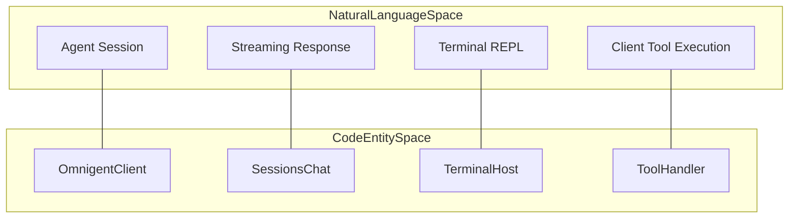
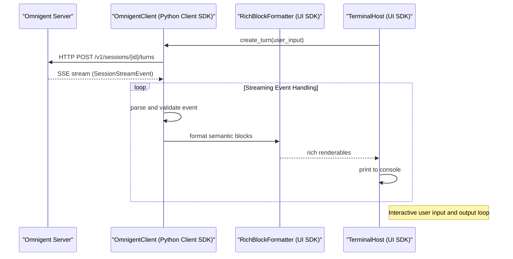

# SDKs & Client Frontends

Relevant source files

The following files were used as context for generating this wiki page:

- [.github/actions/setup-uv/action.yml](.github/actions/setup-uv/action.yml)
- [.github/actions/setup-uv/verify-cache.mjs](.github/actions/setup-uv/verify-cache.mjs)
- [.github/actions/setup-uv/verify-cache.test.mjs](.github/actions/setup-uv/verify-cache.test.mjs)
- [examples/extensions/hello-page/web/package.json](examples/extensions/hello-page/web/package.json)
- [feature-map/remote-agent-launch.md](feature-map/remote-agent-launch.md)
- [integrations/slack/pyproject.toml](integrations/slack/pyproject.toml)
- [omnigent/chat.py](omnigent/chat.py)
- [omnigent/conversation_browser.py](omnigent/conversation_browser.py)
- [omnigent/remote_launch.py](omnigent/remote_launch.py)
- [omnigent/repl/_repl.py](omnigent/repl/_repl.py)
- [omnigent/repl/_resume_picker.py](omnigent/repl/_resume_picker.py)
- [omnigent/resume_dispatch.py](omnigent/resume_dispatch.py)
- [omnigent/version.py](omnigent/version.py)
- [pnpm-lock.yaml](pnpm-lock.yaml)
- [pnpm-workspace.yaml](pnpm-workspace.yaml)
- [pyproject.toml](pyproject.toml)
- [scripts/build_subpackages.py](scripts/build_subpackages.py)
- [sdks/python-client/README.md](sdks/python-client/README.md)
- [sdks/python-client/omnigent_client/__init__.py](sdks/python-client/omnigent_client/__init__.py)
- [sdks/python-client/omnigent_client/_errors.py](sdks/python-client/omnigent_client/_errors.py)
- [sdks/python-client/omnigent_client/_sessions.py](sdks/python-client/omnigent_client/_sessions.py)
- [sdks/python-client/pyproject.toml](sdks/python-client/pyproject.toml)
- [sdks/ui/README.md](sdks/ui/README.md)
- [sdks/ui/pyproject.toml](sdks/ui/pyproject.toml)
- [tests/cli/conftest.py](tests/cli/conftest.py)
- [tests/cli/test_chat.py](tests/cli/test_chat.py)
- [tests/cli/test_session_host.py](tests/cli/test_session_host.py)
- [tests/e2e/test_child_sessions_sdk_live_e2e.py](tests/e2e/test_child_sessions_sdk_live_e2e.py)
- [tests/e2e/test_native_resume_picker_cross_host_e2e.py](tests/e2e/test_native_resume_picker_cross_host_e2e.py)
- [tests/e2e/test_remote_url_chat_fresh_session_2437.py](tests/e2e/test_remote_url_chat_fresh_session_2437.py)
- [tests/e2e/test_subpackage_license_artifacts_e2e.py](tests/e2e/test_subpackage_license_artifacts_e2e.py)
- [tests/e2e_ui/files/test_markdown_preview_tex.py](tests/e2e_ui/files/test_markdown_preview_tex.py)
- [tests/frontends/sdk/test_errors.py](tests/frontends/sdk/test_errors.py)
- [tests/frontends/sdk/test_sessions_namespace.py](tests/frontends/sdk/test_sessions_namespace.py)
- [tests/repl/test_agent_switch_refresh.py](tests/repl/test_agent_switch_refresh.py)
- [tests/repl/test_repl.py](tests/repl/test_repl.py)
- [tests/repl/test_repl_remote_agent_lookup.py](tests/repl/test_repl_remote_agent_lookup.py)
- [tests/repl/test_resume_picker.py](tests/repl/test_resume_picker.py)
- [tests/repl/test_subagent_chat.py](tests/repl/test_subagent_chat.py)
- [tests/repl/test_subagent_registry.py](tests/repl/test_subagent_registry.py)
- [tests/test_conversation_browser.py](tests/test_conversation_browser.py)
- [tests/test_resume_dispatch.py](tests/test_resume_dispatch.py)
- [tests/test_subpackage_legal_files.py](tests/test_subpackage_legal_files.py)
- [uv.lock](uv.lock)
- [uv.toml](uv.toml)
- [web/electron/package.json](web/electron/package.json)
- [web/package.json](web/package.json)

This section provides a high-level overview of the Python SDKs and client frontends that enable programmatic integration with the Omnigent platform. The Omnigent SDKs empower developers to drive sessions, stream agent responses, and build custom terminal or other client interfaces leveraging Omnigent's server API. This page introduces the core SDK components — the Python client SDK and the terminal UI SDK — and outlines their roles in the overall system. Detailed documentation for each SDK and the terminal REPL frontend are available as child pages.

---

## SDKs Architecture Overview

Omnigent provides two primary Python SDK packages designed to work seamlessly together and in lockstep with the `omnigent` core framework versioning:

- **`omnigent_client`**: A headless HTTP + SSE client SDK offering low-level access to the Omnigent server API, session management, event streaming, and semantic block parsing for streamed agent output.
- **`omnigent_ui_sdk`**: Built atop the client SDK, this SDK provides terminal UI components using `rich` and `prompt_toolkit`, enabling sophisticated terminal frontends including the interactive REPL.

Both SDKs are developed and versioned within the monorepo to ensure compatibility with the running server. They integrate core data models, streaming event types, and common configuration elements to build flexible programmatic and interactive client applications [sdks/python-client/pyproject.toml:10-28](), [sdks/ui/pyproject.toml:10-26](), [pyproject.toml:29-30](). The `omnigent-client` and `omnigent-ui-sdk` packages are explicitly listed as dependencies of the main `omnigent` package, ensuring they are installed together and version-locked [pyproject.toml:29-30]().

### Mapping Natural Language Concepts to Code Entities

The following diagram illustrates how typical Omnigent client concepts correspond to the major SDK classes and modules. This helps bridge the domain concepts with their concrete implementation in the SDKs.

**Natural Language to Code Entity Mapping**

Sources: [sdks/python-client/pyproject.toml:10-28](), [sdks/ui/pyproject.toml:10-26](), [pyproject.toml:29-30]()

---

## 1. Python Client SDK (`omnigent_client`)

The `omnigent_client` package is a fully typed Python client for accessing the Omnigent server’s HTTP and SSE API endpoints. It provides facilities for:

- Managing agent sessions: creating sessions, sending user turns, and receiving streaming responses.
- Handling Server-Sent Events streams incrementally and validating incoming events against shared event type models (`SessionStreamEventType`).
- Parsing semantic streaming content into structured `BlockStream` blocks such as `ReasoningBlock` and `ToolResultBlock`.
- Managing session lifecycle including registration, state, and error handling.
- Interfacing with client-side tool execution by allowing the agent's tool calls to be routed to SDK-provided Python handlers.

The main interaction class is `OmnigentClient`, which encapsulates connection settings, authentication, and API calls [sdks/python-client/omnigent_client/__init__.py:34-34](). It depends on `httpx` for HTTP requests and `pydantic` for data validation [sdks/python-client/pyproject.toml:26-27]().

For full implementation details and usage, see the child page: [Python Client SDK (omnigent_client)](#8.1).

---

## 2. Terminal UI SDK (`omnigent_ui_sdk`)

The `omnigent_ui_sdk` package builds on top of the Python client SDK to provide user interface components targeted at terminal applications. It offers:

- A `TerminalHost` class that manages interactive terminal sessions using `prompt_toolkit` for input buffering and rendering [omnigent/repl/_repl.py:47-47]().
- The `RichBlockFormatter` which transforms semantic blocks of agent output into rich terminal renderables featuring Markdown, syntax highlighting, and special renderers for tool responses [omnigent/repl/_repl.py:46-46]().
- Terminal color theming with support for dark and light modes [omnigent/repl/_repl.py:48-49]().
- User preference configuration helpers for loading/saving client state [omnigent/repl/_repl.py:43-45]().

This SDK is the foundation for the bundled Omnigent terminal REPL client, providing a high-quality terminal user experience for streaming agent outputs and conversational controls [sdks/ui/pyproject.toml:10-26](). It depends on `omnigent-client`, `rich`, `prompt_toolkit`, and `pyyaml` [sdks/ui/pyproject.toml:22-25]().

For details, see the child page: [Terminal UI SDK & REPL](#8.2).

---

## Integration Flow: Server to Terminal REPL Via SDKs

The below sequence diagram illustrates the data flow from the Omnigent server through the client and UI SDK layers to an interactive terminal frontend.

**SDK Data Flow Architecture**

Sources: [sdks/python-client/pyproject.toml:10-28](), [sdks/ui/pyproject.toml:10-26]()

---

## SDKs Feature Comparison

| Feature | `omnigent_client` | `omnigent_ui_sdk` |
|---|---|---|
| **Purpose** | Headless API communication with Omnigent server | Rich terminal UI components for interactive REPL experience |
| **Key Dependencies** | `httpx`, `pydantic` [sdks/python-client/pyproject.toml:26-27]() | `omnigent-client`, `rich`, `prompt_toolkit`, `pyyaml` [sdks/ui/pyproject.toml:22-25]() |
| **Main Entity** | `OmnigentClient` | `TerminalHost` |
| **Streaming Output** | Semantic blocks & SSE events | Rich renderables for terminal display |
| **Use Cases** | Bots, automated clients, tooling, test harnesses | CLI users, interactive debugging, conversational UI tooling |

Sources: [sdks/python-client/pyproject.toml:10-28](), [sdks/ui/pyproject.toml:10-26]()

---

This page serves as the parent overview entry for the SDK and client frontend layers within Omnigent. For detailed API documentation, usage examples, and component internals, consult the dedicated child pages:

- [Python Client SDK (omnigent_client)](#8.1)
- [Terminal UI SDK & REPL](#8.2)

Sources:
[pyproject.toml:29-30](),
[sdks/python-client/pyproject.toml:10-28](),
[sdks/ui/pyproject.toml:10-26]()