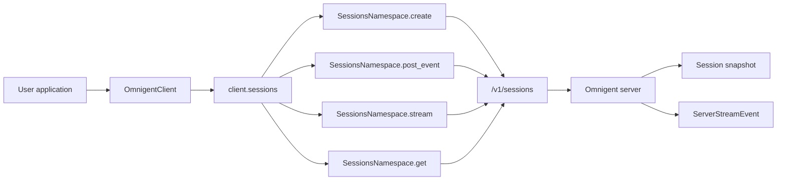
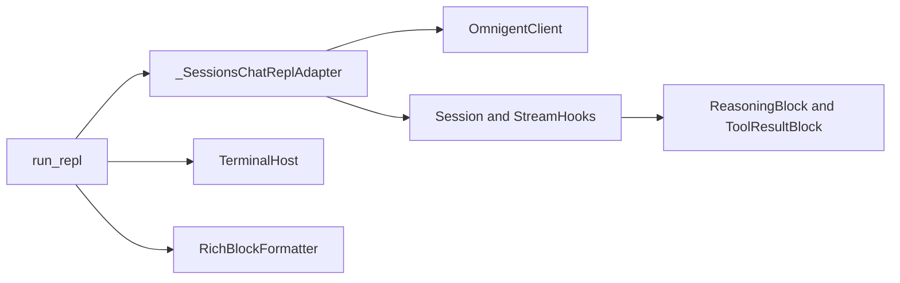
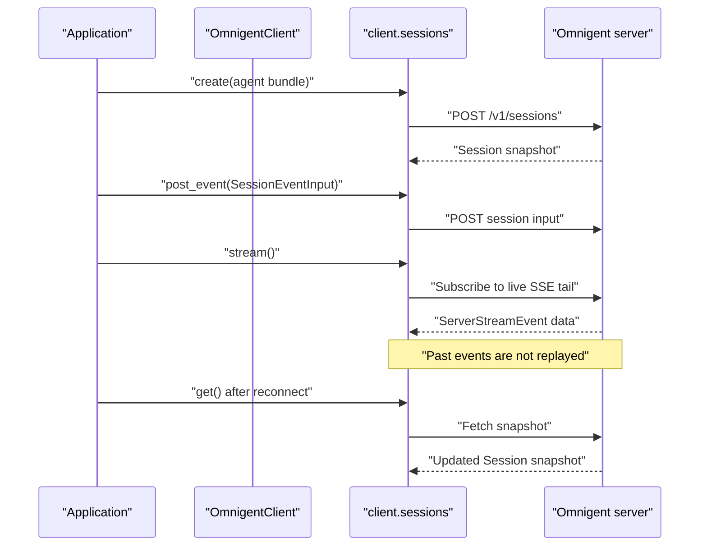

# Python Client SDK (omnigent_client)

Relevant source files

The following files were used as context for generating this wiki page:

- [feature-map/remote-agent-launch.md](feature-map/remote-agent-launch.md)
- [omnigent/chat.py](omnigent/chat.py)
- [omnigent/conversation_browser.py](omnigent/conversation_browser.py)
- [omnigent/native/owner_claim.py](omnigent/native/owner_claim.py)
- [omnigent/remote_launch.py](omnigent/remote_launch.py)
- [omnigent/repl/_repl.py](omnigent/repl/_repl.py)
- [omnigent/repl/_resume_picker.py](omnigent/repl/_resume_picker.py)
- [omnigent/resume_dispatch.py](omnigent/resume_dispatch.py)
- [omnigent/runtime/filesystem_registry.py](omnigent/runtime/filesystem_registry.py)
- [omnigent/runtime/harnesses/process_manager.py](omnigent/runtime/harnesses/process_manager.py)
- [scripts/backend-smoke.sh](scripts/backend-smoke.sh)
- [sdks/python-client/omnigent_client/__init__.py](sdks/python-client/omnigent_client/__init__.py)
- [sdks/python-client/omnigent_client/_errors.py](sdks/python-client/omnigent_client/_errors.py)
- [sdks/python-client/omnigent_client/_sessions.py](sdks/python-client/omnigent_client/_sessions.py)
- [tests/_helpers/README.md](tests/_helpers/README.md)
- [tests/_helpers/host.py](tests/_helpers/host.py)
- [tests/_helpers/live_server.py](tests/_helpers/live_server.py)
- [tests/_helpers/pi_native.py](tests/_helpers/pi_native.py)
- [tests/_helpers/server_runner.py](tests/_helpers/server_runner.py)
- [tests/cli/conftest.py](tests/cli/conftest.py)
- [tests/cli/test_chat.py](tests/cli/test_chat.py)
- [tests/cli/test_session_host.py](tests/cli/test_session_host.py)
- [tests/e2e/resilience/lab/lab.py](tests/e2e/resilience/lab/lab.py)
- [tests/e2e/resilience/test_lab_smoke.py](tests/e2e/resilience/test_lab_smoke.py)
- [tests/e2e/test_child_sessions_sdk_live_e2e.py](tests/e2e/test_child_sessions_sdk_live_e2e.py)
- [tests/e2e/test_files_upload_e2e.py](tests/e2e/test_files_upload_e2e.py)
- [tests/e2e/test_filesystem_changed_files_e2e.py](tests/e2e/test_filesystem_changed_files_e2e.py)
- [tests/e2e/test_inaccessible_git_metadata_e2e.py](tests/e2e/test_inaccessible_git_metadata_e2e.py)
- [tests/e2e/test_native_resume_picker_cross_host_e2e.py](tests/e2e/test_native_resume_picker_cross_host_e2e.py)
- [tests/e2e/test_non_git_changed_files_e2e.py](tests/e2e/test_non_git_changed_files_e2e.py)
- [tests/e2e/test_orphan_sweep_unreadable_tmp_parent_e2e.py](tests/e2e/test_orphan_sweep_unreadable_tmp_parent_e2e.py)
- [tests/e2e/test_remote_url_chat_fresh_session_2437.py](tests/e2e/test_remote_url_chat_fresh_session_2437.py)
- [tests/e2e/test_subagent_model_override_respawn_e2e.py](tests/e2e/test_subagent_model_override_respawn_e2e.py)
- [tests/e2e_ui/files/test_non_git_stray_gitdir.py](tests/e2e_ui/files/test_non_git_stray_gitdir.py)
- [tests/frontends/sdk/test_errors.py](tests/frontends/sdk/test_errors.py)
- [tests/frontends/sdk/test_sessions_namespace.py](tests/frontends/sdk/test_sessions_namespace.py)
- [tests/inner/test_terminal_orphan_ownership.py](tests/inner/test_terminal_orphan_ownership.py)
- [tests/native/test_owner_claim.py](tests/native/test_owner_claim.py)
- [tests/repl/test_agent_switch_refresh.py](tests/repl/test_agent_switch_refresh.py)
- [tests/repl/test_repl.py](tests/repl/test_repl.py)
- [tests/repl/test_repl_remote_agent_lookup.py](tests/repl/test_repl_remote_agent_lookup.py)
- [tests/repl/test_resume_picker.py](tests/repl/test_resume_picker.py)
- [tests/repl/test_subagent_chat.py](tests/repl/test_subagent_chat.py)
- [tests/repl/test_subagent_registry.py](tests/repl/test_subagent_registry.py)
- [tests/runner/test_app_pi_native_model.py](tests/runner/test_app_pi_native_model.py)
- [tests/runner/test_enforce_sandbox_gate.py](tests/runner/test_enforce_sandbox_gate.py)
- [tests/runtime/harnesses/test_process_manager.py](tests/runtime/harnesses/test_process_manager.py)
- [tests/runtime/harnesses/test_process_manager_idle_config.py](tests/runtime/harnesses/test_process_manager_idle_config.py)
- [tests/runtime/test_filesystem_git_discovery.py](tests/runtime/test_filesystem_git_discovery.py)
- [tests/runtime/test_filesystem_registry.py](tests/runtime/test_filesystem_registry.py)
- [tests/test_conversation_browser.py](tests/test_conversation_browser.py)
- [tests/test_local_server_helper.py](tests/test_local_server_helper.py)
- [tests/test_resume_dispatch.py](tests/test_resume_dispatch.py)

## Purpose and scope

`omnigent_client` provides a headless Python interface for communicating with an Omnigent server. This page covers the SDK’s session API and its documented snapshot-plus-live-tail SSE contract, and explains how the SDK fits alongside higher-level consumers such as the terminal REPL. The available source excerpts do not show the implementations of `OmnigentClient`, `BlockStream`, transforms, or `LocalServer`; details about those components are therefore limited to the interfaces and references visible in the supplied files. [sdks/python-client/omnigent_client/_sessions.py:1-19]()

Sources: `sdks/python-client/omnigent_client/_sessions.py`

---

## Architecture and data flow

The SDK’s session namespace targets the server’s `/v1/sessions` route family. A client can create a session from an agent bundle, post additional inputs, stream live events, and fetch a snapshot to reconcile state after reconnecting. The stream is a live tail: past events are not replayed by the server. [sdks/python-client/omnigent_client/_sessions.py:1-9]()

The REPL imports `OmnigentClient` and session-related semantic types from `omnigent_client`, then uses the UI SDK for terminal presentation. This places the client SDK between application logic and server communication, while the REPL and UI SDK provide higher-level interaction and rendering. [omnigent/repl/_repl.py:24-54]()

### Diagram: SDK names mapped to session API entities

Sources: `sdks/python-client/omnigent_client/_sessions.py:1-9`, `sdks/python-client/omnigent_client/_sessions.py:48-54`, `sdks/python-client/omnigent_client/_sessions.py:112-153`

### Diagram: REPL integration mapped to code entities

Sources: `omnigent/repl/_repl.py:1-4`, `omnigent/repl/_repl.py:24-54`

---

## Key components

### `OmnigentClient`

`OmnigentClient` is imported by the REPL from `omnigent_client` and is passed to the public `run_repl(client, agent_name, tool_handler)` entry point. The supplied excerpts do not include its class definition or constructor, so initialization options, authentication behavior, connection ownership, and namespace inventory cannot be established here. [omnigent/repl/_repl.py:1-4] [omnigent/repl/_repl.py:24-41]()

Sources: `omnigent/repl/_repl.py`

### Sessions namespace and session data

The sessions module describes a thin client for `/v1/sessions`. Its documented operations are `create()`, `post_event()`, `stream()`, and `get()`: creation starts a session from an agent bundle, posting adds inputs, streaming receives live events, and fetching retrieves a snapshot for reconciliation. There is no event replay. [sdks/python-client/omnigent_client/_sessions.py:1-9]()

`SessionEventInput` is a frozen dataclass containing a string `type` and dictionary `data`. Its `from_dict()` constructor requires both keys and rejects a non-dictionary `data` value, surfacing malformed input rather than substituting an empty payload. [sdks/python-client/omnigent_client/_sessions.py:67-109]()

The module’s frozen `Session` dataclass mirrors the server’s `SessionResponse`. It represents a point-in-time snapshot; callers obtain updated state by fetching another snapshot. Its documented fields include the session ID, bound agent identity, lifecycle status, timestamps, title, labels, runner ID, reasoning-effort hint, and committed conversation items. [sdks/python-client/omnigent_client/_sessions.py:112-153]()

There are two distinct classes named `Session`: the snapshot class in `_sessions.py` and a higher-level chat helper in `_session.py`, re-exported as `omnigent_client.Session`. The snapshot class is deliberately not re-exported from the package root; callers receive it from `client.sessions.create()` or `client.sessions.get()`. [sdks/python-client/omnigent_client/_sessions.py:11-19] [sdks/python-client/omnigent_client/_sessions.py:112-127]()

Sources: `sdks/python-client/omnigent_client/_sessions.py`

### Raw SSE events and reconnect reconciliation

The sessions module builds a Pydantic `TypeAdapter` for the server’s discriminated `ServerStreamEvent` union. Each SSE `data:` payload can therefore be validated into a concrete event subtype. [sdks/python-client/omnigent_client/_sessions.py:48-54]()

Because the stream is not replayed, a consumer that reconnects must use a session snapshot to reconcile its view; the module explicitly documents `get()` for this purpose. The available excerpt does not show the `stream()` implementation, cursor parameters, retry policy, or exact event-yield behavior, so those details should be checked in the current implementation before relying on them. [sdks/python-client/omnigent_client/_sessions.py:1-9]()

Sources: `sdks/python-client/omnigent_client/_sessions.py`

### `BlockStream` and semantic blocks

The REPL imports semantic block types including `ReasoningBlock`, `ResponseStartBlock`, `ResponseEndBlock`, and `ToolResultBlock`, along with `BlockContext` and `StreamHooks`. These imports establish that the REPL consumes typed block-level concepts from the client SDK. The supplied excerpts do not include the `BlockStream` implementation, its event-to-block mapping, or its buffering and termination rules. [omnigent/repl/_repl.py:24-41]()

Sources: `omnigent/repl/_repl.py`

### Tool handling

The REPL imports `ToolHandler`, `ToolExecution`, and `ToolGroup` from `omnigent_client`, and its public entry-point documentation accepts a `tool_handler`. This indicates that tool-handling types are part of the REPL/client integration surface. The supplied excerpts do not show the protocol definition or the mechanics for executing a tool and returning its result. [omnigent/repl/_repl.py:1-4] [omnigent/repl/_repl.py:24-41]()

Sources: `omnigent/repl/_repl.py`

---

## Session lifecycle and streaming

A session interaction can be understood as a control path followed by a live event path. The SDK’s documented control operations create the session and submit inputs; the event stream provides live updates, while a later snapshot can reconcile state after a disconnect. [sdks/python-client/omnigent_client/_sessions.py:1-9]()

### Diagram: session inputs, live tail, and snapshot reconciliation

Sources: `sdks/python-client/omnigent_client/_sessions.py:1-9`, `sdks/python-client/omnigent_client/_sessions.py:48-54`, `sdks/python-client/omnigent_client/_sessions.py:112-153`

### Event inputs

`SessionEventInput` is the client-side value object for an event submitted to the session API. Its `type` discriminator identifies the input kind, while `data` carries the type-specific payload. The module documentation gives `"message"`, `"function_call_output"`, and `"interrupt"` as examples of event types. [sdks/python-client/omnigent_client/_sessions.py:67-87]()

### Session snapshots

The snapshot dataclass is immutable and represents state at the time it was returned. It is not a mutable local session model; callers fetch a fresh snapshot to observe subsequent state changes. The session ID is also the underlying conversation ID. [sdks/python-client/omnigent_client/_sessions.py:112-153]()

Sources: `sdks/python-client/omnigent_client/_sessions.py`

---

## Transforms and stream processing

The REPL imports `format_tool_args_brief` from the client SDK, establishing a formatting helper for concise tool-argument presentation. The supplied source excerpt does not include its implementation or define the transforms mentioned in the previous version of this page. In particular, this excerpt does not substantiate a transform API named `merge_text` or `skip_blocks`; consult the current SDK implementation before using or documenting those names. [omnigent/repl/_repl.py:24-41]()

Sources: `omnigent/repl/_repl.py`

---

## `LocalServer` helper

The previous page identifies `LocalServer` as a helper in `omnigent/host/local_server.py` for managing a local server process. That implementation file is not included in the supplied excerpts, so its startup, health-check, liveness, and shutdown behavior cannot be verified here. Check the current implementation before depending on specific lifecycle methods or process-management details. [omnigent/host/local_server.py:28-40]()

Sources: `omnigent/host/local_server.py`

---

## Terminal UI SDK integration

The terminal REPL composes `omnigent_client` with `omnigent_ui_sdk`. It imports `RichBlockFormatter`, `TerminalHost`, `TerminalTheme`, configuration helpers, and attachment-related types from the UI SDK, while importing client-side session, stream, and block types from `omnigent_client`. This separates the client protocol and typed interaction surface from terminal presentation and input handling. [omnigent/repl/_repl.py:24-54]()

The REPL also imports `StreamLive` from `omnigent_ui_sdk.terminal`, and formatter-related types from internal terminal SDK modules. These imports show that terminal rendering is implemented above the client SDK rather than being part of the headless session namespace. [omnigent/repl/_repl.py:54-65]()

Sources: `omnigent/repl/_repl.py`

---

## Summary

The supplied implementation documents `omnigent_client`’s sessions namespace as a thin client for `/v1/sessions`, with session creation, input submission, live-tail SSE streaming, and snapshot retrieval. Session inputs and snapshots are represented by frozen dataclasses, and SSE payloads are validated against the server’s `ServerStreamEvent` union. Because streams do not replay past events, snapshot retrieval is the documented reconciliation path. [sdks/python-client/omnigent_client/_sessions.py:1-9] [sdks/python-client/omnigent_client/_sessions.py:48-54] [sdks/python-client/omnigent_client/_sessions.py:67-109] [sdks/python-client/omnigent_client/_sessions.py:112-153]()

The REPL demonstrates how client types are consumed alongside a separate terminal UI SDK. The supplied excerpts do not show enough implementation to specify `BlockStream` internals, transforms beyond the visible formatting helper, or the `LocalServer` lifecycle in detail. [omnigent/repl/_repl.py:24-65]()

Sources: `sdks/python-client/omnigent_client/_sessions.py`, `omnigent/repl/_repl.py`

---

## References and sources

- [sdks/python-client/omnigent_client/_sessions.py:1-19]()
- [sdks/python-client/omnigent_client/_sessions.py:48-54]()
- [sdks/python-client/omnigent_client/_sessions.py:67-109]()
- [sdks/python-client/omnigent_client/_sessions.py:112-153]()
- [omnigent/repl/_repl.py:1-4]()
- [omnigent/repl/_repl.py:24-65]()
- [omnigent/host/local_server.py:28-40]()