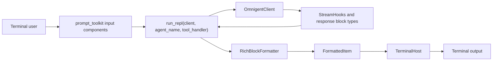
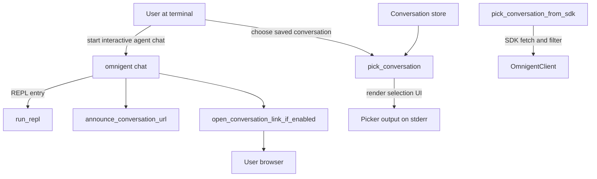
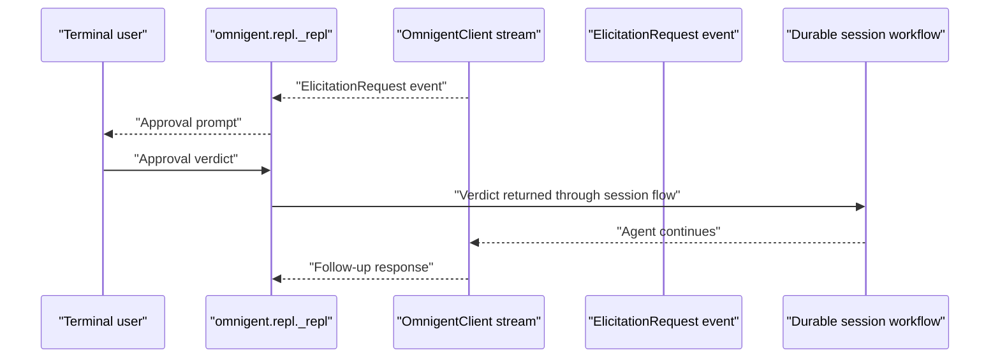
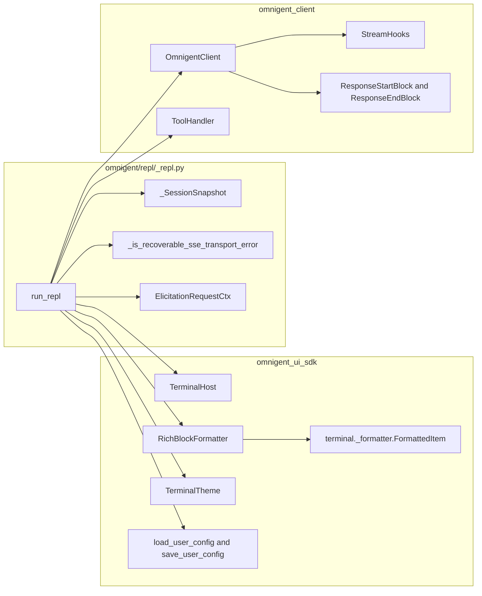

# 8.2 Terminal UI SDK & REPL

Relevant source files

The following files were used as context for generating this wiki page:

- [feature-map/remote-agent-launch.md](feature-map/remote-agent-launch.md)
- [omnigent/chat.py](omnigent/chat.py)
- [omnigent/conversation_browser.py](omnigent/conversation_browser.py)
- [omnigent/models/model_catalog_store.py](omnigent/models/model_catalog_store.py)
- [omnigent/remote_launch.py](omnigent/remote_launch.py)
- [omnigent/repl/_repl.py](omnigent/repl/_repl.py)
- [omnigent/repl/_resume_picker.py](omnigent/repl/_resume_picker.py)
- [omnigent/resume_dispatch.py](omnigent/resume_dispatch.py)
- [omnigent/runtime/policies/approval.py](omnigent/runtime/policies/approval.py)
- [sdks/python-client/omnigent_client/__init__.py](sdks/python-client/omnigent_client/__init__.py)
- [sdks/python-client/omnigent_client/_errors.py](sdks/python-client/omnigent_client/_errors.py)
- [sdks/python-client/omnigent_client/_sessions.py](sdks/python-client/omnigent_client/_sessions.py)
- [tests/_fixtures/agents/e2e-subagent-tool-gate/e2e-subagent-tool-gate.yaml](tests/_fixtures/agents/e2e-subagent-tool-gate/e2e-subagent-tool-gate.yaml)
- [tests/cli/conftest.py](tests/cli/conftest.py)
- [tests/cli/test_chat.py](tests/cli/test_chat.py)
- [tests/cli/test_session_host.py](tests/cli/test_session_host.py)
- [tests/e2e/omnigent/test_host_ctrl_c_stop_server.py](tests/e2e/omnigent/test_host_ctrl_c_stop_server.py)
- [tests/e2e/omnigent/test_host_daemon_gcloud_adc_env_e2e.py](tests/e2e/omnigent/test_host_daemon_gcloud_adc_env_e2e.py)
- [tests/e2e/omnigent/test_host_daemon_lifecycle_lock_e2e.py](tests/e2e/omnigent/test_host_daemon_lifecycle_lock_e2e.py)
- [tests/e2e/omnigent/test_host_daemon_telemetry_env_e2e.py](tests/e2e/omnigent/test_host_daemon_telemetry_env_e2e.py)
- [tests/e2e/omnigent/test_host_no_open.py](tests/e2e/omnigent/test_host_no_open.py)
- [tests/e2e/test_child_sessions_sdk_live_e2e.py](tests/e2e/test_child_sessions_sdk_live_e2e.py)
- [tests/e2e/test_native_resume_picker_cross_host_e2e.py](tests/e2e/test_native_resume_picker_cross_host_e2e.py)
- [tests/e2e/test_pi_native_gateway_claude_404_e2e.py](tests/e2e/test_pi_native_gateway_claude_404_e2e.py)
- [tests/e2e/test_remote_url_chat_fresh_session_2437.py](tests/e2e/test_remote_url_chat_fresh_session_2437.py)
- [tests/e2e/test_repl_approval_e2e.py](tests/e2e/test_repl_approval_e2e.py)
- [tests/e2e/test_repl_sessions_approval_e2e.py](tests/e2e/test_repl_sessions_approval_e2e.py)
- [tests/frontends/sdk/test_errors.py](tests/frontends/sdk/test_errors.py)
- [tests/frontends/sdk/test_sessions_namespace.py](tests/frontends/sdk/test_sessions_namespace.py)
- [tests/onboarding/test_harness_probe_terminal.py](tests/onboarding/test_harness_probe_terminal.py)
- [tests/repl/test_agent_switch_refresh.py](tests/repl/test_agent_switch_refresh.py)
- [tests/repl/test_repl.py](tests/repl/test_repl.py)
- [tests/repl/test_repl_remote_agent_lookup.py](tests/repl/test_repl_remote_agent_lookup.py)
- [tests/repl/test_resume_picker.py](tests/repl/test_resume_picker.py)
- [tests/repl/test_subagent_chat.py](tests/repl/test_subagent_chat.py)
- [tests/repl/test_subagent_registry.py](tests/repl/test_subagent_registry.py)
- [tests/runtime/policies/test_approval.py](tests/runtime/policies/test_approval.py)
- [tests/runtime/policies/test_ask_cycle_e2e.py](tests/runtime/policies/test_ask_cycle_e2e.py)
- [tests/test_conversation_browser.py](tests/test_conversation_browser.py)
- [tests/test_host_daemon_telemetry_helpers.py](tests/test_host_daemon_telemetry_helpers.py)
- [tests/test_resume_dispatch.py](tests/test_resume_dispatch.py)

## Purpose and scope

This page covers the terminal UI SDK and the Omnigent REPL that uses it. The REPL’s documented public entry point is `run_repl(client, agent_name, tool_handler)`. Its implementation imports `RichBlockFormatter`, `TerminalHost`, terminal theme and configuration helpers from `omnigent_ui_sdk`; it also uses client stream types and prompt-toolkit components. [omnigent/repl/_repl.py:1-4]()[omnigent/repl/_repl.py:24-70]()

The available code excerpts establish the SDK-to-REPL interface, REPL session and streaming concerns, conversation picking, and approval-flow behavior. They do not include the implementation of `sdks/ui/`, so this page describes that package only at the boundaries visible from its consumers. [omnigent/repl/_repl.py:42-65]()[omnigent/repl/_resume_picker.py:1-21]()

Sources: [omnigent/repl/_repl.py:1-4]()[omnigent/repl/_repl.py:24-70]()[omnigent/repl/_resume_picker.py:1-21]()

## 1. Core components and their roles

### 1.1 `TerminalHost`

The REPL imports `TerminalHost` from `omnigent_ui_sdk` and uses it as part of the terminal UI layer. The supplied excerpt does not show the class definition or its methods, so details such as viewport management, redraw behavior, and output-clearing semantics cannot be verified here. [omnigent/repl/_repl.py:42-53]()

Tests use a minimal `_CapturingHost` substitute with an `output(item)` method to capture renderables and inspect their plain-text projection. This documents a test seam for output-oriented behavior; it does not establish the full `TerminalHost` interface. [tests/repl/test_repl.py:168-190]()

Sources: [omnigent/repl/_repl.py:42-53]()[tests/repl/test_repl.py:168-190]()

### 1.2 `RichBlockFormatter`

The REPL imports `RichBlockFormatter` from `omnigent_ui_sdk`. It also imports semantic client types including `ReasoningBlock`, `ResponseStartBlock`, `ResponseEndBlock`, and `ToolResultBlock`, and imports the formatter return type `FormattedItem` from the SDK’s internal `_formatter` module. The REPL comments that `FormattedItem` represents a Rich renderable or a streaming/replacement value; the top-level SDK package does not re-export it in the shown code. [omnigent/repl/_repl.py:24-40]()[omnigent/repl/_repl.py:42-65]()

The excerpts do not show formatter method definitions or markdown-boundary logic. For that reason, this page treats formatting as an SDK-provided dependency rather than attributing specific rendering algorithms to it. [omnigent/repl/_repl.py:56-65]()

Sources: [omnigent/repl/_repl.py:24-40]()[omnigent/repl/_repl.py:42-65]()

### 1.3 Conversation browser and conversation picker

The chat command imports `announce_conversation_url` and `open_conversation_link_if_enabled` from `omnigent.conversation_browser`. The available excerpt confirms these are the chat-layer integration points, but does not show their implementations or URL construction rules. [omnigent/chat.py:58-60]()

The resume picker is a separate terminal interaction. `_resume_picker.py` documents two entry points: `pick_conversation`, which receives a conversation list, and `pick_conversation_from_sdk`, which fetches and filters through the SDK. The picker uses stdin for input and stderr for display; it uses prompt-toolkit for interactive terminals and a line-buffered fallback for non-TTY callers. [omnigent/repl/_resume_picker.py:1-21]()

The picker’s list is paginated, with a page size of 10. Its documented input tokens include quit, next/previous page, up/down, and selection. It also defines a preview data type for the latest message preview and role glyphs shared with the REPL’s visual language. [omnigent/repl/_resume_picker.py:74-117]()[omnigent/repl/_resume_picker.py:120-138]()

Sources: [omnigent/chat.py:58-60]()[omnigent/repl/_resume_picker.py:1-21]()[omnigent/repl/_resume_picker.py:74-138]()

### 1.4 Elicitation and approval handling

The REPL imports `ElicitationRequestCtx` from `omnigent_client`. The supplied excerpts do not show the REPL’s elicitation handler implementation, but the end-to-end approval test documents the exercised path: a real terminal input loop consumes `ElicitationRequest` events, uses future-based approval wiring, and sends the verdict back through the durable session workflow. [omnigent/repl/_repl.py:24-40]()[tests/e2e/test_repl_approval_e2e.py:1-15]()

The approval test drives `omnigent chat` in a pseudo-terminal and checks that the agent responds after the user approves a policy `ASK`. A parallel sessions-API test drives `omnigent run` through the `/v1/sessions` path. These tests distinguish the interactive terminal experience from API-only polling. [tests/e2e/test_repl_approval_e2e.py:1-15]()[tests/e2e/test_repl_sessions_approval_e2e.py:1-15]()

Sources: [omnigent/repl/_repl.py:24-40]()[tests/e2e/test_repl_approval_e2e.py:1-15]()[tests/e2e/test_repl_sessions_approval_e2e.py:1-15]()

### 1.5 Tool, sub-agent, and terminal integrations

The REPL imports client tool types such as `ToolExecution`, `ToolGroup`, and `ToolHandler`, along with `format_tool_args_brief`. Its public `run_repl` signature accepts a `tool_handler`, making that handler an explicit integration point for callers. [omnigent/repl/_repl.py:1-4]()[omnigent/repl/_repl.py:24-40]()

The REPL tests cover `_parse_sub_agent_handle`, which recognizes sub-agent handles in tool output. The tests document two accepted encodings: a raw JSON string and an MCP content-parts list containing a JSON text part. The parser rejects valid JSON objects that are not identified as `kind == "sub_agent"` and degrades malformed input to no handle. [tests/repl/test_repl.py:51-110]()[tests/repl/test_repl.py:113-152]()

The REPL’s terminal-oriented helpers also include terminal target parsing, reconstruction, and tmux-related helpers, as shown by the imported test targets. The provided excerpt does not include their definitions, so their detailed runtime behavior is outside the verified scope here. [tests/repl/test_repl.py:20-47]()

Sources: [omnigent/repl/_repl.py:1-4]()[omnigent/repl/_repl.py:24-40]()[tests/repl/test_repl.py:20-47]()[tests/repl/test_repl.py:51-152]()

## 2. Data flow and interaction diagrams

### 2.1 REPL dependency and streaming flow

The REPL accepts an `OmnigentClient` and imports session, stream-hook, response-block, and tool-related types from the client package. It also imports the UI SDK formatter and host types. This diagram shows the evidenced dependency path; it does not assert unshown method calls inside the REPL. [omnigent/repl/_repl.py:1-4]()[omnigent/repl/_repl.py:24-54]()

**Diagram: REPL dependencies from terminal input to formatted output**

Sources: [omnigent/repl/_repl.py:1-4]()[omnigent/repl/_repl.py:24-70]()

### 2.2 Natural-language actions mapped to code entities

This diagram connects user-facing actions with the named code entities visible in the supplied excerpts. The picker functions and `run_repl` API are documented in their module docstrings; the browser functions are imported by `omnigent.chat`. [omnigent/repl/_repl.py:1-4]()[omnigent/repl/_resume_picker.py:1-21]()[omnigent/chat.py:58-60]()

**Diagram: User actions and terminal-facing code entities**

Sources: [omnigent/repl/_repl.py:1-4]()[omnigent/repl/_resume_picker.py:1-21]()[omnigent/chat.py:58-60]()

### 2.3 Natural-language approvals mapped to code entities

The approval test describes a user approving a policy request through the actual terminal streaming path. The REPL imports `ElicitationRequestCtx`, while the test identifies `ElicitationRequest` events and future-based approval wiring. [omnigent/repl/_repl.py:24-40]()[tests/e2e/test_repl_approval_e2e.py:1-15]()

**Diagram: Approval interaction and code entities**

Sources: [omnigent/repl/_repl.py:24-40]()[tests/e2e/test_repl_approval_e2e.py:1-15]()

## 3. Key implementation details

### 3.1 Client stream and transient transport errors

The REPL defines `_is_recoverable_sse_transport_error(exc)`. It lazily imports `httpcore` and `httpx`, then checks the exception and its wrapped `__cause__` or `__context__` chain against known read, write, connect, timeout, and remote-protocol transport exceptions. It tracks visited exception identities to avoid looping through a cyclic cause/context chain. [omnigent/repl/_repl.py:93-148]()

The function’s docstring describes its purpose in the persistent `_stream_pump`: transient transport interruptions can be treated as recoverable reconnect events, while unrecognized exceptions remain distinguishable. The supplied excerpt does not show the `_stream_pump` implementation itself. [omnigent/repl/_repl.py:93-111]()

Sources: [omnigent/repl/_repl.py:93-148]()

### 3.2 Conversation resume picker

The picker shares one rendering loop between an already-fetched conversation list and an SDK-fetching convenience entry point. Interactive TTY use relies on prompt-toolkit; non-TTY callers use a line-buffered fallback. The picker writes to stderr so that stdout remains usable when a parent process captures or pipes agent output. [omnigent/repl/_resume_picker.py:1-21]()

The picker’s row protocol documents the fields it consumes, including conversation ID, title, creation time, and labels. Its preview representation carries a role and a single-line text preview; the picker defines a character limit and a cap on preview prefetching. [omnigent/repl/_resume_picker.py:97-109]()[omnigent/repl/_resume_picker.py:120-170]()

Sources: [omnigent/repl/_resume_picker.py:1-21]()[omnigent/repl/_resume_picker.py:97-170]()

### 3.3 Sub-agent handle parsing

`_parse_sub_agent_handle()` is tested against raw JSON and MCP-wrapped content-parts forms. It returns the decoded handle only when the payload identifies itself as a sub-agent; ordinary tool output and malformed or unsuitable JSON return `None`. This lets callers skip unrelated outputs rather than treating them as sub-agent records. [tests/repl/test_repl.py:51-110]()[tests/repl/test_repl.py:113-152]()

The recognized handle shape includes fields such as `conversation_id`, `type`, and `name`, which downstream sidebar behavior can use. Those tests establish the parser’s input contract, not the full UI behavior of the overlay. [tests/repl/test_repl.py:51-72]()

Sources: [tests/repl/test_repl.py:51-110]()[tests/repl/test_repl.py:113-152]()

### 3.4 Session snapshots and reconnect context

The REPL defines a `_SessionSnapshot` protocol for the subset of session data it reads. Its documented properties include agent identity, runner ID, reasoning effort, model identifier, context-window size, and the last completed task’s token count. [omnigent/repl/_repl.py:151-187]()

The sessions SDK describes the session API as a snapshot plus live-tail SSE contract: clients can create a session, post additional events, stream live events, and fetch a snapshot to reconcile after reconnect. The server does not buffer past events for replay. [sdks/python-client/omnigent_client/_sessions.py:1-19]()

Sources: [omnigent/repl/_repl.py:151-187]()[sdks/python-client/omnigent_client/_sessions.py:1-19]()

## 4. Building custom terminal REPLs

The documented public REPL entry point is `run_repl(client, agent_name, tool_handler)`. A custom terminal integration can use that API as its starting point and provide an `OmnigentClient` plus a tool handler. [omnigent/repl/_repl.py:1-4]()

The REPL imports the following UI SDK symbols: [omnigent/repl/_repl.py:42-54]()

| Symbol | Integration role visible from the REPL |
|---|---|
| `TerminalHost` | Terminal host dependency imported by the REPL. The available excerpt does not show its methods. [omnigent/repl/_repl.py:42-53]() |
| `RichBlockFormatter` | Formatter dependency for the REPL’s terminal output. [omnigent/repl/_repl.py:42-53]() |
| `TerminalTheme` | Theme type imported by the REPL. [omnigent/repl/_repl.py:46-53]() |
| `PendingAttachment` | Attachment-related type imported by the REPL. [omnigent/repl/_repl.py:42-53]() |
| `OverlayTarget` | Overlay-related type imported by the REPL. [omnigent/repl/_repl.py:42-53]() |
| `load_user_config`, `save_user_config`, `update_user_config` | User-configuration helpers imported by the REPL. [omnigent/repl/_repl.py:42-53]() |

For custom implementations that do not use `run_repl`, the provided excerpts establish only the relevant dependency boundary: the Python client provides session and stream types, and the UI SDK provides the host, formatter, theme, and configuration symbols imported by the Omnigent REPL. Consult the SDK package’s own source for method-level contracts; those files were not included in the supplied content. [omnigent/repl/_repl.py:24-70]()

Sources: [omnigent/repl/_repl.py:1-4]()[omnigent/repl/_repl.py:24-70]()

## 5. Code entity relationship diagram

This diagram maps the REPL’s public entry point and imported SDK/client entities. It uses only entities named in the supplied excerpts; it does not imply implementation details that are not shown. [omnigent/repl/_repl.py:1-4]()[omnigent/repl/_repl.py:24-70]()

**Diagram: Terminal UI SDK and REPL entity relationships**

Sources: [omnigent/repl/_repl.py:1-4]()[omnigent/repl/_repl.py:24-70]()[omnigent/repl/_repl.py:93-187]()

## 6. Test coverage and behavior boundaries

The approval-flow end-to-end test runs the CLI under a pseudo-terminal and exercises terminal input, SSE event consumption, approval wiring, and the durable session workflow. Its test description explicitly distinguishes this from an API-polling test. [tests/e2e/test_repl_approval_e2e.py:1-15]()

The sessions-API approval test runs `omnigent run` under a pseudo-terminal through the `/v1/sessions` path. Its harness configures the UI SDK and Python client source paths for the subprocess environment, then waits for the prompt-toolkit input loop to become ready before sending input. [tests/e2e/test_repl_sessions_approval_e2e.py:1-15]()[tests/e2e/test_repl_sessions_approval_e2e.py:46-69]()[tests/e2e/test_repl_sessions_approval_e2e.py:100-156]()

The unit tests cover parser behavior for sub-agent handles and identify renderer-related helpers such as `_render_history_item`; the supplied excerpt does not include all assertions for history rendering. [tests/repl/test_repl.py:20-47]()[tests/repl/test_repl.py:155-165]()

Sources: [tests/e2e/test_repl_approval_e2e.py:1-15]()[tests/e2e/test_repl_sessions_approval_e2e.py:1-15]()[tests/e2e/test_repl_sessions_approval_e2e.py:46-69]()[tests/e2e/test_repl_sessions_approval_e2e.py:100-156]()[tests/repl/test_repl.py:20-47]()[tests/repl/test_repl.py:155-165]()

## Summary table

| Entity | Location | Role evidenced by supplied source |
|---|---|---|
| `run_repl` | `omnigent/repl/_repl.py` | Public Rich-based REPL entry point accepting `client`, `agent_name`, and `tool_handler`. [omnigent/repl/_repl.py:1-4]() |
| `TerminalHost` | `omnigent_ui_sdk`, imported by `omnigent/repl/_repl.py` | UI SDK terminal-host dependency. [omnigent/repl/_repl.py:42-53]() |
| `RichBlockFormatter` | `omnigent_ui_sdk`, imported by `omnigent/repl/_repl.py` | UI SDK formatter dependency. [omnigent/repl/_repl.py:42-53]() |
| `FormattedItem` | `omnigent_ui_sdk.terminal._formatter` | Formatter method return type imported explicitly by the REPL. [omnigent/repl/_repl.py:56-65]() |
| `_is_recoverable_sse_transport_error` | `omnigent/repl/_repl.py` | Classifies known transient HTTPX/HTTPCore transport failures through wrapped exceptions. [omnigent/repl/_repl.py:93-148]() |
| `_SessionSnapshot` | `omnigent/repl/_repl.py` | Protocol for session metadata read by the REPL. [omnigent/repl/_repl.py:151-187]() |
| `pick_conversation` | `omnigent/repl/_resume_picker.py` | Picker entry point for an already-fetched conversation list. [omnigent/repl/_resume_picker.py:8-14]() |
| `pick_conversation_from_sdk` | `omnigent/repl/_resume_picker.py` | Picker convenience entry point that fetches and filters via the SDK. [omnigent/repl/_resume_picker.py:8-14]() |
| `announce_conversation_url` | `omnigent/conversation_browser.py`, imported by `omnigent/chat.py` | Chat command conversation URL announcement integration. [omnigent/chat.py:58-60]() |
| `open_conversation_link_if_enabled` | `omnigent/conversation_browser.py`, imported by `omnigent/chat.py` | Chat command optional conversation-link opening integration. [omnigent/chat.py:58-60]() |
| `_parse_sub_agent_handle` | `omnigent/repl/_repl.py`, exercised by `tests/repl/test_repl.py` | Parses tool output into a sub-agent handle or rejects it. [tests/repl/test_repl.py:51-110]()[tests/repl/test_repl.py:113-152]() |

Sources: [omnigent/repl/_repl.py:1-4]()[omnigent/repl/_repl.py:42-70]()[omnigent/repl/_repl.py:93-187]()[omnigent/repl/_resume_picker.py:8-14]()[omnigent/chat.py:58-60]()[tests/repl/test_repl.py:51-152]()

## References

- `omnigent/repl/_repl.py` — REPL public entry point, imported UI SDK/client types, transport-error classifier, and session snapshot protocol. [omnigent/repl/_repl.py:1-4]()[omnigent/repl/_repl.py:24-70]()[omnigent/repl/_repl.py:93-187]()
- `omnigent/repl/_resume_picker.py` — Conversation-picker contract, terminal stream choices, paging, and preview types. [omnigent/repl/_resume_picker.py:1-21]()[omnigent/repl/_resume_picker.py:74-170]()
- `omnigent/chat.py` — Chat command imports for conversation URL announcement and optional opening. [omnigent/chat.py:58-60]()
- `sdks/python-client/omnigent_client/_sessions.py` — Session snapshot and live-tail SSE contract. [sdks/python-client/omnigent_client/_sessions.py:1-19]()
- `tests/repl/test_repl.py` — Sub-agent handle parsing cases and REPL helper test targets. [tests/repl/test_repl.py:20-47]()[tests/repl/test_repl.py:51-152]()
- `tests/e2e/test_repl_approval_e2e.py` — Interactive approval flow through the chat REPL. [tests/e2e/test_repl_approval_e2e.py:1-15]()
- `tests/e2e/test_repl_sessions_approval_e2e.py` — Interactive approval flow through the sessions API path. [tests/e2e/test_repl_sessions_approval_e2e.py:1-15]()

Sources: [omnigent/repl/_repl.py:1-4]()[omnigent/repl/_repl.py:24-70]()[omnigent/repl/_repl.py:93-187]()[omnigent/repl/_resume_picker.py:1-21]()[omnigent/chat.py:58-60]()[sdks/python-client/omnigent_client/_sessions.py:1-19]()[tests/repl/test_repl.py:20-47]()[tests/repl/test_repl.py:51-152]()[tests/e2e/test_repl_approval_e2e.py:1-15]()[tests/e2e/test_repl_sessions_approval_e2e.py:1-15]()