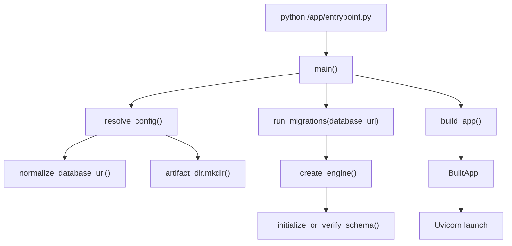
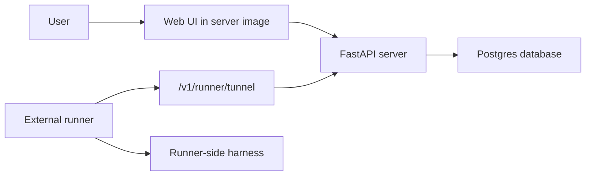
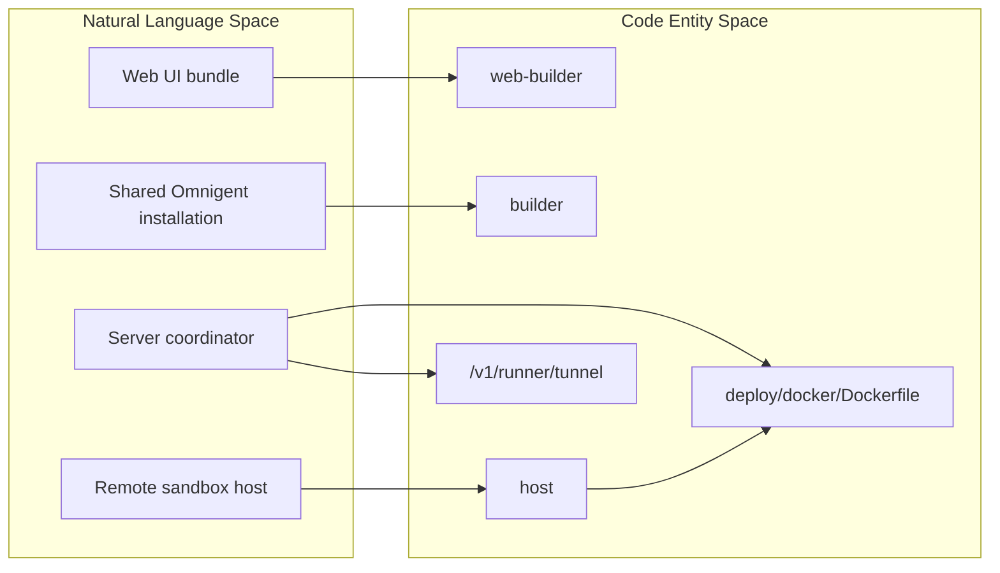
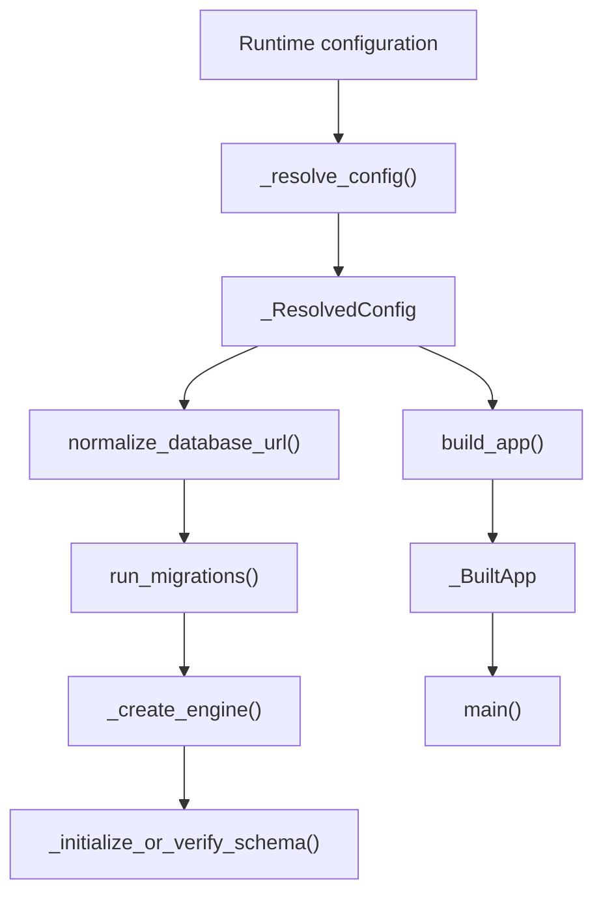

# Docker & Self-Hosted

Relevant source files

The following files were used as context for generating this wiki page:

- [.gitattributes](.gitattributes)
- [deploy/databricks/README.md](deploy/databricks/README.md)
- [deploy/databricks/build.sh](deploy/databricks/build.sh)
- [deploy/databricks/databricks.yml](deploy/databricks/databricks.yml)
- [deploy/databricks/deploy.py](deploy/databricks/deploy.py)
- [deploy/databricks/grant_sp_perms.py](deploy/databricks/grant_sp_perms.py)
- [deploy/databricks/src/app.py](deploy/databricks/src/app.py)
- [deploy/databricks/src/app.yaml](deploy/databricks/src/app.yaml)
- [deploy/databricks/src/web_ui_archive.py](deploy/databricks/src/web_ui_archive.py)
- [deploy/docker/Dockerfile](deploy/docker/Dockerfile)
- [deploy/docker/Dockerfile.ubi](deploy/docker/Dockerfile.ubi)
- [deploy/docker/entrypoint.py](deploy/docker/entrypoint.py)
- [docs/databricks.md](docs/databricks.md)
- [omnigent/runner/transports/ws_tunnel/limits.py](omnigent/runner/transports/ws_tunnel/limits.py)
- [omnigent/server/graceful_shutdown.py](omnigent/server/graceful_shutdown.py)
- [omnigent/util/tunnel_limits.py](omnigent/util/tunnel_limits.py)
- [patches/@tiptap__react@3.31.4.patch](patches/@tiptap__react@3.31.4.patch)
- [patches/README.md](patches/README.md)
- [tests/deploy/__init__.py](tests/deploy/__init__.py)
- [tests/deploy/test_databricks_app_sandbox_config.py](tests/deploy/test_databricks_app_sandbox_config.py)
- [tests/deploy/test_databricks_build_script.py](tests/deploy/test_databricks_build_script.py)
- [tests/deploy/test_databricks_deploy_lock_index.py](tests/deploy/test_databricks_deploy_lock_index.py)
- [tests/deploy/test_databricks_deploy_no_otel.py](tests/deploy/test_databricks_deploy_no_otel.py)
- [tests/deploy/test_databricks_deploy_uc_grants.py](tests/deploy/test_databricks_deploy_uc_grants.py)
- [tests/deploy/test_databricks_empty_features.py](tests/deploy/test_databricks_empty_features.py)
- [tests/deploy/test_databricks_extensions.py](tests/deploy/test_databricks_extensions.py)
- [tests/deploy/test_databricks_web_ui.py](tests/deploy/test_databricks_web_ui.py)
- [tests/deploy/test_docker_entrypoint_capabilities.py](tests/deploy/test_docker_entrypoint_capabilities.py)
- [tests/deploy/test_docker_entrypoint_import.py](tests/deploy/test_docker_entrypoint_import.py)
- [tests/deploy/test_host_image_cli_install.py](tests/deploy/test_host_image_cli_install.py)
- [tests/deploy/test_publish_images_web_build_platform.py](tests/deploy/test_publish_images_web_build_platform.py)
- [tests/e2e/test_databricks_deploy_lock_index_e2e.py](tests/e2e/test_databricks_deploy_lock_index_e2e.py)
- [tests/server/test_graceful_shutdown.py](tests/server/test_graceful_shutdown.py)
- [tests/test_tunnel_limits.py](tests/test_tunnel_limits.py)
- [web/src/shell/TipTapNodeViewSelection.test.tsx](web/src/shell/TipTapNodeViewSelection.test.tsx)
- [web/src/shell/TipTapRendererRegistry.test.tsx](web/src/shell/TipTapRendererRegistry.test.tsx)

## Purpose and scope

This page describes the Docker deployment surfaces evidenced by the available source excerpts: the server and host image roles, visible build-stage design, the Docker entrypoint’s configuration and migration responsibilities, deployment environment variables, and SQLite/Postgres considerations. The excerpts refer to a Compose file and a harness CLI installer, but do not include their contents; details of their service definitions and installer behavior are therefore not asserted here. [deploy/docker/Dockerfile:1-60]()[deploy/docker/entrypoint.py:1-32]()

Sources: [deploy/docker/Dockerfile:1-60]()[deploy/docker/entrypoint.py:1-32]()

---

## Containerization strategy

The standard Dockerfile defines a default server image and a separate `host` target. The server is an external-runner coordinator: it serves HTTP and WebSocket endpoints, including `/v1/runner/tunnel`, while harnesses run on runners that connect to it. The host target is intended for remote sandboxes and managed hosts, and includes runtime tooling such as Git, tmux, and harness CLIs. [deploy/docker/Dockerfile:1-26]()

| Image role | Build target | Responsibilities and constraints |
|---|---|---|
| Server | Default/final target | FastAPI/WebSocket coordination and SQLAlchemy stores; does not execute harnesses itself. The Dockerfile describes the runner tunnel endpoint as `/v1/runner/tunnel`. [deploy/docker/Dockerfile:1-14]() |
| Host | `--target host` | Runtime image for remote sandboxes and managed hosts; includes Git, tmux, and coding-harness CLI tooling. The target is designed to omit server-only components such as the SPA bundle, psycopg, and a Uvicorn entrypoint. [deploy/docker/Dockerfile:16-26]() |

The standard Dockerfile documents builds from the repository root. The host image is selected explicitly with `--target host`; the default build produces the server image. [deploy/docker/Dockerfile:37-48]()

### Build stages visible in the standard Dockerfile

The Dockerfile uses a web builder and a shared Python builder. The shown excerpt establishes that the web builder is for the server path, while the shared Python builder prepares an editable Omnigent installation for reuse by runtime stages. [deploy/docker/Dockerfile:66-108]()

| Stage or build component | Implementation |
|---|---|
| `web-builder` | Uses Node 22 by default, installs pnpm, installs the filtered `web` workspace from the frozen lockfile, then builds the SPA. It is pinned to `$BUILDPLATFORM` because the bundle is architecture-independent and the Dockerfile notes that Vite’s native bundler can stall under QEMU arm64 emulation. [deploy/docker/Dockerfile:62-100]() |
| `builder` | Uses Python 3.12 by default, installs build tooling and `uv`, copies project and SDK sources, creates `/opt/venv`, and installs Omnigent as an editable package. [deploy/docker/Dockerfile:102-151]() |
| Server/host distinction | The Dockerfile describes later server-only additions, including the SPA and psycopg, and host-only runtime tooling. Only the shared builder’s visible implementation is detailed in the excerpt. [deploy/docker/Dockerfile:102-151]() |

The Python builder copies `pyproject.toml`, `setup.py`, the SDKs, Omnigent sources, and examples before installing. Its editable install is intentional: sibling SDKs are configured as editable path dependencies, and the runtime stages must preserve `/build/` so the virtual environment’s `.pth` references remain valid. [deploy/docker/Dockerfile:123-150]()

### UBI variant

`deploy/docker/Dockerfile.ubi` is described as a Red Hat UBI 9 variant with the same server-default and `host` target structure. Its visible builder uses UBI Node and Python images, builds the web UI, and installs the shared Python package in `/opt/venv`. [deploy/docker/Dockerfile.ubi:1-69]()

The shown UBI host stage installs Git, tmux, unzip, and bzip2; adds Node and npm from a Node runtime stage; and installs Claude Code, Codex, and Pi CLIs through npm. It also installs a version-pinned `kiro-cli` from an architecture-specific archive and verifies its checksum and reported version. [deploy/docker/Dockerfile.ubi:82-146]()

Sources: [deploy/docker/Dockerfile:1-60]()[deploy/docker/Dockerfile:62-151]()[deploy/docker/Dockerfile.ubi:1-69]()[deploy/docker/Dockerfile.ubi:82-161]()

### Image build and architecture

The standard Dockerfile documents multi-architecture publishing for `linux/amd64` and `linux/arm64`, and identifies `.github/workflows/oss-publish-images.yml` as the publishing workflow. The Dockerfile states that the base images and package installation steps resolve per architecture, while the web builder is pinned to the build platform. [deploy/docker/Dockerfile:28-35]()

Build arguments support package registries for corporate proxies: `PYPI_INDEX_URL` is used for Python package installation, and `NPM_CONFIG_REGISTRY` is used for npm/pnpm configuration. The Dockerfile shows an example supplying both arguments. [deploy/docker/Dockerfile:50-56]()

Sources: [deploy/docker/Dockerfile:28-35]()[deploy/docker/Dockerfile:50-56]()[deploy/docker/Dockerfile:78-84]()[deploy/docker/Dockerfile:108-120]()

---

## Entrypoint: `deploy/docker/entrypoint.py`

The Docker entrypoint is the server’s startup boundary. It is documented as external-runner-only: the server accepts runner WebSocket connections and does not itself spawn harness subprocesses. Importing the module is intentionally inert; configuration resolution, migrations, and app construction are deferred to startup functions. [deploy/docker/entrypoint.py:1-19]()

### Startup responsibilities

`_ResolvedConfig` carries the loaded server configuration, normalized database URL, artifact directory, optional remote artifact-store URI, and bind host/port. `_BuiltApp` carries the FastAPI app together with resolved bind settings. [deploy/docker/entrypoint.py:65-95]()

`_resolve_config()` loads server configuration, chooses `DATABASE_URL` from the environment before the config’s `database_uri` fallback, normalizes the URL, resolves the artifact directory and bind settings, and creates the artifact directory. The excerpt documents YAML configuration as the source for non-secret settings and environment variables as the location for secrets. [deploy/docker/entrypoint.py:119-158]()

`run_migrations()` normalizes the database URL, creates a migration engine, calls the central `_initialize_or_verify_schema()` initializer, and disposes the engine in a `finally` block. [deploy/docker/entrypoint.py:97-116]()

The module docstring and function documentation describe the startup handoff: `main()` resolves configuration, runs migrations, builds the app, and launches it; the Docker command is documented as `python /app/entrypoint.py`. The code excerpt supplied here does not include the function bodies after line 161, so launch details beyond that documented contract are not expanded. [deploy/docker/entrypoint.py:13-19]()[deploy/docker/entrypoint.py:80-95]()

### Environment variables and precedence

| Setting | Resolution and behavior |
|---|---|
| `DATABASE_URL` | Required unless `database_uri` is set in server config. The resolver checks the environment first. PaaS-style `postgres://` and `postgresql://` forms are normalized to the psycopg dialect form. [deploy/docker/entrypoint.py:134-146]() |
| `ARTIFACT_DIR` | Fallback for the artifact directory when `artifact_location` is not set in config. The default is `/data/artifacts`; the resolved directory is created during configuration resolution. [deploy/docker/entrypoint.py:58-63]()[deploy/docker/entrypoint.py:148-158]() |
| `HOST` | Environment fallback for the bind host when config does not supply `host`; default is `0.0.0.0`. Bind resolution goes through `resolve_bind_host()`. [deploy/docker/entrypoint.py:58-61]()[deploy/docker/entrypoint.py:152-156]() |
| `PORT` | Environment fallback for the port when config does not supply `port`; default is `8000`. The entrypoint documents this as deliberately distinct from the local-server default. [deploy/docker/entrypoint.py:58-61]()[deploy/docker/entrypoint.py:157-157]() |
| `OMNIGENT_CONFIG` | The entrypoint documentation identifies this as an environment variable for selecting configuration; otherwise configuration uses the server-config loader’s default location. [deploy/docker/entrypoint.py:126-132]() |
| `OMNIGENT_ARTIFACT_URI` | The supplied tests document an `s3://` URI selecting `S3ArtifactStore`, while no URI selects `LocalArtifactStore`; non-`s3://` values are rejected. The entrypoint excerpt shown ends before the corresponding implementation. [tests/deploy/test_docker_entrypoint_import.py:125-169]()[tests/deploy/test_docker_entrypoint_import.py:172-179]() |

Configuration precedence shown by `_resolve_config()` is: config value first for artifact location and bind settings, then the corresponding environment variable, then the built-in default. `DATABASE_URL` is the exception: the environment takes precedence, with config `database_uri` as fallback. [deploy/docker/entrypoint.py:134-157]()

### Startup flow

**Diagram: Docker entrypoint startup**

Sources: [deploy/docker/entrypoint.py:13-19]()[deploy/docker/entrypoint.py:65-116]()[deploy/docker/entrypoint.py:119-158]()

The entrypoint is covered by a test that verifies importing it without `DATABASE_URL` does not create an engine or build an app. A separate test verifies that `run_migrations()` uses the central schema initializer and disposes its engine. [tests/deploy/test_docker_entrypoint_import.py:38-87]()[tests/deploy/test_docker_entrypoint_import.py:89-107]()

Sources: [tests/deploy/test_docker_entrypoint_import.py:38-107]()

---

## Docker Compose stack

The Dockerfile points to a bundled Compose workflow and says that the bundled compose file includes Postgres; the entrypoint documentation also identifies the Compose file as a source of defaults for the Docker configuration contract. The Compose file contents are not included in the supplied excerpts, so service names, health checks, volumes, and exact environment wiring cannot be established here. [deploy/docker/Dockerfile:58-60]()[deploy/docker/entrypoint.py:53-57]()

**Diagram: documented self-hosted component relationships**

The Dockerfile identifies the server image as the HTTP/WebSocket coordinator and states that it does not execute harnesses. It documents that external runners connect through `/v1/runner/tunnel`; the diagram’s database relationship reflects the entrypoint’s SQLAlchemy-backed migration and store setup. [deploy/docker/Dockerfile:1-14]()[deploy/docker/entrypoint.py:97-116]()

Sources: [deploy/docker/Dockerfile:1-14]()[deploy/docker/Dockerfile:58-60]()[deploy/docker/entrypoint.py:97-116]()

---

## Harness CLI installation

The standard Dockerfile documents `EXTRA_HARNESS_CLIS` as a way to add harness CLIs to the host image beyond its default set. It allows harness names, optional `@version` pins, or `npm:<pkg-spec>` entries, and points to `deploy/docker/install-harness-cli.sh` for supported names. The installer script’s contents were not supplied, so its supported CLI matrix, checksum handling, and installation algorithm are not detailed here. [deploy/docker/Dockerfile:16-26]()[deploy/docker/Dockerfile:45-48]()

The visible UBI host implementation directly installs Claude Code, Codex, and Pi through npm, then installs `kiro-cli` through a versioned per-architecture archive with SHA-256 verification. The excerpt documents `agy` as not baked into UBI by default and says it can be installed via `EXTRA_HARNESS_CLIS=agy`. [deploy/docker/Dockerfile.ubi:112-146]()[deploy/docker/Dockerfile.ubi:148-156]()

Sources: [deploy/docker/Dockerfile:16-26]()[deploy/docker/Dockerfile:45-48]()[deploy/docker/Dockerfile.ubi:112-156]()

---

## Environment variables and build arguments

The deployment has both runtime settings and build-time arguments. Runtime settings configure the server process; build arguments control package sources or host-image composition. The table includes only names and behavior evidenced by the supplied excerpts. [deploy/docker/Dockerfile:45-56]()[deploy/docker/entrypoint.py:21-32]()

| Name | Type | Purpose |
|---|---|---|
| `DATABASE_URL` | Runtime environment variable | Required unless `database_uri` is set in server config; normalized to the psycopg SQLAlchemy dialect form. [deploy/docker/entrypoint.py:21-27]()[deploy/docker/entrypoint.py:134-146]() |
| `ARTIFACT_DIR` | Runtime environment variable | Local artifact-directory fallback; defaults to `/data/artifacts`. [deploy/docker/entrypoint.py:28-30]()[deploy/docker/entrypoint.py:58-63]() |
| `HOST` | Runtime environment variable | Bind-host fallback; default is `0.0.0.0`. [deploy/docker/entrypoint.py:31-32]()[deploy/docker/entrypoint.py:152-156]() |
| `PORT` | Runtime environment variable | Bind-port fallback; default is `8000`. [deploy/docker/entrypoint.py:31-32]()[deploy/docker/entrypoint.py:157-157]() |
| `OMNIGENT_CONFIG` | Runtime environment variable | Selects the server config file, as described by the entrypoint. [deploy/docker/entrypoint.py:126-132]() |
| `OMNIGENT_ARTIFACT_URI` | Runtime environment variable | Tests document `s3://` as the accepted remote-store URI scheme; absent means local artifact storage. [tests/deploy/test_docker_entrypoint_import.py:125-169]() |
| `PYPI_INDEX_URL` | Build argument | Selects the Python package index used when installing `uv` and Omnigent dependencies. [deploy/docker/Dockerfile:108-120]()[deploy/docker/Dockerfile:146-150]() |
| `NPM_CONFIG_REGISTRY` | Build argument | Selects the npm registry for the web build and is documented for corporate npm proxies. [deploy/docker/Dockerfile:50-56]()[deploy/docker/Dockerfile:78-84]() |
| `EXTRA_HARNESS_CLIS` | Build argument | Requests additional harness CLIs in the host image; accepted input forms are documented in the Dockerfile. [deploy/docker/Dockerfile:45-48]() |
| `VITE_OMNIGENT_HOST_ROUTING` | Build argument | Passed to the web build; the shown Dockerfile default is `false`. [deploy/docker/Dockerfile:98-100]() |

Sources: [deploy/docker/Dockerfile:45-56]()[deploy/docker/Dockerfile:78-100]()[deploy/docker/Dockerfile:108-150]()[deploy/docker/entrypoint.py:21-32]()[deploy/docker/entrypoint.py:126-158]()[tests/deploy/test_docker_entrypoint_import.py:125-169]()

---

## Postgres versus SQLite

The Docker entrypoint accepts a SQLAlchemy database URL and normalizes common PostgreSQL URL prefixes for psycopg3. Its migration path uses the central schema initializer before stores are started. The Dockerfile’s server-image description identifies SQLAlchemy stores, and its visible documentation calls the bundled Compose workflow a Postgres-included option. [deploy/docker/entrypoint.py:21-27]()[deploy/docker/entrypoint.py:97-116]()[deploy/docker/Dockerfile:1-7]()[deploy/docker/Dockerfile:58-60]()

SQLite startup is explicitly tested: `run_migrations()` is called with a `sqlite:///...` URL, and the test checks that the current revision equals the database head revision. This establishes migration-path compatibility in the tested scenario; it does not establish that SQLite is appropriate for every deployment topology. [tests/deploy/test_docker_entrypoint_import.py:109-123]()

The artifact-store choice is separate from the database URL in the entrypoint configuration model: `_ResolvedConfig` holds both `database_url` and artifact-store fields. Tests show the remote S3 store is selected for an `s3://` URI and local storage when the URI is absent. [deploy/docker/entrypoint.py:65-78]()[tests/deploy/test_docker_entrypoint_import.py:125-179]()

| Concern | Postgres | SQLite |
|---|---|---|
| URL handling | Common PostgreSQL forms are normalized for psycopg3. [deploy/docker/entrypoint.py:21-27]()[deploy/docker/entrypoint.py:134-146]() | A SQLite URL is accepted by the tested migration path. [tests/deploy/test_docker_entrypoint_import.py:109-123]() |
| Schema startup | `run_migrations()` invokes `_initialize_or_verify_schema()` before app startup. [deploy/docker/entrypoint.py:97-116]() | The test verifies that migration reaches the current schema head. [tests/deploy/test_docker_entrypoint_import.py:109-123]() |
| Compose reference | The Dockerfile describes the bundled Compose setup as including Postgres. [deploy/docker/Dockerfile:58-60]() | No Compose SQLite configuration is shown in the supplied excerpts. [deploy/docker/Dockerfile:58-60]() |

Sources: [deploy/docker/entrypoint.py:21-27]()[deploy/docker/entrypoint.py:65-78]()[deploy/docker/entrypoint.py:97-116]()[deploy/docker/entrypoint.py:134-146]()[deploy/docker/Dockerfile:58-60]()[tests/deploy/test_docker_entrypoint_import.py:109-123]()[tests/deploy/test_docker_entrypoint_import.py:125-179]()

---

## Technical mapping: concepts to code entities

### Image roles mapped to build entities

**Diagram: deployment concepts to Dockerfile entities**

The mapping uses the Dockerfile’s named build entities and documented runtime roles: `web-builder`, `builder`, `host`, and `/v1/runner/tunnel`. [deploy/docker/Dockerfile:1-26]()[deploy/docker/Dockerfile:66-108]()

Sources: [deploy/docker/Dockerfile:1-26]()[deploy/docker/Dockerfile:66-108]()

### Startup concepts mapped to entrypoint functions

**Diagram: configuration, migration, and app construction**

`_resolve_config()`, `_ResolvedConfig`, `run_migrations()`, and `_BuiltApp` are defined in the Docker entrypoint. The migration function calls `_create_engine()` and `_initialize_or_verify_schema()` after normalizing the URL. [deploy/docker/entrypoint.py:65-116]()[deploy/docker/entrypoint.py:119-158]()

Sources: [deploy/docker/entrypoint.py:65-116]()[deploy/docker/entrypoint.py:119-158]()

---

## Operational boundaries

The server image and host image serve distinct roles: the server coordinates requests and runner tunnels, while harness execution is performed by external runners or host environments. This split is intentional in the Dockerfile’s documented external-runner deployment mode. [deploy/docker/Dockerfile:1-26]()

The entrypoint’s import-safety behavior is enforced by tests that clear `DATABASE_URL`, trip-wire SQLAlchemy engine creation, and verify that importing the module does not build an app or import boot-time modules. [tests/deploy/test_docker_entrypoint_import.py:38-87]()

The runner tunnel’s Uvicorn budget is also guarded by a test that verifies the Docker entrypoint configures the shared tunnel kwargs and graceful-shutdown server. The shared tunnel settings define a 100 MiB message limit and 30-second ping interval with a 90-second ping timeout. [tests/test_tunnel_limits.py:128-155]()[omnigent/util/tunnel_limits.py:14-30]()

Sources: [deploy/docker/Dockerfile:1-26]()[tests/deploy/test_docker_entrypoint_import.py:38-87]()[tests/test_tunnel_limits.py:128-155]()[omnigent/util/tunnel_limits.py:14-30]()