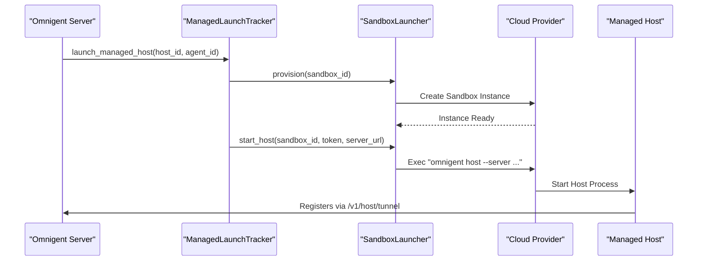
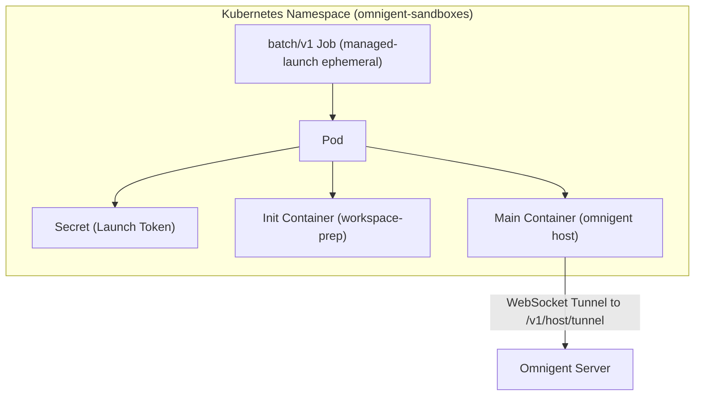
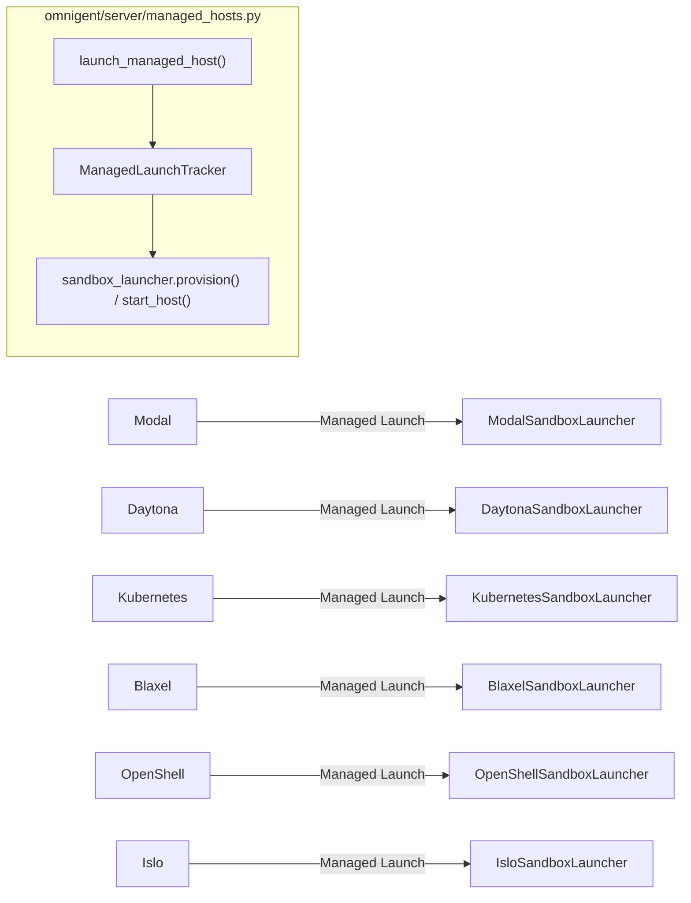
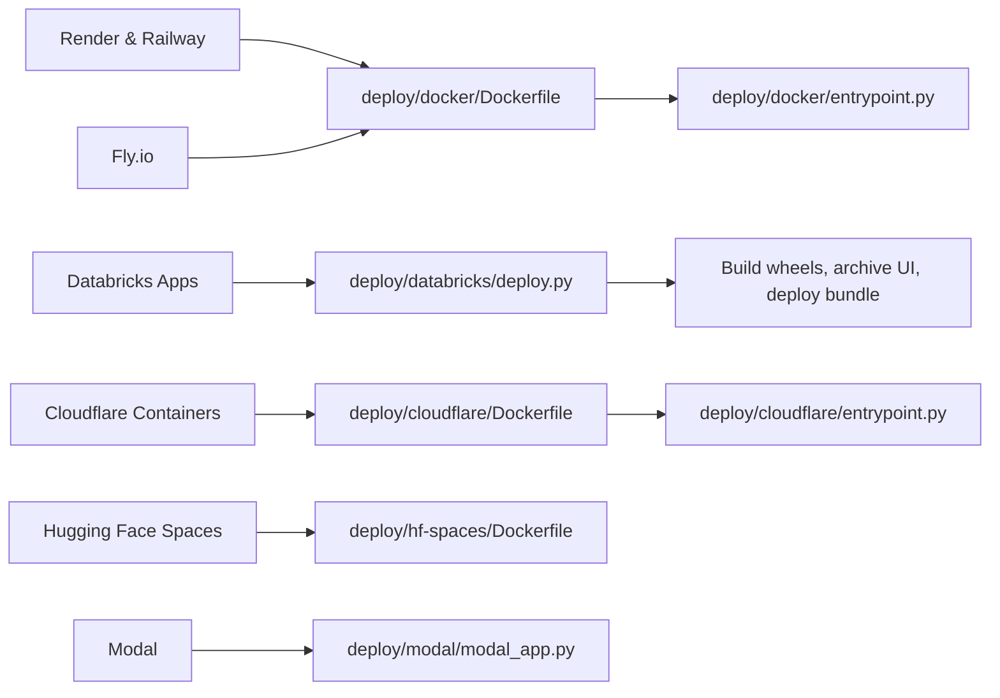

# Cloud Platform Targets

<details>
<summary>Relevant source files</summary>

The following files were used as context for generating this wiki page:

- [.github/scripts/oss-publish-images/maxver.py](.github/scripts/oss-publish-images/maxver.py)
- [.github/scripts/oss-publish-images/reconcile_targets.py](.github/scripts/oss-publish-images/reconcile_targets.py)
- [.github/workflows/docker-build.yml](.github/workflows/docker-build.yml)
- [.github/workflows/oss-publish-images.yml](.github/workflows/oss-publish-images.yml)
- [.github/workflows/web-tests.yml](.github/workflows/web-tests.yml)
- [deploy/cwsandbox/README.md](deploy/cwsandbox/README.md)
- [deploy/databricks/README.md](deploy/databricks/README.md)
- [deploy/databricks/build.sh](deploy/databricks/build.sh)
- [deploy/databricks/databricks.yml](deploy/databricks/databricks.yml)
- [deploy/databricks/deploy.py](deploy/databricks/deploy.py)
- [deploy/databricks/grant_sp_perms.py](deploy/databricks/grant_sp_perms.py)
- [deploy/databricks/src/app.py](deploy/databricks/src/app.py)
- [deploy/databricks/src/app.yaml](deploy/databricks/src/app.yaml)
- [deploy/databricks/src/web_ui_archive.py](deploy/databricks/src/web_ui_archive.py)
- [deploy/docker/entrypoint.py](deploy/docker/entrypoint.py)
- [deploy/islo/README.md](deploy/islo/README.md)
- [deploy/kubernetes/overlays/sandbox-runners/deployment-patch.yaml](deploy/kubernetes/overlays/sandbox-runners/deployment-patch.yaml)
- [deploy/kubernetes/overlays/sandbox-runners/kustomization.yaml](deploy/kubernetes/overlays/sandbox-runners/kustomization.yaml)
- [deploy/kubernetes/overlays/sandbox-runners/namespace-sandboxes.yaml](deploy/kubernetes/overlays/sandbox-runners/namespace-sandboxes.yaml)
- [deploy/kubernetes/overlays/sandbox-runners/rolebinding.yaml](deploy/kubernetes/overlays/sandbox-runners/rolebinding.yaml)
- [deploy/kubernetes/overlays/sandbox-runners/serviceaccount-runner.yaml](deploy/kubernetes/overlays/sandbox-runners/serviceaccount-runner.yaml)
- [deploy/modal/README.md](deploy/modal/README.md)
- [deploy/openshell/README.md](deploy/openshell/README.md)
- [docs/databricks.md](docs/databricks.md)
- [omnigent/onboarding/sandboxes/islo.py](omnigent/onboarding/sandboxes/islo.py)
- [omnigent/runner/transports/ws_tunnel/limits.py](omnigent/runner/transports/ws_tunnel/limits.py)
- [omnigent/server/graceful_shutdown.py](omnigent/server/graceful_shutdown.py)
- [omnigent/util/tunnel_limits.py](omnigent/util/tunnel_limits.py)
- [tests/deploy/__init__.py](tests/deploy/__init__.py)
- [tests/deploy/test_databricks_app_sandbox_config.py](tests/deploy/test_databricks_app_sandbox_config.py)
- [tests/deploy/test_databricks_build_script.py](tests/deploy/test_databricks_build_script.py)
- [tests/deploy/test_databricks_deploy_lock_index.py](tests/deploy/test_databricks_deploy_lock_index.py)
- [tests/deploy/test_databricks_deploy_no_otel.py](tests/deploy/test_databricks_deploy_no_otel.py)
- [tests/deploy/test_databricks_deploy_uc_grants.py](tests/deploy/test_databricks_deploy_uc_grants.py)
- [tests/deploy/test_databricks_empty_features.py](tests/deploy/test_databricks_empty_features.py)
- [tests/deploy/test_databricks_extensions.py](tests/deploy/test_databricks_extensions.py)
- [tests/deploy/test_databricks_web_ui.py](tests/deploy/test_databricks_web_ui.py)
- [tests/deploy/test_docker_entrypoint_capabilities.py](tests/deploy/test_docker_entrypoint_capabilities.py)
- [tests/deploy/test_docker_entrypoint_import.py](tests/deploy/test_docker_entrypoint_import.py)
- [tests/e2e/test_databricks_deploy_lock_index_e2e.py](tests/e2e/test_databricks_deploy_lock_index_e2e.py)
- [tests/onboarding/sandboxes/test_islo.py](tests/onboarding/sandboxes/test_islo.py)
- [tests/server/test_graceful_shutdown.py](tests/server/test_graceful_shutdown.py)
- [tests/test_tunnel_limits.py](tests/test_tunnel_limits.py)

</details>


This page provides comprehensive technical guidance for deploying the Omnigent server and runner infrastructure across multiple cloud platforms and sandbox providers. Omnigent's architecture supports containerized deployments, serverless environments, managed sandbox hosts, and specialized cloud services, ensuring flexibility and scalability.

---

## One-Click & CLI Deployments

Omnigent supports streamlined deployment to various Platform-as-a-Service (PaaS) providers using the provided Docker configuration and orchestration files.

### PaaS Providers (Render, Railway, Fly.io)

These platforms use the multi-stage `Dockerfile` in `deploy/docker/Dockerfile` to build the server image [deploy/docker/Dockerfile:1-43](). The container entrypoint is `deploy/docker/entrypoint.py`, which orchestrates environment resolution, runs Alembic database migrations, and launches the FastAPI server application [deploy/docker/entrypoint.py:1-161](), [deploy/docker/entrypoint.py:97-140]().

- **Render & Railway**:
  - Both provide managed Postgres databases and default to the built-in `accounts` authentication provider.
  - Render offers persistent disk mounting for the artifact directory, configured in `render.yaml`.

- **Fly.io**:
  - Enables deployment using `fly deploy`.
  - Uses SQLite for state persistence on attached persistent volume storage.

### Serverless & Specialized Targets

- **Cloudflare Containers**:
  - Supports scale-to-zero deployment with Cloudflare Containers using D1 (SQLite-compatible) and R2 for storage. The `deploy/cloudflare` directory contains the necessary configuration and Dockerfile for this target [deploy/cloudflare/Dockerfile](). The build process for Cloudflare containers is verified in CI [ .github/workflows/docker-build.yml:155-160]().

- **Cloudflare Quick Tunnel**:
  - For exposing local servers to the internet securely, `cloudflared tunnel --url http://localhost:6767` allows remote runners to connect to a local Omnigent server.

- **Hugging Face Spaces**:
  - Deploy Omnigent as a Docker Space primarily for demonstration using SQLite for state, avoiding external DB provisioning. The `deploy/hf-spaces/Dockerfile` is used for this purpose [deploy/hf-spaces/Dockerfile](). This Dockerfile is also smoke-tested in CI [ .github/workflows/docker-build.yml:161-165]().

- **Tailscale Serve**:
  - Uses Tailscale's zero-config VPN mesh to securely expose the server endpoint via `tailscale serve` for private access without public IPs.

Sources: [deploy/docker/Dockerfile:1-43](), [deploy/docker/entrypoint.py:1-161](), [deploy/docker/entrypoint.py:97-140](), [deploy/cloudflare/Dockerfile](), [deploy/hf-spaces/Dockerfile](), [ .github/workflows/docker-build.yml:155-160](), [ .github/workflows/docker-build.yml:161-165]()

---

## Cloud Sandboxes (Managed Hosts)

Omnigent supports offloading agent execution to disposable cloud sandboxes referred to as "Managed Hosts." When a session specifies `host_type="managed"`, the server provisions a sandbox, runs `omnigent host` inside it, and oversees its lifecycle and registration via a WebSocket tunnel.

### Sandbox Launch Architecture



Each managed host launch utilizes a unique launch token for sandbox authentication. User credentials never enter the sandbox environment directly. Credential injection and token management are securely handled by the server.

### Supported Sandbox Providers

| Provider        | Key Attributes                                                                                              | Reference Files                              |
|-----------------|-------------------------------------------------------------------------------------------------------------|----------------------------------------------|
| **Modal**       | Uses the `ModalSandboxLauncher`, obtaining credentials from environment variables. Provides an official host image. | `deploy/modal/README.md` [135-167]() |
| **Daytona**     | Ephemeral cloud sandboxes with 7-day TTL by default; integrates with Cloudflare Workers for free-tier egress relay. | `omnigent/onboarding/sandboxes/daytona.py` |
| **Kubernetes**  | Launches ephemeral Jobs with Pods running `omnigent host` as the main container. Uses namespace separation, RBAC, and Secrets for tokens. | `omnigent/onboarding/sandboxes/kubernetes.py`, `deploy/kubernetes/overlays/sandbox-runners/kustomization.yaml` |
| **Blaxel**      | High-performance serverless cloud VM provider with custom image and resource sizing.                         | `omnigent/onboarding/sandboxes/blaxel.py` |
| **OpenShell**   | Uses NVIDIA OpenShell SDK with gRPC control plane. Features custom hosts running as non-root sandbox user with writable `/sandbox`. | `omnigent/onboarding/sandboxes/openshell.py`, `deploy/openshell/README.md` [1-163]() |
| **Islo**        | API-key authenticated, prebaked host image, no local port forwarding.                                       | `omnigent/onboarding/sandboxes/islo.py` [1-208]() |

Other providers include Microsandbox, Boxlite, E2B, and Gensee, each with specialized integrations and environment configurations.

Sources: [deploy/modal/README.md:135-167](), [omnigent/onboarding/sandboxes/daytona.py](), [omnigent/onboarding/sandboxes/kubernetes.py](), [deploy/kubernetes/overlays/sandbox-runners/kustomization.yaml](), [omnigent/onboarding/sandboxes/blaxel.py](), [omnigent/onboarding/sandboxes/openshell.py](), [deploy/openshell/README.md:1-163](), [omnigent/onboarding/sandboxes/islo.py:1-208]()

---

## Kubernetes "Entrypoint-as-Host" Model

The Kubernetes sandbox launcher uses a specialized pattern where the host binary runs as the container's main process inside a privileged namespace.

- The batch `Job` creates a Pod under the namespace (usually `omnigent-sandboxes`).
- An init container named `workspace-prep` performs workspace directory creation and optional `git clone` of the agent source before host startup.
- The main container runs as the `sandbox` non-root user (UID `1000660000`) with kernel capabilities dropped.
- The launch token used to authenticate to the server is supplied via a Kubernetes Secret to avoid leakage in logs or specs.

### Kubernetes Architecture Diagram



The launcher respects strict security policies including running as a non-root user, dropping all kernel capabilities, and avoiding privileged escalation. The emptyDir volume backing `$HOME` has a size limit to ensure node stability. The launcher handles repo cloning in parallel, credential injection into git helpers during cloning, and Pod labels that classify agents for credentials injection.

Sources: [deploy/kubernetes/overlays/sandbox-runners/kustomization.yaml](), [deploy/kubernetes/overlays/sandbox-runners/deployment-patch.yaml](), [deploy/kubernetes/overlays/sandbox-runners/serviceaccount-runner.yaml](), [deploy/kubernetes/overlays/sandbox-runners/rolebinding.yaml](), [deploy/kubernetes/overlays/sandbox-runners/namespace-sandboxes.yaml]()

---

## Databricks Apps Deployment

Omnigent can be deployed to Databricks Apps using Databricks Asset Bundles (DAB) with Lakebase for Postgres persistence and Unity Catalog (UC) Volumes as the artifact store.

### Key Components

- **Lakebase**: Provides a managed PostgreSQL instance inside Databricks; requires a dedicated project and a workspace client for deployment [deploy/databricks/README.md:51-80]().

- **Unity Catalog Volumes**: Store agent bundles and executor snapshots persistently [deploy/databricks/README.md:83-86]().

- **Authentication**: Typically uses `header`-mode auth trusting `X-Forwarded-Email` injected by the Databricks App proxy, supporting multi-user access without direct login UI.

### Deployment Workflow

The `deploy/databricks/deploy.py` script automates build and deployment steps:

1. **Version Stamping**: Applies a `.post<timestamp>` suffix to Python package versions to ensure unique wheel builds to avoid caching conflicts [deploy/databricks/deploy.py:128-150]().

2. **Wheel Build**: Builds wheels for `omnigent`, `omnigent-client`, and `omnigent-ui-sdk` components [deploy/databricks/build.sh:55-62]().

3. **Web UI Archiving**: Bundles the SPA frontend into `web-ui.tar.gz` adhering to the 10 MB per file workspace limit [deploy/databricks/deploy.py:40-49](), [deploy/databricks/build.sh:36-45](). The `deploy/databricks/src/app.py` entrypoint extracts this archive at runtime [deploy/databricks/src/app.py:30-58]().

4. **Bundle Deploy**: Calls `databricks bundle deploy` and subsequent `bundle run` commands to update the app [deploy/databricks/deploy.py:1090-1100]().

```mermaid
flowchart TD
  SRC[Source Code]
  VERS[Version Stamp PyProject]
  WHEELS[Build Wheels\n(omnigent, client, ui-sdk)]
  UI_ARCH[Archive Web UI into web-ui.tar.gz]
  DEPLOY[databricks bundle deploy]
  RUN[databricks bundle run]

  SRC --> VERS --> WHEELS --> UI_ARCH --> DEPLOY --> RUN
```

Sources: [deploy/databricks/README.md:51-80](), [deploy/databricks/README.md:83-86](), [deploy/databricks/deploy.py:128-150](), [deploy/databricks/build.sh:55-62](), [deploy/databricks/deploy.py:40-49](), [deploy/databricks/build.sh:36-45](), [deploy/databricks/src/app.py:30-58](), [deploy/databricks/deploy.py:1090-1100]()

---

## Modal Deployment Guide

[Modal](https://modal.com) supports two distinct Omnigent use cases:

1. **Server Deployment**  
   Running the Omnigent server as a single container with persistent artifact storage and HTTPS endpoint.

2. **Sandbox Provider**  
   Provisioning disposable cloud machines running `omnigent host` for executing agent sessions remotely.

### Server Deployment on Modal

- Implemented in `deploy/modal/modal_app.py`, which pulls the standard Omnigent server image (`ghcr.io/omnigent-ai/omnigent-server:latest`) and runs the shared Docker entrypoint (`deploy/docker/entrypoint.py`) [deploy/modal/README.md:16-18]().
- Modal provides managed HTTPS URL, log streaming, and volume persistence for uploaded agents, improving upon ephemeral platform limitations [deploy/modal/README.md:18-21]().
- Requires a Postgres database; Modal does not provide managed Postgres, so external services like Neon are recommended [deploy/modal/README.md:26-29]().
- Supports built-in accounts authentication and OIDC (e.g., GitHub OAuth) modes for user management [deploy/modal/README.md:93-107]().
- Caveats include a 2 MiB WebSocket message cap, 24-hour connection resets, and a single always-on container design [deploy/modal/README.md:74-90]().

### Sandbox Usage

Modal sandboxes boot from the official Omnigent host image (`ghcr.io/omnigent-ai/omnigent-host:latest`), achieving faster startup times [deploy/modal/README.md:165-167]().

- **CLI-Launched Sandbox**: User provisions a sandbox on-demand and deploys local changes by syncing wheels [deploy/modal/README.md:140-143]().
- **Server-Managed Sandbox**: Server auto-provisions and terminates sandboxes tied to session lifecycle [deploy/modal/README.md:144-148]().

This approach abstracts away manual sandbox machine lifecycle management via the `ModalSandboxLauncher` implementing the provider-agnostic `SandboxLauncher` interface.

Sources: [deploy/modal/README.md:16-18](), [deploy/modal/README.md:18-21](), [deploy/modal/README.md:26-29](), [deploy/modal/README.md:93-107](), [deploy/modal/README.md:74-90](), [deploy/modal/README.md:165-167](), [deploy/modal/README.md:140-143](), [deploy/modal/README.md:144-148]()

---

## Other Sandbox Providers

### OpenShell (NVIDIA)

- Integrates with an OpenShell gateway via gRPC [deploy/openshell/README.md:31-38]().
- Sandbox images must meet specific requirements (`sandbox` user, iproute2, nftables) [deploy/openshell/README.md:108-113]().
- Supports CLI-launched and server-managed sandboxes [deploy/openshell/README.md:20-28]().
- The official host image (`ghcr.io/omnigent-ai/omnigent-host:latest`) is compatible and published multi-arch [deploy/openshell/README.md:100-106]().
- Lacks local port forwarding, so the hosted server OAuth dance skips that step [deploy/openshell/README.md:39-43]().

### Islo

- Uses API key authentication configured via `ISLO_API_KEY` environment variable [omnigent/onboarding/sandboxes/islo.py:55-56]().
- Supports SDK-based lifecycle management plus direct HTTP API for SSE streams and file uploads [omnigent/onboarding/sandboxes/islo.py:6-9]().
- Uses the standard Omnigent host image by default, configurable via `OMNIGENT_ISLO_HOST_IMAGE` [omnigent/onboarding/sandboxes/islo.py:58-60]().
- Does not support local port forwarding [omnigent/onboarding/sandboxes/islo.py:18-21]().

### Other Providers

- **Daytona**, **Boxlite**, **Blaxel**, **Microsandbox**, **E2B**, and **Gensee** have specialized implementations and environment configuration options.

Sources: [deploy/openshell/README.md:31-38](), [deploy/openshell/README.md:108-113](), [deploy/openshell/README.md:20-28](), [deploy/openshell/README.md:100-106](), [deploy/openshell/README.md:39-43](), [omnigent/onboarding/sandboxes/islo.py:55-56](), [omnigent/onboarding/sandboxes/islo.py:6-9](), [omnigent/onboarding/sandboxes/islo.py:58-60](), [omnigent/onboarding/sandboxes/islo.py:18-21]()

---

## Authentication Considerations

Most cloud platform deployments and sandboxes rely on Omnigent's standard authentication providers:

- **Header Proxy Authentication** (default for many PaaS environments): Identity is derived from a trusted HTTP header (e.g., `X-Forwarded-Email`), which upstream proxies must inject securely.
- **OIDC Authentication**: Full integrated OAuth authorization code flow handled inside the Omnigent server with local session cookie management and multi-factor policy enforcement.
- **Built-in Accounts Provider**: Username/password-based login system for standalone, multi-user instances.

Proper HTTPS deployment and consistent identity header configuration are critical for security.

---

## Summary Diagrams Bridging Natural Language Targets to Code Entities

### Sandboxes Natural Language to Launcher Code



### Deployment Orchestration: Platforms to Scripts



---

# References and Sources

- [deploy/docker/Dockerfile:1-43]()
- [deploy/docker/entrypoint.py:1-161]()
- [deploy/docker/entrypoint.py:97-140]()
- [deploy/cloudflare/Dockerfile]()
- [deploy/hf-spaces/Dockerfile]()
- [ .github/workflows/docker-build.yml:155-160]()
- [ .github/workflows/docker-build.yml:161-165]()
- [deploy/modal/README.md:135-167]()
- [omnigent/onboarding/sandboxes/daytona.py]()
- [omnigent/onboarding/sandboxes/kubernetes.py]()
- [deploy/kubernetes/overlays/sandbox-runners/kustomization.yaml]()
- [omnigent/onboarding/sandboxes/blaxel.py]()
- [omnigent/onboarding/sandboxes/openshell.py]()
- [deploy/openshell/README.md:1-163]()
- [omnigent/onboarding/sandboxes/islo.py:1-208]()
- [deploy/kubernetes/overlays/sandbox-runners/deployment-patch.yaml]()
- [deploy/kubernetes/overlays/sandbox-runners/serviceaccount-runner.yaml]()
- [deploy/kubernetes/overlays/sandbox-runners/rolebinding.yaml]()
- [deploy/kubernetes/overlays/sandbox-runners/namespace-sandboxes.yaml]()
- [deploy/databricks/README.md:51-80]()
- [deploy/databricks/README.md:83-86]()
- [deploy/databricks/deploy.py:128-150]()
- [deploy/databricks/build.sh:55-62]()
- [deploy/databricks/deploy.py:40-49]()
- [deploy/databricks/build.sh:36-45]()
- [deploy/databricks/src/app.py:30-58]()
- [deploy/databricks/deploy.py:1090-1100]()
- [deploy/modal/README.md:16-18]()
- [deploy/modal/README.md:18-21]()
- [deploy/modal/README.md:26-29]()
- [deploy/modal/README.md:93-107]()
- [deploy/modal/README.md:74-90]()
- [deploy/modal/README.md:165-167]()
- [deploy/modal/README.md:140-143]()
- [deploy/modal/README.md:144-148]()
- [deploy/openshell/README.md:31-38]()
- [deploy/openshell/README.md:108-113]()
- [deploy/openshell/README.md:20-28]()
- [deploy/openshell/README.md:100-106]()
- [deploy/openshell/README.md:39-43]()
- [omnigent/onboarding/sandboxes/islo.py:55-56]()
- [omnigent/onboarding/sandboxes/islo.py:6-9]()
- [omnigent/onboarding/sandboxes/islo.py:58-60]()
- [omnigent/onboarding/sandboxes/islo.py:18-21]()