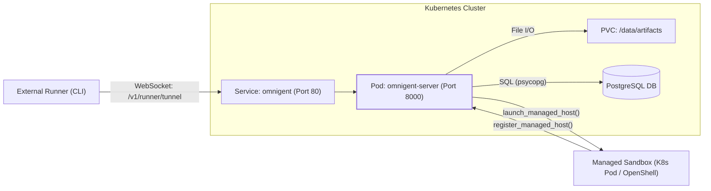
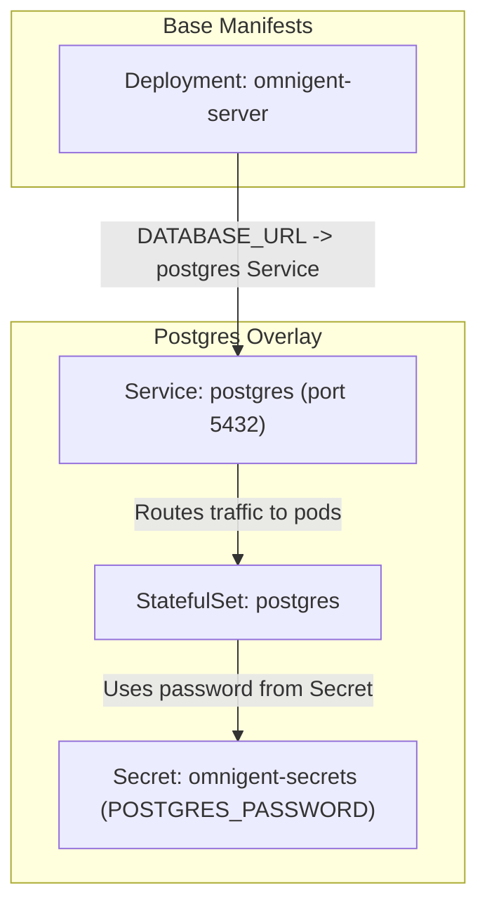
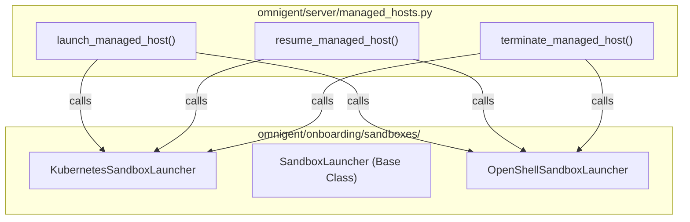
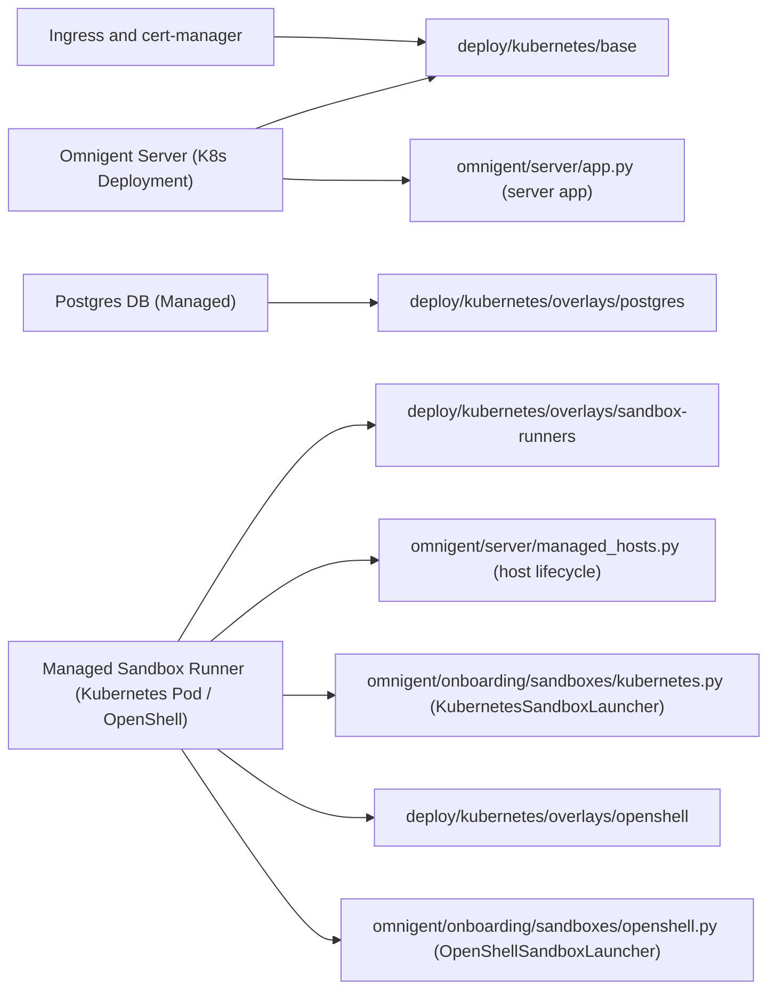

# Kubernetes Deployment

<details>
<summary>Relevant source files</summary>

The following files were used as context for generating this wiki page:

- [.github/scripts/oss-publish-images/maxver.py](.github/scripts/oss-publish-images/maxver.py)
- [.github/scripts/oss-publish-images/reconcile_targets.py](.github/scripts/oss-publish-images/reconcile_targets.py)
- [.github/workflows/docker-build.yml](.github/workflows/docker-build.yml)
- [.github/workflows/oss-publish-images.yml](.github/workflows/oss-publish-images.yml)
- [.github/workflows/web-tests.yml](.github/workflows/web-tests.yml)
- [deploy/README.md](deploy/README.md)
- [deploy/cwsandbox/README.md](deploy/cwsandbox/README.md)
- [deploy/islo/README.md](deploy/islo/README.md)
- [deploy/kubernetes/overlays/sandbox-runners/README.md](deploy/kubernetes/overlays/sandbox-runners/README.md)
- [deploy/kubernetes/overlays/sandbox-runners/deployment-patch.yaml](deploy/kubernetes/overlays/sandbox-runners/deployment-patch.yaml)
- [deploy/kubernetes/overlays/sandbox-runners/kustomization.yaml](deploy/kubernetes/overlays/sandbox-runners/kustomization.yaml)
- [deploy/kubernetes/overlays/sandbox-runners/namespace-sandboxes.yaml](deploy/kubernetes/overlays/sandbox-runners/namespace-sandboxes.yaml)
- [deploy/kubernetes/overlays/sandbox-runners/role.yaml](deploy/kubernetes/overlays/sandbox-runners/role.yaml)
- [deploy/kubernetes/overlays/sandbox-runners/rolebinding.yaml](deploy/kubernetes/overlays/sandbox-runners/rolebinding.yaml)
- [deploy/kubernetes/overlays/sandbox-runners/sandbox-config.yaml](deploy/kubernetes/overlays/sandbox-runners/sandbox-config.yaml)
- [deploy/kubernetes/overlays/sandbox-runners/serviceaccount-runner.yaml](deploy/kubernetes/overlays/sandbox-runners/serviceaccount-runner.yaml)
- [deploy/modal/README.md](deploy/modal/README.md)
- [deploy/openshell/README.md](deploy/openshell/README.md)
- [docs/extending/sandbox_providers.md](docs/extending/sandbox_providers.md)
- [omnigent/cli_sandbox.py](omnigent/cli_sandbox.py)
- [omnigent/host/__init__.py](omnigent/host/__init__.py)
- [omnigent/onboarding/sandboxes/__init__.py](omnigent/onboarding/sandboxes/__init__.py)
- [omnigent/onboarding/sandboxes/base.py](omnigent/onboarding/sandboxes/base.py)
- [omnigent/onboarding/sandboxes/islo.py](omnigent/onboarding/sandboxes/islo.py)
- [omnigent/onboarding/sandboxes/kubernetes.py](omnigent/onboarding/sandboxes/kubernetes.py)
- [omnigent/onboarding/sandboxes/openshell.py](omnigent/onboarding/sandboxes/openshell.py)
- [omnigent/onboarding/sandboxes/registry.py](omnigent/onboarding/sandboxes/registry.py)
- [omnigent/server/managed_hosts.py](omnigent/server/managed_hosts.py)
- [tests/e2e/test_openshell_sandbox_create_upload_e2e.py](tests/e2e/test_openshell_sandbox_create_upload_e2e.py)
- [tests/onboarding/sandboxes/test_base.py](tests/onboarding/sandboxes/test_base.py)
- [tests/onboarding/sandboxes/test_islo.py](tests/onboarding/sandboxes/test_islo.py)
- [tests/onboarding/sandboxes/test_kubernetes.py](tests/onboarding/sandboxes/test_kubernetes.py)
- [tests/onboarding/sandboxes/test_openshell.py](tests/onboarding/sandboxes/test_openshell.py)
- [tests/onboarding/sandboxes/test_registry.py](tests/onboarding/sandboxes/test_registry.py)
- [tests/server/helpers.py](tests/server/helpers.py)
- [tests/server/integration/test_host_session_binding.py](tests/server/integration/test_host_session_binding.py)
- [tests/server/test_managed_hosts.py](tests/server/test_managed_hosts.py)

</details>


Omnigent can be deployed to Kubernetes clusters using Kustomize manifests. This deployment method provides a flexible and extensible approach with base manifests and layered overlays for key components such as PostgreSQL, ingress with cert-manager, and sandbox runners including Kubernetes pods and NVIDIA OpenShell sandboxes.

---

## Deployment Architecture

The core Kubernetes deployment centers on a single-replica **Deployment** running the `ghcr.io/omnigent-ai/omnigent-server` container exposing port `8000`. It includes readiness and liveness probes to monitor pod health and ensure reliability. A **Service** of type `ClusterIP` exposes the server internally on port `80`.

The deployment uses a **PersistentVolumeClaim** (PVC) of 10 Gi for storing artifacts (such as uploaded files), cookie secrets, and initial admin passwords. Environment variables like `DATABASE_URL` and `OMNIGENT_ACCOUNTS_COOKIE_SECRET` are injected via ConfigMap and Secret manifests respectively.

Optionally, ingress resources configured with cert-manager manage HTTPS termination, enabling public URLs and secure access to the server.

| Component | Role |
| :-------------------------- | :------------------------------------------------------- |
| Deployment | Runs Omnigent server Pod |
| Service | Exposes Omnigent server internally on port 80 |
| PersistentVolumeClaim (PVC) | Stores artifacts and generated secrets |
| ConfigMap & Secrets | Provide server environment variables and secrets |
| Ingress (Optional) | Provides HTTPS routing via cert-manager |

Sources: [deploy/README.md:130]()

---

## Data Flow and Connectivity

Omnigent’s Kubernetes deployment supports two main connectivity models:

- **External Runner Model:** Runner hosts—such as local developer machines or external servers—connect to the Omnigent server by dialing into its WebSocket endpoint `/v1/runner/tunnel`. This permits flexible execution of sessions on external infrastructure.

- **Managed Sandbox Model:** The server provisions ephemeral sandbox host environments that run `omnigent host` within Kubernetes pods or other sandbox providers like OpenShell. These hosts dial back to the server using a launch token for authentication and session binding.

### Managed Sandbox Lifecycle

- The server provisions sandbox hosts identified by a durable `host_id`.
- The sandboxes themselves are ephemeral, subject to provider-imposed lifetime caps.
- On sandbox expiry, the server can relaunch a new sandbox reusing the same durable host identity.
- Each sandbox authenticates to the server via a unique per-launch launch token that is minted fresh on each start.
- This flow avoids embedding user credentials inside sandboxes, improving security isolation.



Sources: [omnigent/server/managed_hosts.py:11-15](), [omnigent/server/managed_hosts.py:17-23]()

---

## Configuration and Managed Sandbox Providers

Managed sandboxes and the Kubernetes runner environment are configured via a `sandbox:` section in the server’s configuration YAML, often mounted from a ConfigMap at `/etc/omnigent/config.yaml`.

### Sandbox Configuration Highlights

| Key | Description | Default / Notes |
| :------------------- | :------------------------------------------------------ | :--------------------------------------------------- |
| `provider` | Sandbox backend name (`kubernetes`, `openshell`, etc.) | Required |
| `server_url` | URL sandboxes dial back to for host registration | Required |
| `image` | Docker image for the sandbox host | Defaults to `ghcr.io/omnigent-ai/omnigent-host:latest` |
| `secret_name` | Kubernetes Secret with harness credentials | Defaults to `omnigent-creds` |
| `namespace` | Namespace where sandbox pods are created | Defaults to `omnigent-sandboxes` |
| `home_size_limit` | Size limit on writable `$HOME` volume | Defaults to `8Gi` (bounded emptyDir) |
| `env` | List of SERVER-process environment variables to inject | Empty by default |

The configuration supports additional tuning such as service account, resource requests/limits, node selectors, and ports forwarded by the sandbox host.

Sources: [omnigent/server/managed_hosts.py:34-118](), [omnigent/onboarding/sandboxes/kubernetes.py:80-143]()

---

## Deployment Overlays

Kustomize overlays extend the base Kubernetes manifests to add optional features or environment-specific configuration.

### In-Cluster PostgreSQL Overlay

- Adds a `StatefulSet` running PostgreSQL 16 with a 10 Gi volume.
- Provisioned PostgreSQL server is reached via a `ClusterIP` named `postgres` on port 5432.
- The Omnigent server Deployment uses this service via `DATABASE_URL`.



Sources: [deploy/README.md:130]()

---

### On-Demand Kubernetes Runner Pods Overlay

This overlay activates the `kubernetes` managed sandbox provider for `host_type: managed` sessions:

- Sessions requesting managed hosts spawn ephemeral Kubernetes `batch/v1` Jobs.
- Each Job’s Pod runs `omnigent host` as its container entrypoint; no exec into running containers is performed.
- An init container prepares the workspace by creating directories and optionally cloning Git repos.
- Launch tokens are delivered securely via dedicated Kubernetes Secrets mounted using `secretKeyRef`, preventing token leakage.
- An RBAC Role and RoleBinding scoped to the `omnigent-sandboxes` namespace limit the server’s permissions to only what is required for pods, jobs, and secrets.
- Runner Pods are non-root, have dropped capabilities, and run with PodSecurityPolicy restricted compliance.
- Pods are labeled with `omnigent.ai/agent: <agent_name>` if the running session uses a built-in agent with a valid Kubernetes label value. This label can drive workload-scoped credential injection policies.

Important design notes:

- **Entrypoint as host:** The host process runs as the Pod’s primary container command, supervised by a lightweight PID-1 reaper forwarding SIGTERM and reaping zombies for graceful shutdown.
- **Two namespaces:** Separation of server (`omnigent`) and runners (`omnigent-sandboxes`) isolates workloads and reduces blast radius in case of compromise.

Sources: [omnigent/onboarding/sandboxes/kubernetes.py:11-44](), [omnigent/onboarding/sandboxes/kubernetes.py:127-150]()

---

### NVIDIA OpenShell Overlay

- Enables provisioning of OpenShell sandboxes as a managed sandbox backend.
- Uses the `openshell` sandbox provider implemented in `omnigent/onboarding/sandboxes/openshell.py`.
- OpenShell is self-hosted and runs sandboxes via a gRPC gateway controlling Docker, Podman, microVM, or Kubernetes compute drivers.
- Supports programmatic lifecycle management, file copying into sandboxes by chunked `cat` exec streams, and foreground `omnigent host` execution.
- Environment variables for credentials, workspace names, and gateway selection are configurable.



Sources: [omnigent/server/managed_hosts.py:39-45](), [omnigent/onboarding/sandboxes/openshell.py:1-106]()

---

### ArgoCD Integration Overlay (Optional)

For GitOps workflows, an `argocd/` overlay provides:

- ArgoCD `Application` manifests describing the deployment.
- Kustomize patches to ignore mutable Secret data and PVC storage size field diffs during reconciliation.
- Annotations on Secrets and PVCs to help safely preserve state without triggering unnecessary reconciliation restarts or deletions.

This allows seamless ArgoCD management with stateful components protected.

Sources: [deploy/README.md:130]()

---

## Operations and Usage

### Prerequisites

- Kubernetes cluster version 1.25+ with support for Kustomize.
- `kubectl` with Kustomize (modern versions).
- PostgreSQL instance (external or deployed in-cluster).
- Optional ingress controller with cert-manager for HTTPS.
- The server image built with the `kubernetes` optional extras installed (providing the official launcher classes).

### Deploying

Use `kubectl kustomize` to build and apply manifests.

```bash
kubectl kustomize deploy/kubernetes/base/ | kubectl apply -f -
```

To enable PostgreSQL overlay:

```bash
kubectl kustomize deploy/kubernetes/overlays/postgres/ | kubectl apply -f -
```

To enable Kubernetes sandbox runners:

```bash
kubectl kustomize deploy/kubernetes/overlays/sandbox-runners/ | kubectl apply -f -
```

For local development or testing, forward the Service port:

```bash
kubectl port-forward svc/omnigent 8000:80
```

Then access the server at `http://localhost:8000`.

Sources: [deploy/README.md:130]()

---

## Summary Diagram: Natural Language to Code Entity Space

This diagram links high-level deployment components to their related core code entities, easing navigation for developers.



Sources: [omnigent/server/managed_hosts.py:1-120](), [omnigent/onboarding/sandboxes/kubernetes.py:1-151](), [omnigent/onboarding/sandboxes/openshell.py:1-106]()

---

This page documents the Kubernetes deployment of Omnigent using layered Kustomize manifests, with detailed insights on the base server deployment, ingress and certificate management, PostgreSQL overlay, managed sandbox provider overlays (Kubernetes jobs and OpenShell sandboxes), and operational guidance. The association of code entities to natural components aids developers in locating implementation details.