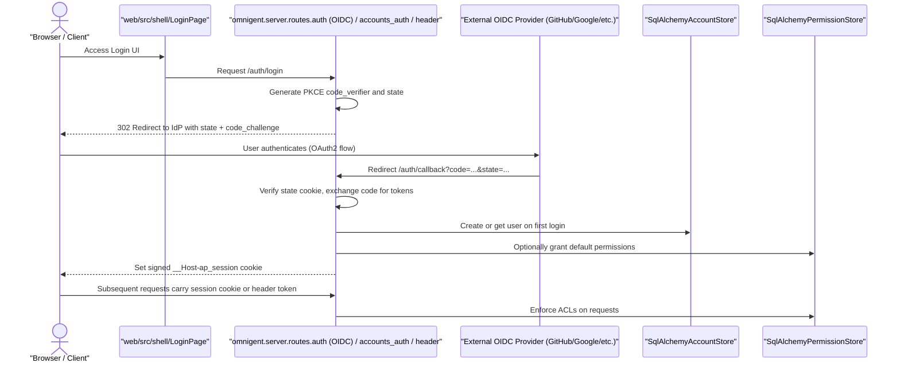
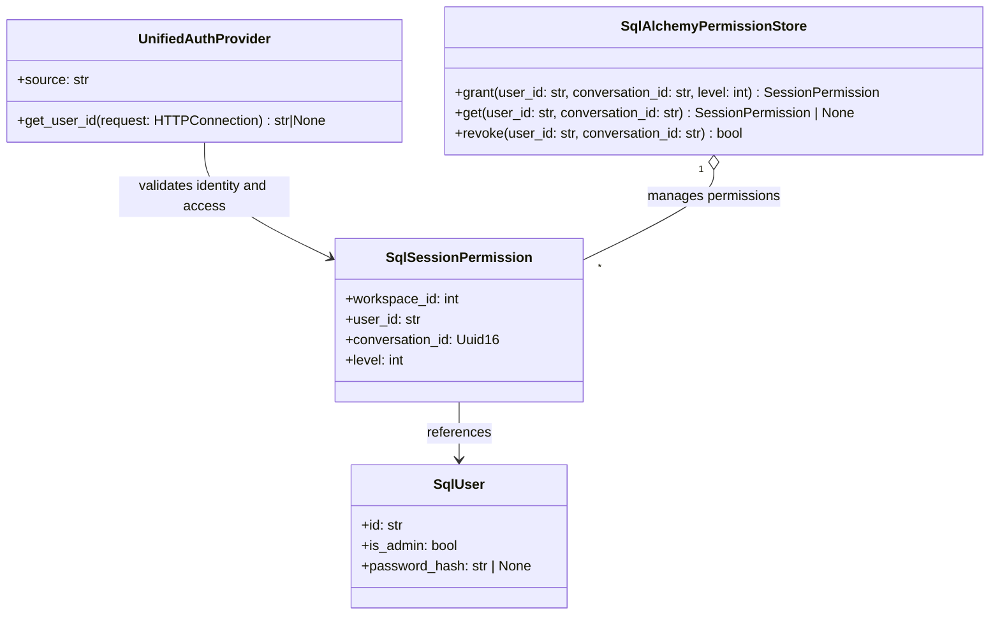
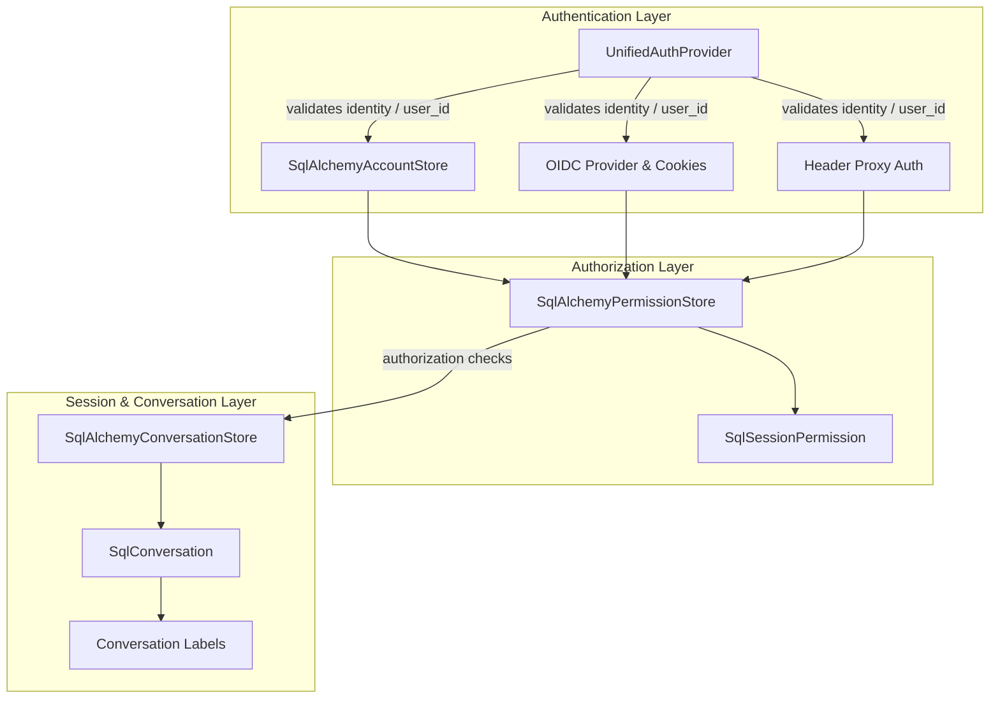

# Authentication & Multi-User Setup

<details>
<summary>Relevant source files</summary>

The following files were used as context for generating this wiki page:

- [deploy/docker/.env.example](deploy/docker/.env.example)
- [deploy/docker/README.md](deploy/docker/README.md)
- [deploy/docker/docker-compose.yaml](deploy/docker/docker-compose.yaml)
- [designs/DEVICE_AUTH.md](designs/DEVICE_AUTH.md)
- [docs/DATA_DIR_LAYOUT.md](docs/DATA_DIR_LAYOUT.md)
- [omnigent/runtime/agent_cache.py](omnigent/runtime/agent_cache.py)
- [omnigent/server/auth.py](omnigent/server/auth.py)
- [omnigent/server/device_grant_store.py](omnigent/server/device_grant_store.py)
- [omnigent/server/oidc.py](omnigent/server/oidc.py)
- [omnigent/server/routes/auth.py](omnigent/server/routes/auth.py)
- [omnigent/server/routes/device_auth.py](omnigent/server/routes/device_auth.py)
- [omnigent/server/routes/sharing.py](omnigent/server/routes/sharing.py)
- [omnigent/server/sharing_settings.py](omnigent/server/sharing_settings.py)
- [tests/e2e_ui/agents/test_damaged_agent_cache.py](tests/e2e_ui/agents/test_damaged_agent_cache.py)
- [tests/e2e_ui/auth/_fake_idp.py](tests/e2e_ui/auth/_fake_idp.py)
- [tests/e2e_ui/auth/_oidc_server.py](tests/e2e_ui/auth/_oidc_server.py)
- [tests/e2e_ui/auth/test_oidc_login_flow.py](tests/e2e_ui/auth/test_oidc_login_flow.py)
- [tests/e2e_ui/chat/test_stale_stream.py](tests/e2e_ui/chat/test_stale_stream.py)
- [tests/e2e_ui/collaboration/test_author_label.py](tests/e2e_ui/collaboration/test_author_label.py)
- [tests/e2e_ui/collaboration/test_collab_realtime.py](tests/e2e_ui/collaboration/test_collab_realtime.py)
- [tests/e2e_ui/collaboration/test_default_public_sessions.py](tests/e2e_ui/collaboration/test_default_public_sessions.py)
- [tests/e2e_ui/collaboration/test_share_dialog_mobile_fit.py](tests/e2e_ui/collaboration/test_share_dialog_mobile_fit.py)
- [tests/e2e_ui/collaboration/test_sharing_journey.py](tests/e2e_ui/collaboration/test_sharing_journey.py)
- [tests/e2e_ui/messages/test_task_list_render.py](tests/e2e_ui/messages/test_task_list_render.py)
- [tests/e2e_ui/mobile/test_mobile_workflow.py](tests/e2e_ui/mobile/test_mobile_workflow.py)
- [tests/e2e_ui/sessions/test_agent_cache_wipe_recovery.py](tests/e2e_ui/sessions/test_agent_cache_wipe_recovery.py)
- [tests/e2e_ui/sessions/test_clone_session.py](tests/e2e_ui/sessions/test_clone_session.py)
- [tests/e2e_ui/sessions/test_idle_notifications.py](tests/e2e_ui/sessions/test_idle_notifications.py)
- [tests/e2e_ui/sessions/test_sidebar_stop.py](tests/e2e_ui/sessions/test_sidebar_stop.py)
- [tests/e2e_ui/test_embed_service_worker.py](tests/e2e_ui/test_embed_service_worker.py)
- [tests/e2e_ui/visual/snapshots/test_storybook_snapshot/test_story_matches_baseline/test_story_matches_baseline[chromium-components-sharing-permissionsmodal--public-read-only][linux].png](tests/e2e_ui/visual/snapshots/test_storybook_snapshot/test_story_matches_baseline/test_story_matches_baseline[chromium-components-sharing-permissionsmodal--public-read-only][linux].png)
- [tests/e2e_ui/visual/snapshots/test_storybook_snapshot/test_story_matches_baseline/test_story_matches_baseline[chromium-components-sharing-permissionsmodal--restricted-home-directory][linux].png](tests/e2e_ui/visual/snapshots/test_storybook_snapshot/test_story_matches_baseline/test_story_matches_baseline[chromium-components-sharing-permissionsmodal--restricted-home-directory][linux].png)
- [tests/runtime/test_agent_cache.py](tests/runtime/test_agent_cache.py)
- [tests/server/integration/test_app.py](tests/server/integration/test_app.py)
- [tests/server/integration/test_oidc_native_login.py](tests/server/integration/test_oidc_native_login.py)
- [tests/server/integration/test_well_known_auth.py](tests/server/integration/test_well_known_auth.py)
- [tests/server/test_auth_mode.py](tests/server/test_auth_mode.py)
- [tests/server/test_device_auth.py](tests/server/test_device_auth.py)
- [tests/server/test_oidc.py](tests/server/test_oidc.py)
- [tests/server/test_oidc_callback.py](tests/server/test_oidc_callback.py)
- [tests/server/test_oidc_login_reauth.py](tests/server/test_oidc_login_reauth.py)
- [tests/server/test_oidc_provider_compatibility.py](tests/server/test_oidc_provider_compatibility.py)
- [web/src/components/PermissionsModal.stories.tsx](web/src/components/PermissionsModal.stories.tsx)
- [web/src/components/PermissionsModal.test.tsx](web/src/components/PermissionsModal.test.tsx)
- [web/src/components/PermissionsModal.tsx](web/src/components/PermissionsModal.tsx)
- [web/src/hooks/useSharing.ts](web/src/hooks/useSharing.ts)
- [web/src/lib/permissionsApi.test.ts](web/src/lib/permissionsApi.test.ts)
- [web/src/lib/permissionsApi.ts](web/src/lib/permissionsApi.ts)
- [web/src/lib/viteProxy.test.ts](web/src/lib/viteProxy.test.ts)
- [web/src/pages/SharingPage.test.tsx](web/src/pages/SharingPage.test.tsx)
- [web/src/pages/SharingPage.tsx](web/src/pages/SharingPage.tsx)
- [web/src/shell/ForkSessionDialog.test.tsx](web/src/shell/ForkSessionDialog.test.tsx)
- [web/src/shell/ForkSessionDialog.tsx](web/src/shell/ForkSessionDialog.tsx)
- [web/vite.config.ts](web/vite.config.ts)

</details>


Omnigent provides a secure, multi-tenant environment supporting various authentication modes, fine-grained access control, and collaborative features including session sharing, co-driving, and forking.

This page details the implementation and data flows for authentication, authorization, invite workflows, and collaboration features to support multi-user deployments.

---

## Authentication Architecture and Modes

Authentication is controlled by the environment variable `OMNIGENT_AUTH_ENABLED` and the authentication provider configured by `OMNIGENT_AUTH_PROVIDER` [omnigent/server/auth.py:46-47]().

Omnigent uses a pluggable `AuthProvider` abstraction with a core implementation `UnifiedAuthProvider` that supports three identity sources, selected via the environment:

| Mode                   | Config / Env Var                     | Description                                                                                          | Code Location                                    |
|------------------------|------------------------------------|----------------------------------------------------------------------------------------------------|-------------------------------------------------|
| **Built-in Accounts**   | `source="accounts"` (default without OIDC) | Implements username+password authentication, including password hashing, first-user-is-admin bootstrap, invite-only signups, and session cookie minting. Uses `SqlAlchemyAccountStore` for persistence. | [omnigent/server/auth.py:49-50](), [omnigent/server/routes/accounts_auth.py](), [omnigent/server/accounts_store.py]() |
| **OIDC / SSO**          | `source="oidc"` or detected via `OMNIGENT_OIDC_ISSUER` env var | Integrates with external OpenID Connect providers (e.g., GitHub, Google, Okta), performing full authorization code + PKCE login flows that mint signed session cookies. Supports native apps and CLI device grants. Includes invite bypass and domain allowlists. | [omnigent/server/auth.py:50-51](), [omnigent/server/routes/auth.py](), [omnigent/server/oidc.py]() |
| **Header Proxy Auth**   | `source="header"` via `OMNIGENT_AUTH_PROVIDER=header` | Relies on a trusted upstream proxy injecting a user identity header (default `X-Forwarded-Email`) per request. Supports optional header prefix stripping (e.g., Google IAP). Requests missing the header return 401 unless in local single-user mode. | [omnigent/server/auth.py:7-14](), [omnigent/server/auth.py:106-122]() |

### Identity Extraction Flow

The core `UnifiedAuthProvider` exposes a key method:

```python
get_user_id(request: HTTPConnection) -> str | None
```

This method extracts the authenticated user ID or returns `None` if unauthenticated. It performs source-specific validation:

- **Header mode:** extracts and normalizes the configured identity header, stripping optional proxy-specific prefixes.
- **OIDC and Accounts modes:** validate the signed `__Host-ap_session` cookie (HS256 JWT), verifying signature, expiry, and extracting the `sub` claim as user ID. The OIDC provider delegates user creation/upsertion to `SqlAlchemyAccountStore` on login callbacks.

Configured reserved users like `"local"` (single-user local mode) and `"__public__"` (public read access sentinel) are guarded to prevent misuse [omnigent/server/auth.py:48-50]().

This unified interface allows all server components to enforce consistent authenticated identity checks regardless of the underlying auth mode [omnigent/server/auth.py:40-124]().

---

## Authentication Data Flow Diagram



This flow describes the OIDC and accounts providers. The header proxy mode differs by skipping external redirects, relying solely on the proxy-supplied identity header.

Sources: [omnigent/server/routes/auth.py:59-163](), [omnigent/server/routes/accounts_auth.py:1-176](), [omnigent/server/auth.py:40-124]()

---

## Invite Flow and User Onboarding (Built-in Accounts)

The built-in accounts provider supports an invite-only signup process designed to avoid needing SMTP:

- Admins mint single-use invite tokens via the `/auth/invite` endpoint.
- Invite tokens are persisted in the `account_tokens` table managed by the `SqlAlchemyAccountStore`. Tokens encode the invited user's email and admin status flags.
- Redeeming an invite requires the token and chosen username/password at `/auth/register`. The redemption atomically validates and consumes the invite.
- The first admin can be bootstrapped either interactively via the web UI or pre-seeded with the environment variable `OMNIGENT_ACCOUNTS_INIT_ADMIN_PASSWORD`.
- Invite tokens have a TTL matching 72h by default [deploy/docker/.env.example:123-124]().

This invite flow supports controlled team onboarding without requiring email infrastructure.

Sources: [omnigent/server/accounts_store.py:1-195](), [deploy/docker/.env.example:123-124](), [omnigent/server/routes/accounts_auth.py:10-160]()

---

## Permissions and Access Control (ACLs)

Omnigent enforces session-level access control, managing users’ permissions on conversations (sessions) with four permission levels:

| Level              | Numeric Value | Description                            |
|--------------------|---------------|------------------------------------|
| `LEVEL_READ`       | 1             | Read-only access (view transcripts, files etc.). |
| `LEVEL_EDIT`       | 2             | Can interact and modify the session. |
| `LEVEL_MANAGE`     | 3             | Membership and permission management. |
| `LEVEL_OWNER`      | 4             | Full ownership including admin override. |

These are encoded as numeric constants [omnigent/server/auth.py:123-126]().

The permissions are stored in the `session_permissions` SQL table, backed by ORM class `SqlSessionPermission`. The `SqlAlchemyPermissionStore` implements grants, revocations, and queries with upsert semantics and robust concurrency control.

---

### Sharing Modes

Sharing policies are controlled via the `SharingMode` enum with these modes:

| Mode                  | Behavior                                                    |
|-----------------------|-------------------------------------------------------------|
| `ON`                  | Allow grants at any level; enables sharing and interactions. |
| `READ_ONLY`            | Grants capped at read-only; no edit/manage grants allowed.  |
| `RESTRICTED_READ_ONLY` | Read-only plus blocks sharing sessions scoped to broad user/home FS dirs. |
| `OFF`                 | No new grants allowed; sharing disabled.                    |

This controls whether session permission grants can be created or upgraded [omnigent/server/auth.py:129-162](). The web UI for managing these settings is found in `web/src/pages/SharingPage.tsx` [web/src/pages/SharingPage.tsx:1-175]().

---

### Cached Access Evaluation

To optimize permission checks on hot event streams, `SqlAlchemyPermissionStore` maintains an LRU cache of positive access resolutions keyed by `(conversation_id, user_id, account_generation)`.

- Negative (denied) results are never cached to avoid stale denial.
- Cache TTL is configurable via environment `OMNIGENT_ACL_RESOLVE_CACHE_TTL_S` (default 5 seconds).
- The cache reduces database queries during frequent access checks.

This cache maximizes performance while maintaining consistency across multiple nodes [omnigent/stores/permission_store/sqlalchemy_store.py:35-165]().

---

### Permission Store Interface and Behavior

`SqlAlchemyPermissionStore` exposes:

- `grant(user_id: str, conversation_id: str, level: int) -> SessionPermission`
- `get(user_id: str, conversation_id: str) -> SessionPermission | None`
- `revoke(user_id: str, conversation_id: str) -> bool`

Grant calls upsert permissions with atomic `ON CONFLICT DO UPDATE` to upgrade or downgrade levels reliably.

It enforces user existence via `ensure_user(user_id)` which creates dummy user rows if missing to satisfy foreign key constraints.

Permission rows link `user_id` (from `SqlUser`) to `conversation_id` with assigned `level` [omnigent/stores/permission_store/sqlalchemy_store.py:120-165]().

---

### Permission Enforcement Diagram



Sources: [omnigent/stores/permission_store/sqlalchemy_store.py:100-165](), [omnigent/server/auth.py:123-126](), [tests/stores/test_permission_store.py:60-180]()

---

## Team Collaboration Features

### Session Sharing

Sessions (conversations) can be shared among users by granting them appropriate permissions via the ACL system. The `PermissionsModal` component in the web frontend handles the UI for managing these permissions [web/src/components/PermissionsModal.tsx:73-78]().

Sharing obeys server-wide policies (`SharingMode`) and workspace context restrictions that prevent unsafe sharing of broad file scopes (e.g., user home directories) [omnigent/server/auth.py:163-172]().

### Co-Driving

Co-driving enables multiple users to simultaneously interact with the same conversation.

This is achieved by streaming session events and sharing permission grants between team members, making the collaborative experience seamless.

### Session Forking

Users can fork sessions to create parallel conversation branches. The `ForkSessionDialog` component in the web frontend provides the UI for this functionality [web/src/shell/ForkSessionDialog.tsx:15]().

The `SqlAlchemyConversationStore.fork_conversation` method duplicates conversation data and omits import provenance and user-pin labels to produce a clean, unpinned copy:

- It explicitly filters out labels with prefix `omnigent.pinned.<user_id>` to avoid carrying over user-specific pins.
- Import source provenance labels are dropped to treat the fork as independent.

Forking is a key collaboration tool supporting parallel research or experimentation [omnigent/stores/conversation_store/sqlalchemy_store.py:167-200](), [omnigent/stores/conversation_store/__init__.py:89-132]().

---

## Session Metadata and Persistence

Each conversation stores metadata including:

- `session_overrides`: JSON blob supporting session-specific parameters and model overrides.
- Labels: key/value pairs representing arbitrary flags, user pins, and import provenance.

Sidebar pin labels use a hashing function to compress user IDs into label keys fitting database constraints [omnigent/stores/conversation_store/__init__.py:120-135]().

---

## Authentication & Session Relationship Diagram



Sources: [omnigent/server/auth.py:1-162](), [omnigent/accounts_store.py:1-195](), [omnigent/stores/permission_store/sqlalchemy_store.py:1-165](), [omnigent/stores/conversation_store/sqlalchemy_store.py:167-200]()

---

## Summary

- **Multiple authentication modes** supported: built-in accounts with invites and passwords; native OIDC SSO; header proxy authentication.
- **Unified identity resolution** through `UnifiedAuthProvider` centralizes auth logic in the server.
- **Invite flow** provides single-use token onboarding with an invite-only signup policy and first-admin bootstrap.
- **Permission model** enforces session-level ACLs, supporting read/edit/manage/owner roles, with caching for performance.
- **Collaboration features** include session sharing governed by policies, co-driving for live interaction, and session forking with label clean-up.
- **Session metadata** layers support user-specific pins and per-session overrides, persisted reliably in the conversation store.

Omnigent's authentication and multi-user system is designed for secure, scalable team deployments supporting advanced collaborative scenarios.

---

### Sources

- [omnigent/server/auth.py:1-162]()
- [omnigent/server/routes/auth.py:59-163]()
- [omnigent/server/routes/accounts_auth.py:1-176]()
- [omnigent/server/accounts_store.py:1-195]()
- [omnigent/stores/permission_store/sqlalchemy_store.py:35-165]()
- [tests/stores/test_permission_store.py:60-180]()
- [omnigent/stores/conversation_store/sqlalchemy_store.py:167-200]()
- [omnigent/stores/conversation_store/__init__.py:89-135]()
- [deploy/docker/.env.example:123-124]()
- [web/src/components/PermissionsModal.tsx:73-78]()
- [web/src/shell/ForkSessionDialog.tsx:15]()
- [web/src/pages/SharingPage.tsx:1-175]()