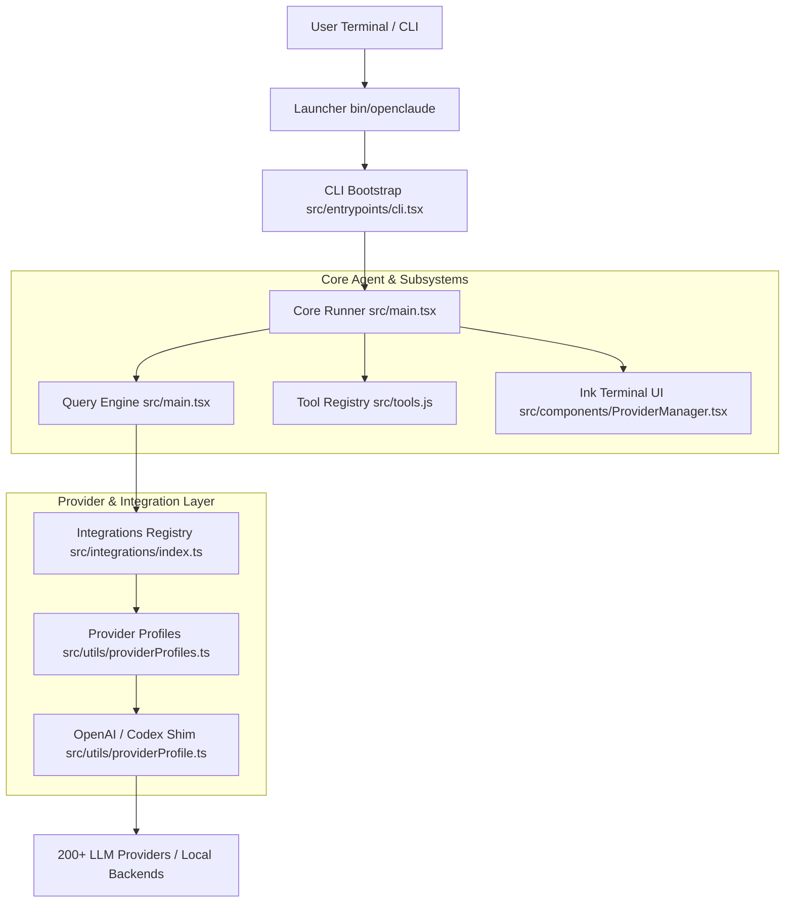
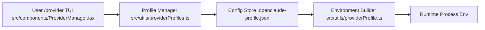

# Overview

Relevant source files

The following files were used as context for generating this wiki page:

- [.env.example](.env.example)
- [.github/workflows/release.yml](.github/workflows/release.yml)
- [.node-version](.node-version)
- [.nvmrc](.nvmrc)
- [.release-please-manifest.json](.release-please-manifest.json)
- [CHANGELOG.md](CHANGELOG.md)
- [README.md](README.md)
- [bun.lock](bun.lock)
- [docs/advanced-setup.md](docs/advanced-setup.md)
- [package.json](package.json)
- [release-please-config.json](release-please-config.json)
- [scripts/build.ts](scripts/build.ts)
- [scripts/externals.ts](scripts/externals.ts)
- [src/components/ProviderManager.test.tsx](src/components/ProviderManager.test.tsx)
- [src/components/ProviderManager.tsx](src/components/ProviderManager.tsx)
- [src/entrypoints/init.ts](src/entrypoints/init.ts)
- [src/i18n/index.ts](src/i18n/index.ts)
- [src/integrations/compatibility.test.ts](src/integrations/compatibility.test.ts)
- [src/integrations/generated/integrationArtifacts.generated.ts](src/integrations/generated/integrationArtifacts.generated.ts)
- [src/integrations/routeMetadata.test.ts](src/integrations/routeMetadata.test.ts)
- [src/integrations/routeMetadata.ts](src/integrations/routeMetadata.ts)
- [src/utils/envFile.test.ts](src/utils/envFile.test.ts)
- [src/utils/envFile.ts](src/utils/envFile.ts)
- [src/utils/providerFlag.test.ts](src/utils/providerFlag.test.ts)
- [src/utils/providerFlag.ts](src/utils/providerFlag.ts)
- [src/utils/providerProfile.test.ts](src/utils/providerProfile.test.ts)
- [src/utils/providerProfile.ts](src/utils/providerProfile.ts)
- [src/utils/providerProfiles.test.ts](src/utils/providerProfiles.test.ts)
- [src/utils/providerProfiles.ts](src/utils/providerProfiles.ts)
- [src/utils/sentry.test.ts](src/utils/sentry.test.ts)
- [src/utils/sentry.ts](src/utils/sentry.ts)
- [web/public/llms.txt](web/public/llms.txt)
- [web/src/data/partners.ts](web/src/data/partners.ts)

OpenClaude is a fork of Claude Code and an extensible terminal-based coding agent CLI designed to run agentic development workflows across 200+ LLM providers and model backends (including OpenAI, Gemini, DeepSeek, Ollama, Codex OAuth, and local runtimes) [package.json:2-8, README.md:11-13]. It unifies prompt execution, tool orchestration (bash, file editing, grep, web search), Model Context Protocol (MCP) servers, skills, plugins, and custom Ink-based terminal user interfaces under a single runtime environment [README.md:11-12, README.md:120-123].

---

## High-Level Architecture Map

The system boots via launcher scripts that hand off to the CLI entrypoint (`src/entrypoints/cli.tsx`), initialize global configurations and security state, resolve active provider profiles, and mount either the interactive Ink REPL or a headless print/SDK mode [package.json:6-8, src/entrypoints/cli.tsx:1-40].

### Diagram: OpenClaude System Architecture Bridge

Sources: [package.json:6-8](), [src/entrypoints/cli.tsx:1-40](), [src/main.tsx:1-99](), [src/utils/providerProfiles.ts:1-40](), [src/utils/providerProfile.ts:1-45]()

---

## Repository Layout

The codebase is structured around a CLI frontend, integration registry, provider abstraction layer, query orchestration engine, tool framework, and terminal UI renderer.

| Directory / File Path | Core Responsibility |
| :--- | :--- |
| `bin/openclaude` | Executable wrapper setting up Node heap sizes and launching the CLI bundle [package.json:6-8] |
| `src/entrypoints/cli.tsx` | CLI startup sequence, argument routing, and env defaults [src/entrypoints/cli.tsx:1-50] |
| `src/main.tsx` | Main application boot, agent state wiring, and session lifecycle [src/main.tsx:1-100] |
| `src/utils/providerProfiles.ts` | Provider profile persistence, switching, and environment binding [src/utils/providerProfiles.ts:1-99] |
| `src/utils/providerProfile.ts` | Profile environment generation and credentials mapping [src/utils/providerProfile.ts:1-65] |
| `src/components/ProviderManager.tsx` | TUI wizard for onboarding, configuring, and switching providers (`/provider`) [src/components/ProviderManager.tsx:1-142] |
| `docs/advanced-setup.md` | Advanced installation, source setup, and provider integration guides [docs/advanced-setup.md:1-50] |

Sources: [package.json:6-8](), [src/entrypoints/cli.tsx:1-50](), [src/main.tsx:1-100](), [src/utils/providerProfiles.ts:1-99](), [src/utils/providerProfile.ts:1-65](), [src/components/ProviderManager.tsx:1-142](), [docs/advanced-setup.md:1-50]()

---

## Provider & Profile Architecture Bridge

Provider routing and credential management bridge natural-language user intent with concrete gateway endpoints, shims, and environment variables [src/utils/providerProfiles.ts:80-110, src/utils/providerProfile.ts:60-140].

### Diagram: Provider Profile Resolution Flow

Sources: [src/components/ProviderManager.tsx:1-142](), [src/utils/providerProfiles.ts:1-99](), [src/utils/providerProfile.ts:1-65]()

---

## Child Pages

For detailed technical documentation on specific subsystems, refer to the following child pages:

- **1.1. Getting Started & Installation** — Covers install paths (npm, Docker, Termux/Android, VS Code extension), the `bin/openclaude` launcher script, V8 heap options (`--max-old-space-size-percentage`), clean-install verification scripts, and quick-start documentation [package.json:6-27, docs/advanced-setup.md:1-40].
- **1.2. Configuration & Settings** — Details global and project-level configuration schemas, settings files, state transactions, environment file integration, credential secrets storage backends, and comprehensive environment variable references [src/utils/providerProfiles.ts:1-100, src/utils/providerProfile.ts:60-140].
- **1.3. Contributing & Repo Conventions** — Outlines contribution guidelines, `AGENTS.md` instructions, pull request templates, internal development playbooks, and TypeScript/coding conventions [package.json:28-83, README.md:11-25].

Sources: [package.json:6-83](), [docs/advanced-setup.md:1-40](), [src/utils/providerProfiles.ts:1-100](), [src/utils/providerProfile.ts:60-140](), [README.md:11-25]()