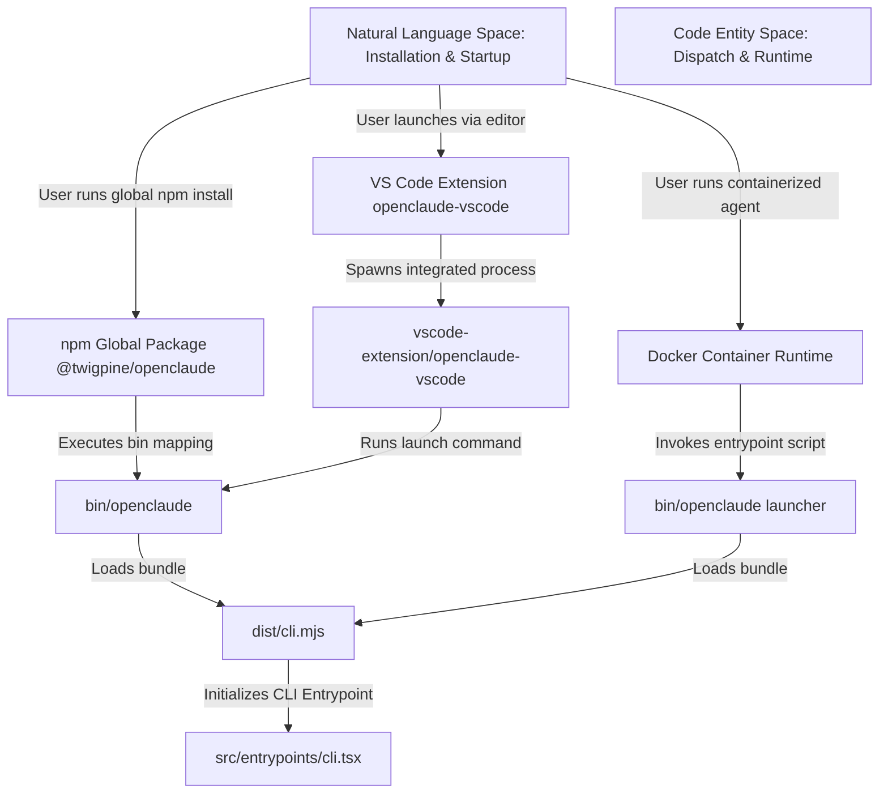
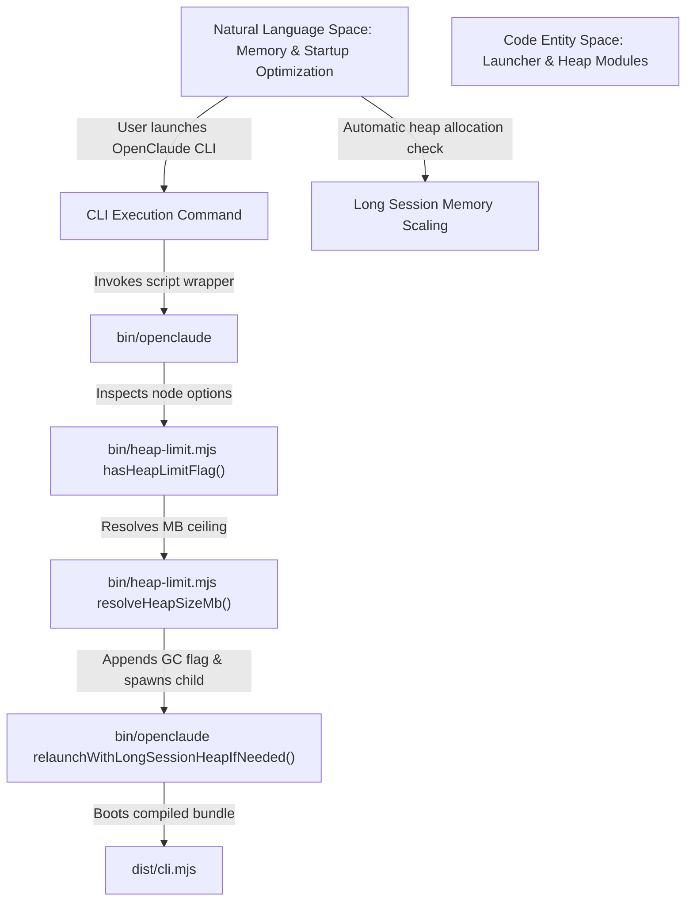

# Getting Started & Installation

<details>
<summary>Relevant source files</summary>

The following files were used as context for generating this wiki page:

- [.github/workflows/install-hygiene.yml](.github/workflows/install-hygiene.yml)
- [PLAYBOOK.md](PLAYBOOK.md)
- [bin/heap-limit.mjs](bin/heap-limit.mjs)
- [bin/openclaude](bin/openclaude)
- [scripts/openclaude-bin-heap.test.ts](scripts/openclaude-bin-heap.test.ts)
- [scripts/provider-bootstrap.ts](scripts/provider-bootstrap.ts)
- [scripts/provider-discovery.ts](scripts/provider-discovery.ts)
- [scripts/provider-launch.ts](scripts/provider-launch.ts)
- [scripts/provider-recommend.ts](scripts/provider-recommend.ts)
- [scripts/system-check.test.ts](scripts/system-check.test.ts)
- [scripts/system-check.ts](scripts/system-check.ts)
- [scripts/verify-clean-install.test.ts](scripts/verify-clean-install.test.ts)
- [scripts/verify-clean-install.ts](scripts/verify-clean-install.ts)
- [src/entrypoints/applyChildProcessHeapOptions.ts](src/entrypoints/applyChildProcessHeapOptions.ts)
- [src/utils/claudeInChrome/launch.test.ts](src/utils/claudeInChrome/launch.test.ts)
- [src/utils/claudeInChrome/launch.ts](src/utils/claudeInChrome/launch.ts)
- [src/utils/claudeInChrome/setup.ts](src/utils/claudeInChrome/setup.ts)
- [src/utils/claudeInChrome/startup.test.ts](src/utils/claudeInChrome/startup.test.ts)
- [src/utils/cliEntrypoint.ts](src/utils/cliEntrypoint.ts)
- [src/utils/doctorDiagnostic.test.ts](src/utils/doctorDiagnostic.test.ts)
- [src/utils/doctorDiagnostic.ts](src/utils/doctorDiagnostic.ts)
- [src/utils/globalPackageManager.test.ts](src/utils/globalPackageManager.test.ts)
- [src/utils/globalPackageManager.ts](src/utils/globalPackageManager.ts)
- [src/utils/nativeDistribution.ts](src/utils/nativeDistribution.ts)
- [src/utils/openclaudeInstallSurfaces.test.ts](src/utils/openclaudeInstallSurfaces.test.ts)
- [src/utils/providerRecommendation.test.ts](src/utils/providerRecommendation.test.ts)
- [src/utils/providerRecommendation.ts](src/utils/providerRecommendation.ts)
- [src/utils/updateStrategy.test.ts](src/utils/updateStrategy.test.ts)
- [src/utils/updateStrategy.ts](src/utils/updateStrategy.ts)

</details>


## Purpose and Scope

This document provides complete technical documentation for installing, booting, and verifying **OpenClaude**. It details the supported installation pathways (npm global packages, Docker containers, Android/Termux environments, and the VS Code companion extension), the behavior of the `bin/openclaude` launcher script [bin/openclaude:1-140]() and its Node.js heap management mechanisms in `bin/heap-limit.mjs`, the clean-install verification pipeline (`scripts/verify-clean-install.ts`) [scripts/verify-clean-install.ts:1-36](), and quick-start operational guides [PLAYBOOK.md:1-25]().

Sources: `bin/openclaude:1-140`, `scripts/verify-clean-install.ts:1-36`, `PLAYBOOK.md:1-25`

---

## 1. Installation Pathways

OpenClaude supports multiple installation paths depending on your operating system and environment. Each path sets up the underlying Node.js runtime and routes execution through the core launcher.

### npm Global Installation

The primary distribution channel for OpenClaude is the npm registry (`@twigpine/openclaude`). 

* **Package Definition**: Defined in `package.json`.
* **Bin Mapping**: Maps the `openclaude` executable directly to `./bin/openclaude` [bin/openclaude:1-8]().
* **Execution**: Installing globally (`npm install -g @twigpine/openclaude@latest`) links the binary into the system `PATH` [scripts/verify-clean-install.ts:2-6]().

### Docker Container

For containerized environments or isolated sandboxes, OpenClaude can be packaged in container runtimes using Node.js 22+ base images, compiling the bundle via build scripts and executing under a non-root `node` user with an entrypoint targeting `node /app/bin/openclaude` [bin/openclaude:1-8]().

### Termux / Android Setup

OpenClaude runs on Android devices via [Termux](https://termux.dev/), utilizing Node.js installed within the Termux package prefix. Terminal navigation and tool execution mirror standard Linux environments, provided `git` and `ripgrep` packages are present in Termux.

### VS Code Extension Companion

The companion extension (`openclaude-vscode`) provides a project-aware launch mechanism, Control Center webview, and secret storage configurations [vscode-extension/openclaude-vscode/package.json:1-32]().

* **Extension Manifest**: Located at `vscode-extension/openclaude-vscode/package.json` [vscode-extension/openclaude-vscode/package.json:1-8]().
* **Activation Events & Commands**: Activates on startup or commands such as `openclaude.start` and `openclaude.openControlCenter` [vscode-extension/openclaude-vscode/package.json:14-74]().

### Natural Language to Code Entity Mapping: Installation & Boot Architecture


Sources: `bin/openclaude:1-140`, `scripts/verify-clean-install.ts:1-55`, `vscode-extension/openclaude-vscode/package.json:1-74`

---

## 2. The Launcher Script & Heap Options

The executable script `bin/openclaude` serves as the front door for all CLI invocations [bin/openclaude:1-140]().

### Boot Sequence and Heap Management

1. **Existence Check**: It verifies whether `dist/cli.mjs` exists [bin/openclaude:27,123](). If missing, it halts execution and instructs the user to build or run development mode [bin/openclaude:127-140]().
2. **Compile Cache**: Enables Node.js compile caching if available via `enableNodeCompileCacheIfAvailable()` [bin/openclaude:14,125]().
3. **Heap Relaunch (`bin/heap-limit.mjs`)**: Long interactive sessions and large context windows require increased memory thresholds. The launcher inspects current Node execution arguments and environment flags via helper functions in `bin/heap-limit.mjs` [bin/openclaude:15-24,60-66]().
4. **Explicit GC**: If `--expose-gc` is missing from `process.execArgv`, the launcher appends it to permit manual garbage collection during intensive prompt evaluations [bin/openclaude:62,83-85]().
5. **Process Relaunch**: It spawns a new Node child process (`spawnSync`) passing resolved heap limits (e.g., `--max-old-space-size`), `--expose-gc`, and setting `OPENCLAUDE_HEAP_RELAUNCHED=1` to prevent infinite relaunch loops [bin/openclaude:103-113]().

### Natural Language to Code Entity Mapping: Launcher Heap Relaunch Flow


Sources: `bin/openclaude:1-141`, `bin/heap-limit.mjs`

Sources: `bin/openclaude:1-141`, `bin/heap-limit.mjs`

---

## 3. Clean-Install Verification & Release Hygiene

To ensure pristine global installations without unexpected warning chatter, deprecation notices, or broken transitive dependencies, OpenClaude incorporates a rigorous validation pipeline (`scripts/verify-clean-install.ts`) [scripts/verify-clean-install.ts:1-36]().

### Verification Script (`scripts/verify-clean-install.ts`)

* **Purpose**: Acts as the runtime half of the installation hygiene contract [scripts/verify-clean-install.ts:1-6]().
* **Scenarios**: Executes two throwaway global installation scenarios with cold caches:
  1. `cold`: Fresh global installation of the packed tarball or published package [scripts/verify-clean-install.ts:15-16]().
  2. `upgrade`: Installs a previously published version, then installs the target version over it [scripts/verify-clean-install.ts:16-19]().
* **Strict Whitelisting**: Any unexpected line on `stderr` (such as `npm warn`, deprecation flags, or funding notices) fails the verification pipeline [scripts/verify-clean-install.ts:21-25]().
* **Bundle Smoke Testing**: Verifies that `--version` and `--help` execute successfully with zero stderr output [scripts/verify-clean-install.ts:27-30]().

### CI/CD Workflow (`.github/workflows/install-hygiene.yml`)

The automated daily install-hygiene workflow verifies real published artifacts against live registries across multiple Node.js environments and OS matrices [,.github/workflows/install-hygiene.yml:1-53]():
* **Schedule**: Runs daily via cron triggers to catch upstream dependency deprecations or registry drift [,.github/workflows/install-hygiene.yml:16-18]().
* **Matrix Validation**: Executes `bun run scripts/verify-clean-install.ts --published` across Ubuntu, macOS, and Windows with Node 22 and 24 [,.github/workflows/install-hygiene.yml:24-53]().

Sources: `scripts/verify-clean-install.ts:1-100`, `.github/workflows/install-hygiene.yml:1-53`

---

## 4. Quick-Start & Operational Guidance

Users can jump into OpenClaude using local provider initialization scripts, startup presets, and runtime verification tools.

### Quick Start & Local Profile Setup

Initialize a local profile (e.g., using Ollama or OpenAI) via the bootstrap script:

```bash
bun run profile:init -- --provider ollama --model llama3.1:8b
```

Alternatively, let OpenClaude recommend the best local model for your goal [PLAYBOOK.md:33-51]():

```bash
bun run profile:init -- --provider ollama --goal coding
```

### Daily Start Shortcuts & Presets

| Command | Action / Preset Focus |
| :--- | :--- |
| `bun run dev:profile` | Launches OpenClaude using the persisted `.openclaude-profile.json` profile [PLAYBOOK.md:12-18]() |
| `bun run dev:fast` | Low latency preset (disables heavy background tasks and auto-compaction) [PLAYBOOK.md:20-25]() |
| `bun run dev:code` | Better coding quality preset [PLAYBOOK.md:26-29]() |
| `bun run doctor:runtime` | Runs runtime health and configuration checks [PLAYBOOK.md:60-63]() |

Sources: `PLAYBOOK.md:1-96`, `scripts/provider-bootstrap.ts:1-195`, `scripts/provider-launch.ts:1-180`