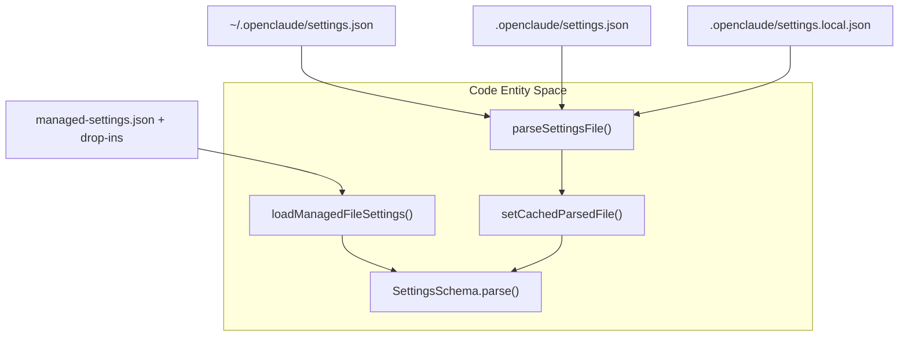
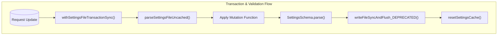
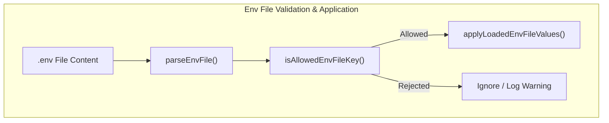
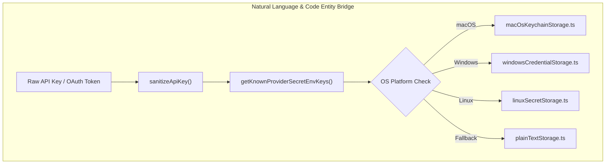

# Configuration & Settings

Relevant source files

The following files were used as context for generating this wiki page:

- [src/services/api/agentRouting.test.ts](src/services/api/agentRouting.test.ts)
- [src/services/api/agentRouting.ts](src/services/api/agentRouting.ts)
- [src/services/settingsSync/index.ts](src/services/settingsSync/index.ts)
- [src/services/settingsSync/settings.transaction.test.ts](src/services/settingsSync/settings.transaction.test.ts)
- [src/test/fixtures/settingsTransactionWriter.fixture.ts](src/test/fixtures/settingsTransactionWriter.fixture.ts)
- [src/tools/shared/spawnMultiAgent.ts](src/tools/shared/spawnMultiAgent.ts)
- [src/utils/cleanup.test.ts](src/utils/cleanup.test.ts)
- [src/utils/cleanup.ts](src/utils/cleanup.ts)
- [src/utils/effort.test.ts](src/utils/effort.test.ts)
- [src/utils/geminiCredentials.test.ts](src/utils/geminiCredentials.test.ts)
- [src/utils/model/modelSupportOverrides.ts](src/utils/model/modelSupportOverrides.ts)
- [src/utils/providerSecrets.test.ts](src/utils/providerSecrets.test.ts)
- [src/utils/providerSecrets.ts](src/utils/providerSecrets.ts)
- [src/utils/secureStorage/fallbackStorage.ts](src/utils/secureStorage/fallbackStorage.ts)
- [src/utils/secureStorage/linuxSecretStorage.ts](src/utils/secureStorage/linuxSecretStorage.ts)
- [src/utils/secureStorage/macOsKeychainHelpers.ts](src/utils/secureStorage/macOsKeychainHelpers.ts)
- [src/utils/secureStorage/macOsKeychainStorage.ts](src/utils/secureStorage/macOsKeychainStorage.ts)
- [src/utils/secureStorage/plainTextStorage.ts](src/utils/secureStorage/plainTextStorage.ts)
- [src/utils/secureStorage/platformStorage.test.ts](src/utils/secureStorage/platformStorage.test.ts)
- [src/utils/secureStorage/windowsCredentialStorage.ts](src/utils/secureStorage/windowsCredentialStorage.ts)
- [src/utils/settings/settings.transaction.test.ts](src/utils/settings/settings.transaction.test.ts)
- [src/utils/settings/settings.ts](src/utils/settings/settings.ts)
- [src/utils/settings/settingsFileTransaction.ts](src/utils/settings/settingsFileTransaction.ts)
- [src/utils/settings/types.ts](src/utils/settings/types.ts)
- [src/utils/status.test.ts](src/utils/status.test.ts)
- [src/utils/status.tsx](src/utils/status.tsx)
- [src/utils/statusRedaction.test.ts](src/utils/statusRedaction.test.ts)

## Purpose & Scope
This page covers the configuration and settings architecture of OpenClaude. It details how global and project-level settings files are structured, how atomic settings transactions are managed through validation schemas, how `.env` files are safely parsed against strict whitelists, how provider secrets and environment keys are redacted and handled, and how credentials are securely stored using OS-native backends (such as Windows DPAPI, macOS Keychain, and Linux Secret Service).

---

## 1. Configuration Files & Hierarchy
OpenClaude loads configuration from a strict hierarchy of user, project, local, and managed paths. Lower-precedence files provide baseline defaults, while local overrides, environment variables, and managed enterprise policies take precedence.

The core configuration paths and scopes defined by the codebase are summarized below:

| File Path | Scope | Notes |
| :--- | :--- | :--- |
| `~/.openclaude/settings.json` | User | Default global settings for all projects; relocatable via `OPENCLAUDE_CONFIG_DIR` [web/src/data/configuration.ts:9-14](). |
| `.openclaude/settings.json` | Project | Shared project settings committed to version control [web/src/data/configuration.ts:15-19](). |
| `.openclaude/settings.local.json` | Local | Per-machine overrides for a specific project; typically gitignored [web/src/data/configuration.ts:20-24](). |
| `~/.openclaude/keybindings.json` | User | Keyboard shortcut customization mappings [web/src/data/configuration.ts:25-29](). |
| `CLAUDE.md / .claude/CLAUDE.md` | Project | Project instructions injected into session context [web/src/data/configuration.ts:30-35](). |
| `managed-settings.json` + `managed-settings.d/*.json` | Managed / Enterprise | Admin-enforced policies loaded via system drop-in directories [src/utils/settings/settings.ts:61-124](). |

### Configuration Merge and Resolution Pipeline
The following diagram bridges natural language configuration sources to code entity parsing functions (`parseSettingsFile`, `loadManagedFileSettings`) and schema validators (`SettingsSchema`):

**Sources:** `web/src/data/configuration.ts:9-35`, `src/utils/settings/settings.ts:61-124`, `src/utils/settings/types.ts`

---

## 2. Settings Files & Atomic Transactions
To prevent race conditions and partial writes when multiple processes or asynchronous operations update configuration files, OpenClaude utilizes synchronized file transactions.

File updates are wrapped via `withSettingsFileTransactionSync` (`src/utils/settings/settingsFileTransaction.ts`), which acquires file locks, reads the latest configuration, applies mutations, validates against Zod validation schemas (`src/utils/settings/types.ts`), and writes atomically. Caching mechanisms in `src/utils/settings/settingsCache.ts` maintain parsed instances in memory to optimize subsequent reads.

### Zod Schema Validation & Model Pricing
Settings are validated using comprehensive Zod structures (`src/utils/settings/types.ts`), including `PermissionsSchema` for allow/deny/ask rules and `ModelPricingSchema` which normalizes custom pricing metadata:

**Sources:** `src/utils/settings/settings.ts:48`, `src/utils/settings/types.ts`, `src/utils/settings/settingsCache.ts`, `src/utils/file.ts:17`

---

## 3. Environment File Parsing (`.env`)
OpenClaude supports loading environment variables from `.env` files using `parseEnvFile` and `loadEnvFile` (`src/utils/envFile.ts`). The parser supports standard `KEY=VALUE`, double quotes (`"VAL"`), single quotes (`'VAL'`), `export` prefixes, and inline comments (`#`), while strictly rejecting unescaped multiline quotes or malformed syntax [src/utils/envFile.ts:234-243]().

### Security Whitelist
To protect against accidental credential leakage or privilege escalation from arbitrary `.env` files, environment keys are validated against `ALLOWED_ENV_FILE_KEYS` and `ALLOWED_ENV_FILE_PREFIXES` [src/utils/envFile.ts:5-150](). Only explicitly recognized provider credentials, gateway tokens, and web search configurations are permitted.

**Sources:** `src/utils/envFile.ts:5-161`, `src/utils/envFile.test.ts:1-215`

---

## 4. Secrets, Redaction & Secure Storage
Provider secrets (such as API keys and OAuth tokens) are identified dynamically through integration descriptors (`PROVIDER_PRESET_MANIFEST`, `VENDOR_DESCRIPTORS`, `GATEWAY_DESCRIPTORS`) and cached known secret keys via `getKnownProviderSecretEnvKeys()` [src/utils/providerSecrets.ts:13-80]().

### Secret Redaction & Sanitization
Values entering status displays or diagnostics are sanitized using `sanitizeApiKey` and redacted using `redactSecretValueForDisplay` and `redactConfiguredSecretSubstrings` to prevent key exposure [src/utils/status.tsx:114-210](). Heuristic prefixes (`sk-`, `AIza`, `ghp_`, etc.) and JWT/opaque token detectors (`looksLikeSecretValue`) catch unlabelled secrets [src/utils/providerSecrets.ts:109-184]().

### Platform Secure Storage Routing
For persistent storage of sensitive credentials, OpenClaude delegates to platform-native secure storage backends:
* **macOS**: Keychain Services via `macOsKeychainStorage.ts`
* **Windows**: DPAPI protected file storage (`windowsCredentialStorage.ts`) with legacy `PasswordVault` fallback via `OPENCLAUDE_ENABLE_LEGACY_WINDOWS_PASSWORDVAULT` [src/utils/secureStorage/windowsCredentialStorage.ts:33-35]()
* **Linux**: Secret Service API (`secret-tool`) via `linuxSecretStorage.ts`
* **Fallback**: Encrypted or constrained local file storage via `plainTextStorage.ts` or `fallbackStorage.ts`

**Sources:** `src/utils/providerSecrets.ts:13-140`, `src/utils/secureStorage/platformStorage.test.ts:1-114`, `src/utils/secureStorage/windowsCredentialStorage.ts:1-40`, `src/utils/status.tsx:114-139`

---

## 5. Environment Variable & Override Reference
Below is a reference of primary configuration and credential environment variables supported across OpenClaude, alongside advanced per-agent routing configuration (`agentModels` and `agentRouting` in `src/services/api/agentRouting.ts`):

| Environment Variable / Config | Description |
| :--- | :--- |
| `ANTHROPIC_API_KEY` | Anthropic API key (required in `--bare` mode) [web/src/data/configuration.ts:68](). |
| `OPENAI_API_KEY` | Primary API key for OpenAI-compatible providers and gateways [web/src/data/configuration.ts:71](). |
| `OPENAI_API_KEYS` | Comma-separated key pool for OpenAI-compatible endpoints; rotates on failure [web/src/data/configuration.ts:72](). |
| `OPENAI_BASE_URL` | Base URL of an OpenAI-compatible `/v1` endpoint [web/src/data/configuration.ts:73](). |
| `OPENCLAUDE_CONFIG_DIR` | Preferred configuration directory override. Defaults to `~/.openclaude` [web/src/data/configuration.ts:90](). |
| `CLAUDE_CONFIG_DIR` | Legacy configuration directory override (used only when `OPENCLAUDE_CONFIG_DIR` is unset) [web/src/data/configuration.ts:91](). |
| `GEMINI_API_KEY` | Google Gemini API key [web/src/data/configuration.ts:79](). |
| `XAI_API_KEY` | xAI Grok API key [web/src/data/configuration.ts:80](). |
| `NVIDIA_API_KEY` | NVIDIA NIM API key [web/src/data/configuration.ts:85](). |
| `BASH_MAX_OUTPUT_LENGTH` | Max characters of shell output shown inline before truncation (default 30,000) [web/src/data/configuration.ts:92](). |
| `agentModels` / `agentRouting` | Settings dictionary mapping subagents or route names to cross-provider endpoints and models [src/services/api/agentRouting.ts:38-146](). |

**Sources:** `web/src/data/configuration.ts:67-92`, `src/utils/envFile.ts:5-145`, `src/services/api/agentRouting.ts:38-146`