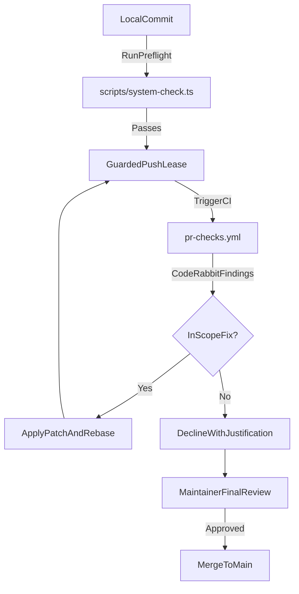
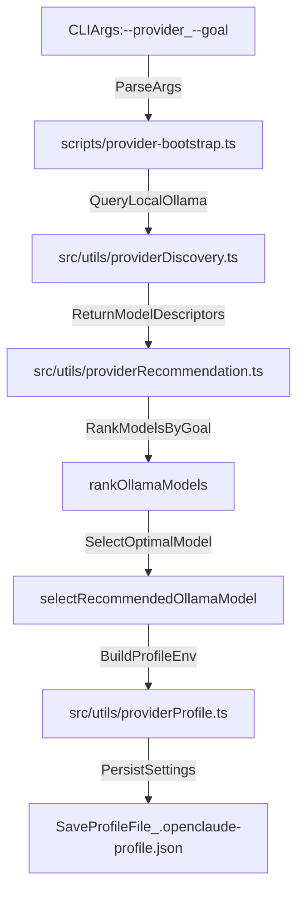

# Contributing & Repo Conventions

<details>
<summary>Relevant source files</summary>

The following files were used as context for generating this wiki page:

- [.github/ISSUE_TEMPLATE/config.yml](.github/ISSUE_TEMPLATE/config.yml)
- [.github/pull_request_template.md](.github/pull_request_template.md)
- [.github/workflows/pr-checks.yml](.github/workflows/pr-checks.yml)
- [AGENTS.md](AGENTS.md)
- [ANDROID_INSTALL.md](ANDROID_INSTALL.md)
- [CONTRIBUTING.md](CONTRIBUTING.md)
- [scripts/pr-intent-scan.test.ts](scripts/pr-intent-scan.test.ts)
- [scripts/pr-intent-scan.ts](scripts/pr-intent-scan.ts)
- [src/assistant/sessionHistory.test.ts](src/assistant/sessionHistory.test.ts)
- [src/assistant/sessionHistory.ts](src/assistant/sessionHistory.ts)
- [src/assistant/sessionHistorySerialization.ts](src/assistant/sessionHistorySerialization.ts)
- [src/integrations/generated/integrationManifest.generated.ts](src/integrations/generated/integrationManifest.generated.ts)
- [src/utils/conversationCache.test.ts](src/utils/conversationCache.test.ts)
- [src/utils/conversationCache.ts](src/utils/conversationCache.ts)
- [src/utils/sessionPersistence.test.ts](src/utils/sessionPersistence.test.ts)
- [src/utils/sessionPersistence.ts](src/utils/sessionPersistence.ts)
- [web/astro.config.mjs](web/astro.config.mjs)
- [web/public/robots.txt](web/public/robots.txt)
- [web/scripts/verify-dist.test.ts](web/scripts/verify-dist.test.ts)
- [web/scripts/verify-dist.ts](web/scripts/verify-dist.ts)
- [web/src/components/DocsSidebar.astro](web/src/components/DocsSidebar.astro)
- [web/src/components/Footer.astro](web/src/components/Footer.astro)
- [web/src/components/Nav.astro](web/src/components/Nav.astro)
- [web/src/data/commands.ts](web/src/data/commands.ts)
- [web/src/data/configuration.ts](web/src/data/configuration.ts)
- [web/src/data/docsNav.ts](web/src/data/docsNav.ts)
- [web/src/data/providers.ts](web/src/data/providers.ts)
- [web/src/data/site.ts](web/src/data/site.ts)
- [web/src/pages/docs/index.astro](web/src/pages/docs/index.astro)
- [web/src/pages/index.astro](web/src/pages/index.astro)
- [web/vercel.json](web/vercel.json)

</details>


This page details the contributor policies, AI coding agent guidelines (`AGENTS.md`), pull request requirements, repository layout, validation contracts, and local development playbooks for OpenClaude. The project prioritizes core stability, performance, and predictable execution over broad feature additions `[CONTRIBUTING.md:1-6]()`.

---

## 1. Contributor Policy & Feature Proposals

Before implementing code modifications, contributors must review both `CONTRIBUTING.md` and `AGENTS.md` `[CONTRIBUTING.md:48-53]()`. Because OpenClaude maintains a strict, maintainer-directed roadmap focused on runtime reliability, new features require prior alignment via GitHub issues `[CONTRIBUTING.md:36-46]()`.

* **Issue-First Workflow**: For any non-trivial enhancement or breaking architectural change, open an issue first to verify alignment with current release targets `[CONTRIBUTING.md:33-46]()`.
* **Duplicate Prevention**: Inspect open and recently closed pull requests before submitting changes; overlapping PRs without prior coordination may be closed without review `[CONTRIBUTING.md:29-31]()`.
* **Scope Discipline**: Keep branches narrowly scoped to a single issue or targeted improvement `[CONTRIBUTING.md:55]()` and avoid unrelated refactoring, renames, or dependency additions `[AGENTS.md:13-15]()`.

Sources: `[CONTRIBUTING.md:1-46]()`, `[AGENTS.md:11-18]()`

---

## 2. Pull Request Lifecycle & Branch Hygiene

Every pull request must contain a complete description following the repository template `[.github/pull_request_template.md:1-22]()`. 

### PR Submission Requirements
PR descriptions must explicitly confirm review of contribution guidelines, summarize the exact technical changes, state user/developer impact, record the execution output of local validation checks, and link any associated issues using keywords like `Fixes #123` `[CONTRIBUTING.md:58-64]()`. PRs modifying UI components must include visual screenshots `[.github/pull_request_template.md:21]()`.

### Automated Review Protocol (CodeRabbit)
OpenClaude utilizes CodeRabbit for automated PR analysis `[CONTRIBUTING.md:72-74]()`. 
* Authors must address automated findings rather than waiting for human overrides `[CONTRIBUTING.md:76]()`.
* Every suggestion must be verified against the PR's stated intent `[CONTRIBUTING.md:78]`. If a finding forces architectural drift or touches out-of-scope code surfaces, it may be declined with a concise justification in the review thread `[CONTRIBUTING.md:78-83]()`.

### Branch Synchronization & Guarded Pushes
Contributors must keep their feature branches synchronized with `main` by rebasing before pushing follow-up revisions `[CONTRIBUTING.md:85-89]()`. To avoid race conditions and accidental overwrites of remote updates, force-pushes must always employ an explicit commit hash lease `[CONTRIBUTING.md:90-95]()`:

```bash
git push --force-with-lease=refs/heads/<pr-branch>:<recorded-pr-head-sha> <pr-remote> HEAD:refs/heads/<pr-branch>
```

Title: "PR Review and Validation Lifecycle"

Sources: `[CONTRIBUTING.md:48-100]()`, `[.github/pull_request_template.md:1-23]`, `[.github/workflows/pr-checks.yml:1-51]()`, `[AGENTS.md:49-88]()`

---

## 3. AI Coding Agent Guidance (`AGENTS.md`)

AI agents contributing to the repository must adhere to specific runtime and architectural standards `[AGENTS.md:1-4]()`.

### Stack Constraints & Tooling
* **Runtime**: Node.js `>=22.0.0` for built CLI execution `[AGENTS.md:9]()`.
* **Package Manager / Runner**: Bun is strictly required for source builds, dependency management, scripts, and test suites `[AGENTS.md:9]()`.
* **Language & Paradigm**: TypeScript in strict mode with explicit ESM imports `[AGENTS.md:24]()`.
* **UI Framework**: React and Ink (`src/components/`) for terminal user interfaces `[AGENTS.md:25]()`.

### Repository Map
The codebase is structured into discrete domain directories `[AGENTS.md:36-48]()`:

| Directory | Primary Responsibility | Code Entities |
| :--- | :--- | :--- |
| `src/commands/` | Slash and CLI command entrypoints | Command handlers, argument definitions |
| `src/components/` | Terminal UI layout and renderers | React/Ink components, REPL layout |
| `src/services/` | External integrations and core loops | API clients, MCP connection managers |
| `src/tools/` | Executable agent tools | `BashTool`, `FileTools`, `WebSearchTool` |
| `src/utils/` | Shared utilities and helpers | Tokenizers, configuration parsers, encryption |
| `src/integrations/` | Metadata for vendors, models, and routes | Model registries, gateway descriptors |
| `src/entrypoints/` | Public SDK boundaries and runners | CLI bootstrap (`main.tsx`), SDK types |
| `src/tasks/` | Background tasks and workflow engines | Monitor loops, swarm spawn utilities |

Sources: `[AGENTS.md:1-48]()`

---

## 4. Validation & Pre-Push Contracts

Before pushing modifications to a pull request, developers must execute the local validation suite `[AGENTS.md:49-51]()`. While CI checks (`.github/workflows/pr-checks.yml`) provide clean-runner and OS-matrix coverage, local pre-flight checks prevent basic syntax and test regressions `[AGENTS.md:20]()`.

### Core Validation Commands
```bash
bun install --frozen-lockfile
bun run build
bun run check
bun run typecheck
bun run typecheck:type-tests
```
`[.github/workflows/pr-checks.yml:37-41]()`, `[AGENTS.md:55-62]()`

### Diagnostic Checks & Security Scans
```bash
bun run doctor:runtime
bun run security:pr-scan
```
`[.github/workflows/pr-checks.yml:47-51]()`, `[AGENTS.md:83-85]()`

Sources: `[.github/workflows/pr-checks.yml:1-136]()`, `[AGENTS.md:49-88]()`

---

## 5. Provider Recommendation & Initialization Architecture

When initializing or bootstrapping provider profiles (`scripts/provider-bootstrap.ts`), OpenClaude uses an automated recommendation engine (`src/utils/providerRecommendation.ts`) to score and rank local models based on performance goals (`latency`, `balanced`, or `coding`) `[src/utils/providerRecommendation.ts:1-252]()`.

Title: "Provider Initialization and Recommendation Data Flow"

Sources: `[src/utils/providerRecommendation.ts:1-252]()`, `[web/src/data/providers.ts:1-407]()`

### Recommendation Heuristics
The ranking engine inspects model metadata fields (such as parameter size strings and quantization tags via `modelHaystack()`) to filter out non-chat models like embedding engines (`isViableOllamaChatModel`) `[src/utils/providerRecommendation.ts:46-64]()`. Depending on the active `RecommendationGoal`, parameter tiers and family hints adjust scoring weights `[src/utils/providerRecommendation.ts:88-175]()`:
* **`latency`**: Favors tiny or small parameter thresholds (`<=4B` or `<=8B`) for immediate token generation `[src/utils/providerRecommendation.ts:98-106]()`.
* **`coding`**: Prioritizes coding-oriented families (`qwen2.5-coder`, `codestral`, `devstral`) within optimal model sizing tiers `[src/utils/providerRecommendation.ts:119-134]`, `[src/utils/providerRecommendation.ts:165-188]()`.
* **`balanced`**: Balances general model families (`llama`, `mistral`, `gemma`) aiming near `14B` sizing benchmarks `[src/utils/providerRecommendation.ts:34-41]`, `[src/utils/providerRecommendation.ts:136-154]`, `[src/utils/providerRecommendation.ts:197]()`.

Sources: `[src/utils/providerRecommendation.ts:1-252]()`, `[web/src/data/providers.ts:1-407]()`