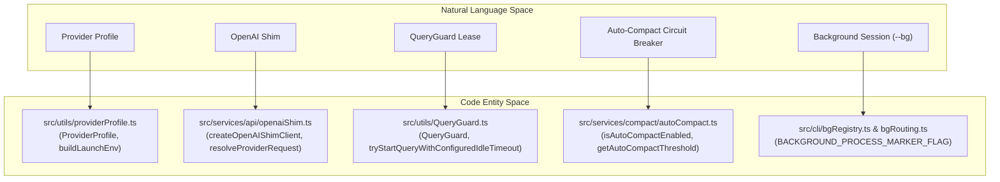
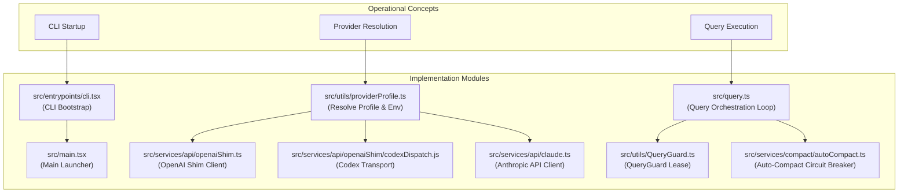

# Glossary

Relevant source files

The following files were used as context for generating this wiki page:

- [.env.example](.env.example)
- [README.md](README.md)
- [docs/advanced-setup.md](docs/advanced-setup.md)
- [docs/integrations/how-to/add-gateway.md](docs/integrations/how-to/add-gateway.md)
- [docs/integrations/overview.md](docs/integrations/overview.md)
- [src/Tool.ts](src/Tool.ts)
- [src/commands/model/model.test.tsx](src/commands/model/model.test.tsx)
- [src/commands/model/model.tsx](src/commands/model/model.tsx)
- [src/commands/provider/provider.test.tsx](src/commands/provider/provider.test.tsx)
- [src/commands/provider/provider.tsx](src/commands/provider/provider.tsx)
- [src/components/ProviderManager.test.tsx](src/components/ProviderManager.test.tsx)
- [src/components/ProviderManager.tsx](src/components/ProviderManager.tsx)
- [src/components/Settings/Config.tsx](src/components/Settings/Config.tsx)
- [src/components/Settings/queryIdleTimeoutConfig.test.ts](src/components/Settings/queryIdleTimeoutConfig.test.ts)
- [src/components/Settings/queryIdleTimeoutSetting.ts](src/components/Settings/queryIdleTimeoutSetting.ts)
- [src/integrations/compatibility.test.ts](src/integrations/compatibility.test.ts)
- [src/integrations/descriptors.ts](src/integrations/descriptors.ts)
- [src/integrations/discoveryService.test.ts](src/integrations/discoveryService.test.ts)
- [src/integrations/discoveryService.ts](src/integrations/discoveryService.ts)
- [src/integrations/generated/integrationArtifacts.generated.ts](src/integrations/generated/integrationArtifacts.generated.ts)
- [src/integrations/routeMetadata.test.ts](src/integrations/routeMetadata.test.ts)
- [src/integrations/routeMetadata.ts](src/integrations/routeMetadata.ts)
- [src/integrations/runtimeMetadata.test.ts](src/integrations/runtimeMetadata.test.ts)
- [src/integrations/runtimeMetadata.ts](src/integrations/runtimeMetadata.ts)
- [src/screens/REPL.queryLifecycle.test.ts](src/screens/REPL.queryLifecycle.test.ts)
- [src/screens/REPL.tsx](src/screens/REPL.tsx)
- [src/services/api/bootstrap.test.ts](src/services/api/bootstrap.test.ts)
- [src/services/api/bootstrap.ts](src/services/api/bootstrap.ts)
- [src/services/api/codexShim.test.ts](src/services/api/codexShim.test.ts)
- [src/services/api/codexShim.ts](src/services/api/codexShim.ts)
- [src/services/api/openaiShim.test.ts](src/services/api/openaiShim.test.ts)
- [src/services/api/openaiShim.ts](src/services/api/openaiShim.ts)
- [src/services/api/providerConfig.local.test.ts](src/services/api/providerConfig.local.test.ts)
- [src/services/api/providerConfig.ts](src/services/api/providerConfig.ts)
- [src/services/compact/compact.ts](src/services/compact/compact.ts)
- [src/tools/AgentTool/runAgent.routing.test.ts](src/tools/AgentTool/runAgent.routing.test.ts)
- [src/utils/QueryGuard.test.ts](src/utils/QueryGuard.test.ts)
- [src/utils/QueryGuard.ts](src/utils/QueryGuard.ts)
- [src/utils/config.ts](src/utils/config.ts)
- [src/utils/effort.codex.test.ts](src/utils/effort.codex.test.ts)
- [src/utils/effort.ts](src/utils/effort.ts)
- [src/utils/envFile.test.ts](src/utils/envFile.test.ts)
- [src/utils/envFile.ts](src/utils/envFile.ts)
- [src/utils/forkedAgent.ts](src/utils/forkedAgent.ts)
- [src/utils/providerFlag.test.ts](src/utils/providerFlag.test.ts)
- [src/utils/providerFlag.ts](src/utils/providerFlag.ts)
- [src/utils/providerProfile.test.ts](src/utils/providerProfile.test.ts)
- [src/utils/providerProfile.ts](src/utils/providerProfile.ts)
- [src/utils/providerProfiles.test.ts](src/utils/providerProfiles.test.ts)
- [src/utils/providerProfiles.ts](src/utils/providerProfiles.ts)
- [src/utils/queryGuardConfig.test.ts](src/utils/queryGuardConfig.test.ts)
- [src/utils/queryGuardConfig.ts](src/utils/queryGuardConfig.ts)
- [src/utils/queryLifecycle.ts](src/utils/queryLifecycle.ts)
- [web/src/data/partners.ts](web/src/data/partners.ts)

This page provides full technical definitions, jargon, OpenClaude-specific terminology, and environment variable references used across the codebase, complete with precise code pointers and architectural mappings.

---

## 1. Core Architectural & System Terms

### Provider Profile
A named, persisted configuration block (stored in `.openclaude-profile.json` or managed via the TUI) that defines which backend provider, base URL, model, and auth scheme the CLI should use [src/utils/providerProfile.ts:55-176](). Profiles map user-friendly labels (e.g., `openai`, `gemini`, `ollama`, `xai`) directly to runtime environment variables via launchers and profile injectors [src/utils/providerProfiles.ts:1-2352]().

### Capability Route
A resolved operational path within the integration layer that dictates request schemas, protocol shims (such as Anthropic-to-OpenAI translation), and supported features (like thinking effort levels or tool streaming) for a given model or endpoint [src/integrations/routeMetadata.ts:1-100]().

### OpenAI Shim
The network boundary layer (`src/services/api/openaiShim.ts`) that intercepts Anthropic SDK message requests (`anthropic.beta.messages.create`) and translates them on-the-fly into OpenAI-compatible chat completion payloads or streamed SSE chunks, letting the rest of OpenClaude operate agnostically across 200+ third-party LLM vendors [src/services/api/openaiShim.ts:1-100]().

### Codex Transport
The specialized dispatch logic (`src/services/api/codexShim.ts` and `src/services/api/openaiShim/codexDispatch.js`) designed to route requests to Codex/ChatGPT endpoints using OAuth tokens (`~/.codex/auth.json`) or `CODEX_API_KEY`, supporting high-reasoning parameter structures and strict schema sanitization [src/services/api/openaiShim.ts:60-67]().

### Reasoning Effort
A parameter governing model "thinking" depth or effort level (e.g., `low`, `medium`, `high`, `max`), passed either through model options or environment settings (`--effort`, `CLAUDE_CODE_OPENAI_CONTEXT_WINDOWS`) to control reasoning token budgets on supported models [src/utils/effort.ts:1-100]().

### Discovery Cache
A caching subsystem (`src/integrations/discoveryService.ts`) that probes remote `/v1/models` endpoints or parses hybrid model catalogs to dynamically populate available model lists, pricing metadata, and token limits for active provider routes.

### QueryGuard Lease
A resource lock managed by `QueryGuard` (`src/utils/QueryGuard.ts`) that enforces turn timeouts, abort signals, and execution safety invariants during active agent turn loops, preventing orphan loops or runaway background generation tasks.

### Generation
A discrete sequence iteration or response generation step within the query orchestration loop (`src/query.ts`), tracking input/output tokens, tool use executions, and intermediate model handoffs.

### Auto-Compact Circuit Breaker
A fault-protection mechanism (`src/services/compact/autoCompact.ts`) that monitors conversation token usage against safety thresholds and tracks consecutive compaction failures to prevent infinite retry loops or context collapse errors (`MAX_CONSECUTIVE_AUTOCOMPACT_FAILURES`) [src/query.ts:10-15]().

### Micro / Snip Compact
Fine-grained context reduction strategies (`src/services/compact/microCompact.ts`, `src/services/compact/snipCompact.ts`) that selectively prune stale tool outputs, intermediate scratchpads, or redundant message block histories to preserve critical context space without triggering full transcript compaction.

### Background Session (`--bg`)
An isolated detached background process mode managed by the background registry (`src/cli/bgRegistry.ts`) and background router (`src/cli/bgRouting.ts`), allowing coding sessions to run headlessly while tracking state via process markers, logs, and IPC attachments.

### Process Marker
A dedicated flag (`BACKGROUND_PROCESS_MARKER_FLAG`) or validation check (`src/cli/bgRouting.ts`) used to verify that a spawned subprocess belongs to a legitimate OpenClaude background session executor rather than an arbitrary shell invocation [src/main.tsx:50-55]().

### Terminal Facts
Runtime telemetry and dimension metrics regarding the host terminal (such as columns, rows, color support, and focus state) retrieved via Ink hooks and terminal utility modules (`src/ink/terminal.ts`) to adapt REPL layout rendering.

### Skill
An extensible user or system script/tool package located within project directories or skill folders, discovered via `loadSkillsDir` and managed via the `skills` CLI subcommand handler [src/entrypoints/cli.tsx:50-145]().

### Plugin Marketplace
The extension ecosystem registry (`src/services/plugins/`) that handles loading, schema validation, and secure installation of community plugins and command bundles into designated local directories.

### MCP Transport
Model Context Protocol client/server communication channels (`src/services/mcp/`) that support stdio, SSE, and authenticated remote transports for external tool providers.

### Canonical Model Name
The authoritative internal identifier for an LLM (e.g., `gpt-4o`, `claude-sonnet-4-6`), resolved from user-facing aliases or configuration defaults by `model.ts` [src/utils/model/model.ts:1-115]().

### Model Alias
A shorthand keyword (such as `codexplan`, `codexspark`, `deepseek-chat`) mapped to a canonical model name and default configuration profile during model resolution [docs/advanced-setup.md:49-83]().

### Cross-Profile Switch
The capability to switch active provider profiles mid-session or across restarts using the `ProviderManager` TUI or `/provider` commands without losing session transcripts.

### Effort Level
See *Reasoning Effort*.

### 1M Context Tag
An opt-in configuration flag or capability header indicating that an extended context window (up to 1,000,000 tokens) should be requested from supported provider backends.

### Gateway vs Vendor vs Brand
Taxonomical distinctions in the integration metadata registry (`src/integrations/`):
- **Gateway**: The proxy or infrastructure hosting the API endpoint (e.g., OpenRouter, AIMLAPI, Together).
- **Vendor**: The organization creating the foundational model family (e.g., Anthropic, OpenAI, Google, Mistral).
- **Brand**: The user-facing product marketing label associated with a specific model release.

### Hybrid Catalog
A compiled model registry combining static preset configurations with dynamically discovered remote models from active vendor endpoints.

### Time-Boxed Entry
An asynchronous task or network request bound by a strict execution timeout or deadline wrapper (e.g., `fetchWithHeadersDeadline`) to prevent hanging UI states [src/services/api/openaiShim/transport.ts:80-87]().

### YOLO Classifier
A safety classification heuristic or `--dangerously-skip-permissions` / `--yolo` flag mode that bypasses interactive confirmation prompts for filesystem-mutating or bash execution tools [src/entrypoints/cli.tsx:50-60]().

### Swarm
Multi-agent cooperative execution mode (`src/utils/swarm/`) enabling agent-to-agent task delegation, permission synchronization via mailboxes, and teammate synchronization [src/screens/REPL.tsx:45-55]().

### Worktree
Git worktree isolation mode (`src/utils/worktreeModeEnabled.ts`) allowing concurrent agent sessions to operate within separate isolated directory checkouts [src/main.tsx:75-78]().

### Memdir
The localized knowledge and memory directory (`memdir`) used by the agent to persist long-term context, scratchpads, and extracted memory blocks across conversation sessions.

### Attachments
Files, images, or memory documents injected into agent requests via `src/utils/attachments.ts`, supporting token filtering and relevance prefetching [src/query.ts:78-84]().

Sources:
- [src/utils/providerProfile.ts:55-176]()
- [src/utils/providerProfiles.ts:1-2352]()
- [src/integrations/routeMetadata.ts:1-100]()
- [src/services/api/openaiShim.ts:1-100]()
- [src/utils/effort.ts:1-100]()
- [src/integrations/discoveryService.ts:1-50]()
- [src/utils/QueryGuard.ts:1-50]()
- [src/query.ts:10-15]()
- [src/services/compact/autoCompact.ts:1-20]()
- [src/cli/bgRegistry.ts:1-40]()
- [src/main.tsx:50-78]()
- [src/entrypoints/cli.tsx:50-145]()
- [src/utils/model/model.ts:1-115]()
- [docs/advanced-setup.md:49-83]()
- [src/services/api/openaiShim/transport.ts:80-87]()
- [src/screens/REPL.tsx:45-55]()

---

## 2. Natural Language to Code Entity Mapping (Core Subsystems)

The following diagram bridges conceptual system terminology to precise code entities, classes, and source files within the repository.

Sources: [src/utils/providerProfile.ts:1-176](), [src/services/api/openaiShim.ts:1-100](), [src/utils/QueryGuard.ts:1-50](), [src/services/compact/autoCompact.ts:1-20](), [src/cli/bgRouting.ts:1-30]()

---

## 3. Environment Variable Reference

The table below documents key OpenClaude-specific and provider environment variables, their purpose, and their code pointers.

| Environment Variable | Purpose | Code Pointers |
| :--- | :--- | :--- |
| `CLAUDE_CODE_USE_OPENAI=1` | Enables the OpenAI-compatible Shim provider path. | [src/services/api/openaiShim.ts:12-15](), [src/utils/providerProfile.ts:64-70]() |
| `OPENAI_API_KEY` / `OPENAI_API_KEYS` | Primary API key or comma-separated credential pool for rotation. | [src/services/api/openaiShim.ts:13-14](), [src/services/api/credentialPool.ts:1-119]() |
| `OPENAI_BASE_URL` | Overrides the target base URL for OpenAI-compatible gateways. | [src/services/api/openaiShim.ts:19-20](), [src/utils/providerProfile.ts:79-85]() |
| `OPENAI_MODEL` | Sets the default model override for shimmed endpoints. | [src/services/api/openaiShim.ts:20-21]() |
| `CODEX_API_KEY` / `CHATGPT_ACCOUNT_ID` | Authentication credentials for Codex OAuth and ChatGPT backend routes. | [docs/advanced-setup.md:58-69](), [src/utils/providerProfile.ts:92-96]() |
| `CLAUDE_CODE_USE_GEMINI=1` | Enables Google Gemini integration mode. | [src/services/api/openaiShim.test.ts:52-53](), [src/utils/providerProfile.ts:66-68]() |
| `OPENCLAUDE_SMART_ROUTING=1` | Opts in to smart auto-routing of simple turns to cheaper models. | [src/services/api/openaiShim.ts:23-27](), [src/services/api/smartRouting/index.ts:1-164]() |
| `BACKGROUND_SESSION_ID_ENV` | Identifies active background sessions in detached worker runs. | [src/entrypoints/cli.tsx:3-6](), [src/cli/bg.ts:1-50]() |
| `CLAUDE_STREAM_IDLE_TIMEOUT_MS` | Configures the stream reader idle timeout threshold. | [src/services/api/openaiShim/streamControl.ts:1-50]() |

Sources: [src/services/api/openaiShim.ts:12-27](), [src/services/api/credentialPool.ts:1-119](), [docs/advanced-setup.md:58-69](), [src/services/api/openaiShim.test.ts:52-53]()

---

## 4. Execution Pipeline & Routing Mapping

Sources: [src/entrypoints/cli.tsx:1-50](), [src/main.tsx:30-70](), [src/utils/providerProfile.ts:1-100](), [src/services/api/openaiShim.ts:1-70](), [src/query.ts:10-145](), [src/utils/QueryGuard.ts:1-40](), [src/services/compact/autoCompact.ts:1-20]()