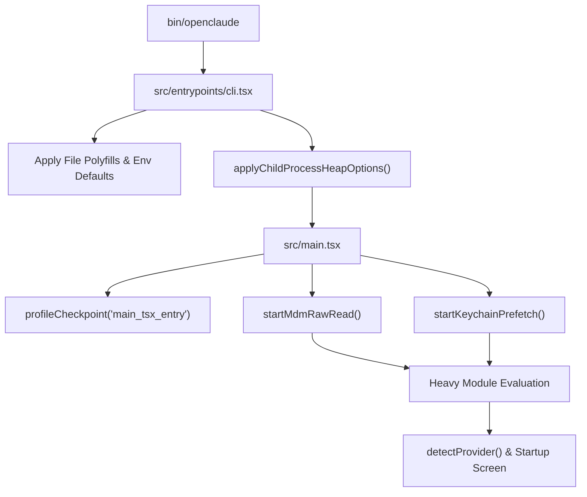
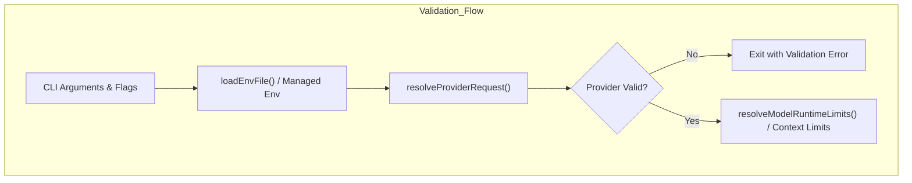
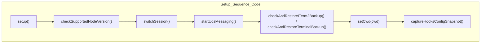

# Startup & Bootstrap Flow

Relevant source files

The following files were used as context for generating this wiki page:

- [.gitignore](.gitignore)
- [src/bootstrap/state.ts](src/bootstrap/state.ts)
- [src/components/StartupScreen.test.ts](src/components/StartupScreen.test.ts)
- [src/components/StartupScreen.ts](src/components/StartupScreen.ts)
- [src/entrypoints/sdk/query.ts](src/entrypoints/sdk/query.ts)
- [src/entrypoints/sdk/v2.ts](src/entrypoints/sdk/v2.ts)
- [src/services/api/logging.ts](src/services/api/logging.ts)
- [src/setup.ts](src/setup.ts)
- [src/tools.ts](src/tools.ts)
- [src/utils/context.test.ts](src/utils/context.test.ts)
- [src/utils/context.ts](src/utils/context.ts)
- [src/utils/dangerousSkipFlags.test.ts](src/utils/dangerousSkipFlags.test.ts)
- [src/utils/dangerousSkipFlags.ts](src/utils/dangerousSkipFlags.ts)
- [src/utils/earlyInput.ts](src/utils/earlyInput.ts)
- [src/utils/gracefulShutdown.ts](src/utils/gracefulShutdown.ts)
- [src/utils/interactivity.test.ts](src/utils/interactivity.test.ts)
- [src/utils/interactivity.ts](src/utils/interactivity.ts)
- [src/utils/model/openaiContextWindows.ts](src/utils/model/openaiContextWindows.ts)
- [src/utils/providerDiscovery.test.ts](src/utils/providerDiscovery.test.ts)
- [src/utils/providerDiscovery.ts](src/utils/providerDiscovery.ts)
- [tests/sdk/query-concurrency.test.ts](tests/sdk/query-concurrency.test.ts)
- [tests/sdk/sdk-context-isolation.test.ts](tests/sdk/sdk-context-isolation.test.ts)
- [tests/sdk/sdk-v2-lifecycle.test.ts](tests/sdk/sdk-v2-lifecycle.test.ts)

## Purpose & Scope
This page details the startup, bootstrap, and initialization flow of OpenClaude, spanning the entrypoints (`src/entrypoints/cli.tsx` and `src/main.tsx`), early process-level side effects, environment validation, branding / startup screen rendering (`src/components/StartupScreen.ts`), setup gates (`src/setup.ts`), and graceful shutdown handling (`src/utils/gracefulShutdown.ts`).

---

## 1. Entrypoint & Early Side-Effects Sequence (`cli.tsx` & `main.tsx`)

The OpenClaude CLI boots through a carefully ordered sequence designed to minimize startup latency while establishing required global state, polyfills, process heap limits, and background reader pre-fetches.

### Early Side-Effects & Parallelized Subprocesses
Before heavy module evaluation occurs in `src/main.tsx` [src/main.tsx:1-13](), side-effects are dispatched to run in parallel with the remaining module imports (~135ms optimization):
1. **Startup Profiling**: `profileCheckpoint('main_tsx_entry')` records the initial boot timestamp [src/main.tsx:9-12]().
2. **MDM Raw Reads**: `startMdmRawRead()` spawns platform-specific Mobile Device Management subprocesses (`plutil` on macOS, `reg query` on Windows) asynchronously [src/main.tsx:3-16]().
3. **Keychain Prefetching**: `startKeychainPrefetch()` initiates parallel reads of macOS keychain entries (OAuth and legacy API keys) to avoid sequential sync spawns later during config evaluation [src/main.tsx:5-20]().

### Polyfills and Environment Defaults (`cli.tsx`)
In `src/entrypoints/cli.tsx`, defensive compatibility guards ensure runtime stability across Node.js versions (targeting Node >=22):
- **File Polyfill**: If `globalThis.File` is missing, a fallback constructor extending `Blob` is assigned [src/entrypoints/cli.tsx:13-38]().
- **Experimental Betas**: `process.env.CLAUDE_CODE_DISABLE_EXPERIMENTAL_BETAS` defaults to `'true'` to prevent internal-only API beta routing errors for external accounts [src/entrypoints/cli.tsx:40-45]().
- **Corepack Auto-Pinning**: `COREPACK_ENABLE_AUTO_PIN` is explicitly set to `'0'` to avoid unwanted `yarnpkg` insertions into local package configurations [src/entrypoints/cli.tsx:47-49]().

Sources: `src/entrypoints/cli.tsx:1-49`, `src/main.tsx:1-21`

---

## 2. Environment, Configuration, and Provider Validation

Following early side-effects, OpenClaude evaluates configuration layers, provider profiles, and environment variables to ensure the execution context is valid.

### Heap Management & Subprocess Relaunching
To prevent JavaScript heap Out-Of-Memory (OOM) errors during large agentic tasks (Issue #402), `applyChildProcessHeapOptions` evaluates `process.execArgv` and `process.env.NODE_OPTIONS`, ensuring a default old-space memory cap (8192 MB) is propagated to child processes without overriding user-specified configurations [src/entrypoints/cli.tsx:225-241]().

### Provider Profile & Active Route Resolution
Environment variables, `.openclaude-profile.json` files, and CLI flags (`--provider`, `--model`) are processed to determine the active model backend. Validation routines inspect keys for supported providers (OpenAI, Anthropic, Gemini, Mistral, GitHub Copilot, NVIDIA NIM, MiniMax, Codex) before initializing the query loop.

Sources: `src/entrypoints/cli.tsx:225-241`, `src/components/StartupScreen.ts:80-124`, `src/utils/model/openaiContextWindows.ts:1-211`

---

## 3. Startup Screen & Branding (`StartupScreen.ts`)

Before mounting the Ink Terminal UI (`src/main.tsx`), OpenClaude prints a branded filled-block text logo with a sunset gradient [src/components/StartupScreen.ts:1-6]().

### Color Interpolation & Palettes
The startup screen utilizes RGB linear interpolation (`lerp` and `gradAt`) to paint ASCII block figures (`LOGO_OPEN` and `LOGO_CLAUDE`) line-by-line across terminal character columns [src/components/StartupScreen.ts:31-55]().

### Provider Detection Logic
`detectProvider(modelOverride)` inspects environment toggles (`CLAUDE_CODE_USE_GEMINI`, `CLAUDE_CODE_USE_OPENAI`, etc.) and returns metadata identifying the active LLM provider, model name, base URL, and local/remote execution status [src/components/StartupScreen.ts:80-124]().

| Environment Flag | Target Provider | Default Base URL |
| :--- | :--- | :--- |
| `CLAUDE_CODE_USE_GEMINI=1` | Google AI / Gemini | `https://generativelanguage.googleapis.com/v1beta/openai` |
| `CLAUDE_CODE_USE_MISTRAL=1` | Mistral | `https://api.mistral.ai/v1` |
| `CLAUDE_CODE_USE_GITHUB=1` | GitHub Copilot | `https://api.githubcopilot.com` |
| `CLAUDE_CODE_USE_OPENAI=1` | OpenAI / Custom Shim | Resolved via `resolveProviderRequest()` |

Sources: `src/components/StartupScreen.ts:1-124`

---

## 4. Setup Gates & Initialization (`src/setup.ts`)

Once configuration and branding complete, `setup()` in `src/setup.ts` verifies execution constraints before control passes to the REPL or headless execution mode [src/setup.ts:57-67]().

### Initialization Sequence & Gates
1. **Node Version Validation**: `checkSupportedNodeVersion(process.version)` checks runtime constraints and exits if unsupported [src/setup.ts:70-79]().
2. **Session Identification**: `switchSession(asSessionId(customSessionId))` assigns the session identifier if specified [src/setup.ts:81-84]().
3. **UDS Messaging Server**: Unless running in bare mode, `startUdsMessaging()` binds local Unix domain sockets for agent communication [src/setup.ts:89-102]().
4. **Terminal Backup Restoration**: For interactive sessions, `checkAndRestoreITerm2Backup()` and `checkAndRestoreTerminalBackup()` inspect terminal configurations for interrupted sessions [src/setup.ts:115-158]().
5. **CWD Assignment**: `setCwd(cwd)` sets the working directory context prior to hooks evaluation [src/setup.ts:161]().

Sources: `src/setup.ts:57-163`

---

## 5. Graceful Shutdown & Status Notices

OpenClaude manages application termination and real-time status notices through specialized utility handlers.

### Graceful Shutdown (`gracefulShutdown.ts`)
Signal listeners catch termination events (`SIGINT`, `SIGTERM`), flushing pending state, running cleanup workers, and safely executing `cleanupTerminalModes()` [src/utils/gracefulShutdown.ts:66-148]().
- **Mouse Tracking**: `writeSync(1, DISABLE_MOUSE_TRACKING)` stops event polling immediately [src/utils/gracefulShutdown.ts:77]().
- **Alternate Screen Exit**: Unmounts the Ink instance or sends `EXIT_ALT_SCREEN` to restore the primary buffer [src/utils/gracefulShutdown.ts:94-101]().
- **Mode Resets**: Disables bracketed paste, focus reporting, key reporting, and clears progress indicators and terminal titles [src/utils/gracefulShutdown.ts:119-143]().

### Status Notices
Runtime warnings, model context limitations, and deprecation notices are surfaced via status notice registries, providing contextual feedback in the UI footer or startup logs.

Sources: `src/utils/gracefulShutdown.ts:1-569`