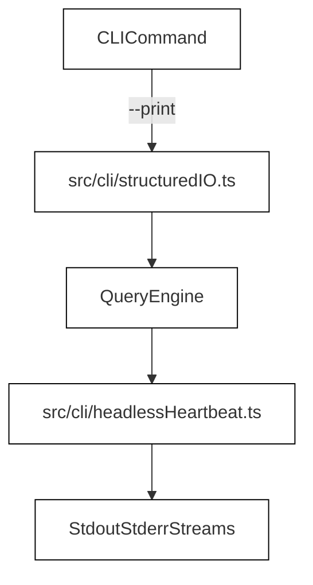
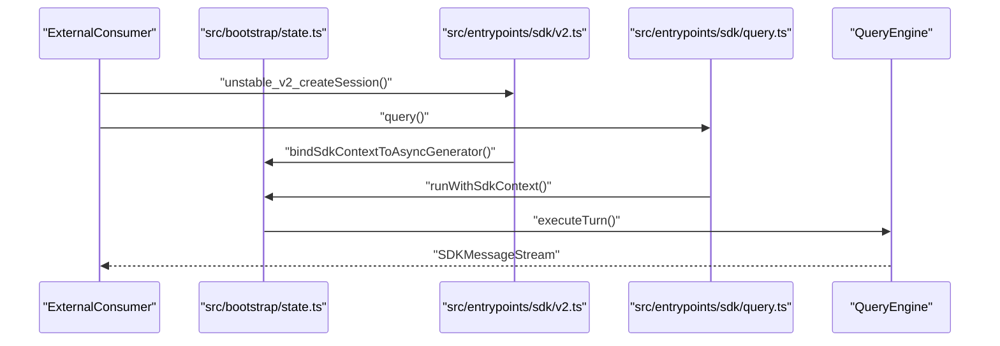
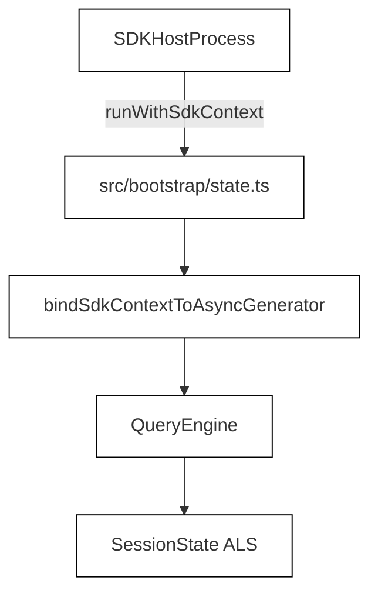
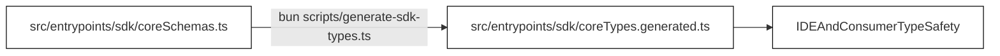

# Headless Print Mode & SDK

Relevant source files

The following files were used as context for generating this wiki page:

- [scripts/generate-sdk-types.ts](scripts/generate-sdk-types.ts)
- [src/bootstrap/state.ts](src/bootstrap/state.ts)
- [src/cli/headlessHeartbeat.test.ts](src/cli/headlessHeartbeat.test.ts)
- [src/cli/headlessHeartbeat.ts](src/cli/headlessHeartbeat.ts)
- [src/cli/printHeartbeat.test.ts](src/cli/printHeartbeat.test.ts)
- [src/entrypoints/sdk.d.ts](src/entrypoints/sdk.d.ts)
- [src/entrypoints/sdk/coreSchemas.ts](src/entrypoints/sdk/coreSchemas.ts)
- [src/entrypoints/sdk/coreTypes.generated.ts](src/entrypoints/sdk/coreTypes.generated.ts)
- [src/entrypoints/sdk/query.ts](src/entrypoints/sdk/query.ts)
- [src/entrypoints/sdk/v2.ts](src/entrypoints/sdk/v2.ts)
- [src/hooks/useReplBridge.tsx](src/hooks/useReplBridge.tsx)
- [src/ink/hooks/use-input.test.ts](src/ink/hooks/use-input.test.ts)
- [src/ink/hooks/use-input.ts](src/ink/hooks/use-input.ts)
- [src/query/stopHooks.goal.test.ts](src/query/stopHooks.goal.test.ts)
- [src/query/stopHooks.ts](src/query/stopHooks.ts)
- [src/tools.ts](src/tools.ts)
- [src/tools/FileReadTool/constants.ts](src/tools/FileReadTool/constants.ts)
- [src/tools/FileReadTool/prompt.ts](src/tools/FileReadTool/prompt.ts)
- [src/tools/REPLTool/constants.ts](src/tools/REPLTool/constants.ts)
- [src/utils/messageFilters.ts](src/utils/messageFilters.ts)
- [src/utils/settings/mdm/settings.ts](src/utils/settings/mdm/settings.ts)
- [src/utils/user.test.ts](src/utils/user.test.ts)
- [src/utils/validation.ts](src/utils/validation.ts)
- [tests/sdk/generated-types.test.ts](tests/sdk/generated-types.test.ts)
- [tests/sdk/helpers/query-test-doubles.ts](tests/sdk/helpers/query-test-doubles.ts)
- [tests/sdk/package-consumer-types.test.ts](tests/sdk/package-consumer-types.test.ts)
- [tests/sdk/query-concurrency.test.ts](tests/sdk/query-concurrency.test.ts)
- [tests/sdk/query-lifecycle.test.ts](tests/sdk/query-lifecycle.test.ts)
- [tests/sdk/sdk-context-isolation.test.ts](tests/sdk/sdk-context-isolation.test.ts)
- [tests/sdk/sdk-v2-lifecycle.test.ts](tests/sdk/sdk-v2-lifecycle.test.ts)

This page details the headless execution modes, structured input/output streams, heartbeat mechanisms, and the SDK v2 entrypoints of OpenClaude. It covers non-interactive CLI printing, structured serialization, the multi-turn session SDK, type generation pipelines via Zod schemas, and context isolation primitives.

---

## 1. Headless Print Mode & Structured I/O

OpenClaude supports running agent turns non-interactively via print mode and structured I/O streams. Rather than rendering via the Ink TUI (`src/entrypoints/cli.tsx`), headless executions stream JSON or line-delimited records directly to standard output.

Sources: `src/cli/structuredIO.ts`, `src/cli/headlessHeartbeat.ts`

---

## 2. SDK v2 Architecture & Entrypoints

The OpenClaude SDK is bundled separately (`dist/sdk.mjs`) and excludes all React/Ink dependencies (`src/entrypoints/sdk/index.ts`). It exposes programmatic APIs for one-shot queries and persistent multi-turn sessions.

*Key Modules & Interfaces:*
- **Barrel Exports**: `src/entrypoints/sdk/index.ts` validates stub-leak detection on module load via `detectStubLeaks()` [src/entrypoints/sdk/index.ts:42-63]().
- **Persistent Sessions (`SDKSession`)**: Implemented in `src/entrypoints/sdk/v2.ts` providing `sendMessage`, `getMessages`, and `respondToPermission` [src/entrypoints/sdk/v2.ts:146-163]().
- **Query API**: Implemented in `src/entrypoints/sdk/query.ts` delivering asynchronous iteration over tool calls and text generation [src/entrypoints/sdk/query.ts:178-191]().

Sources: `src/entrypoints/sdk/index.ts`, `src/entrypoints/sdk/v2.ts`, `src/entrypoints/sdk/query.ts`

---

## 3. Context Isolation & State Management

To safely handle concurrent SDK queries without polluting process-global state, OpenClaude uses `AsyncLocalStorage` bindings implemented in `src/bootstrap/state.ts` [src/bootstrap/state.ts:42-141]().

*Key Primitives:*
- `runWithSdkContext` and `bindSdkContextToAsyncGenerator`: Isolate execution context across concurrent generator yields (`tests/sdk/sdk-context-isolation.test.ts`) [tests/sdk/sdk-context-isolation.test.ts:3-15]().
- Global state indirection: Ensures environment variable overrides and working directory mutations are strictly scoped per query (`src/bootstrap/state.ts`) [src/bootstrap/state.ts:42-141]().

Sources: `src/bootstrap/state.ts`, `tests/sdk/sdk-context-isolation.test.ts`

---

## 4. Generated SDK Types & Zod Schemas

Data transfer objects across the SDK boundary are validated using Zod schemas located in `src/entrypoints/sdk/coreSchemas.ts`. Static TypeScript declarations are compiled automatically into `src/entrypoints/sdk/coreTypes.generated.ts`.

*Key Schemas:*
- `ModelUsageSchema` and `ThinkingConfigSchema`: Define token usage metrics and model reasoning constraints [src/entrypoints/sdk/coreSchemas.ts:17-120]().
- `PermissionResultSchema`: Governs tool execution authorizations and decision classifications [src/entrypoints/sdk/coreTypes.generated.ts:238-255]().

Sources: `src/entrypoints/sdk/coreSchemas.ts`, `src/entrypoints/sdk/coreTypes.generated.ts`, `scripts/generate-sdk-types.ts`

---

## 5. SDK Test Suite Architecture

The SDK test suite ensures correctness, lifecycle integrity, and concurrency safety.

*Test Files & Responsibilities:*
- `tests/sdk/query-lifecycle.test.ts`: Validates `Query.sessionId` assignment, interruption handling, and lazy engine initialization guards [tests/sdk/query-lifecycle.test.ts:79-208]().
- `tests/sdk/sdk-v2-lifecycle.test.ts`: Verifies session creation, multiplexed execution with mock query engines, and resource disposal [tests/sdk/sdk-v2-lifecycle.test.ts:113-204]().
- `tests/sdk/sdk-context-isolation.test.ts`: Tests asynchronous generator state binding and concurrent CWD/session isolation [tests/sdk/sdk-context-isolation.test.ts:28-163]().

Sources: `tests/sdk/query-lifecycle.test.ts`, `tests/sdk/sdk-v2-lifecycle.test.ts`, `tests/sdk/sdk-context-isolation.test.ts`