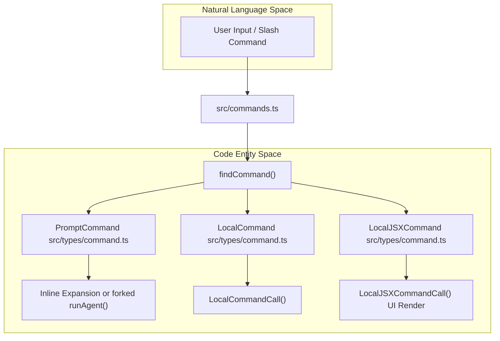
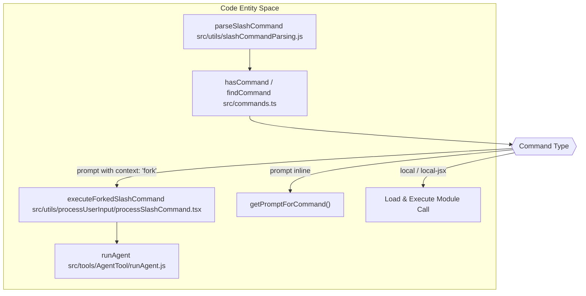
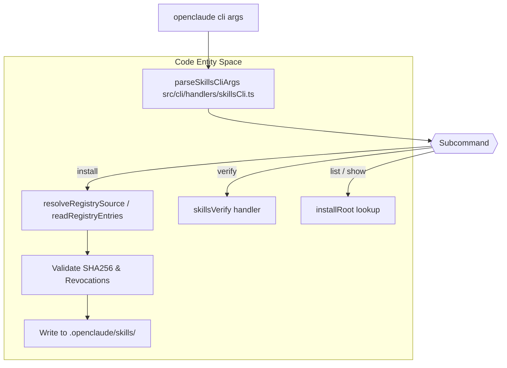
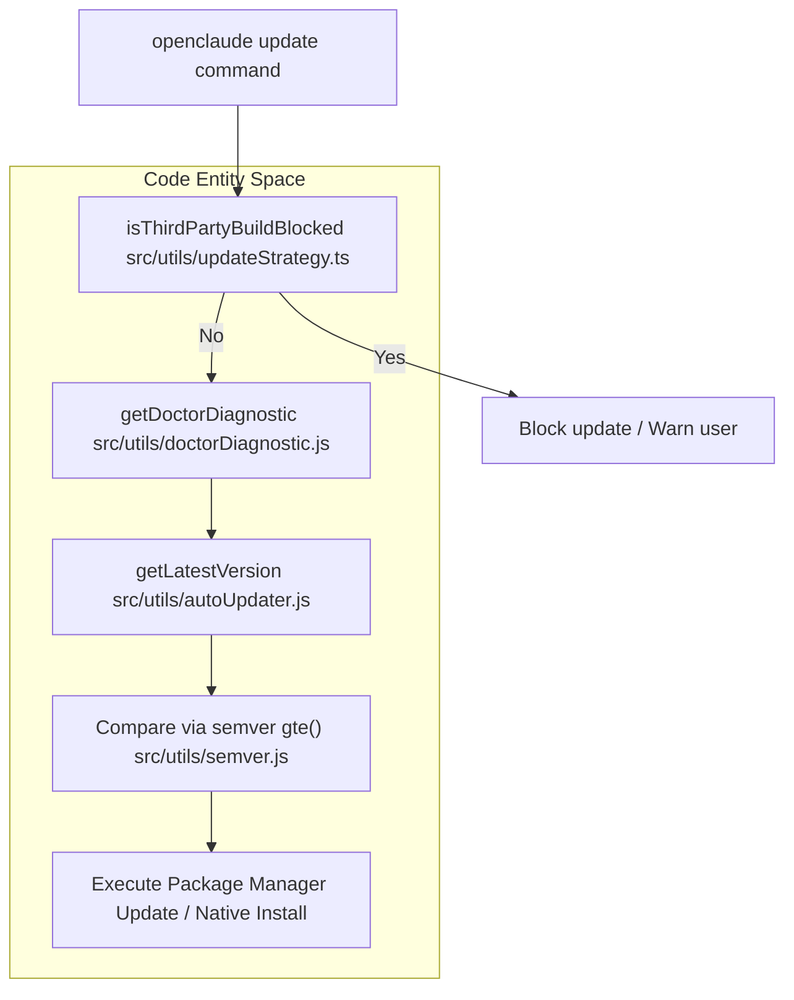

# Slash Commands & CLI Handlers

Relevant source files

The following files were used as context for generating this wiki page:

- [scripts/missing-module-stub.test.ts](scripts/missing-module-stub.test.ts)
- [src/__tests__/statusNoticeLocalModel.test.ts](src/__tests__/statusNoticeLocalModel.test.ts)
- [src/cli/update.test.ts](src/cli/update.test.ts)
- [src/cli/update.ts](src/cli/update.ts)
- [src/commands.test.ts](src/commands.test.ts)
- [src/commands.ts](src/commands.ts)
- [src/commands/sessions/index.ts](src/commands/sessions/index.ts)
- [src/commands/sessions/sessions.test.tsx](src/commands/sessions/sessions.test.tsx)
- [src/commands/sessions/sessions.tsx](src/commands/sessions/sessions.tsx)
- [src/commands/update/update.test.ts](src/commands/update/update.test.ts)
- [src/commands/update/update.tsx](src/commands/update/update.tsx)
- [src/components/StatusNotices.tsx](src/components/StatusNotices.tsx)
- [src/i18n/commandDescriptions.ts](src/i18n/commandDescriptions.ts)
- [src/i18n/languages/en.ts](src/i18n/languages/en.ts)
- [src/i18n/languages/vi.ts](src/i18n/languages/vi.ts)
- [src/state/AppStateStore.ts](src/state/AppStateStore.ts)
- [src/tools/AgentTool/UI.tsx](src/tools/AgentTool/UI.tsx)
- [src/types/command.ts](src/types/command.ts)
- [src/utils/analyzeContext.mcp.test.ts](src/utils/analyzeContext.mcp.test.ts)
- [src/utils/analyzeContext.ts](src/utils/analyzeContext.ts)
- [src/utils/processUserInput/processSlashCommand.tsx](src/utils/processUserInput/processSlashCommand.tsx)
- [src/utils/sessionDeletion.test.ts](src/utils/sessionDeletion.test.ts)
- [src/utils/sessionDeletion.ts](src/utils/sessionDeletion.ts)
- [src/utils/sessionStorage.commandOnlySession.test.ts](src/utils/sessionStorage.commandOnlySession.test.ts)
- [src/utils/statusNoticeDefinitions.safety.test.tsx](src/utils/statusNoticeDefinitions.safety.test.tsx)
- [src/utils/statusNoticeDefinitions.tsx](src/utils/statusNoticeDefinitions.tsx)
- [src/utils/statusNoticeLocalModel.ts](src/utils/statusNoticeLocalModel.ts)
- [src/utils/truncate.test.ts](src/utils/truncate.test.ts)
- [src/utils/truncate.ts](src/utils/truncate.ts)

## Purpose & Scope

This page documents the architecture of OpenClaude's command system, slash command registration and parsing, specialized CLI handlers (such as skills management and updates), and command execution pipelines. OpenClaude maintains a registry of over 300 commands (`src/commands.ts`) supporting interactive REPL slash commands, non-interactive CLI flags, and sub-agent task delegation.

Sources: `[src/commands.ts:1-152]`, `[src/cli/update.ts:1-190]()`

---

## 1. The `src/commands` Registry & Command Types

OpenClaude consolidates built-in, bundled, and project-specific commands through a centralized registry module (`src/commands.ts`). Commands are categorized into three core structural variants defined in `src/types/command.ts`:

- **`prompt`**: Text-expanding skills or prompts that inject content or execute via sub-agents (`PromptCommand`) [src/types/command.ts:41-82]().
- **`local`**: Programmatic local actions executed directly inside the REPL context (`LocalCommand`) [src/types/command.ts:99-103]().
- **`local-jsx`**: Advanced React/Ink components rendered inside the terminal UI when invoked (`LocalJSXCommand`) [src/types/command.ts:170-178]().

Sources: `[src/commands.ts:1-152]`, `[src/types/command.ts:41-178]()`

Commands specify static availability constraints (`CommandAvailability`) such as `claude-ai` or `console` to gate feature accessibility based on active authentication profiles [src/types/command.ts:191-196]().

Sources: `[src/commands.ts:1-152]`, `[src/types/command.ts:41-196]()`

---

## 2. Slash Command Processing & Execution Pipeline

When a user types a slash command (e.g., `/commit` or `/skills`), OpenClaude routes execution through `processSlashCommand.tsx` [src/utils/processUserInput/processSlashCommand.tsx:1-50]().

Sources: `[src/utils/processUserInput/processSlashCommand.tsx:38-86]`, `[src/types/command.ts:41-178]()`

### Key Execution Logic
- **Parsing**: `parseSlashCommand` splits the raw input buffer into the command name and argument payload `[src/utils/processUserInput/processSlashCommand.tsx:38]()`.
- **Forked Sub-agents**: Commands marked with `context: 'fork'` spawn an isolated sub-agent using `executeForkedSlashCommand` and `runAgent`, preventing heavy tool execution blocks on the primary REPL thread `[src/utils/processUserInput/processSlashCommand.tsx:60-86]()`.

Sources: `[src/utils/processUserInput/processSlashCommand.tsx:38-113]()`

---

## 3. CLI Handlers: Skills, MCP & Extensibility

OpenClaude's CLI supports subcommand trees like `openclaude skills` and `openclaude mcp`. The skills CLI handler parses flags such as `--registry`, `--lockfile`, and `--sha256` to route operations to underlying managers `[src/commands.ts:44-62]()`.

Sources: `[src/commands.ts:44-62]`, `[src/types/command.ts:41-82]()`

### Skill Installation Safeguards
When installing a skill via remote registry specifiers, verification scripts enforce strict security boundaries:
1. Verifies the registry provides a valid `sha256` digest.
2. Checks revocations to prevent installing revoked or vulnerable skill versions.
3. Normalizes line endings (`\n`) and verifies cryptographic checksums before writing files locally.

Sources: `[src/commands.ts:1-152]`, `[src/types/command.ts:41-82]()`

---

## 4. Update Command & Self-Update Strategy

The `update` routine (`src/cli/update.ts` and `src/commands/update/update.tsx`) manages package updates, checks remote release channels, and verifies distribution compatibility.

Sources: `[src/cli/update.ts:88-190]`, `[src/commands/update/update.tsx:89-189]()`

### Update Protections
- **Third-Party Build Guard**: `isThirdPartyBuildBlocked()` checks if the current binary relies on an upstream distribution bucket, blocking automated self-updates that would overwrite custom provider builds with first-party binaries `[src/cli/update.ts:88-106]()`.
- **Diagnostic Gate**: Pre-update checks run `getDoctorDiagnostic()` to detect conflicting multiple global installations or broken path symlinks `[src/cli/update.ts:116-135]()`.
- **Ink UI Component**: The interactive slash command `/update` renders an Ink-based UI via `Update` (`src/commands/update/update.tsx`) which tracks the `UpdateState` machine (checking, blocked, package-manager, updating, success, error) [src/commands/update/update.tsx:40-49]() & `[src/commands/update/update.tsx:89-114]()`.

Sources: `[src/cli/update.ts:88-190]`, `[src/commands/update/update.tsx:1-189]()`