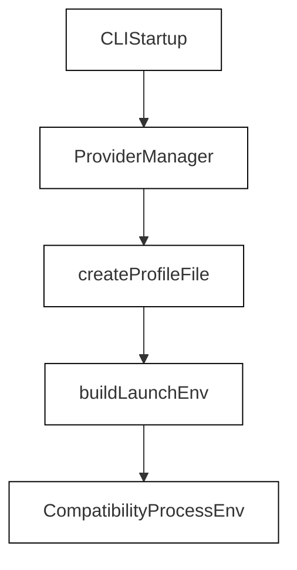
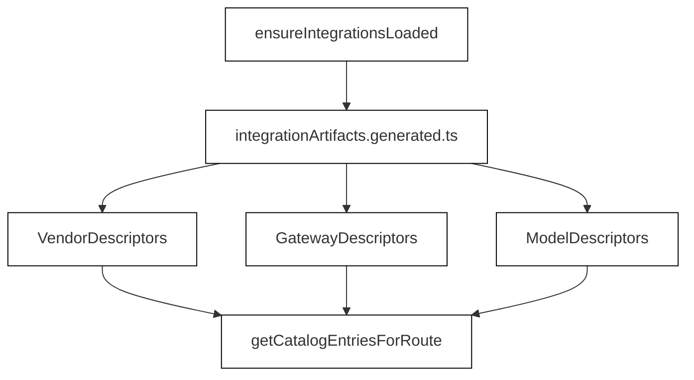

# Provider & Model Layer

Relevant source files

The following files were used as context for generating this wiki page:

- [.env.example](.env.example)
- [README.md](README.md)
- [docs/advanced-setup.md](docs/advanced-setup.md)
- [src/components/ProviderManager.test.tsx](src/components/ProviderManager.test.tsx)
- [src/components/ProviderManager.tsx](src/components/ProviderManager.tsx)
- [src/integrations/compatibility.test.ts](src/integrations/compatibility.test.ts)
- [src/integrations/generated/integrationArtifacts.generated.ts](src/integrations/generated/integrationArtifacts.generated.ts)
- [src/integrations/routeMetadata.test.ts](src/integrations/routeMetadata.test.ts)
- [src/integrations/routeMetadata.ts](src/integrations/routeMetadata.ts)
- [src/utils/envFile.test.ts](src/utils/envFile.test.ts)
- [src/utils/envFile.ts](src/utils/envFile.ts)
- [src/utils/providerFlag.test.ts](src/utils/providerFlag.test.ts)
- [src/utils/providerFlag.ts](src/utils/providerFlag.ts)
- [src/utils/providerProfile.test.ts](src/utils/providerProfile.test.ts)
- [src/utils/providerProfile.ts](src/utils/providerProfile.ts)
- [src/utils/providerProfiles.test.ts](src/utils/providerProfiles.test.ts)
- [src/utils/providerProfiles.ts](src/utils/providerProfiles.ts)
- [web/src/data/partners.ts](web/src/data/partners.ts)

The Provider & Model Layer provides the core multi-provider abstraction for OpenClaude, enabling seamless communication across Anthropic, OpenAI, Google Gemini, Ollama, local execution engines, and custom gateways. It decouples agent execution from underlying model interfaces through provider profiles, a static integrations registry, dynamic model discovery, context window mapping, and unified authentication routing.

For detailed documentation, refer to the child pages:
- [Provider Profiles, Flags & Auto-Detection](#3.1) — `--provider` flag, `.openclaude-profile.json`, `ProviderManager` TUI, auto-detect, validation, and recommendation scripts.
- [Integrations Registry (Vendors, Gateways, Brands, Models)](#3.2) — `defineGateway`/registry architecture, descriptors, generated manifests, catalog entries, and route metadata.
- [Model Resolution & Selection](#3.3) — `getMainLoopModel`, aliases, canonical names, model options, `ModelPicker`, cross-profile switching, effort levels, and pricing.
- [Context Windows & Token Limits](#3.4) — `getContextWindowForModel`, `openaiContextWindows` overrides, runtime limits, token counting, and 1M context opt-in.
- [Authentication & Credentials](#3.5) — OAuth flows (Codex, xAI, GitHub device flow), auth routing, provider secrets, and secure storage backends.

---

## 3.1. Provider Profiles, Flags & Auto-Detection

OpenClaude configurations and active backend parameters are managed via saved provider profiles stored in `.openclaude-profile.json` [src/utils/providerProfile.ts:56-56](). Users can bootstrap or modify configurations using the interactive `ProviderManager` TUI component [src/components/ProviderManager.tsx:1-135](), explicit command-line flags (such as `--provider`) [src/utils/providerFlag.ts:108-110](), or automated environment detection. 

The launch environment builder correlates profile states with target runtime variables [src/utils/providerProfile.test.ts:76-92]() to configure API bases, authentication schemes, and model defaults. For complete implementation details, validation logic, and automated recommendation scripts, see [Provider Profiles, Flags & Auto-Detection](#3.1).

Title: Profile configuration and environment bootstrapping flow

*Figure 3.1: Profile configuration and environment bootstrapping flow.*

Sources: `src/utils/providerProfile.ts`, `src/utils/providerProfile.test.ts`, `src/components/ProviderManager.tsx`, `src/utils/providerFlag.ts`

---

## 3.2. Integrations Registry (Vendors, Gateways, Brands, Models)

The integrations registry defines the structural taxonomy for all supported LLM providers through a strongly typed descriptor architecture. Descriptors are aggregated into generated manifests (`integrationArtifacts.generated.ts`) that expose vendor identities, gateway properties, model lineages, and route metadata without bloating startup initialization [src/integrations/generated/integrationArtifacts.generated.ts:1-7](). 

- **Model Discovery & Caching**: Dynamic probing via `/v1/models` endpoints is handled by `discoveryService` and cached via `discoveryCache` to support hybrid static-dynamic catalogs.
- **AIMLAPI & Gateway Integrations**: Specialized gateways (such as `aimlapi`, `ollama`, `nvidia-nim`, and `openrouter`) implement custom client routing, top-up workflows [src/components/ProviderManager.tsx:52-74](), and attribution headers.

For deeper architectural analysis, descriptor schemas, and gateway specifics, see [Integrations Registry (Vendors, Gateways, Brands, Models)](#3.2).

Title: Static integration artifact loading and catalog resolution

*Figure 3.2: Static integration artifact loading and catalog resolution.*

Sources: `src/integrations/generated/integrationArtifacts.generated.ts`, `src/components/ProviderManager.tsx`, `src/utils/providerFlag.ts`

---

## 3.3. Model Resolution & Selection

Model resolution maps user-provided strings, environment configurations, and legacy aliases into canonical model identifiers. Functions like `getMainLoopModel` and components like the `ModelPicker` handle cross-profile switching, reasoning effort configurations, and pricing/cost metadata lookups. 

When switching profiles or passing model flags, the layer normalizes aliases (such as mapping Codex shortcuts) and resolves target model characteristics for the active execution loop. For comprehensive details on resolution precedence and effort level handling, see [Model Resolution & Selection](#3.3).

Sources: `src/utils/providerProfiles.ts`, `src/utils/providerProfile.ts`

---

## 3.4. Context Windows & Token Limits

Model-specific context capacities and output ceilings are resolved dynamically via `getContextWindowForModel` and runtime limit evaluators. The system maintains fallback mapping tables (`openaiContextWindows`) to handle providers that do not report native context windows via `/v1/models`. 

Runtime limit enforcement ensures safety margins for auto-compaction and token counting, including support for 1M-context opt-ins on high-capacity endpoints. For details on runtime limit resolution and token bounds, see [Context Windows & Token Limits](#3.4).

Sources: `src/utils/providerProfile.ts`, `src/utils/providerProfiles.ts`

---

## 3.5. Authentication & Credentials

Authentication routing manages secure credential storage, API keys, and complex OAuth handshakes—including Codex, xAI, and GitHub device authorization flows. Credentials are isolated per profile and accessed via credential pools (`firstUsableCredential`) to support fallback keys and rotating tokens. 

Sensitive values are sanitized and masked for terminal display [src/utils/providerProfile.ts:40-47]() prior to process injection. For implementation specs on secure storage backends and OAuth lifecycle management, see [Authentication & Credentials](#3.5).

Sources: `src/utils/providerProfile.ts`, `src/components/ProviderManager.tsx`