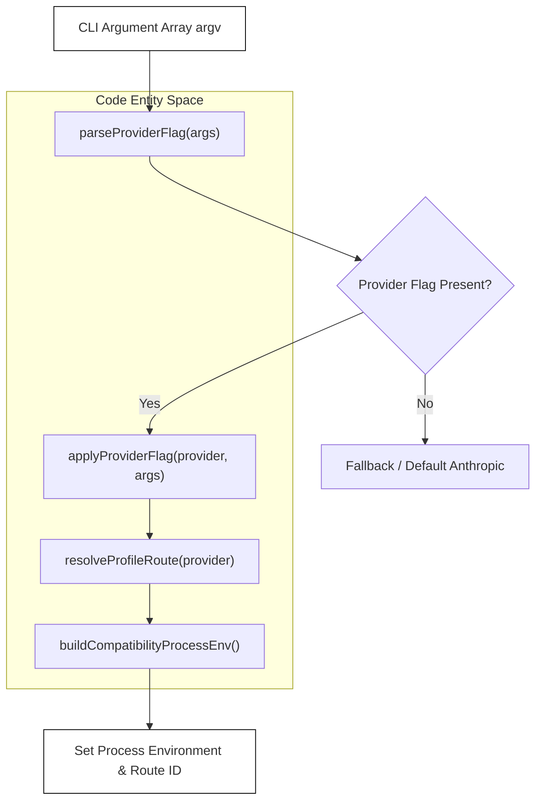

# Provider Profiles, Flags & Auto-Detection

<details>
<summary>Relevant source files</summary>

The following files were used as context for generating this wiki page:

- [.env.example](.env.example)
- [PLAYBOOK.md](PLAYBOOK.md)
- [README.md](README.md)
- [docs/advanced-setup.md](docs/advanced-setup.md)
- [scripts/provider-bootstrap.ts](scripts/provider-bootstrap.ts)
- [scripts/provider-discovery.ts](scripts/provider-discovery.ts)
- [scripts/provider-launch.ts](scripts/provider-launch.ts)
- [scripts/provider-recommend.ts](scripts/provider-recommend.ts)
- [scripts/system-check.test.ts](scripts/system-check.test.ts)
- [scripts/system-check.ts](scripts/system-check.ts)
- [src/components/ProviderManager.test.tsx](src/components/ProviderManager.test.tsx)
- [src/components/ProviderManager.tsx](src/components/ProviderManager.tsx)
- [src/integrations/artifactGenerator.ts](src/integrations/artifactGenerator.ts)
- [src/integrations/compatibility.test.ts](src/integrations/compatibility.test.ts)
- [src/integrations/generated/integrationArtifacts.generated.ts](src/integrations/generated/integrationArtifacts.generated.ts)
- [src/integrations/routeMetadata.test.ts](src/integrations/routeMetadata.test.ts)
- [src/integrations/routeMetadata.ts](src/integrations/routeMetadata.ts)
- [src/services/api/openaiShim.diagnostics.test.ts](src/services/api/openaiShim.diagnostics.test.ts)
- [src/services/api/providerConfig.envDiagnostics.test.ts](src/services/api/providerConfig.envDiagnostics.test.ts)
- [src/utils/envFile.test.ts](src/utils/envFile.test.ts)
- [src/utils/envFile.ts](src/utils/envFile.ts)
- [src/utils/providerAutoDetect.test.ts](src/utils/providerAutoDetect.test.ts)
- [src/utils/providerAutoDetect.ts](src/utils/providerAutoDetect.ts)
- [src/utils/providerFlag.test.ts](src/utils/providerFlag.test.ts)
- [src/utils/providerFlag.ts](src/utils/providerFlag.ts)
- [src/utils/providerProfile.test.ts](src/utils/providerProfile.test.ts)
- [src/utils/providerProfile.ts](src/utils/providerProfile.ts)
- [src/utils/providerProfiles.test.ts](src/utils/providerProfiles.test.ts)
- [src/utils/providerProfiles.ts](src/utils/providerProfiles.ts)
- [src/utils/providerRecommendation.test.ts](src/utils/providerRecommendation.test.ts)
- [src/utils/providerRecommendation.ts](src/utils/providerRecommendation.ts)
- [web/src/data/partners.ts](web/src/data/partners.ts)

</details>


### Purpose and Scope
This document details the multi-provider abstraction layer in OpenClaude, focusing on CLI flag routing (`--provider`), persistent profile storage (`.openclaude-profile.json`), the interactive terminal user interface (`ProviderManager`), and the auto-detection, validation, and recommendation systems. OpenClaude supports over 200 LLM providers and gateways through a unified configuration architecture.

---

## 1. The `--provider` Flag & CLI Routing

The `--provider` CLI flag allows users to switch between supported backend vendors, gateways, and local models directly from the command line without manually exporting environment variables.

### Implementation and Flag Parsing
Flag parsing is handled in `src/utils/providerFlag.ts`. The helper function `parseProviderFlag` inspects `process.argv` or an input argument array using root option parsers, supporting both spaced (`--provider openai`) and inline (`--provider=openai`) syntax [src/utils/providerFlag.ts:105-110]().

```typescript
// Example usage pattern from src/utils/providerFlag.ts
export function parseProviderFlag(args: string[]): string | null {
  return parseRootOptionValue(args, '--provider') ?? null
}
```[src/utils/providerFlag.ts:108-110]()

When a provider flag is validated, `applyProviderFlag` resolves the target route ID via `resolveProfileRoute` and configures the appropriate environment variables (`CLAUDE_CODE_USE_OPENAI`, `OPENAI_BASE_URL`, `OPENAI_MODEL`, etc.) [src/utils/providerFlag.ts:165-182]().

Title: CLI `--provider` Flag Parsing and Environment Mapping Flow


*Figure 3.1.1: CLI `--provider` flag parsing and environment mapping flow bridging user input to runtime environment code entities.*

Sources: `src/utils/providerFlag.ts:105-182()`, `src/utils/providerFlag.test.ts:152-230()`

---

## 2. Provider Profiles & Persistence (`.openclaude-profile.json`)

Saved configurations and credentials are structured into profiles stored inside the configuration directory (`CLAUDE_CONFIG_DIR` or `OPENCLAUDE_CONFIG_DIR`), defaulting to `.openclaude-profile.json` [src/utils/providerProfile.ts:54-56]().

### Profile File Structure and Management
The profile management module (`src/utils/providerProfile.ts` and `src/utils/providerProfiles.ts`) manages reading, writing, and applying profile states across execution sessions.

- **`loadProfileFile()`**: Reads and parses `.openclaude-profile.json` from the config home directory [src/utils/providerProfile.test.ts:36]().
- **`saveProfileFile()`**: Writes updated profile objects and environment maps to disk with secure permissions [src/utils/providerProfile.ts:1-2]() [src/utils/providerProfile.test.ts:38]().
- **`buildLaunchEnv()`**: Merges persisted profile environment variables with active process environment variables and goal-based defaults [src/utils/providerProfile.test.ts:77-120]().

Title: Profile Data Flow and Persistence Architecture

```mermaid
graph TD
    subgraph "Filesystem"
      File[".openclaude-profile.json"]
    end

    subgraph "Code Entity Space"
      File -->|loadProfileFile()| Loader["ProfileFile Object"]
      Loader --> Builder["buildLaunchEnv()"]
      Builder --> Session["applySavedProfileToCurrentSession()"]
      Session --> Runtime["Active Runtime Environment"]
      Writer["saveProfileFile()"] -->|Persists| File
    end

    style File fill:none,stroke:#000,stroke-width:1px
    style Runtime fill:none,stroke:#000,stroke-width:1px
```
*Figure 3.1.2: Profile data flow from disk storage to runtime environment application via `loadProfileFile`, `buildLaunchEnv`, and `applySavedProfileToCurrentSession`.*

Sources: `src/utils/providerProfile.ts:1-56()`, `src/utils/providerProfiles.ts:1-13()`, `src/utils/providerProfile.test.ts:35-120()`

---

## 3. Interactive Provider Management TUI (`ProviderManager.tsx`)

The `ProviderManager` component (`src/components/ProviderManager.tsx`) provides an Ink-based TUI for interactive first-run setup or ongoing profile management via the `/provider` slash command [README.md:120]() [src/components/ProviderManager.tsx:1-142]().

### Component States and Wizard Flow
`ProviderManager` operates across multiple screen states to guide users through vendor selection, API key entry, OAuth authentication, and model configuration:

```typescript
type Screen =
  | 'menu'
  | 'select-preset'
  | 'select-ollama-model'
  | 'select-atomic-chat-model'
  | 'codex-oauth'
  | 'xai-oauth'
  | 'form'
  | 'preset-model'
  | 'aimlapi-api-key-choice'
  | 'aimlapi-configured'
  // ... additional billing and onboarding screens
```[src/components/ProviderManager.tsx:144-160]()

Key capabilities include:
- **Preset Selection**: Displays ordered provider presets (`ORDERED_PROVIDER_PRESETS`) with metadata lookups (`getProviderPresetUiMetadata`) [src/components/ProviderManager.tsx:37-50]() [src/components/ProviderManager.test.tsx:133-178]().
- **OAuth Handlers**: Integrates Codex OAuth and xAI OAuth flows (`useCodexOAuthFlow`, `useXaiOAuthFlow`) [src/components/ProviderManager.tsx:128-130]().
- **Partner Onboarding**: Specialized onboarding and top-up wizards for partner gateways such as AI/ML API (`provisionAimlapiKey`, `topUpAimlapiByApiKey`) [src/components/ProviderManager.tsx:52-74]().

Sources: `src/components/ProviderManager.tsx:1-160()`, `src/components/ProviderManager.test.tsx:133-190()`

---

## 4. Auto-Detection, Validation & Recommendation

OpenClaude includes utilities to auto-detect active provider parameters from environment variables, validate credentials before request dispatch, and recommend optimal models based on specific coding goals.

### Validation (`providerValidation.ts`)
The validation module checks whether required API keys, base URLs, or account identifiers are present for a given target route before session initialization [src/utils/providerProfile.ts:23]() [src/utils/providerValidation.ts]().

### Auto-Detection (`providerAutoDetect.ts`)
Inspects existing environment variables (such as `OPENAI_API_KEY`, `ANTHROPIC_API_KEY`, `GEMINI_API_KEY`, or local ports like Ollama's `11434`) to automatically configure the active provider route if no explicit profile or flag is provided [src/utils/providerAutoDetect.ts]().

### Recommendation Scripts (`scripts/provider-recommend.ts` & `providerRecommendation.ts`)
Provides heuristic-based model suggestions matched to user goals (e.g., `balanced`, `coding`, `latency`) [src/utils/providerProfile.ts:16-19]() [scripts/provider-recommend.ts]() [src/utils/providerRecommendation.ts]().

Sources: `src/utils/providerValidation.ts()`, `src/utils/providerAutoDetect.ts()`, `scripts/provider-recommend.ts()`, `src/utils/providerRecommendation.ts()`