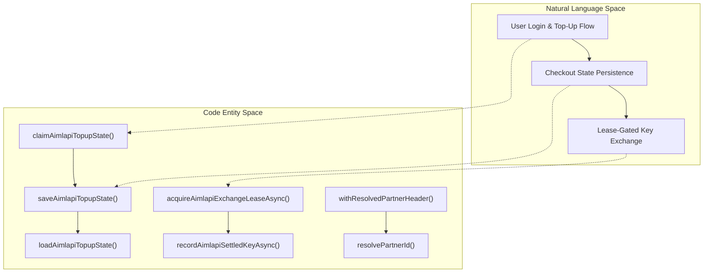
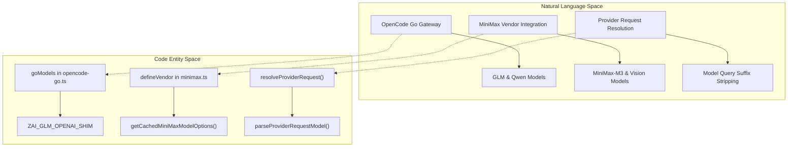

# AIMLAPI & Specific Gateway Integrations

<details>
<summary>Relevant source files</summary>

The following files were used as context for generating this wiki page:

- [src/cli/handlers/skillsListFormat.ts](src/cli/handlers/skillsListFormat.ts)
- [src/cli/handlers/skillsRemoveMessage.ts](src/cli/handlers/skillsRemoveMessage.ts)
- [src/components/skills/SkillsMenu.tsx](src/components/skills/SkillsMenu.tsx)
- [src/entrypoints/cli.skills.test.ts](src/entrypoints/cli.skills.test.ts)
- [src/integrations/aimlapi/config.test.ts](src/integrations/aimlapi/config.test.ts)
- [src/integrations/aimlapi/config.ts](src/integrations/aimlapi/config.ts)
- [src/integrations/aimlapi/topup.test.ts](src/integrations/aimlapi/topup.test.ts)
- [src/integrations/aimlapi/topupState.test.ts](src/integrations/aimlapi/topupState.test.ts)
- [src/integrations/aimlapi/topupState.ts](src/integrations/aimlapi/topupState.ts)
- [src/integrations/brands/minimax.ts](src/integrations/brands/minimax.ts)
- [src/integrations/gateways/aimlapi.ts](src/integrations/gateways/aimlapi.ts)
- [src/integrations/gateways/hicap.ts](src/integrations/gateways/hicap.ts)
- [src/integrations/gateways/nvidia-nim.ts](src/integrations/gateways/nvidia-nim.ts)
- [src/integrations/gateways/opencode-go.ts](src/integrations/gateways/opencode-go.ts)
- [src/integrations/gateways/opencode.test.ts](src/integrations/gateways/opencode.test.ts)
- [src/integrations/gateways/opencode.ts](src/integrations/gateways/opencode.ts)
- [src/integrations/models/opencode.ts](src/integrations/models/opencode.ts)
- [src/integrations/vendors/minimax.ts](src/integrations/vendors/minimax.ts)
- [src/services/api/minimaxUsage.test.ts](src/services/api/minimaxUsage.test.ts)
- [src/services/api/minimaxUsage/fetch.ts](src/services/api/minimaxUsage/fetch.ts)
- [src/services/api/providerConfig.test.ts](src/services/api/providerConfig.test.ts)
- [src/skills/loadSkillsDir.test.ts](src/skills/loadSkillsDir.test.ts)
- [src/skills/loadSkillsDir.ts](src/skills/loadSkillsDir.ts)
- [src/utils/model/minimaxModels.ts](src/utils/model/minimaxModels.ts)
- [src/utils/model/modelOptions.hicap.test.ts](src/utils/model/modelOptions.hicap.test.ts)
- [src/utils/model/parseUserSpecifiedModel.codexTag.test.ts](src/utils/model/parseUserSpecifiedModel.codexTag.test.ts)
- [src/utils/skills/skillChangeDetector.test.ts](src/utils/skills/skillChangeDetector.test.ts)
- [src/utils/skills/skillChangeDetector.ts](src/utils/skills/skillChangeDetector.ts)
- [web/src/pages/docs/skills.astro](web/src/pages/docs/skills.astro)

</details>


## Purpose and Scope

This page documents the technical implementation of specific third-party API gateways and partner integrations within OpenClaude, focusing on the **AIMLAPI** passwordless onboarding, partner checkout, and top-up subsystem (`src/integrations/aimlapi/`), as well as aggregating and specialized provider gateways like **OpenCode Zen** (`src/integrations/gateways/opencode.ts`), **OpenCode Go** (`src/integrations/gateways/opencode-go.ts`), **MiniMax** (`src/integrations/vendors/minimax.ts`), NVIDIA NIM, Ollama, OpenRouter, and request-routing shims.

---

## 1. AIMLAPI Integration & Subsystem

The AIMLAPI integration enables passwordless user registration, secure session authentication, balance tracking, and automated partner-checkout top-ups. Usage through this gateway is attributed to a fixed rebate partner ID (`part_62yQoGYDq4Yqnrj2R1iGrDNJ`) managed by OpenClaude [src/integrations/aimlapi/config.ts:40]().

### Configuration, Endpoints & Attribution

Endpoints and attribution constants are centralized in `src/integrations/aimlapi/config.ts`, where base URLs for authentication, application services, payments, inference, and verification can be overridden via environment variables (`AIMLAPI_AUTH_URL`, `AIMLAPI_APP_URL`, etc.) [src/integrations/aimlapi/config.ts:12-31]().

```typescript
export type AimlapiEndpoints = {
  authBaseUrl: string
  appBaseUrl: string
  payBaseUrl: string
  inferenceBaseUrl: string
  verificationBaseUrl: string
}
```
*Cited from [src/integrations/aimlapi/config.ts:12-23]().*

Attribution headers (`X-AIMLAPI-Partner-ID`, `X-AIMLAPI-Source`, etc.) are injected into requests using `withResolvedPartnerHeader()`, ensuring that partner tracking (`DEFAULT_PARTNER_ID`) cannot be overridden by user configurations [src/integrations/aimlapi/config.ts:131-150]().

Sources: [src/integrations/aimlapi/config.ts:1-166](), [src/integrations/aimlapi/config.test.ts:1-47]()

### Top-Up & Checkout State Persistence

The subsystem manages in-flight checkouts, exchange leases, and key-minting concurrency via `src/integrations/aimlapi/topupState.ts`. It provides persistent state storage (`aimlapi-topup.json`) under the user's config directory with owner-only file permissions (`0o600`) [src/integrations/aimlapi/topupState.ts:88-111]().

Key state primitives include:
- `AimlapiTopupIntent`: Captures user email, target amount in USD minor units (`amountUsdMinor`), partner metadata, and base URLs [src/integrations/aimlapi/topupState.ts:16-26]().
- `AimlapiPersistedTopup`: Tracks `paymentSessionId`, `resumeSessionToken`, settled keys, and distributed lock leases (`exchangeLeaseOwner`, `keyMintLeaseOwner`) to prevent concurrent process collisions [src/integrations/aimlapi/topupState.ts:28-75]().


*Diagram: AIMLAPI Onboarding and State Persistence Architecture.*

Sources: [src/integrations/aimlapi/topupState.ts:1-185](), [src/integrations/aimlapi/topupState.test.ts:1-190]()

---

## 2. Specific Gateway & Vendor Integrations

OpenClaude registers gateway and vendor descriptors via `defineGateway()` and `defineVendor()`. These descriptors configure default base URLs, authentication schemes, validation rules, and model catalogs.

### OpenCode Zen & OpenCode Go

Aggregating gateways such as OpenCode Zen (`src/integrations/gateways/opencode.ts`) and OpenCode Go (`src/integrations/gateways/opencode-go.ts`) provide access to a wide collection of upstream models through OpenAI-compatible transport shims.

- **OpenCode Go**: Configured with `defaultBaseUrl` at `https://opencode.ai/zen/go/v1` and a catalog of models (such as GLM variants and Qwen models) [src/integrations/gateways/opencode-go.ts:51-72](). GLM-based models opt into Z.AI request shaping via `ZAI_GLM_OPENAI_SHIM` [src/integrations/gateways/opencode-go.ts:2-12]().

### MiniMax Integration

MiniMax is configured as a native vendor (`src/integrations/vendors/minimax.ts`) with endpoints supporting Anthropic proxy transport or OpenAI-compatible shims [src/integrations/vendors/minimax.ts:6-20](). Model options for the TUI model picker are cached and managed in `src/utils/model/minimaxModels.ts` [src/utils/model/minimaxModels.ts:1-40]().


*Diagram: Gateway and Vendor Integration Mapping.*

Sources: [src/integrations/gateways/opencode-go.ts:1-105](), [src/integrations/vendors/minimax.ts:1-55](), [src/utils/model/minimaxModels.ts:1-40](), [src/services/api/providerConfig.test.ts:1-53]()

---

## Sources

- [src/integrations/aimlapi/config.ts]()
- [src/integrations/aimlapi/config.test.ts]()
- [src/integrations/aimlapi/topupState.ts]()
- [src/integrations/aimlapi/topupState.test.ts]()
- [src/integrations/gateways/opencode-go.ts]()
- [src/integrations/vendors/minimax.ts]()
- [src/utils/model/minimaxModels.ts]()
- [src/services/api/providerConfig.test.ts]()