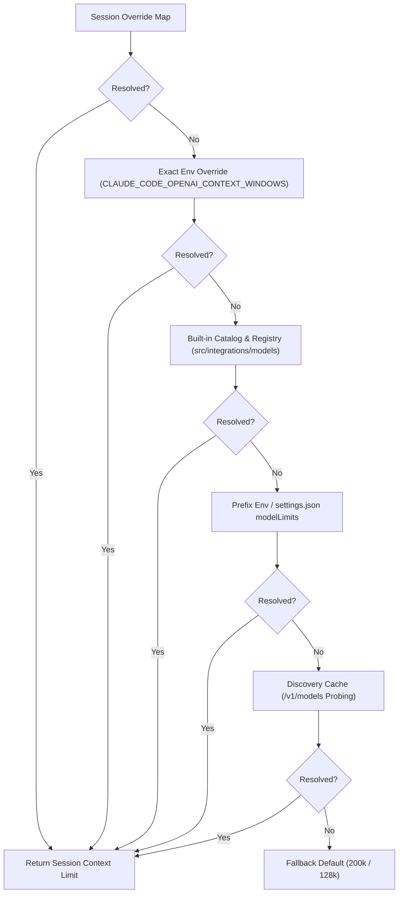
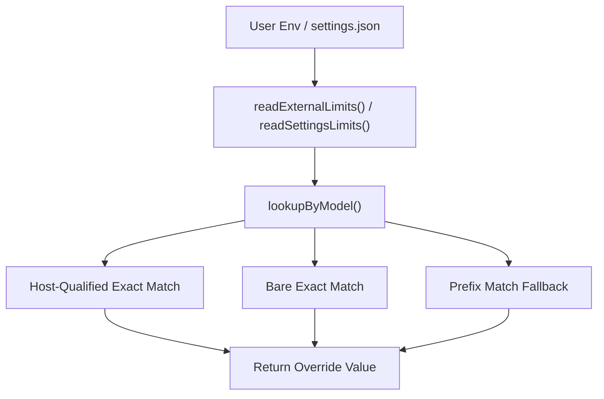

# Context Windows & Token Limits

<details>
<summary>Relevant source files</summary>

The following files were used as context for generating this wiki page:

- [.gitignore](.gitignore)
- [src/components/StartupScreen.test.ts](src/components/StartupScreen.test.ts)
- [src/components/StartupScreen.ts](src/components/StartupScreen.ts)
- [src/components/StatusLine.active.test.tsx](src/components/StatusLine.active.test.tsx)
- [src/components/StatusLine.test.ts](src/components/StatusLine.test.ts)
- [src/components/StatusLine.tsx](src/components/StatusLine.tsx)
- [src/tools/AgentTool/built-in/statuslineSetup.ts](src/tools/AgentTool/built-in/statuslineSetup.ts)
- [src/types/statusLine.ts](src/types/statusLine.ts)
- [src/utils/context.test.ts](src/utils/context.test.ts)
- [src/utils/context.ts](src/utils/context.ts)
- [src/utils/incrementalTokenCounter.test.ts](src/utils/incrementalTokenCounter.test.ts)
- [src/utils/incrementalTokenCounter.ts](src/utils/incrementalTokenCounter.ts)
- [src/utils/model/openaiContextWindows.ts](src/utils/model/openaiContextWindows.ts)
- [src/utils/providerDiscovery.test.ts](src/utils/providerDiscovery.test.ts)
- [src/utils/providerDiscovery.ts](src/utils/providerDiscovery.ts)
- [src/utils/tokens.test.ts](src/utils/tokens.test.ts)
- [src/utils/tokens.ts](src/utils/tokens.ts)

</details>


## Purpose and Scope
This section details how OpenClaude manages model context window allocations, maximum output token limits, session-scoped overrides, token counting utilities, and high-context (1M token) opt-in controls. Because OpenClaude proxies requests across 200+ LLM providers and custom OpenAI-compatible gateways, it implements a robust, multi-tier precedence chain to resolve context boundaries and token limits at runtime.

---

## 1. Core Context Window Resolution & Precedence Chain

OpenClaude defines a default context window of `200,000` tokens for standard models (`MODEL_CONTEXT_WINDOW_DEFAULT`) [src/utils/context.ts:16-17]() and a fallback window of `128,000` tokens for unrecognised third-party models (`OPENAI_FALLBACK_CONTEXT_WINDOW`) to prevent auto-compaction loops [src/utils/context.ts:24-27](). 

When resolving limits for a model at runtime, OpenClaude delegates to `resolveModelRuntimeLimits` in `src/integrations/runtimeMetadata.ts` [src/integrations/runtimeMetadata.ts:11-13](), following an explicit precedence order:
1. **Session-Scoped Overrides**: In-memory overrides set during the current REPL session via `/set_context_window`.
2. **Exact Environment Variable Overrides**: JSON-encoded maps in `CLAUDE_CODE_OPENAI_CONTEXT_WINDOWS` or `CLAUDE_CODE_OPENAI_MAX_OUTPUT_TOKENS` matching the exact model name or host-qualified model name (`<host>:<model>`) [src/utils/model/openaiContextWindows.ts:112-138]().
3. **Built-in Static Catalog**: Hardcoded model definitions in `src/integrations/models/` and vendor descriptors [src/utils/model/openaiContextWindows.ts:4-8]().
4. **Prefix Environment Variable Overrides**: Wildcard prefix matches in external environment maps [src/utils/model/openaiContextWindows.ts:112-138]().
5. **Settings `modelLimits` Map**: User configurations defined in `settings.json` under the `modelLimits` property [src/utils/model/openaiContextWindows.ts:161-183]().
6. **Discovery Cache**: Dynamically probed model properties fetched via `/v1/models` endpoints [src/integrations/runtimeMetadata.test.ts:145-175]().
7. **Descriptor Defaults**: Fallback constants defined in provider and route descriptors.


*Diagram 1: Context Resolution Precedence Flow bridging configuration sources to runtime limit resolution.*

**Sources:**
- `src/utils/context.ts:16-56`
- `src/utils/model/openaiContextWindows.ts:38-205`
- `src/integrations/runtimeMetadata.ts:11-19`

---

## 2. OpenAI Context Windows & Output Token Overrides

Custom or private deployments using OpenAI-compatible shims can override built-in context windows and output limits without modifying source code [src/utils/model/openaiContextWindows.ts:1-16](). This is handled by `src/utils/model/openaiContextWindows.ts` [src/utils/model/openaiContextWindows.ts:1-246]().

### Environment Variables
- `CLAUDE_CODE_OPENAI_CONTEXT_WINDOWS`: A JSON string mapping model keys (or host-qualified model keys like `api.example.com:gpt-4o`) to integer token capacities.
- `CLAUDE_CODE_OPENAI_MAX_OUTPUT_TOKENS`: A JSON string mapping model keys to maximum output generation tokens.

### Settings Configuration
Users may also configure limits persistently inside global or project `settings.json`:
```json
{
  "modelLimits": {
    "my-custom-model": {
      "contextWindow": 500000,
      "maxOutputTokens": 16384
    }
  }
}
```


*Diagram 2: Mapping external limit configuration entities to runtime lookup functions in openaiContextWindows.ts.*

**Sources:**
- `src/utils/model/openaiContextWindows.ts:38-192`
- `src/utils/context.ts:1-12`

---

## 3. Session-Scoped Overrides & Minimum Constraints

During an active REPL session, developers can dynamically modify context allocations using `setSessionContextWindowOverride()` in `src/utils/context.ts` [src/utils/context.ts:83-99](). 

### Constraints and Validation
- **Positive Integer Check**: Token values must be finite, positive integers [src/utils/context.ts:87-89]().
- **Floor Protection**: To prevent the auto-compaction floor paradox (where reserved tokens for summaries plus auto-compaction buffers exceed the total window), overrides must satisfy `MIN_CONTEXT_WINDOW_OVERRIDE` (`33,000` tokens) [src/utils/context.ts:54-56, 90-95]().
- **Lifecycle**: Overrides are held in a module-level `Map` (`sessionContextWindowOverrides`) and are cleared when the session terminates [src/utils/context.ts:49-53]().

**Sources:**
- `src/utils/context.ts:49-132`
- `src/utils/context.test.ts:39-41`

---

## 4. 1M Context Opt-In & Enterprise Restrictions

OpenClaude supports extended 1M token context windows for qualified models (such as Sonnet 4 and Opus 4.x variants) [src/utils/context.ts:150-161]().

### Mechanisms
- **Suffix Tagging**: Appending `[1m]` to a user-specified model name explicitly flags the session for 1M context evaluation [src/utils/context.ts:142-147]().
- **Beta Headers**: Activation injects specific beta request headers (`CONTEXT_1M_BETA_HEADER`) into downstream API payloads [src/utils/context.ts:2]().
- **Enterprise Disable Flag (`CLAUDE_CODE_DISABLE_1M_CONTEXT`)**: Administrators and compliance officers (e.g., for HIPAA requirements) can set `CLAUDE_CODE_DISABLE_1M_CONTEXT=1` or `true` in the environment to globally disable 1M context capabilities, forcing models back to standard limits regardless of user flags or model descriptors [src/utils/context.ts:135-140, 151-153]().

**Sources:**
- `src/utils/context.ts:1-12, 135-161`
- `src/utils/context.test.ts:165-179`

---

## 5. Token Counting & Incremental Tracking

Token accounting across turns and conversational transcripts is managed via utility modules in `src/utils/tokens.ts` and incremental token counters (`src/utils/incrementalTokenCounter.ts`).

### Key Functions
- `calculateContextPercentages()`: Computes used vs. remaining context ratios based on API usage metrics (`input_tokens`, `cache_creation_input_tokens`, `cache_read_input_tokens`) and the active model context window [src/utils/context.ts:165-178]().
- **Incremental Counter**: Tracks token growth incrementally during streaming tool execution and message generation to trigger auto-compaction circuits when approaching context ceilings (`autoCompact` circuit breaker) [src/utils/incrementalTokenCounter.ts:1-50]().

**Sources:**
- `src/utils/context.ts:165-179`
- `src/utils/tokens.ts:1-50`
- `src/utils/incrementalTokenCounter.ts:1-40`