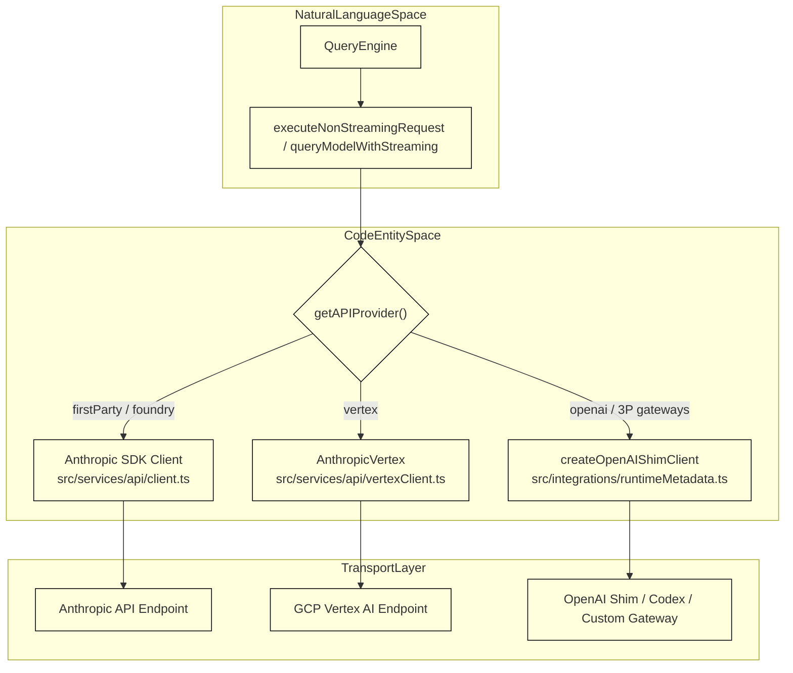
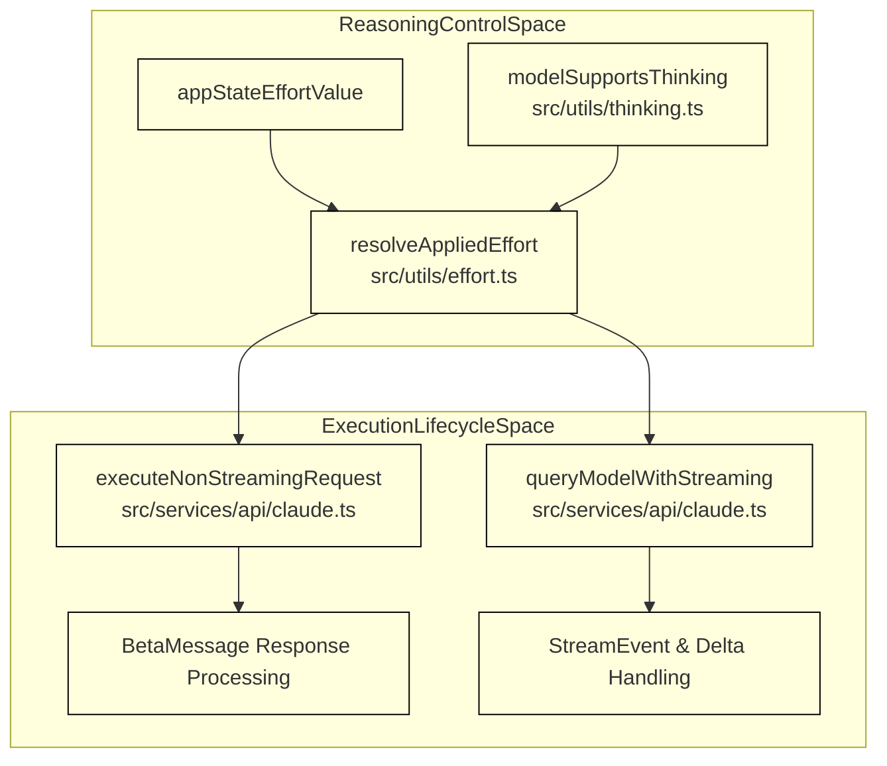

# API Client & Transport

Relevant source files

The following files were used as context for generating this wiki page:

- [src/services/api/client.test.ts](src/services/api/client.test.ts)
- [src/services/api/client.ts](src/services/api/client.ts)
- [src/utils/providerValidation.test.ts](src/utils/providerValidation.test.ts)
- [src/utils/providerValidation.ts](src/utils/providerValidation.ts)

The API Client & Transport subsystem is responsible for dispatching inference requests from OpenClaude to downstream LLM providers. It acts as a unified abstraction layer that handles both native Anthropic endpoints (via the official SDK) and multi-provider targets (via OpenAI-compatible shims, Codex transports, AWS Bedrock, and Google Vertex). 

For detailed technical breakdowns, refer to the child pages:
- [OpenAI & Codex Shim](#4.1)
- [Errors, Retries & Networking](#4.2)
- [Anthropic Client Lifecycle & Reasoning Effort](#4.3)

---

## Architecture Overview

The transport tier evaluates active provider profiles and environmental configurations [`src/services/api/client.ts:1-60`]() to instantiate the appropriate client wrapper. Whether communicating with native Anthropic endpoints or routing through third-party gateways (such as AIMLAPI or custom endpoints), requests flow through standardized normalization and schema adaptation pipelines defined in the integration registry [`src/integrations/descriptors.ts:7-50`]().

*Figure 4.1: High-level request dispatch architecture linking core agent routines to provider-specific client transports.*

Sources: `[src/services/api/client.ts:1-60]`, `[src/integrations/descriptors.ts:7-50]`, `[src/services/api/vertexClient.ts:1-65]()`

---

## 4.1 OpenAI & Codex Shim

When operating against non-Anthropic endpoints, OpenClaude rewrites Anthropic-formatted tool calls, streaming events, and message histories into OpenAI-compatible chat completion or response payloads. This is governed by `OpenAIShimTransportConfig` specifications [`src/integrations/descriptors.ts:30-50`]() and runtime metadata resolvers [`src/integrations/runtimeMetadata.ts:37-48`]() which normalize request bodies, token parameter fields (`max_tokens` vs `max_completion_tokens`), and model-specific reasoning prefixes.

For deep technical details on schema sanitization, request preparation, message conversion, and the Codex `/responses` transport, see [OpenAI & Codex Shim](#4.1).

Sources: `[src/integrations/descriptors.ts:30-50]`, `[src/integrations/runtimeMetadata.ts:37-48]()`

---

## 4.2 Errors, Retries & Networking

Reliability and fault tolerance are handled via systematic error classification, exponential backoff execution wrappers (`withRetry`), proxy fetch options [`src/services/api/client.ts:29-29`](), and specialized abort reason handlers [`src/services/api/claude.ts:66-70`]() that distinguish between user interruptions, streaming idle timeouts, and quota exhaustion errors extracted from response headers [`src/services/api/claude.ts:112-114`]() or error payloads.

For full implementation details regarding stream watchdogs, abort propagation, and max-token cap retries, see [Errors, Retries & Networking](#4.2).

Sources: `[src/services/api/client.ts:29-29]`, `[src/services/api/claude.ts:66-70]`, `[src/services/api/claude.ts:112-114]()`

---

## 4.3 Anthropic Client Lifecycle & Reasoning Effort

The native streaming lifecycle is coordinated within `src/services/api/claude.ts`, managing message chunks, usage telemetry, and abort tracking. Additionally, reasoning and thinking budgets are resolved dynamically via `resolveAppliedEffort` [`src/utils/effort.ts:15-16`]() and model capability detectors like `modelSupportsThinking` [`src/utils/thinking.ts:120-156`](), mapping abstract effort tiers (`low`, `medium`, `high`, `xhigh`, `max`, `ultracode`) to wire-format specific parameters.

*Figure 4.2: Interaction pipeline between effort/thinking configuration and execution loops in claude.ts.*

For comprehensive details on stream event processing, API limit handling, and adaptive thinking rules, see [Anthropic Client Lifecycle & Reasoning Effort](#4.3).

Sources: `[src/services/api/claude.ts:1-200]`, `[src/utils/effort.ts:15-16]`, `[src/utils/thinking.ts:120-156]()`